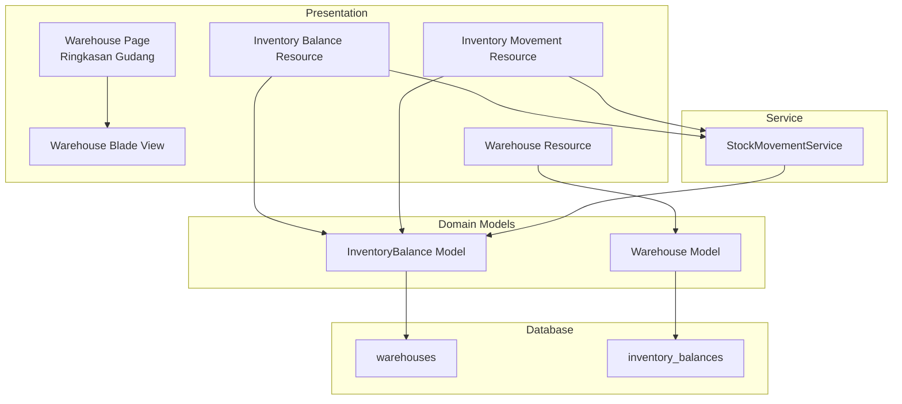
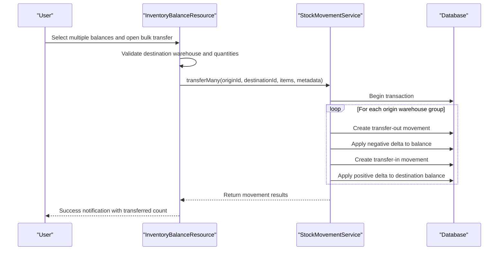
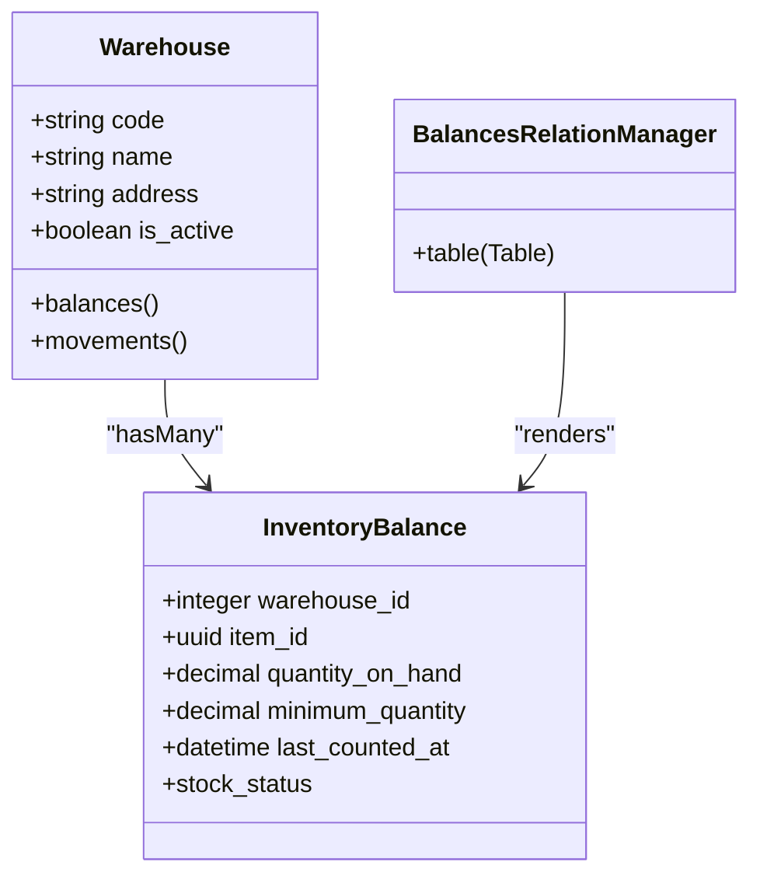
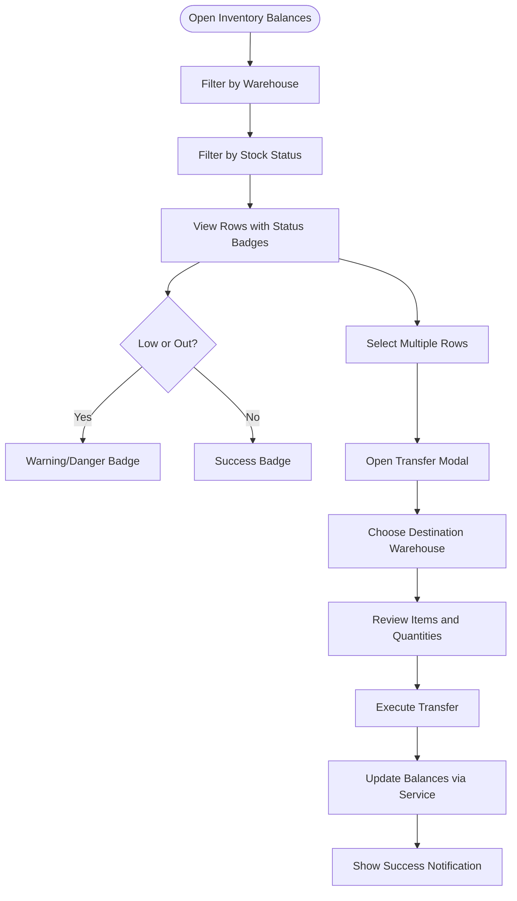
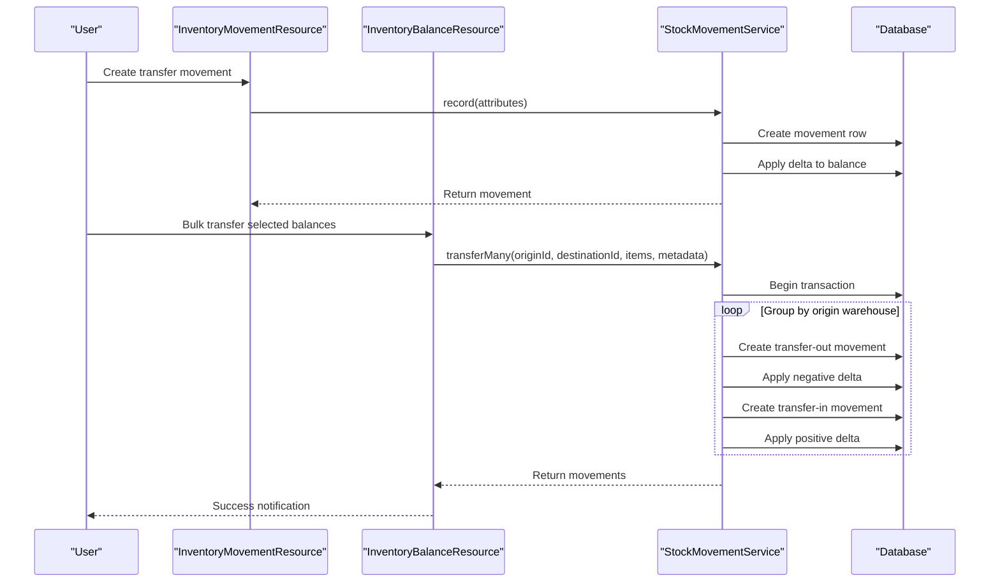
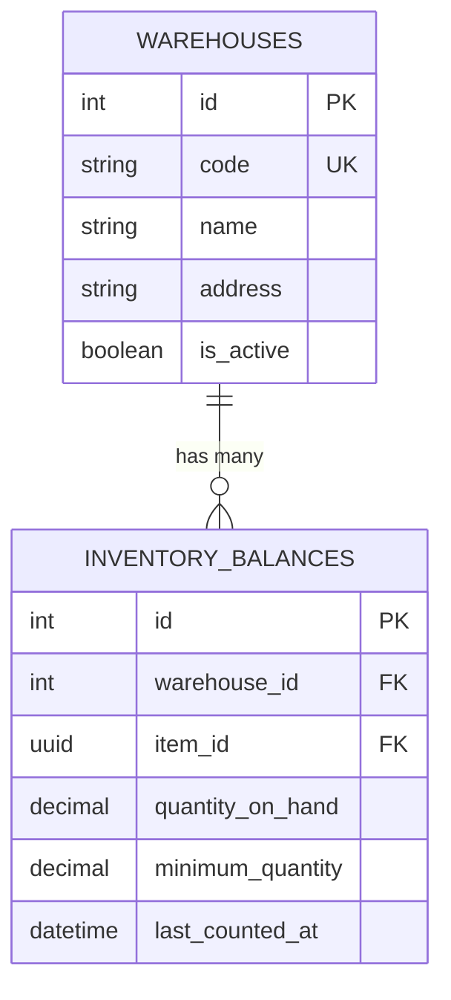
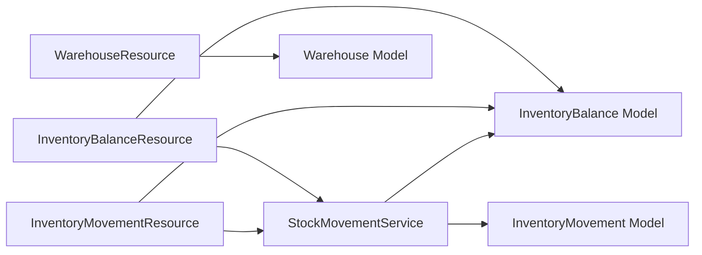

# Warehouse Management View

<cite>
**Referenced Files in This Document**
- [Warehouse.php](file://app/Filament/Pages/Warehouse.php)
- [warehouse.blade.php](file://resources/views/filament/pages/warehouse.blade.php)
- [WarehouseResource.php](file://app/Filament/Resources/Warehouses/WarehouseResource.php)
- [BalancesRelationManager.php](file://app/Filament/Resources/Warehouses/RelationManagers/BalancesRelationManager.php)
- [InventoryBalanceResource.php](file://app/Filament/Resources/InventoryBalances/InventoryBalanceResource.php)
- [InventoryMovementResource.php](file://app/Filament/Resources/InventoryMovements/InventoryMovementResource.php)
- [StockMovementService.php](file://app/Services/StockMovementService.php)
- [Warehouse.php](file://app/Models/Warehouse.php)
- [InventoryBalance.php](file://app/Models/InventoryBalance.php)
- [2026_11_16_000001_create_warehouses_table.php](file://database/migrations/2026_11_16_000001_create_warehouses_table.php)
- [2026_11_16_000002_create_inventory_balances_table.php](file://database/migrations/2026_11_16_000002_create_inventory_balances_table.php)
</cite>

## Table of Contents
1. [Introduction](#introduction)
2. [Project Structure](#project-structure)
3. [Core Components](#core-components)
4. [Architecture Overview](#architecture-overview)
5. [Detailed Component Analysis](#detailed-component-analysis)
6. [Dependency Analysis](#dependency-analysis)
7. [Performance Considerations](#performance-considerations)
8. [Troubleshooting Guide](#troubleshooting-guide)
9. [Conclusion](#conclusion)

## Introduction
This document explains the warehouse management interface that provides multi-warehouse inventory oversight. It covers how users select warehouses, monitor stock levels and capacity-related signals, perform cross-warehouse transfers, and integrate with InventoryBalance models. It also includes guidance for configuring warehouse-specific settings and customizing the dashboard layout.

The system is built on Filament resources, Eloquent models, and a dedicated StockMovementService. The current warehouse summary page is a placeholder; actual operational controls live under the “Gudang” navigation group: warehouse master data, stock balances, and stock transactions.

## Project Structure
The warehouse management feature spans several layers:

- Presentation layer: Filament pages and Blade view for the warehouse summary.
- Resource layer: Filament resources for warehouses, inventory balances, and inventory movements.
- Service layer: Stock movement orchestration for single and bulk operations.
- Model layer: Warehouse and InventoryBalance entities with relationships and computed attributes.
- Database layer: Migrations defining warehouse and balance tables.

**Diagram sources**
- [Warehouse.php:1-21](file://app/Filament/Pages/Warehouse.php#L1-L21)
- [warehouse.blade.php:1-14](file://resources/views/filament/pages/warehouse.blade.php#L1-L14)
- [InventoryBalanceResource.php:1-446](file://app/Filament/Resources/InventoryBalances/InventoryBalanceResource.php#L1-L446)
- [InventoryMovementResource.php:1-340](file://app/Filament/Resources/InventoryMovements/InventoryMovementResource.php#L1-L340)
- [WarehouseResource.php:1-131](file://app/Filament/Resources/Warehouses/WarehouseResource.php#L1-L131)
- [StockMovementService.php:1-398](file://app/Services/StockMovementService.php#L1-L398)
- [Warehouse.php:1-37](file://app/Models/Warehouse.php#L1-L37)
- [InventoryBalance.php:1-71](file://app/Models/InventoryBalance.php#L1-L71)
- [2026_11_16_000001_create_warehouses_table.php:1-32](file://database/migrations/2026_11_16_000001_create_warehouses_table.php#L1-L32)
- [2026_11_16_000002_create_inventory_balances_table.php:1-41](file://database/migrations/2026_11_16_000002_create_inventory_balances_table.php#L1-L41)

**Section sources**
- [Warehouse.php:1-21](file://app/Filament/Pages/Warehouse.php#L1-L21)
- [warehouse.blade.php:1-14](file://resources/views/filament/pages/warehouse.blade.php#L1-L14)
- [WarehouseResource.php:1-131](file://app/Filament/Resources/Warehouses/WarehouseResource.php#L1-L131)
- [InventoryBalanceResource.php:1-446](file://app/Filament/Resources/InventoryBalances/InventoryBalanceResource.php#L1-L446)
- [InventoryMovementResource.php:1-340](file://app/Filament/Resources/InventoryMovements/InventoryMovementResource.php#L1-L340)
- [StockMovementService.php:1-398](file://app/Services/StockMovementService.php#L1-L398)
- [Warehouse.php:1-37](file://app/Models/Warehouse.php#L1-L37)
- [InventoryBalance.php:1-71](file://app/Models/InventoryBalance.php#L1-L71)
- [2026_11_16_000001_create_warehouses_table.php:1-32](file://database/migrations/2026_11_16_000001_create_warehouses_table.php#L1-L32)
- [2026_11_16_000002_create_inventory_balances_table.php:1-41](file://database/migrations/2026_11_16_000002_create_inventory_balances_table.php#L1-L41)

## Core Components
- Warehouse summary page: A Filament page registered under the “Gudang” group. It currently renders a placeholder section indicating where supply menus are grouped.
- Warehouse resource: Master data for warehouses, including code, name, address, and active status. It shows balance counts and links to per-warehouse balances.
- Inventory balance resource: Multi-warehouse stock overview with filters by warehouse and stock status, plus a bulk transfer action.
- Inventory movement resource: Transactional entry points for stock changes, including transfers between warehouses and production consumption previews.
- Stock movement service: Centralized logic for recording movements, applying deltas to balances, performing single and bulk transfers, and reversing deletions.
- Warehouse model: Defines warehouse attributes and relations to balances and movements.
- Inventory balance model: Tracks per-warehouse item quantities, minimum thresholds, last counted timestamp, and a computed stock status attribute.

**Section sources**
- [Warehouse.php:1-21](file://app/Filament/Pages/Warehouse.php#L1-L21)
- [warehouse.blade.php:1-14](file://resources/views/filament/pages/warehouse.blade.php#L1-L14)
- [WarehouseResource.php:1-131](file://app/Filament/Resources/Warehouses/WarehouseResource.php#L1-L131)
- [InventoryBalanceResource.php:1-446](file://app/Filament/Resources/InventoryBalances/InventoryBalanceResource.php#L1-L446)
- [InventoryMovementResource.php:1-340](file://app/Filament/Resources/InventoryMovements/InventoryMovementResource.php#L1-L340)
- [StockMovementService.php:1-398](file://app/Services/StockMovementService.php#L1-L398)
- [Warehouse.php:1-37](file://app/Models/Warehouse.php#L1-L37)
- [InventoryBalance.php:1-71](file://app/Models/InventoryBalance.php#L1-L71)

## Architecture Overview
The warehouse management architecture follows a layered approach:

- UI Layer: Filament pages and resources render forms, tables, filters, and actions.
- Business Logic Layer: StockMovementService encapsulates transactional rules, validation, and delta application.
- Data Layer: Eloquent models represent warehouses and balances; migrations define schema constraints and indexes.

**Diagram sources**
- [InventoryBalanceResource.php:231-419](file://app/Filament/Resources/InventoryBalances/InventoryBalanceResource.php#L231-L419)
- [StockMovementService.php:209-290](file://app/Services/StockMovementService.php#L209-L290)
- [StockMovementService.php:147-200](file://app/Services/StockMovementService.php#L147-L200)

## Detailed Component Analysis

### Warehouse Summary Page
The warehouse summary page is a Filament page under the “Gudang” group. It currently displays a placeholder section explaining that inventory menus are grouped under “Gudang,” production under “Produksi,” and reference data under “Data Master.” This page can be extended later with charts, KPIs, or widgets.

Key behaviors:
- Navigation group: “Gudang”.
- Title and label: “Ringkasan Gudang”.
- View binding: Blade template at `filament.pages.warehouse`.

Customization opportunities:
- Replace placeholder content with real-time stock summaries, low-stock alerts, and capacity indicators.
- Add Filament widgets for charts and tables.
- Integrate filters for active warehouses and regions.

**Section sources**
- [Warehouse.php:1-21](file://app/Filament/Pages/Warehouse.php#L1-L21)
- [warehouse.blade.php:1-14](file://resources/views/filament/pages/warehouse.blade.php#L1-L14)

### Warehouse Master Data
The warehouse resource manages master records for warehouses. Users can create, edit, list, and delete warehouses. The table shows code, name, address, balance count, active status, and creation time. Filters allow narrowing by active status.

Configuration options exposed:
- Code: unique identifier for the warehouse.
- Name: display name.
- Address: optional location details.
- Active flag: toggles whether the warehouse participates in operations.

Capacity monitoring integration:
- Balance count column indicates how many inventory balance rows exist for the warehouse.
- Relation manager shows per-warehouse stock levels and stock status badges.

**Diagram sources**
- [Warehouse.php:11-35](file://app/Models/Warehouse.php#L11-L35)
- [InventoryBalance.php:13-45](file://app/Models/InventoryBalance.php#L13-L45)
- [BalancesRelationManager.php:9-50](file://app/Filament/Resources/Warehouses/RelationManagers/BalancesRelationManager.php#L9-L50)

**Section sources**
- [WarehouseResource.php:26-131](file://app/Filament/Resources/Warehouses/WarehouseResource.php#L26-L131)
- [BalancesRelationManager.php:1-52](file://app/Filament/Resources/Warehouses/RelationManagers/BalancesRelationManager.php#L1-L52)
- [Warehouse.php:11-35](file://app/Models/Warehouse.php#L11-L35)

### Inventory Balances and Capacity Monitoring
The inventory balance resource provides multi-warehouse stock oversight. It supports:
- Creating and editing per-warehouse item balances.
- Filtering by warehouse and stock status (out, low, ok).
- Visual stock status badges with color coding.
- Bulk transfer across warehouses.

Capacity monitoring signals:
- Stock status derived from quantity_on_hand vs minimum_quantity.
- Navigation badge showing count of low-stock rows.
- Table columns for stock and minimum thresholds.

Real-time stock level visualization:
- Status badges reflect current stock condition.
- Filters enable quick focus on critical stock states.
- Per-warehouse relation manager exposes concise stock views.

**Diagram sources**
- [InventoryBalanceResource.php:76-229](file://app/Filament/Resources/InventoryBalances/InventoryBalanceResource.php#L76-L229)
- [InventoryBalanceResource.php:231-419](file://app/Filament/Resources/InventoryBalances/InventoryBalanceResource.php#L231-L419)
- [InventoryBalance.php:47-69](file://app/Models/InventoryBalance.php#L47-L69)

**Section sources**
- [InventoryBalanceResource.php:43-229](file://app/Filament/Resources/InventoryBalances/InventoryBalanceResource.php#L43-L229)
- [InventoryBalance.php:13-71](file://app/Models/InventoryBalance.php#L13-L71)

### Cross-Warehouse Transfers
Cross-warehouse transfers are supported through:
- Single-item transfers via inventory movement form.
- Bulk transfers via inventory balance resource action.

Single transfer flow:
- Choose transaction type and warehouse.
- If transfer type, choose destination warehouse.
- Select item and quantity; optionally link to production batch.
- Submit creates outgoing and incoming movements and updates balances.

Bulk transfer flow:
- Select multiple balances across potentially different origin warehouses.
- Choose destination warehouse and date/time.
- Review per-row quantities constrained by available stock.
- Execute groups transfers by origin warehouse and applies them atomically.

**Diagram sources**
- [InventoryMovementResource.php:54-163](file://app/Filament/Resources/InventoryMovements/InventoryMovementResource.php#L54-L163)
- [InventoryBalanceResource.php:231-419](file://app/Filament/Resources/InventoryBalances/InventoryBalanceResource.php#L231-L419)
- [StockMovementService.php:23-60](file://app/Services/StockMovementService.php#L23-L60)
- [StockMovementService.php:147-200](file://app/Services/StockMovementService.php#L147-L200)
- [StockMovementService.php:209-290](file://app/Services/StockMovementService.php#L209-L290)

**Section sources**
- [InventoryMovementResource.php:38-163](file://app/Filament/Resources/InventoryMovements/InventoryMovementResource.php#L38-L163)
- [InventoryBalanceResource.php:231-419](file://app/Filament/Resources/InventoryBalances/InventoryBalanceResource.php#L231-L419)
- [StockMovementService.php:23-60](file://app/Services/StockMovementService.php#L23-L60)
- [StockMovementService.php:147-200](file://app/Services/StockMovementService.php#L147-L200)
- [StockMovementService.php:209-290](file://app/Services/StockMovementService.php#L209-L290)

### Integration with InventoryBalance Models
InventoryBalance models are central to stock tracking:
- Each row ties an item to a specific warehouse.
- quantity_on_hand reflects current stock after movements.
- minimum_quantity defines low-stock threshold.
- stock_status computes out/low/ok based on thresholds.
- last_counted_at tracks physical count timestamps.

Integration points:
- Warehouse model has a hasMany relationship to balances.
- InventoryMovementService applies deltas to balances within transactions.
- Resources display and filter by stock status and warehouse.

**Diagram sources**
- [2026_11_16_000001_create_warehouses_table.php:14-21](file://database/migrations/2026_11_16_000001_create_warehouses_table.php#L14-L21)
- [2026_11_16_000002_create_inventory_balances_table.php:14-30](file://database/migrations/2026_11_16_000002_create_inventory_balances_table.php#L14-L30)
- [Warehouse.php:27-35](file://app/Models/Warehouse.php#L27-L35)
- [InventoryBalance.php:37-45](file://app/Models/InventoryBalance.php#L37-L45)

**Section sources**
- [InventoryBalance.php:13-71](file://app/Models/InventoryBalance.php#L13-L71)
- [Warehouse.php:27-35](file://app/Models/Warehouse.php#L27-L35)
- [2026_11_16_000002_create_inventory_balances_table.php:14-30](file://database/migrations/2026_11_16_000002_create_inventory_balances_table.php#L14-L30)

### Configuring Warehouse-Specific Settings
Current configuration surface:
- Warehouse master data fields: code, name, address, is_active.
- Inventory balance fields: quantity_on_hand, minimum_quantity, last_counted_at.
- Active-only destination warehouses in transfer flows.

Recommended practices:
- Use meaningful codes and names for warehouses to simplify filtering and reporting.
- Set minimum_quantity per item per warehouse to trigger low-stock alerts.
- Keep is_active true only for operational warehouses.
- Record last_counted_at during physical inventories to track recency.

Extensibility ideas:
- Add capacity limits per warehouse (e.g., max volume or weight) and visualize utilization.
- Add region or zone attributes for grouping and dashboards.
- Introduce warehouse-level permissions or roles.

**Section sources**
- [WarehouseResource.php:44-66](file://app/Filament/Resources/Warehouses/WarehouseResource.php#L44-L66)
- [InventoryBalanceResource.php:76-149](file://app/Filament/Resources/InventoryBalances/InventoryBalanceResource.php#L76-L149)
- [InventoryMovementResource.php:70-89](file://app/Filament/Resources/InventoryMovements/InventoryMovementResource.php#L70-L89)

### Customizing the Dashboard Layout
The warehouse summary page is a Blade view bound to a Filament page. To customize:
- Edit the Blade template to add sections, cards, charts, and tables.
- Register Filament widgets for real-time metrics such as low-stock counts, total stock value, and transfer activity.
- Add filters for active warehouses and date ranges.
- Link to related resources: inventory balances and inventory movements.

Example customization steps:
- Replace placeholder text with a grid of KPIs: active warehouses, low-stock items, recent transfers.
- Embed a chart of stock status distribution across warehouses.
- Provide quick links to bulk transfer and movement history.

[No sources needed since this section provides general guidance]

## Dependency Analysis
The warehouse management components have clear dependencies:

- InventoryBalanceResource depends on InventoryBalance model and StockMovementService for bulk transfers.
- InventoryMovementResource depends on InventoryMovement model and StockMovementService for recording and deleting movements.
- WarehouseResource depends on Warehouse model and BalancesRelationManager for per-warehouse stock views.
- StockMovementService depends on InventoryBalance and InventoryMovement models and uses database transactions for consistency.

**Diagram sources**
- [InventoryBalanceResource.php:43-446](file://app/Filament/Resources/InventoryBalances/InventoryBalanceResource.php#L43-L446)
- [InventoryMovementResource.php:38-340](file://app/Filament/Resources/InventoryMovements/InventoryMovementResource.php#L38-L340)
- [WarehouseResource.php:26-131](file://app/Filament/Resources/Warehouses/WarehouseResource.php#L26-L131)
- [StockMovementService.php:16-398](file://app/Services/StockMovementService.php#L16-L398)

**Section sources**
- [InventoryBalanceResource.php:43-446](file://app/Filament/Resources/InventoryBalances/InventoryBalanceResource.php#L43-L446)
- [InventoryMovementResource.php:38-340](file://app/Filament/Resources/InventoryMovements/InventoryMovementResource.php#L38-L340)
- [WarehouseResource.php:26-131](file://app/Filament/Resources/Warehouses/WarehouseResource.php#L26-L131)
- [StockMovementService.php:16-398](file://app/Services/StockMovementService.php#L16-L398)

## Performance Considerations
- Infinite scrolling: Both inventory balance and movement tables use infinite pagination to improve responsiveness with large datasets.
- Indexed queries: Inventory balances include indexes on item_id and unique constraints on warehouse_id + item_id to optimize lookups.
- Transactional integrity: StockMovementService wraps operations in database transactions and uses lockForUpdate when applying deltas to prevent race conditions.
- Batch processing: Bulk transfers group operations by origin warehouse to minimize repeated setup and reduce overhead.

Recommendations:
- Monitor query performance for large warehouses and consider adding composite indexes if filtering by warehouse and item becomes frequent.
- Cache frequently accessed warehouse lists for dropdowns if performance degrades.
- Avoid excessive eager loading in list views; load relationships only when necessary.

**Section sources**
- [InventoryBalanceResource.php:227-228](file://app/Filament/Resources/InventoryBalances/InventoryBalanceResource.php#L227-L228)
- [InventoryMovementResource.php:264-265](file://app/Filament/Resources/InventoryMovements/InventoryMovementResource.php#L264-L265)
- [2026_11_16_000002_create_inventory_balances_table.php:28-30](file://database/migrations/2026_11_16_000002_create_inventory_balances_table.php#L28-L30)
- [StockMovementService.php:358-387](file://app/Services/StockMovementService.php#L358-L387)

## Troubleshooting Guide
Common issues and resolutions:

- Transfer fails due to insufficient stock:
  - Cause: Requested quantity exceeds available stock.
  - Resolution: Adjust quantity or verify source warehouse selection.
  - Evidence: Validation exceptions thrown when checking on-hand quantities.

- Destination warehouse equals origin warehouse:
  - Cause: Same warehouse selected for both origin and destination.
  - Resolution: Choose a different destination warehouse.
  - Evidence: Validation exception raised when origin equals destination.

- No items selected for bulk transfer:
  - Cause: All selected rows have zero quantity or were removed.
  - Resolution: Ensure at least one item has a positive quantity.
  - Evidence: Validation exception when items collection is empty.

- Cannot delete a movement:
  - Cause: Deleting would require reversing an incoming movement whose stock has been consumed.
  - Resolution: Reverse downstream usage or adjust stock before deletion.
  - Evidence: Validation exception during reverse operation.

Operational tips:
- Use filters to isolate low-stock items and correct minimum_quantity values.
- Verify active status of warehouses before transferring.
- Record references and notes for auditability.

**Section sources**
- [InventoryBalanceResource.php:330-419](file://app/Filament/Resources/InventoryBalances/InventoryBalanceResource.php#L330-L419)
- [StockMovementService.php:249-265](file://app/Services/StockMovementService.php#L249-L265)
- [StockMovementService.php:321-344](file://app/Services/StockMovementService.php#L321-L344)

## Conclusion
The warehouse management interface provides robust multi-warehouse inventory oversight through Filament resources, Eloquent models, and a centralized StockMovementService. Users can configure warehouse settings, monitor stock levels and capacity signals, and execute cross-warehouse transfers safely and efficiently. The current warehouse summary page is a placeholder ready to be extended with real-time visualizations and customized layouts. By leveraging filters, badges, and bulk actions, operators can maintain accurate stock levels and respond quickly to low-stock conditions.