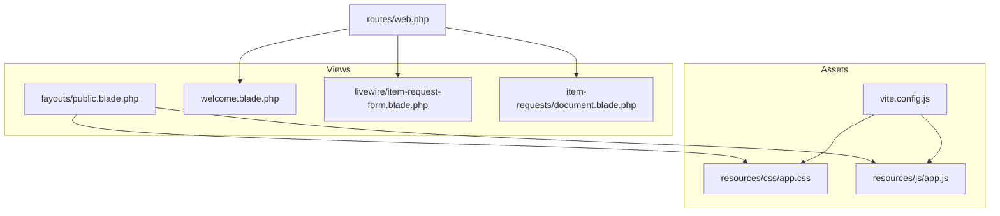
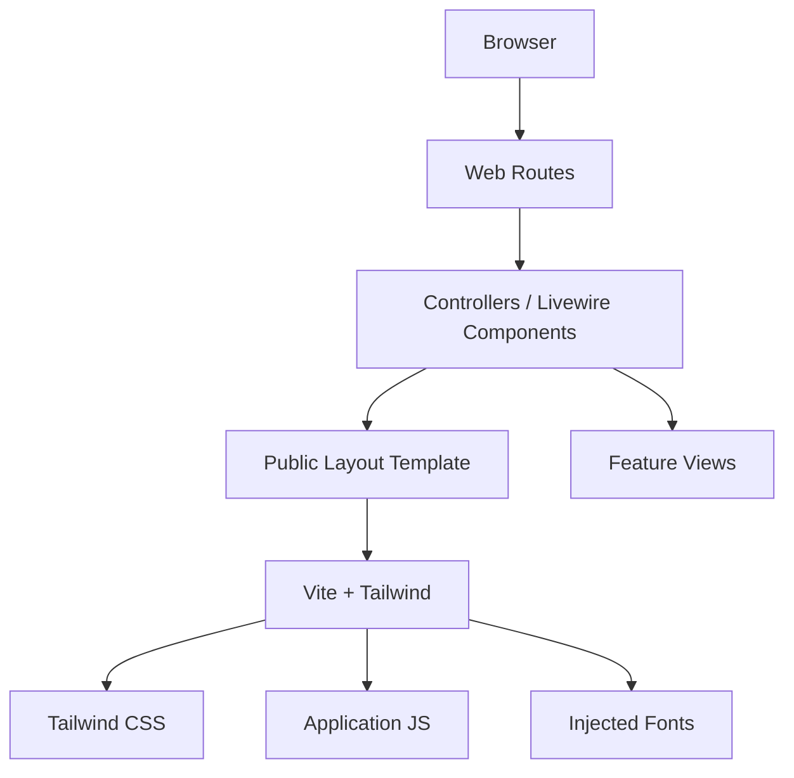
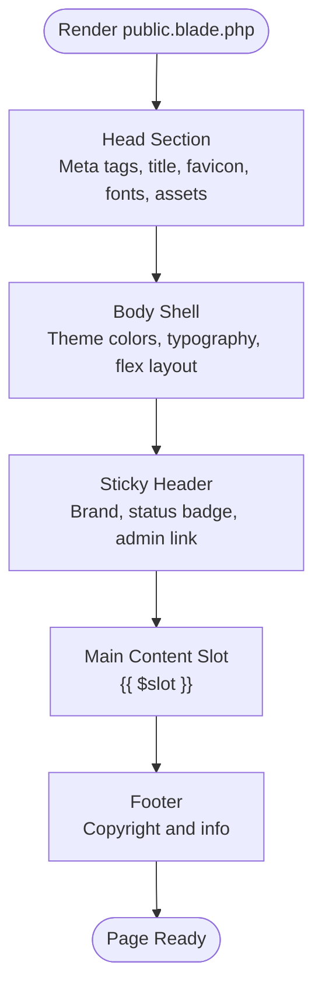
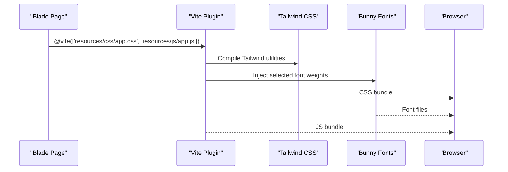
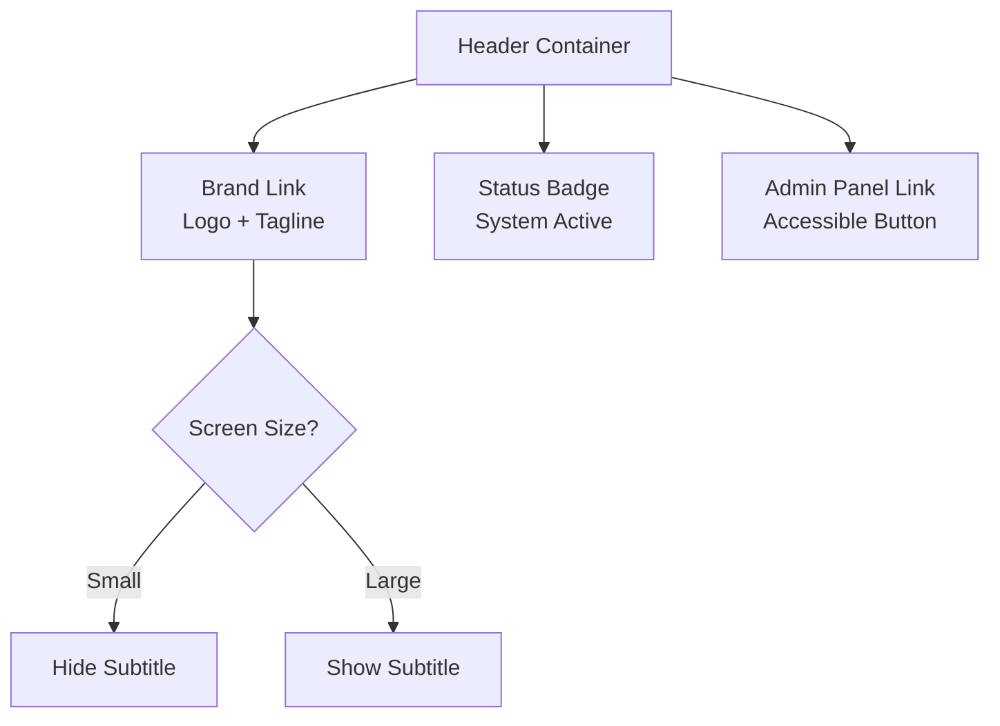
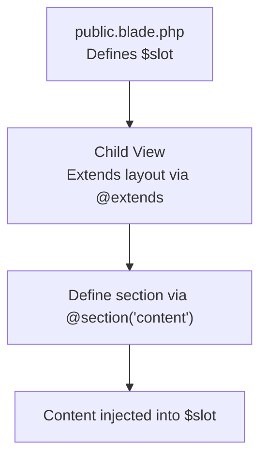
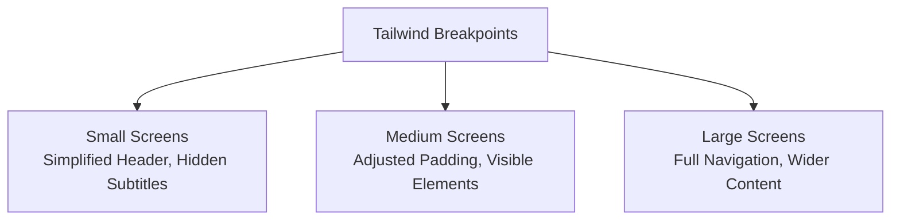
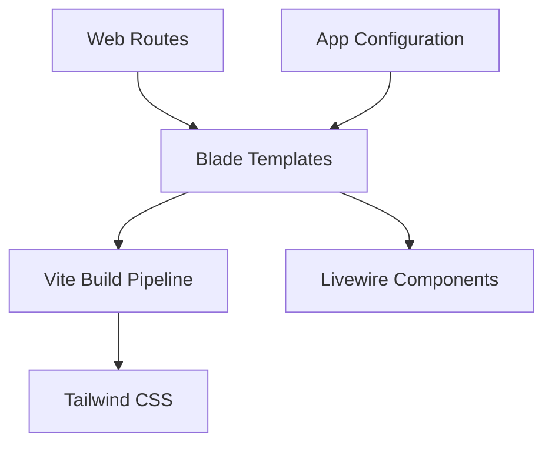

# Layout System

<cite>
**Referenced Files in This Document**
- [public.blade.php](file://resources/views/layouts/public.blade.php)
- [welcome.blade.php](file://resources/views/welcome.blade.php)
- [item-request-form.blade.php](file://resources/views/livewire/item-request-form.blade.php)
- [document.blade.php](file://resources/views/item-requests/document.blade.php)
- [app.css](file://resources/css/app.css)
- [app.js](file://resources/js/app.js)
- [vite.config.js](file://vite.config.js)
- [web.php](file://routes/web.php)
- [app.php](file://config/app.php)
</cite>

## Table of Contents
1. [Introduction](#introduction)
2. [Project Structure](#project-structure)
3. [Core Components](#core-components)
4. [Architecture Overview](#architecture-overview)
5. [Detailed Component Analysis](#detailed-component-analysis)
6. [Dependency Analysis](#dependency-analysis)
7. [Performance Considerations](#performance-considerations)
8. [Troubleshooting Guide](#troubleshooting-guide)
9. [Conclusion](#conclusion)
10. [Appendices](#appendices)

## Introduction
This document explains the Blade layout system centered around the public layout template. It covers the main layout structure, meta tags configuration, asset loading patterns for CSS and JavaScript, navigation components, responsive design implementation, accessibility features, and integration with Tailwind CSS classes. It also documents how child views extend this layout using Blade directives and how sections are defined and populated. Finally, it provides guidance on creating new layouts and extending existing ones.

## Project Structure
The layout system is implemented through Blade templates under `resources/views`, with shared styles and scripts managed by Vite and Tailwind CSS. The primary public layout defines the global HTML shell, header navigation, main content area, and footer. Other views either reuse this layout or provide standalone pages such as the welcome page and PDF-oriented document view.

**Diagram sources**
- [public.blade.php:1-77](file://resources/views/layouts/public.blade.php#L1-L77)
- [welcome.blade.php:1-99](file://resources/views/welcome.blade.php#L1-L99)
- [item-request-form.blade.php:1-584](file://resources/views/livewire/item-request-form.blade.php#L1-L584)
- [document.blade.php:1-398](file://resources/views/item-requests/document.blade.php#L1-L398)
- [app.css:1-11](file://resources/css/app.css#L1-L11)
- [app.js:1-70](file://resources/js/app.js#L1-L70)
- [vite.config.js:1-31](file://vite.config.js#L1-L31)
- [web.php:1-18](file://routes/web.php#L1-L18)

**Section sources**
- [public.blade.php:1-77](file://resources/views/layouts/public.blade.php#L1-L77)
- [welcome.blade.php:1-99](file://resources/views/welcome.blade.php#L1-L99)
- [item-request-form.blade.php:1-584](file://resources/views/livewire/item-request-form.blade.php#L1-L584)
- [document.blade.php:1-398](file://resources/views/item-requests/document.blade.php#L1-L398)
- [app.css:1-11](file://resources/css/app.css#L1-L11)
- [app.js:1-70](file://resources/js/app.js#L1-L70)
- [vite.config.js:1-31](file://vite.config.js#L1-L31)
- [web.php:1-18](file://routes/web.php#L1-L18)

## Core Components
- Public layout template: Defines the global HTML structure, head metadata, theme color, title generation, favicon, font injection, Vite asset injection, Livewire styles and scripts, sticky header navigation, main content slot, and footer.
- Welcome page: A standalone landing page that mirrors the layout’s visual style but does not use the layout template.
- Item request form (Livewire): A feature-rich form component used by the “Permintaan Barang” route; it uses Tailwind utility classes and integrates with client-side PDF preparation and sharing logic.
- Document view: A print/PDF-oriented template for rendering item requests with dedicated print styles and a preview mode.
- Asset pipeline: Vite configuration compiles Tailwind CSS and application JavaScript, including font injection via Bunny Fonts.
- Routing: Web routes expose the home page, item request form, and signed PDF endpoint.
- Application configuration: Provides app name, locale, and other environment-driven settings used by views.

**Section sources**
- [public.blade.php:1-77](file://resources/views/layouts/public.blade.php#L1-L77)
- [welcome.blade.php:1-99](file://resources/views/welcome.blade.php#L1-L99)
- [item-request-form.blade.php:1-584](file://resources/views/livewire/item-request-form.blade.php#L1-L584)
- [document.blade.php:1-398](file://resources/views/item-requests/document.blade.php#L1-L398)
- [vite.config.js:1-31](file://vite.config.js#L1-L31)
- [web.php:1-18](file://routes/web.php#L1-L18)
- [app.php:1-127](file://config/app.php#L1-L127)

## Architecture Overview
The layout architecture follows a clear separation between shared presentation and feature-specific views:

- Global layout (`public.blade.php`) provides consistent branding, navigation, and content container.
- Feature views like the item request form compose UI using Tailwind utilities and integrate with Livewire for interactivity.
- Print/PDF views isolate print-specific styling and behavior.
- Assets are centrally managed via Vite and Tailwind, ensuring consistent fonts, styles, and scripts across all pages.

[No sources needed since this diagram shows conceptual workflow, not actual code structure]

## Detailed Component Analysis

### Public Layout Template
The public layout template establishes the foundational structure for public-facing pages:

- HTML language and direction are derived from the application locale.
- Meta tags include charset, viewport, and theme color for mobile browsers.
- Title generation supports an optional `$title` variable and falls back to the configured application name.
- Favicon is linked from the public directory.
- Fonts are injected via a Blade directive provided by the Vite plugin.
- CSS and JS assets are loaded through Vite, including both styles and scripts.
- Livewire styles and scripts are included for interactive components.
- Header contains brand identity, status indicator, and admin panel link.
- Main content area uses a flexible container with responsive padding and width constraints.
- Footer includes copyright and informational text.

**Diagram sources**
- [public.blade.php:1-77](file://resources/views/layouts/public.blade.php#L1-L77)

**Section sources**
- [public.blade.php:1-77](file://resources/views/layouts/public.blade.php#L1-L77)

### Meta Tags and Title Configuration
- Charset and viewport meta tags ensure correct rendering and responsiveness.
- Theme color meta tag sets the mobile browser toolbar color.
- Title dynamically combines a page-specific title with the application name when available.
- Application name is sourced from configuration, defaulting to a fallback value.

**Section sources**
- [public.blade.php:1-14](file://resources/views/layouts/public.blade.php#L1-L14)
- [app.php:15-16](file://config/app.php#L15-L16)

### Asset Loading Patterns
- CSS and JS are compiled and served via Vite.
- Tailwind CSS is imported and configured with custom font theme.
- Fonts are injected using the Bunny Fonts integration within Vite.
- Livewire styles and scripts are included to support interactive components.

**Diagram sources**
- [public.blade.php:12-16](file://resources/views/layouts/public.blade.php#L12-L16)
- [app.css:1-11](file://resources/css/app.css#L1-L11)
- [vite.config.js:1-31](file://vite.config.js#L1-L31)

**Section sources**
- [public.blade.php:12-16](file://resources/views/layouts/public.blade.php#L12-L16)
- [app.css:1-11](file://resources/css/app.css#L1-L11)
- [vite.config.js:1-31](file://vite.config.js#L1-L31)

### Navigation Components
- Brand logo and tagline are presented in the header with responsive visibility toggles.
- A status indicator displays system availability.
- Admin panel link provides quick access to the administration interface.
- All navigation elements use Tailwind utility classes for spacing, typography, and focus states.

**Diagram sources**
- [public.blade.php:19-56](file://resources/views/layouts/public.blade.php#L19-L56)

**Section sources**
- [public.blade.php:19-56](file://resources/views/layouts/public.blade.php#L19-L56)

### Child Views and Sections
- The public layout exposes a `$slot` for child content.
- Child views can extend the layout using Blade’s `@extends` directive and populate sections using `@section` and `@endsection`.
- In this repository, the welcome page is a standalone template rather than extending the layout, while the item request form and document view are feature-specific templates that may be rendered by controllers or Livewire components.

[No sources needed since this diagram shows conceptual workflow, not actual code structure]

**Section sources**
- [public.blade.php:58-61](file://resources/views/layouts/public.blade.php#L58-L61)
- [welcome.blade.php:1-99](file://resources/views/welcome.blade.php#L1-L99)
- [item-request-form.blade.php:1-584](file://resources/views/livewire/item-request-form.blade.php#L1-L584)
- [document.blade.php:1-398](file://resources/views/item-requests/document.blade.php#L1-L398)

### Responsive Design Implementation
- The layout uses Tailwind’s responsive prefixes (e.g., `sm:`, `lg:`) to adjust padding, visibility, and layout behavior across screen sizes.
- The header hides certain elements on small screens and reveals them on larger screens.
- The main content container adapts its width and padding based on breakpoints.
- The item request form uses grid layouts and responsive spacing to accommodate various devices.

**Diagram sources**
- [public.blade.php:20-56](file://resources/views/layouts/public.blade.php#L20-L56)
- [item-request-form.blade.php:1-584](file://resources/views/livewire/item-request-form.blade.php#L1-L584)

**Section sources**
- [public.blade.php:20-56](file://resources/views/layouts/public.blade.php#L20-L56)
- [item-request-form.blade.php:1-584](file://resources/views/livewire/item-request-form.blade.php#L1-L584)

### Accessibility Features
- Semantic HTML elements (`<header>`, `<main>`, `<footer>`) improve document structure.
- Links include descriptive titles where appropriate.
- SVG icons use `aria-hidden="true"` to avoid redundant announcements.
- Form inputs include labels and error messages for better assistive technology support.
- Focus states are styled for keyboard navigation.

**Section sources**
- [public.blade.php:19-56](file://resources/views/layouts/public.blade.php#L19-L56)
- [item-request-form.blade.php:192-292](file://resources/views/livewire/item-request-form.blade.php#L192-L292)

### Integration with Tailwind CSS Classes
- The layout and feature views extensively use Tailwind utility classes for layout, spacing, typography, colors, and shadows.
- Custom theme configuration defines the sans font stack and source paths for Tailwind scanning.
- Vite compiles Tailwind utilities and injects fonts during development and production builds.

**Section sources**
- [app.css:1-11](file://resources/css/app.css#L1-L11)
- [vite.config.js:1-31](file://vite.config.js#L1-L31)
- [public.blade.php:18-73](file://resources/views/layouts/public.blade.php#L18-L73)
- [item-request-form.blade.php:1-584](file://resources/views/livewire/item-request-form.blade.php#L1-L584)

## Dependency Analysis
The layout system depends on several interconnected components:

- Blade templates render HTML and integrate with Laravel services.
- Vite compiles assets and injects fonts.
- Tailwind CSS provides utility classes.
- Livewire enables interactive components without full page reloads.
- Routes connect URLs to controllers and Livewire components.

**Diagram sources**
- [public.blade.php:1-77](file://resources/views/layouts/public.blade.php#L1-L77)
- [vite.config.js:1-31](file://vite.config.js#L1-L31)
- [web.php:1-18](file://routes/web.php#L1-L18)
- [app.php:1-127](file://config/app.php#L1-L127)

**Section sources**
- [public.blade.php:1-77](file://resources/views/layouts/public.blade.php#L1-L77)
- [vite.config.js:1-31](file://vite.config.js#L1-L31)
- [web.php:1-18](file://routes/web.php#L1-L18)
- [app.php:1-127](file://config/app.php#L1-L127)

## Performance Considerations
- Use Vite’s hot module replacement for faster development cycles.
- Keep Tailwind utility usage consistent to minimize CSS bloat.
- Avoid inline styles in Blade templates; prefer Tailwind classes.
- Leverage Livewire’s incremental updates to reduce full page reloads.
- Optimize images and fonts; consider lazy loading where appropriate.

[No sources needed since this section provides general guidance]

## Troubleshooting Guide
- If assets do not load, verify Vite server is running and ports match the configuration.
- If fonts are missing, confirm the Bunny Fonts integration is correctly configured in Vite.
- If Livewire components fail to initialize, check that Livewire styles and scripts are included in the layout.
- If responsive styles are not applied, ensure Tailwind is scanning Blade files and storage/framework/views.

**Section sources**
- [vite.config.js:1-31](file://vite.config.js#L1-L31)
- [app.css:1-11](file://resources/css/app.css#L1-L11)
- [public.blade.php:12-16](file://resources/views/layouts/public.blade.php#L12-L16)

## Conclusion
The Blade layout system in this project provides a robust foundation for public-facing pages. The public layout template centralizes common structure, metadata, navigation, and asset loading, while feature-specific views compose their interfaces using Tailwind utilities and Livewire interactivity. The asset pipeline ensures consistent styling and performance, and the routing layer connects user interactions to the appropriate views and components. Following the patterns documented here will help maintain consistency, accessibility, and scalability across the application.

[No sources needed since this section summarizes without analyzing specific files]

## Appendices

### Creating New Layouts
- Create a new Blade file under `resources/views/layouts/`.
- Define the HTML shell, head section, body shell, and content slot.
- Include necessary meta tags, fonts, Vite assets, and Livewire scripts.
- Add navigation and footer components as needed.
- Reference the new layout in child views using Blade’s `@extends` directive.

**Section sources**
- [public.blade.php:1-77](file://resources/views/layouts/public.blade.php#L1-L77)

### Extending Existing Layouts
- Use `@extends('layouts.public')` in child views.
- Define content sections with `@section('content')` and close with `@endsection`.
- Pass variables to the layout via controller or view composition.
- Ensure child views inherit Tailwind classes and asset loading from the parent layout.

**Section sources**
- [public.blade.php:58-61](file://resources/views/layouts/public.blade.php#L58-L61)