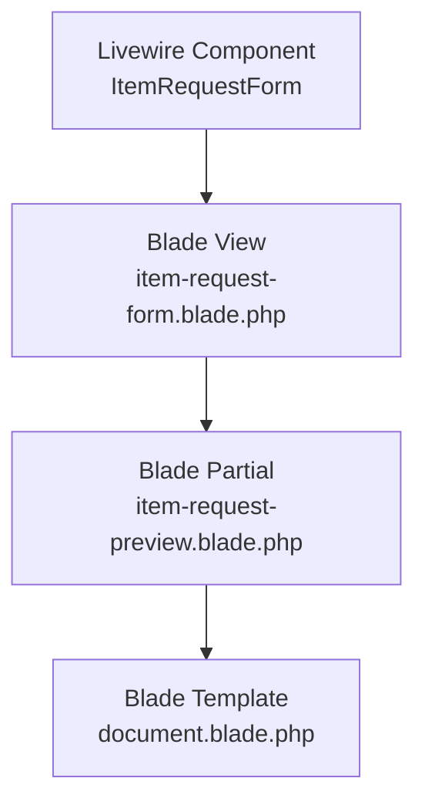
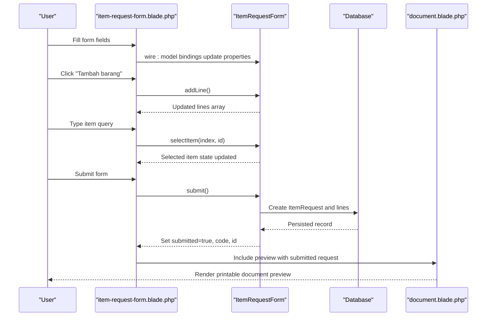
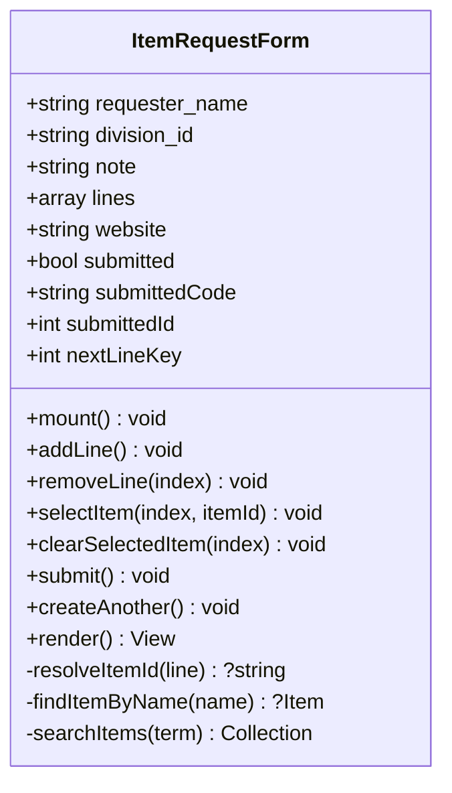
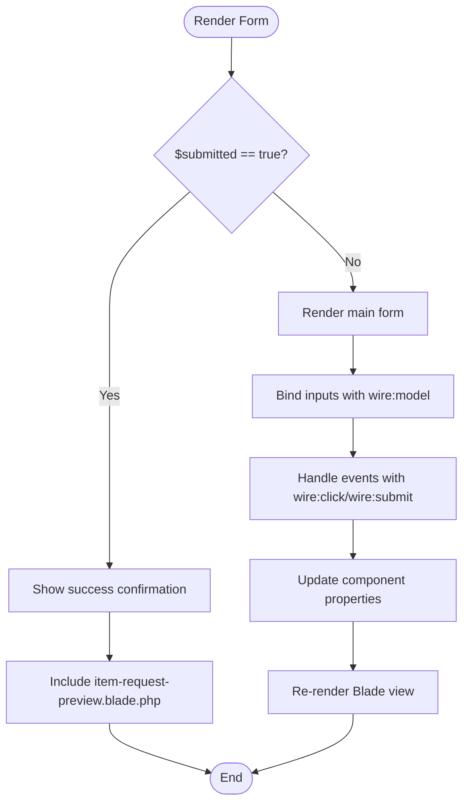
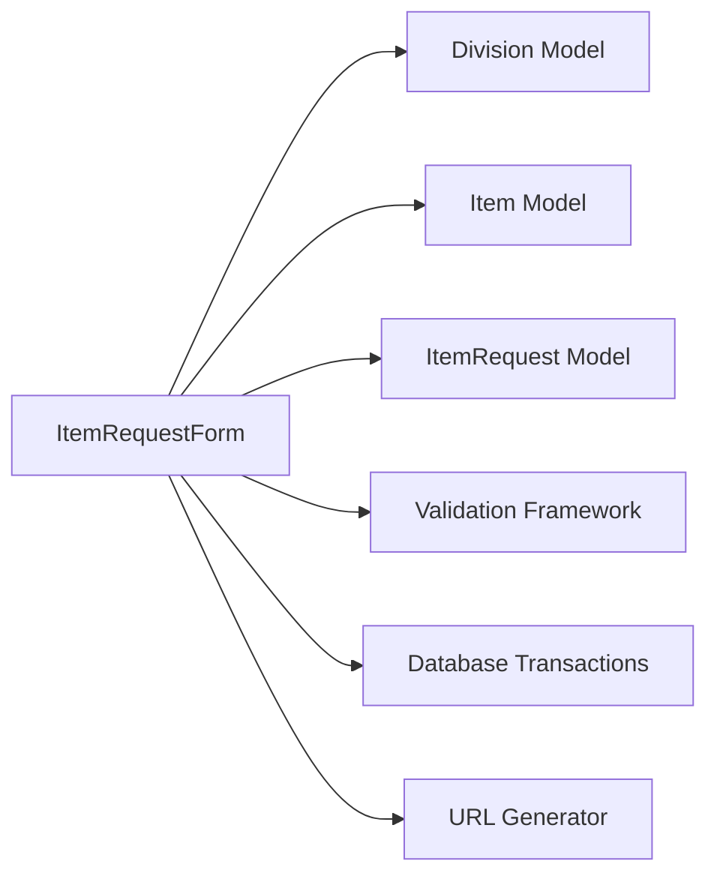

# Livewire Integration

<cite>
**Referenced Files in This Document**
- [ItemRequestForm.php](file://app/Livewire/ItemRequestForm.php)
- [item-request-form.blade.php](file://resources/views/livewire/item-request-form.blade.php)
- [item-request-preview.blade.php](file://resources/views/livewire/partials/item-request-preview.blade.php)
- [document.blade.php](file://resources/views/item-requests/document.blade.php)
</cite>

## Table of Contents
1. [Introduction](#introduction)
2. [Project Structure](#project-structure)
3. [Core Components](#core-components)
4. [Architecture Overview](#architecture-overview)
5. [Detailed Component Analysis](#detailed-component-analysis)
6. [Dependency Analysis](#dependency-analysis)
7. [Performance Considerations](#performance-considerations)
8. [Troubleshooting Guide](#troubleshooting-guide)
9. [Conclusion](#conclusion)

## Introduction
This document explains how the item request feature integrates Livewire components with Blade templates. The main component is `ItemRequestForm`, which renders the form view and manages user interactions, validation, persistence, and post-submission state. The preview partial reuses a shared document template to render a printable preview of the submitted request.

The goal is to help you understand:
- How `item-request-form.blade.php` acts as the main Livewire component view.
- How `item-request-preview.blade.php` provides live preview functionality after submission.
- How data binding works between Livewire properties and Blade inputs.
- How events are handled through Livewire actions.
- How real-time updates occur without full page reloads.
- How to create new Livewire components and integrate them into existing views.

## Project Structure
The Livewire integration for item requests lives under these paths:
- Livewire component: `app/Livewire/ItemRequestForm.php`
- Main component view: `resources/views/livewire/item-request-form.blade.php`
- Preview partial: `resources/views/livewire/partials/item-request-preview.blade.php`
- Shared document template: `resources/views/item-requests/document.blade.php`

**Diagram sources**
- [ItemRequestForm.php:20-22](file://app/Livewire/ItemRequestForm.php#L20-L22)
- [item-request-form.blade.php:179-582](file://resources/views/livewire/item-request-form.blade.php#L179-L582)
- [item-request-preview.blade.php:1-4](file://resources/views/livewire/partials/item-request-preview.blade.php#L1-L4)
- [document.blade.php:282-398](file://resources/views/item-requests/document.blade.php#L282-L398)

**Section sources**
- [ItemRequestForm.php:1-305](file://app/Livewire/ItemRequestForm.php#L1-L305)
- [item-request-form.blade.php:1-584](file://resources/views/livewire/item-request-form.blade.php#L1-L584)
- [item-request-preview.blade.php:1-4](file://resources/views/livewire/partials/item-request-preview.blade.php#L1-L4)
- [document.blade.php:1-398](file://resources/views/item-requests/document.blade.php#L1-L398)

## Core Components
- **Livewire Component**: `ItemRequestForm` holds public properties for form fields, line items, submission state, and helper values. It defines methods for adding/removing lines, selecting items, submitting the request, and resetting the form. It also prepares data for the Blade view, including divisions, active items, search results per line, and PDF/share links.
- **Main Blade View**: `item-request-form.blade.php` renders the complete form UI, binds inputs to Livewire properties, triggers actions via `wire:click`, and switches between form and success states based on component state.
- **Preview Partial**: `item-request-preview.blade.php` includes the shared document template in preview mode, wrapping it in a scrollable container.
- **Document Template**: `document.blade.php` renders a print-friendly document layout for an `ItemRequest` model instance, supporting both preview and PDF modes.

Key responsibilities:
- Data binding: Two-way binding via `wire:model` and live debounced input via `wire:model.live.debounce`.
- Event handling: User actions call component methods using `wire:click`.
- Real-time updates: Validation feedback, search dropdowns, and state changes update the DOM without full reloads.
- Submission flow: Validates, persists data, sets success state, and exposes a locked ID for subsequent rendering.

**Section sources**
- [ItemRequestForm.php:24-44](file://app/Livewire/ItemRequestForm.php#L24-L44)
- [ItemRequestForm.php:46-170](file://app/Livewire/ItemRequestForm.php#L46-L170)
- [ItemRequestForm.php:171-262](file://app/Livewire/ItemRequestForm.php#L171-L262)
- [item-request-form.blade.php:179-582](file://resources/views/livewire/item-request-form.blade.php#L179-L582)
- [item-request-preview.blade.php:1-4](file://resources/views/livewire/partials/item-request-preview.blade.php#L1-L4)
- [document.blade.php:282-398](file://resources/views/item-requests/document.blade.php#L282-L398)

## Architecture Overview
The item request feature follows a clear separation of concerns:
- Livewire component orchestrates business logic, validation, and data preparation.
- Blade views handle presentation and user interaction.
- A shared document template supports both preview and PDF generation.

**Diagram sources**
- [item-request-form.blade.php:313-322](file://resources/views/livewire/item-request-form.blade.php#L313-L322)
- [item-request-form.blade.php:417-425](file://resources/views/livewire/item-request-form.blade.php#L417-L425)
- [item-request-form.blade.php:437-450](file://resources/views/livewire/item-request-form.blade.php#L437-L450)
- [item-request-form.blade.php:557-579](file://resources/views/livewire/item-request-form.blade.php#L557-L579)
- [ItemRequestForm.php:51-84](file://app/Livewire/ItemRequestForm.php#L51-L84)
- [ItemRequestForm.php:95-152](file://app/Livewire/ItemRequestForm.php#L95-L152)
- [item-request-preview.blade.php:1-4](file://resources/views/livewire/partials/item-request-preview.blade.php#L1-L4)
- [document.blade.php:282-398](file://resources/views/item-requests/document.blade.php#L282-L398)

## Detailed Component Analysis

### Livewire Component: ItemRequestForm
Responsibilities:
- Public properties bind to form fields and manage dynamic line items.
- Methods handle adding/removing lines, selecting items from catalog, clearing selections, and submitting the request.
- Validation rules and messages enforce required fields, valid divisions, unique items, and positive quantities.
- Rendering method prepares divisions, active items, per-line search results, and post-submission data (PDF URL, share message).

Key implementation patterns:
- Dynamic list management with unique keys for stable DOM reconciliation.
- Debounced live search bound to each line’s query field.
- Transactional persistence for request header and lines.
- Locked property for submitted ID to prevent client-side tampering.

**Diagram sources**
- [ItemRequestForm.php:24-44](file://app/Livewire/ItemRequestForm.php#L24-L44)
- [ItemRequestForm.php:46-170](file://app/Livewire/ItemRequestForm.php#L46-L170)
- [ItemRequestForm.php:210-262](file://app/Livewire/ItemRequestForm.php#L210-L262)
- [ItemRequestForm.php:267-303](file://app/Livewire/ItemRequestForm.php#L267-L303)

**Section sources**
- [ItemRequestForm.php:24-44](file://app/Livewire/ItemRequestForm.php#L24-L44)
- [ItemRequestForm.php:46-170](file://app/Livewire/ItemRequestForm.php#L46-L170)
- [ItemRequestForm.php:171-262](file://app/Livewire/ItemRequestForm.php#L171-L262)
- [ItemRequestForm.php:267-303](file://app/Livewire/ItemRequestForm.php#L267-L303)

### Main Blade View: item-request-form.blade.php
Responsibilities:
- Renders the hero header, step indicators, and instructions.
- Displays either the success confirmation or the main form depending on `$submitted`.
- Binds inputs to Livewire properties using `wire:model` and `wire:model.live.debounce`.
- Triggers component actions via `wire:click` for adding/removing lines, selecting items, and submitting.
- Shows validation errors inline and uses loading directives for submit button.

Data binding examples:
- Requester name: `wire:model="requester_name"`
- Division selection: `wire:model="division_id"`
- Note textarea: `wire:model="note"`
- Line item query: `wire:model.live.debounce.300ms="lines.{index}.item_query"`
- Line quantity: `wire:model="lines.{index}.quantity"`
- Line note: `wire:model="lines.{index}.note"`

Event handling examples:
- Add line: `wire:click="addLine"`
- Remove line: `wire:click="removeLine({index})"`
- Select item: `wire:click="selectItem({index}, '{itemId}')"`
- Clear selected item: `wire:click="clearSelectedItem({index})"`
- Submit form: `wire:submit="submit"`
- Reset form: `wire:click="createAnother"`

Real-time updates:
- Live debounced search populates dropdown suggestions per line.
- Validation errors appear immediately when fields change.
- Success state replaces the form with confirmation and preview.

**Diagram sources**
- [item-request-form.blade.php:34-102](file://resources/views/livewire/item-request-form.blade.php#L34-L102)
- [item-request-form.blade.php:179-582](file://resources/views/livewire/item-request-form.blade.php#L179-L582)

**Section sources**
- [item-request-form.blade.php:34-102](file://resources/views/livewire/item-request-form.blade.php#L34-L102)
- [item-request-form.blade.php:179-582](file://resources/views/livewire/item-request-form.blade.php#L179-L582)

### Preview Partial: item-request-preview.blade.php
Responsibilities:
- Wraps the shared document template in a scrollable container.
- Passes the submitted request and sets preview mode.

Integration points:
- Included conditionally when a request has been successfully submitted.
- Uses the shared document template to render a printable layout.

**Section sources**
- [item-request-preview.blade.php:1-4](file://resources/views/livewire/partials/item-request-preview.blade.php#L1-L4)
- [item-request-form.blade.php:100-102](file://resources/views/livewire/item-request-form.blade.php#L100-L102)

### Shared Document Template: document.blade.php
Responsibilities:
- Renders a print-friendly document layout for an `ItemRequest` instance.
- Supports two modes: preview and PDF.
- Includes toolbar for printing in preview mode.
- Displays request details, item lines, reason section, and signature blocks.

Usage:
- Preview mode: Used by `item-request-preview.blade.php` to show a screen-friendly version.
- PDF mode: Used by PDF generation routes/controllers elsewhere in the application.

**Section sources**
- [document.blade.php:1-398](file://resources/views/item-requests/document.blade.php#L1-L398)

## Dependency Analysis
The Livewire component depends on models and services to prepare data and persist submissions:
- Models: `Division`, `Item`, `ItemRequest`
- Database transactions for atomic writes
- URL generator for temporary signed PDF links
- Validation framework for custom rules and messages

**Diagram sources**
- [ItemRequestForm.php:5-14](file://app/Livewire/ItemRequestForm.php#L5-L14)
- [ItemRequestForm.php:95-152](file://app/Livewire/ItemRequestForm.php#L95-L152)
- [ItemRequestForm.php:210-262](file://app/Livewire/ItemRequestForm.php#L210-L262)

**Section sources**
- [ItemRequestForm.php:5-14](file://app/Livewire/ItemRequestForm.php#L5-L14)
- [ItemRequestForm.php:95-152](file://app/Livewire/ItemRequestForm.php#L95-L152)
- [ItemRequestForm.php:210-262](file://app/Livewire/ItemRequestForm.php#L210-L262)

## Performance Considerations
- Use `wire:model.live.debounce` for search inputs to reduce server round-trips while maintaining responsiveness.
- Limit search results to a small set (e.g., top 10) to avoid heavy queries on every keystroke.
- Preload only necessary relationships (e.g., base unit of measure) in the component’s render method.
- Avoid unnecessary re-renders by keeping component state minimal and using locked properties for immutable values like IDs.
- For large lists, consider pagination or virtualization strategies if the number of lines grows significantly.

[No sources needed since this section provides general guidance]

## Troubleshooting Guide
Common issues and resolutions:
- Validation errors not showing: Ensure `@error('field')` directives match the exact property path, including array indices like `lines.$index.item_query`.
- Search dropdown not updating: Verify `wire:model.live.debounce.300ms` is applied to the correct line property and that the component’s render method computes search results for non-empty queries.
- Duplicate items allowed: Confirm custom validator logic checks duplicates across selected and manual entries and adds appropriate error messages.
- Submitted state not persisting: Ensure `$submittedId` is marked as locked and that the success view includes the preview partial only when `$submittedRequest`, `$pdfUrl`, and `$shareMessage` are present.
- PDF link not working: Check that temporary signed route generation includes an expiration time and correct parameters.

**Section sources**
- [ItemRequestForm.php:95-152](file://app/Livewire/ItemRequestForm.php#L95-L152)
- [ItemRequestForm.php:171-208](file://app/Livewire/ItemRequestForm.php#L171-L208)
- [ItemRequestForm.php:228-262](file://app/Livewire/ItemRequestForm.php#L228-L262)
- [item-request-form.blade.php:468-473](file://resources/views/livewire/item-request-form.blade.php#L468-L473)
- [item-request-form.blade.php:100-102](file://resources/views/livewire/item-request-form.blade.php#L100-L102)

## Conclusion
The item request feature demonstrates a clean integration of Livewire components with Blade templates:
- `ItemRequestForm` encapsulates form logic, validation, and persistence.
- `item-request-form.blade.php` provides a rich interactive UI with real-time updates.
- `item-request-preview.blade.php` reuses a shared document template for consistent preview and PDF rendering.
- Data binding and event handling follow Livewire best practices, enabling seamless user experiences without full page reloads.

To extend this pattern:
- Create a new Livewire component with public properties and methods.
- Build a corresponding Blade view with `wire:model` bindings and `wire:click` actions.
- Use partials to reuse common UI elements like previews or tables.
- Keep component state minimal and leverage locked properties for security-sensitive values.

[No sources needed since this section summarizes without analyzing specific files]