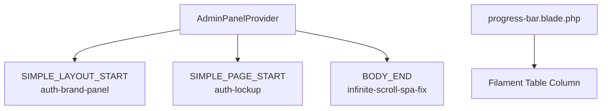
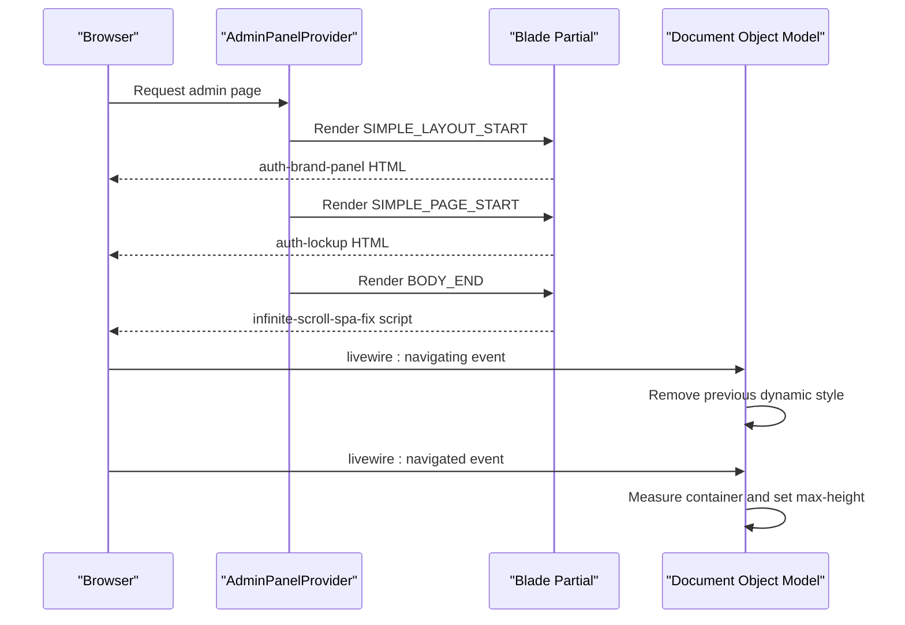
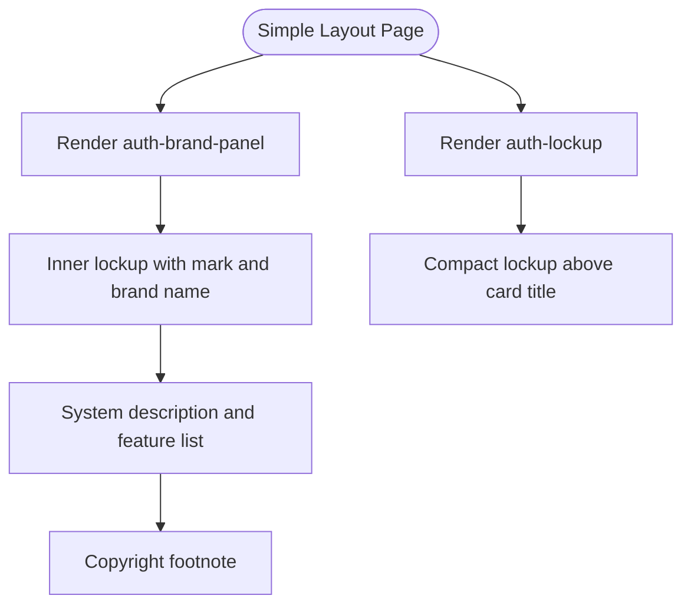
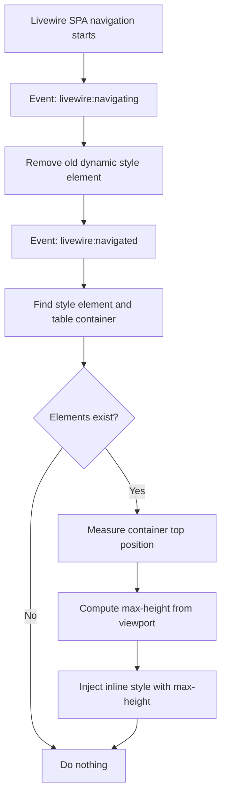
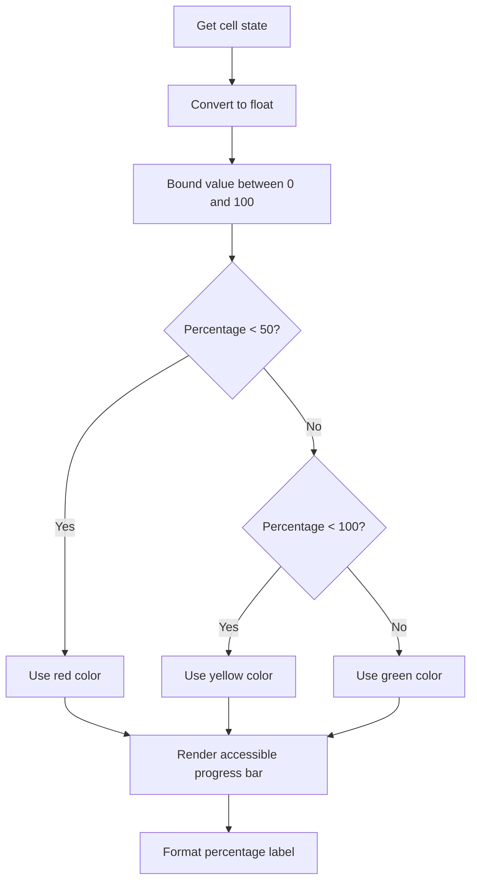
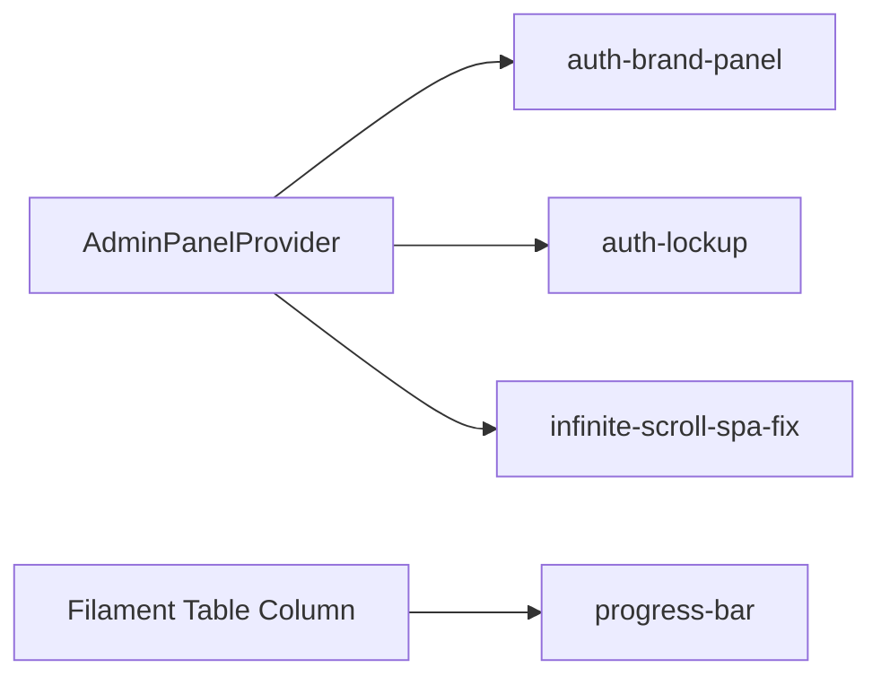

# Partials and Components

<cite>
**Referenced Files in This Document**
- [AdminPanelProvider.php](file://app/Providers/Filament/AdminPanelProvider.php)
- [auth-brand-panel.blade.php](file://resources/views/filament/partials/auth-brand-panel.blade.php)
- [auth-lockup.blade.php](file://resources/views/filament/partials/auth-lockup.blade.php)
- [infinite-scroll-spa-fix.blade.php](file://resources/views/filament/partials/infinite-scroll-spa-fix.blade.php)
- [progress-bar.blade.php](file://resources/views/filament/tables/columns/progress-bar.blade.php)
- [AGENTS.md](file://AGENTS.md)
</cite>

## Table of Contents
1. [Introduction](#introduction)
2. [Project Structure](#project-structure)
3. [Core Components](#core-components)
4. [Architecture Overview](#architecture-overview)
5. [Detailed Component Analysis](#detailed-component-analysis)
6. [Dependency Analysis](#dependency-analysis)
7. [Performance Considerations](#performance-considerations)
8. [Troubleshooting Guide](#troubleshooting-guide)
9. [Conclusion](#conclusion)
10. [Appendices](#appendices)

## Introduction
This document explains the reusable Blade partials and components used across the Filament admin panel:
- Authentication-related branding partials: `auth-brand-panel` and `auth-lockup`.
- Technical utility partial for SPA navigation behavior: `infinite-scroll-spa-fix`.
- Custom table column component: `progress-bar`.

It covers how these pieces are composed, how data is passed to them, how styling remains consistent, and how to create new partials that integrate cleanly with existing views.

## Project Structure
The relevant files live under `resources/views/filament`:
- `partials/` contains small, reusable Blade templates injected by the Filament panel provider.
- `tables/columns/` contains custom column view templates consumed by Filament table columns.
- The panel provider wires these partials into specific render hooks so they appear automatically on authentication pages and at the end of every page body.

**Diagram sources**
- [AdminPanelProvider.php:63-74](file://app/Providers/Filament/AdminPanelProvider.php#L63-L74)

**Section sources**
- [AdminPanelProvider.php:31-89](file://app/Providers/Filament/AdminPanelProvider.php#L31-L89)

## Core Components
This section summarizes each partial/component and its role.

### Authentication Brand Panel (`auth-brand-panel`)
- Purpose: Renders a wide-screen branding side panel shown on simple layout pages such as login or password reset.
- Behavior: It is pure presentation; it does not require any variables from the caller.
- Styling: Uses scoped class names prefixed with `rsv-auth-*` to avoid conflicts with Filament’s own classes.
- Composition: Contains an inner lockup and descriptive copy, plus a copyright footnote.

**Section sources**
- [auth-brand-panel.blade.php:1-29](file://resources/views/filament/partials/auth-brand-panel.blade.php#L1-L29)

### Authentication Lockup (`auth-lockup`)
- Purpose: Renders a compact logo lockup above the card title on simple pages.
- Behavior: Pure presentation without required variables.
- Styling: Uses `rsv-auth-lockup` and `rsv-auth-lockup-card` to distinguish itself from the larger brand panel lockup.

**Section sources**
- [auth-lockup.blade.php:1-6](file://resources/views/filament/partials/auth-lockup.blade.php#L1-L6)

### Infinite Scroll SPA Fix (`infinite-scroll-spa-fix`)
- Purpose: Fixes table container height after Livewire SPA navigation when using infinite scroll tables.
- Behavior:
  - On `livewire:navigating`, removes any previously injected inline style element.
  - On `livewire:navigated`, measures the table container position and injects a `<style>` tag that sets `max-height` for `.fi-ta-content-ctn`.
- Integration: Registered via the panel’s `BODY_END` render hook.

**Section sources**
- [infinite-scroll-spa-fix.blade.php:1-20](file://resources/views/filament/partials/infinite-scroll-spa-fix.blade.php#L1-L20)
- [AdminPanelProvider.php:71-74](file://app/Providers/Filament/AdminPanelProvider.php#L71-L74)
- [AGENTS.md:43-57](file://AGENTS.md#L43-L57)

### Progress Bar Column (`progress-bar`)
- Purpose: Displays a percentage progress bar inside Filament table columns.
- Data input: Reads the current cell value through `$getState()`.
- Processing:
  - Converts the state to a float.
  - Bounds the value between 0 and 100.
  - Chooses a color based on thresholds: red below 50%, yellow below 100%, green otherwise.
- Output: An accessible progress bar with ARIA attributes and a formatted percentage label.

**Section sources**
- [progress-bar.blade.php:1-29](file://resources/views/filament/tables/columns/progress-bar.blade.php#L1-L29)

## Architecture Overview
The panel provider configures three render hooks:
- `SIMPLE_LAYOUT_START` includes the full brand panel on simple layouts.
- `SIMPLE_PAGE_START` includes the compact lockup on simple pages.
- `BODY_END` includes the JavaScript fix for SPA navigation.

**Diagram sources**
- [AdminPanelProvider.php:63-74](file://app/Providers/Filament/AdminPanelProvider.php#L63-L74)
- [infinite-scroll-spa-fix.blade.php:1-20](file://resources/views/filament/partials/infinite-scroll-spa-fix.blade.php#L1-L20)

## Detailed Component Analysis

### Authentication Branding Composition
The authentication UI is composed from two partials:
- The large brand panel appears only on wide screens and provides context about the system.
- The compact lockup appears above the card title and reinforces branding.

**Diagram sources**
- [auth-brand-panel.blade.php:1-29](file://resources/views/filament/partials/auth-brand-panel.blade.php#L1-L29)
- [auth-lockup.blade.php:1-6](file://resources/views/filament/partials/auth-lockup.blade.php#L1-L6)

**Section sources**
- [auth-brand-panel.blade.php:1-29](file://resources/views/filament/partials/auth-brand-panel.blade.php#L1-L29)
- [auth-lockup.blade.php:1-6](file://resources/views/filament/partials/auth-lockup.blade.php#L1-L6)

### Infinite Scroll SPA Navigation Fix
The fix ensures the table content container has a correct maximum height after Livewire navigates within the SPA.

**Diagram sources**
- [infinite-scroll-spa-fix.blade.php:1-20](file://resources/views/filament/partials/infinite-scroll-spa-fix.blade.php#L1-L20)

**Section sources**
- [infinite-scroll-spa-fix.blade.php:1-20](file://resources/views/filament/partials/infinite-scroll-spa-fix.blade.php#L1-L20)

### Progress Bar Column Logic
The progress bar column transforms raw percentage values into a visual indicator with appropriate colors and accessibility attributes.

**Diagram sources**
- [progress-bar.blade.php:1-29](file://resources/views/filament/tables/columns/progress-bar.blade.php#L1-L29)

**Section sources**
- [progress-bar.blade.php:1-29](file://resources/views/filament/tables/columns/progress-bar.blade.php#L1-L29)

## Dependency Analysis
The partials have minimal coupling:
- `auth-brand-panel` and `auth-lockup` are independent presentation templates.
- `infinite-scroll-spa-fix` depends on Livewire events and Filament table container selectors.
- `progress-bar` depends on Filament’s column rendering contract (`$getState()`).

**Diagram sources**
- [AdminPanelProvider.php:63-74](file://app/Providers/Filament/AdminPanelProvider.php#L63-L74)
- [progress-bar.blade.php:1-29](file://resources/views/filament/tables/columns/progress-bar.blade.php#L1-L29)

**Section sources**
- [AdminPanelProvider.php:63-74](file://app/Providers/Filament/AdminPanelProvider.php#L63-L74)
- [progress-bar.blade.php:1-29](file://resources/views/filament/tables/columns/progress-bar.blade.php#L1-L29)

## Performance Considerations
- Keep partials lightweight and free of heavy logic. All three authentication and SPA partials are small and focused.
- Avoid excessive DOM queries in client-side scripts. The SPA fix performs one measurement per navigation and updates a single style element.
- Use bounded values and deterministic color selection in table columns to prevent unnecessary reflows.

[No sources needed since this section provides general guidance]

## Troubleshooting Guide
- Brand panel not visible on simple pages:
  - Verify the panel provider registers `SIMPLE_LAYOUT_START` and `SIMPLE_PAGE_START` hooks.
  - Confirm the partial paths match the registered view names.
- Lockup missing above card title:
  - Ensure `SIMPLE_PAGE_START` renders `auth-lockup`.
- Table height incorrect after navigation:
  - Confirm `BODY_END` renders `infinite-scroll-spa-fix`.
  - Check that Livewire SPA navigation is enabled and that the table container selector matches Filament’s default class.
- Progress bar shows unexpected color:
  - Validate the cell value is numeric and within 0–100.
  - Remember the thresholds: below 50% is red, below 100% is yellow, otherwise green.

**Section sources**
- [AdminPanelProvider.php:63-74](file://app/Providers/Filament/AdminPanelProvider.php#L63-L74)
- [infinite-scroll-spa-fix.blade.php:1-20](file://resources/views/filament/partials/infinite-scroll-spa-fix.blade.php#L1-L20)
- [progress-bar.blade.php:1-29](file://resources/views/filament/tables/columns/progress-bar.blade.php#L1-L29)

## Conclusion
These partials provide consistent branding, reliable SPA navigation behavior, and a reusable progress visualization for tables. They are intentionally small, scoped, and integrated through clear extension points in the panel provider and Filament’s column system. Following the patterns here will help you add new partials that fit naturally into the admin interface.

[No sources needed since this section summarizes without analyzing specific files]

## Appendices

### How to Create a New Partial
1. Decide where the partial belongs:
   - Authentication UI: place under `resources/views/filament/partials/`.
   - Table column: place under `resources/views/filament/tables/columns/`.
2. Write a small, focused Blade template:
   - For UI partials, use scoped class names (for example, prefix with `rsv-*`).
   - For table columns, read data through `$getState()` and keep formatting logic local.
3. Register UI partials via the panel provider:
   - Use `renderHook` with the appropriate hook:
     - `SIMPLE_LAYOUT_START` for full branding panels.
     - `SIMPLE_PAGE_START` for compact lockups.
     - `BODY_END` for scripts or global utilities.
4. Consume table columns:
   - Reference the column view path in your resource table definition.
   - Provide a numeric percentage value from the column’s state accessor.

**Section sources**
- [AdminPanelProvider.php:63-74](file://app/Providers/Filament/AdminPanelProvider.php#L63-L74)
- [progress-bar.blade.php:1-29](file://resources/views/filament/tables/columns/progress-bar.blade.php#L1-L29)

### Styling Consistency Guidelines
- Prefer scoped class prefixes for custom UI elements to avoid conflicts with Filament’s styles.
- Reuse existing semantic structure rather than duplicating markup.
- Keep Tailwind utility classes close to the component that needs them.
- Maintain dark mode support by using Tailwind’s dark variants where applicable.

[No sources needed since this section provides general guidance]