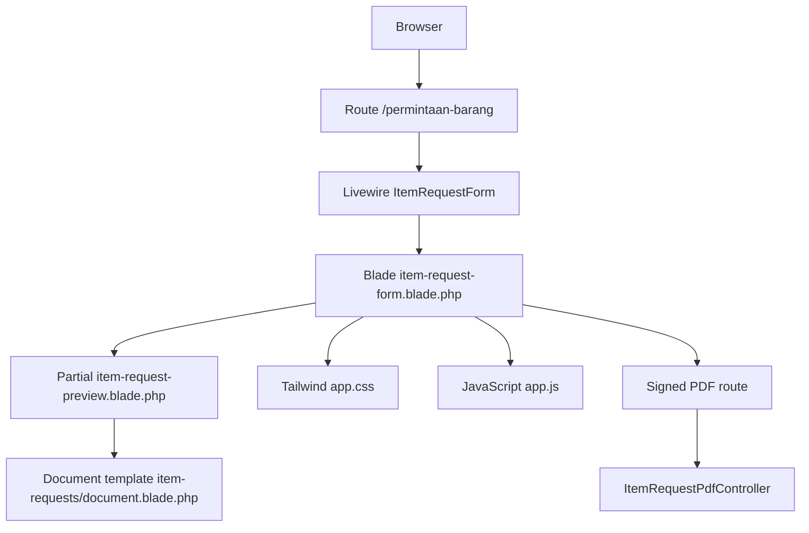
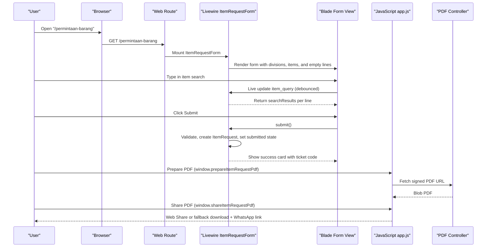
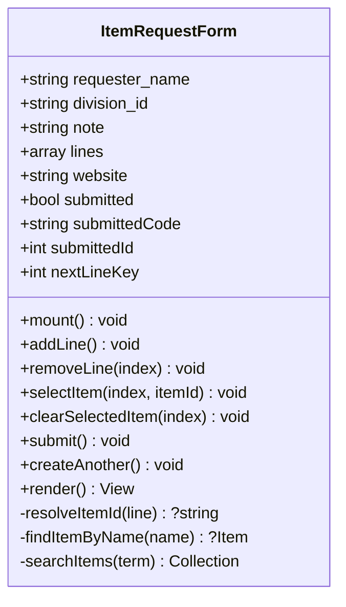
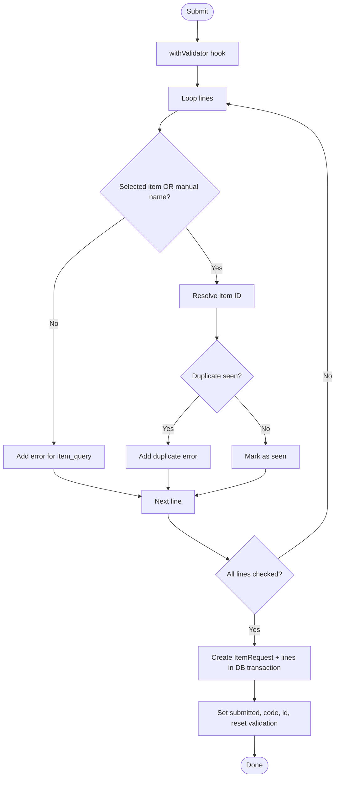
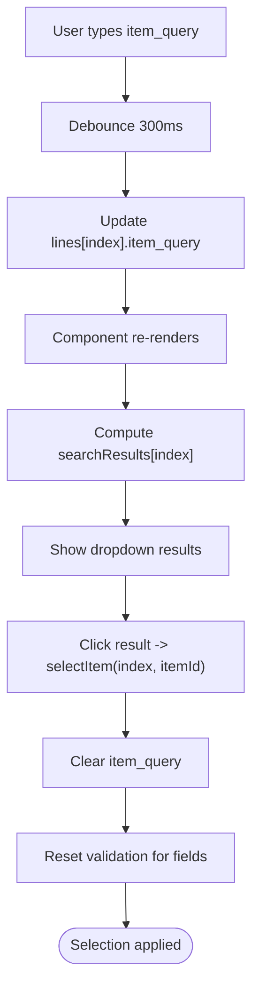
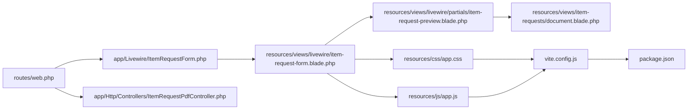

# Frontend Components

<cite>
**Referenced Files in This Document**
- [ItemRequestForm.php](file://app/Livewire/ItemRequestForm.php)
- [item-request-form.blade.php](file://resources/views/livewire/item-request-form.blade.php)
- [item-request-preview.blade.php](file://resources/views/livewire/partials/item-request-preview.blade.php)
- [document.blade.php](file://resources/views/item-requests/document.blade.php)
- [app.css](file://resources/css/app.css)
- [app.js](file://resources/js/app.js)
- [vite.config.js](file://vite.config.js)
- [package.json](file://package.json)
- [web.php](file://routes/web.php)
- [ItemRequestPdfController.php](file://app/Http/Controllers/ItemRequestPdfController.php)
</cite>

## Table of Contents
1. [Introduction](#introduction)
2. [Project Structure](#project-structure)
3. [Core Components](#core-components)
4. [Architecture Overview](#architecture-overview)
5. [Detailed Component Analysis](#detailed-component-analysis)
6. [Dependency Analysis](#dependency-analysis)
7. [Performance Considerations](#performance-considerations)
8. [Accessibility and Browser Compatibility](#accessibility-and-browser-compatibility)
9. [Troubleshooting Guide](#troubleshooting-guide)
10. [Conclusion](#conclusion)

## Introduction
This document explains the frontend layer for the item request feature. It focuses on the Livewire component, Blade templates, Tailwind CSS styling, JavaScript utilities, Vite build configuration, and related routing and PDF generation. The goal is to help developers understand how the interactive form works, how state is managed, how real-time updates are achieved, and how assets are built and served.

## Project Structure
The frontend implementation spans several layers:

- Livewire component: `app/Livewire/ItemRequestForm.php`
- Blade views:
  - Main form view: `resources/views/livewire/item-request-form.blade.php`
  - Preview partial: `resources/views/livewire/partials/item-request-preview.blade.php`
  - Print/PDF document template: `resources/views/item-requests/document.blade.php`
- Styles: `resources/css/app.css`
- JavaScript: `resources/js/app.js`
- Build configuration: `vite.config.js`, `package.json`
- Routing and controller: `routes/web.php`, `app/Http/Controllers/ItemRequestPdfController.php`

**Diagram sources**
- [web.php:7-17](file://routes/web.php#L7-L17)
- [ItemRequestForm.php:20-22](file://app/Livewire/ItemRequestForm.php#L20-L22)
- [item-request-form.blade.php:1-584](file://resources/views/livewire/item-request-form.blade.php#L1-L584)
- [item-request-preview.blade.php:1-4](file://resources/views/livewire/partials/item-request-preview.blade.php#L1-L4)
- [document.blade.php:1-398](file://resources/views/item-requests/document.blade.php#L1-L398)
- [app.css:1-11](file://resources/css/app.css#L1-L11)
- [app.js:1-70](file://resources/js/app.js#L1-L70)
- [ItemRequestPdfController.php:9-19](file://app/Http/Controllers/ItemRequestPdfController.php#L9-L19)

**Section sources**
- [web.php:7-17](file://routes/web.php#L7-L17)
- [ItemRequestForm.php:20-22](file://app/Livewire/ItemRequestForm.php#L20-L22)
- [item-request-form.blade.php:1-584](file://resources/views/livewire/item-request-form.blade.php#L1-L584)
- [item-request-preview.blade.php:1-4](file://resources/views/livewire/partials/item-request-preview.blade.php#L1-L4)
- [document.blade.php:1-398](file://resources/views/item-requests/document.blade.php#L1-L398)
- [app.css:1-11](file://resources/css/app.css#L1-L11)
- [app.js:1-70](file://resources/js/app.js#L1-L70)
- [vite.config.js:1-31](file://vite.config.js#L1-L31)
- [package.json:1-20](file://package.json#L1-L20)
- [ItemRequestPdfController.php:9-19](file://app/Http/Controllers/ItemRequestPdfController.php#L9-L19)

## Core Components
- Livewire component: `ItemRequestForm` manages form state, validation, line items, search results, submission flow, and preview data.
- Blade view: `livewire/item-request-form.blade.php` renders the interactive UI with sections for requester data, dynamic line items, submit actions, and success confirmation.
- Preview partial: `livewire/partials/item-request-preview.blade.php` includes the print-ready document template for previewing a submitted request.
- Document template: `item-requests/document.blade.php` defines the A4 layout, table structure, and print styles used by both preview and PDF generation.
- Styles: `resources/css/app.css` configures Tailwind v4, source scanning, and font theme.
- JavaScript: `resources/js/app.js` provides PDF preparation and sharing helpers using the Web Share API or fallback download.
- Build: `vite.config.js` and `package.json` define inputs, plugins, fonts, dev server, and scripts.
- Routing and PDF controller: `routes/web.php` exposes the form and signed PDF endpoint; `ItemRequestPdfController.php` streams the generated PDF.

**Section sources**
- [ItemRequestForm.php:20-305](file://app/Livewire/ItemRequestForm.php#L20-L305)
- [item-request-form.blade.php:1-584](file://resources/views/livewire/item-request-form.blade.php#L1-L584)
- [item-request-preview.blade.php:1-4](file://resources/views/livewire/partials/item-request-preview.blade.php#L1-L4)
- [document.blade.php:1-398](file://resources/views/item-requests/document.blade.php#L1-L398)
- [app.css:1-11](file://resources/css/app.css#L1-L11)
- [app.js:1-70](file://resources/js/app.js#L1-L70)
- [vite.config.js:1-31](file://vite.config.js#L1-L31)
- [package.json:1-20](file://package.json#L1-L20)
- [web.php:7-17](file://routes/web.php#L7-L17)
- [ItemRequestPdfController.php:9-19](file://app/Http/Controllers/ItemRequestPdfController.php#L9-L19)

## Architecture Overview
The item request feature uses a Livewire-driven single-page-like experience within a Blade layout. The main entry point is a route that mounts the Livewire component. The component prepares data (divisions, active items, search results, and post-submission preview), while the Blade view handles interactivity through Livewire directives and Alpine.js for small client-side behaviors. After submission, the user can preview the document, download a signed PDF, or share it via the Web Share API.

**Diagram sources**
- [web.php:11-17](file://routes/web.php#L11-L17)
- [ItemRequestForm.php:95-169](file://app/Livewire/ItemRequestForm.php#L95-L169)
- [item-request-form.blade.php:179-584](file://resources/views/livewire/item-request-form.blade.php#L179-L584)
- [app.js:1-70](file://resources/js/app.js#L1-L70)
- [ItemRequestPdfController.php:11-18](file://app/Http/Controllers/ItemRequestPdfController.php#L11-L18)

## Detailed Component Analysis

### Livewire Component: ItemRequestForm
Responsibilities:
- State management for requester name, division, note, hidden honeypot field, line items, submission flags, and next line key.
- Dynamic line management: add/remove lines, select/clear items, live search result computation.
- Validation rules and custom messages, including duplicate item prevention across lines.
- Submission logic wrapped in a database transaction, creating an `ItemRequest` and its lines.
- Post-submission state: show success, provide PDF URL, and prepare share message.
- Data preparation for the view: active divisions, active items with base unit of measure, per-line search results, and optional PDF/share data.

Key methods and properties:
- Public properties: `requester_name`, `division_id`, `note`, `lines`, `website`, `submitted`, `submittedCode`, `submittedId`, `nextLineKey`.
- Lifecycle and actions: `mount`, `addLine`, `removeLine`, `selectItem`, `clearSelectedItem`, `submit`, `createAnother`.
- Validation: `rules`, `messages`, plus custom validator hook for duplicate detection.
- Rendering: `render` loads divisions, items, computes search results, resolves submitted request, generates temporary signed PDF URL, and builds share message.
- Helpers: `resolveItemId`, `findItemByName`, `searchItems`.

State model overview:

**Diagram sources**
- [ItemRequestForm.php:20-305](file://app/Livewire/ItemRequestForm.php#L20-L305)

Validation and duplicate prevention flow:

**Diagram sources**
- [ItemRequestForm.php:95-169](file://app/Livewire/ItemRequestForm.php#L95-L169)

Real-time search and selection flow:

**Diagram sources**
- [item-request-form.blade.php:417-425](file://resources/views/livewire/item-request-form.blade.php#L417-L425)
- [ItemRequestForm.php:73-84](file://app/Livewire/ItemRequestForm.php#L73-L84)
- [ItemRequestForm.php:210-262](file://app/Livewire/ItemRequestForm.php#L210-L262)

**Section sources**
- [ItemRequestForm.php:20-305](file://app/Livewire/ItemRequestForm.php#L20-L305)

### Blade Template: item-request-form.blade.php
Structure:
- Header hero section with branding and quick guide.
- Success confirmation view when `$submitted` is true:
  - Ticket code display with copy-to-clipboard via Alpine.js.
  - Preview partial inclusion.
  - Action buttons: back to home, download PDF, share to WhatsApp, create another.
- Main form when not submitted:
  - Section 1: Requester data (name, division, note).
  - Section 2: Dynamic list of requested items with:
    - Search input bound to `lines[index].item_query` with `.live.debounce.300ms`.
    - Master catalog dropdown populated from `$searchResults[index]`.
    - Selected item display card with “Ganti” action.
    - Quantity input, read-only unit display, and per-line note.
    - Add/remove line controls.
  - Honeypot anti-spam field (`website`).
  - Submit button with loading states controlled by Livewire directives.

Interactive features:
- Real-time search with debounced input.
- Live validation feedback per field.
- Dynamic line addition/removal.
- Selection and clearing of items.
- Success state with ticket code and actions.
- Alpine.js-powered clipboard copy and PDF sharing UI state.

Composition patterns:
- Uses `@include('livewire.partials.item-request-preview', ...)` to embed the document preview.
- Uses `@include('item-requests.document', ...)` inside the preview partial.
- Uses Tailwind utility classes extensively for responsive design and consistent visual hierarchy.

**Section sources**
- [item-request-form.blade.php:1-584](file://resources/views/livewire/item-request-form.blade.php#L1-L584)

### Preview Partial: item-request-preview.blade.php
Purpose:
- Wraps the document template in a scrollable container with accessible label.
- Includes the shared document template with mode set to preview.

Usage:
- Included only after successful submission when preview data is available.

**Section sources**
- [item-request-preview.blade.php:1-4](file://resources/views/livewire/partials/item-request-preview.blade.php#L1-L4)

### Document Template: item-requests/document.blade.php
Purpose:
- Defines the A4 print layout for item requests.
- Provides screen preview scaling and print-specific styles.
- Renders header, document information, item details table, reason section, and signature blocks.

Key aspects:
- Fixed-width paper container sized for A4.
- Tables with column widths for number, name/specification, quantity, and unit.
- Blank rows to ensure minimum height for print.
- Print media queries to hide non-document content and scale preview appropriately.
- Toolbar button to trigger browser print dialog.

**Section sources**
- [document.blade.php:1-398](file://resources/views/item-requests/document.blade.php#L1-L398)

### Styling: Tailwind CSS and Custom Theme
Configuration:
- Imports Tailwind v4 and sets source paths for Blade views and pagination views.
- Defines a theme font family for sans-serif text.

Implementation:
- Extensive use of Tailwind utility classes for spacing, typography, colors, borders, shadows, focus rings, and responsive layouts.
- Consistent visual language across form fields, cards, badges, and buttons.

Optimization:
- Source scanning ensures only used classes are included.
- Font theme configured via Vite plugin for efficient delivery.

**Section sources**
- [app.css:1-11](file://resources/css/app.css#L1-L11)

### JavaScript: PDF Preparation and Sharing
Functions:
- `prepareItemRequestPdf(pdfUrl, code)`:
  - Fetches the signed PDF blob once per URL.
  - Caches the blob and file object.
  - Throws errors if fetch fails or PDF is not ready.
- `shareItemRequestPdf(pdfUrl, code, message)`:
  - Attempts native Web Share API with files if supported.
  - Falls back to downloading the PDF and opening WhatsApp with a pre-filled message.
  - Manages object URLs and cleanup.

Integration:
- Called from Alpine.js bindings in the success card.
- Provides user feedback for preparation and sharing states.

**Section sources**
- [app.js:1-70](file://resources/js/app.js#L1-L70)
- [item-request-form.blade.php:145-160](file://resources/views/livewire/item-request-form.blade.php#L145-L160)

### Build Process: Vite and Assets
Inputs:
- CSS: `resources/css/app.css`, `resources/css/filament/admin/theme.css`
- JS: `resources/js/app.js`

Plugins:
- Laravel Vite plugin for asset pipeline integration.
- Tailwind CSS plugin for processing Tailwind utilities.
- Font plugin to serve Instrument Sans with specified weights.

Dev server:
- Port 5174 with strict port enforcement.
- Ignores compiled Blade views during watch to avoid unnecessary rebuilds.

Scripts:
- `npm run dev` starts development server.
- `npm run build` produces production assets.

**Section sources**
- [vite.config.js:1-31](file://vite.config.js#L1-L31)
- [package.json:1-20](file://package.json#L1-L20)

### Routing and PDF Controller
Routing:
- `/permintaan-barang` mounts the Livewire component with throttling middleware.
- `/permintaan-barang/{itemRequest}/pdf` serves a signed PDF stream.

PDF controller:
- Loads relationships for division, lines, items, and base units.
- Streams a PDF generated from `pdf.item-request` view with A4 paper size.

**Section sources**
- [web.php:7-17](file://routes/web.php#L7-L17)
- [ItemRequestPdfController.php:9-19](file://app/Http/Controllers/ItemRequestPdfController.php#L9-L19)

## Dependency Analysis
High-level dependencies:
- Routes depend on Livewire component and PDF controller.
- Livewire component depends on models (Division, Item, ItemRequest), database transactions, URL generator, and validation.
- Blade view depends on Livewire state, Tailwind classes, and Alpine.js attributes.
- JavaScript depends on browser APIs (fetch, navigator.share, File).
- Vite depends on Laravel Vite plugin, Tailwind plugin, and font plugin.

**Diagram sources**
- [web.php:7-17](file://routes/web.php#L7-L17)
- [ItemRequestForm.php:20-305](file://app/Livewire/ItemRequestForm.php#L20-L305)
- [item-request-form.blade.php:1-584](file://resources/views/livewire/item-request-form.blade.php#L1-L584)
- [item-request-preview.blade.php:1-4](file://resources/views/livewire/partials/item-request-preview.blade.php#L1-L4)
- [document.blade.php:1-398](file://resources/views/item-requests/document.blade.php#L1-L398)
- [app.css:1-11](file://resources/css/app.css#L1-L11)
- [app.js:1-70](file://resources/js/app.js#L1-L70)
- [vite.config.js:1-31](file://vite.config.js#L1-L31)
- [package.json:1-20](file://package.json#L1-L20)
- [ItemRequestPdfController.php:9-19](file://app/Http/Controllers/ItemRequestPdfController.php#L9-L19)

**Section sources**
- [web.php:7-17](file://routes/web.php#L7-L17)
- [ItemRequestForm.php:20-305](file://app/Livewire/ItemRequestForm.php#L20-L305)
- [item-request-form.blade.php:1-584](file://resources/views/livewire/item-request-form.blade.php#L1-L584)
- [item-request-preview.blade.php:1-4](file://resources/views/livewire/partials/item-request-preview.blade.php#L1-L4)
- [document.blade.php:1-398](file://resources/views/item-requests/document.blade.php#L1-L398)
- [app.css:1-11](file://resources/css/app.css#L1-L11)
- [app.js:1-70](file://resources/js/app.js#L1-L70)
- [vite.config.js:1-31](file://vite.config.js#L1-L31)
- [package.json:1-20](file://package.json#L1-L20)
- [ItemRequestPdfController.php:9-19](file://app/Http/Controllers/ItemRequestPdfController.php#L9-L19)

## Performance Considerations
- Debounced live search reduces server round-trips while typing.
- Locked property for `submittedId` prevents unnecessary revalidation and keeps the ID stable across Livewire updates.
- Transactional submission ensures atomic persistence of request and lines.
- Signed PDF URL limits exposure and expiration reduces risk.
- Vite ignores compiled Blade views during watch to speed up development.
- Tailwind source scanning minimizes CSS payload by including only used classes.
- PDF blob caching avoids repeated network requests for the same PDF URL.

[No sources needed since this section provides general guidance]

## Accessibility and Browser Compatibility
Accessibility considerations:
- Use of semantic headings and labels improves screen reader navigation.
- Error messages include descriptive text and icons; consider adding `role="alert"` where appropriate.
- Interactive elements have visible focus rings and keyboard-friendly behavior.
- Hidden honeypot field uses `aria-hidden="true"` and negative tabindex to avoid interfering with assistive technology.
- Preview container has an accessible label describing its purpose.

Browser compatibility:
- Web Share API with files requires modern browsers; fallback to download and WhatsApp link is implemented.
- Clipboard API usage should be guarded by environment checks; current implementation assumes availability in the success card context.
- Print styles rely on standard CSS @media print; test across browsers for consistent output.

Recommendations:
- Add explicit `aria-live="polite"` regions for dynamic validation messages.
- Ensure all SVG icons have `aria-hidden="true"` and meaningful text alternatives.
- Test Web Share fallback behavior on iOS Safari and older Android browsers.

**Section sources**
- [item-request-form.blade.php:541-545](file://resources/views/livewire/item-request-form.blade.php#L541-L545)
- [item-request-preview.blade.php:1-4](file://resources/views/livewire/partials/item-request-preview.blade.php#L1-L4)
- [app.js:24-69](file://resources/js/app.js#L24-L69)

## Troubleshooting Guide
Common issues and resolutions:
- Search returns no results:
  - Verify item names/codes exist and are active.
  - Check that `searchItems` query matches expected columns and filters.
- Duplicate item error:
  - Ensure each line selects a unique item or manual name.
  - Review duplicate detection logic in the validator hook.
- Submission fails validation:
  - Inspect per-field error messages and ensure required fields are filled.
  - Confirm division exists and is active.
- PDF not ready when sharing:
  - Call `prepareItemRequestPdf` before sharing.
  - Handle errors thrown by the function and inform the user.
- Web Share not available:
  - Fallback will download the PDF and open WhatsApp; verify the fallback message and link.

Operational tips:
- Use browser developer tools to inspect Livewire network requests and Blade-rendered HTML.
- Check Vite dev server logs for asset compilation issues.
- Validate Tailwind classes and ensure source paths are correct in `app.css`.

**Section sources**
- [ItemRequestForm.php:95-169](file://app/Livewire/ItemRequestForm.php#L95-L169)
- [ItemRequestForm.php:210-262](file://app/Livewire/ItemRequestForm.php#L210-L262)
- [app.js:1-70](file://resources/js/app.js#L1-L70)
- [app.css:1-11](file://resources/css/app.css#L1-L11)

## Conclusion
The item request frontend combines Livewire’s reactive components with Blade templating, Tailwind CSS styling, and lightweight JavaScript utilities. The architecture emphasizes clarity, maintainability, and user experience: real-time search, robust validation, transactional submission, and flexible PDF handling. With Vite managing assets and Tailwind optimizing styles, the system delivers a responsive, accessible, and performant interface suitable for operational workflows.

[No sources needed since this section summarizes without analyzing specific files]