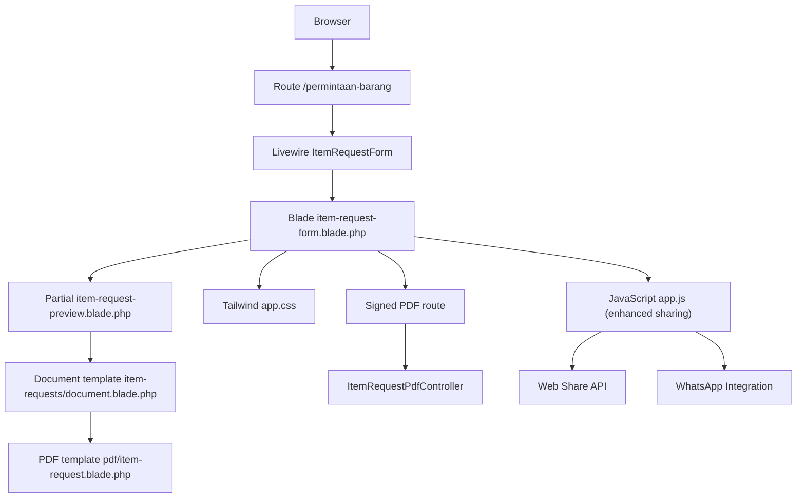
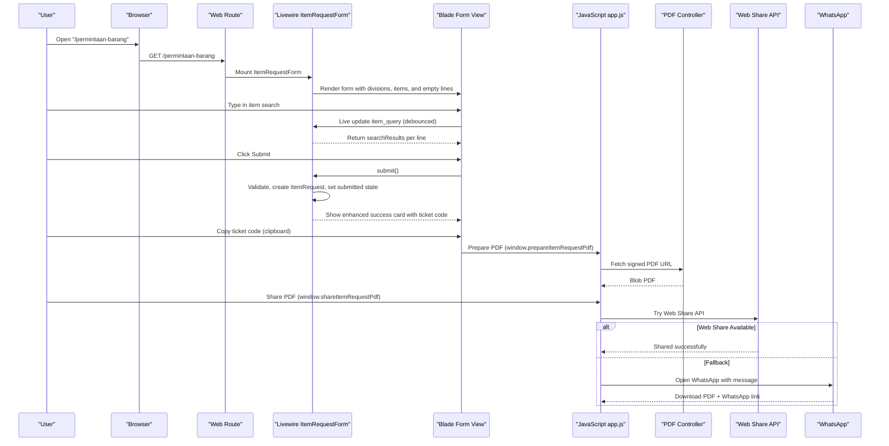
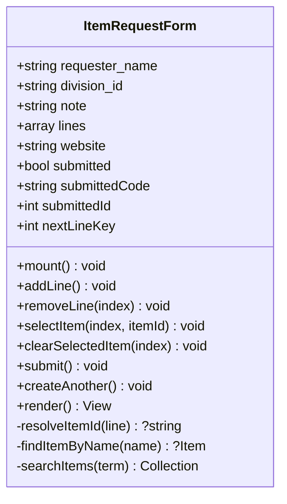
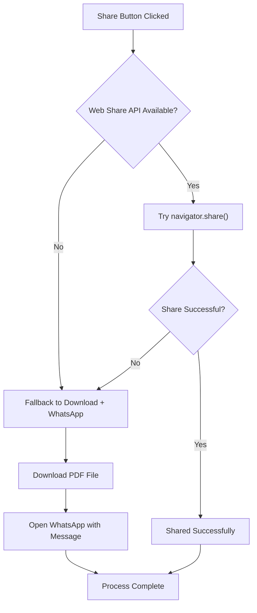
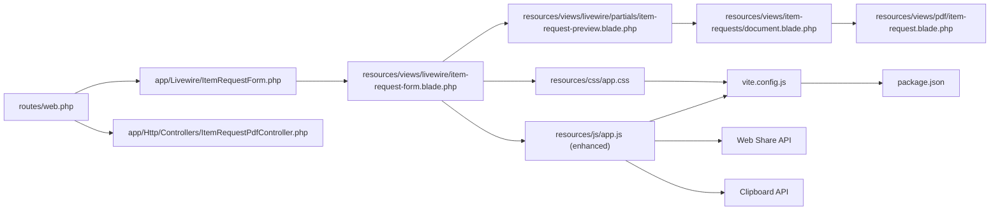

# Frontend Components

<cite>
**Referenced Files in This Document**
- [ItemRequestForm.php](file://app/Livewire/ItemRequestForm.php)
- [item-request-form.blade.php](file://resources/views/livewire/item-request-form.blade.php)
- [item-request-preview.blade.php](file://resources/views/livewire/partials/item-request-preview.blade.php)
- [document.blade.php](file://resources/views/item-requests/document.blade.php)
- [item-request.blade.php](file://resources/views/pdf/item-request.blade.php)
- [app.css](file://resources/css/app.css)
- [app.js](file://resources/js/app.js)
- [vite.config.js](file://vite.config.js)
- [package.json](file://package.json)
- [web.php](file://routes/web.php)
- [ItemRequestPdfController.php](file://app/Http/Controllers/ItemRequestPdfController.php)
</cite>

## Update Summary
**Changes Made**
- Enhanced success confirmation view with copy-to-clipboard functionality for ticket codes
- Integrated comprehensive PDF download and WhatsApp sharing capabilities
- Improved form layout with better accessibility and validation error display
- Added advanced sharing features with Web Share API and fallback mechanisms
- Simplified user interface with streamlined navigation and action buttons

## Table of Contents
1. [Introduction](#introduction)
2. [Project Structure](#project-structure)
3. [Core Components](#core-components)
4. [Architecture Overview](#architecture-overview)
5. [Detailed Component Analysis](#detailed-component-analysis)
6. [Enhanced Sharing Capabilities](#enhanced-sharing-capabilities)
7. [Improved Success Confirmation View](#improved-success-confirmation-view)
8. [Dependency Analysis](#dependency-analysis)
9. [Performance Considerations](#performance-considerations)
10. [Accessibility and Browser Compatibility](#accessibility-and-browser-compatibility)
11. [Troubleshooting Guide](#troubleshooting-guide)
12. [Conclusion](#conclusion)

## Introduction
This document explains the frontend layer for the item request feature with enhanced sharing capabilities and improved user experience. The system now features a redesigned success confirmation view with copy-to-clipboard functionality, integrated PDF download and WhatsApp sharing features, and a simplified form layout with better accessibility and validation error display. The goal is to help developers understand how the interactive form works, how state is managed, how real-time updates are achieved, and how the new sharing capabilities work.

## Project Structure
The frontend implementation spans several layers with enhanced sharing and success handling:

- Livewire component: `app/Livewire/ItemRequestForm.php`
- Blade views:
  - Main form view: `resources/views/livewire/item-request-form.blade.php`
  - Preview partial: `resources/views/livewire/partials/item-request-preview.blade.php`
  - Print/PDF document template: `resources/views/item-requests/document.blade.php`
  - PDF generation template: `resources/views/pdf/item-request.blade.php`
- Styles: `resources/css/app.css`
- JavaScript: `resources/js/app.js` (enhanced with sharing capabilities)
- Build configuration: `vite.config.js`, `package.json`
- Routing and controller: `routes/web.php`, `app/Http/Controllers/ItemRequestPdfController.php`

**Diagram sources**
- [web.php:11-17](file://routes/web.php#L11-L17)
- [ItemRequestForm.php:20-22](file://app/Livewire/ItemRequestForm.php#L20-L22)
- [item-request-form.blade.php:1-419](file://resources/views/livewire/item-request-form.blade.php#L1-L419)
- [item-request-preview.blade.php:1-4](file://resources/views/livewire/partials/item-request-preview.blade.php#L1-L4)
- [document.blade.php:1-398](file://resources/views/item-requests/document.blade.php#L1-L398)
- [item-request.blade.php:1-21](file://resources/views/pdf/item-request.blade.php#L1-L21)
- [app.css:1-11](file://resources/css/app.css#L1-L11)
- [app.js:1-70](file://resources/js/app.js#L1-L70)
- [ItemRequestPdfController.php:9-19](file://app/Http/Controllers/ItemRequestPdfController.php#L9-L19)

**Section sources**
- [web.php:11-17](file://routes/web.php#L11-L17)
- [ItemRequestForm.php:20-22](file://app/Livewire/ItemRequestForm.php#L20-L22)
- [item-request-form.blade.php:1-419](file://resources/views/livewire/item-request-form.blade.php#L1-L419)
- [item-request-preview.blade.php:1-4](file://resources/views/livewire/partials/item-request-preview.blade.php#L1-L4)
- [document.blade.php:1-398](file://resources/views/item-requests/document.blade.php#L1-L398)
- [item-request.blade.php:1-21](file://resources/views/pdf/item-request.blade.php#L1-L21)
- [app.css:1-11](file://resources/css/app.css#L1-L11)
- [app.js:1-70](file://resources/js/app.js#L1-L70)
- [vite.config.js:1-31](file://vite.config.js#L1-L31)
- [package.json:1-20](file://package.json#L1-L20)
- [ItemRequestPdfController.php:9-19](file://app/Http/Controllers/ItemRequestPdfController.php#L9-L19)

## Core Components
- Livewire component: `ItemRequestForm` manages form state, validation, line items, search results, submission flow, preview data, and enhanced sharing capabilities.
- Blade view: `livewire/item-request-form.blade.php` renders the interactive UI with sections for requester data, dynamic line items, submit actions, and an improved success confirmation view with copy-to-clipboard functionality.
- Preview partial: `livewire/partials/item-request-preview.blade.php` includes the print-ready document template for previewing a submitted request.
- Document template: `item-requests/document.blade.php` defines the A4 layout, table structure, and print styles used by both preview and PDF generation.
- PDF template: `pdf/item-request.blade.php` provides the PDF-specific wrapper for the document template.
- Styles: `resources/css/app.css` configures Tailwind v4, source scanning, and font theme.
- JavaScript: `resources/js/app.js` provides enhanced PDF preparation and sharing helpers using the Web Share API or fallback download with WhatsApp integration.
- Build: `vite.config.js` and `package.json` define inputs, plugins, fonts, dev server, and scripts.
- Routing and PDF controller: `routes/web.php` exposes the form and signed PDF endpoint; `ItemRequestPdfController.php` streams the generated PDF.

**Section sources**
- [ItemRequestForm.php:20-316](file://app/Livewire/ItemRequestForm.php#L20-L316)
- [item-request-form.blade.php:1-419](file://resources/views/livewire/item-request-form.blade.php#L1-L419)
- [item-request-preview.blade.php:1-4](file://resources/views/livewire/partials/item-request-preview.blade.php#L1-L4)
- [document.blade.php:1-398](file://resources/views/item-requests/document.blade.php#L1-L398)
- [item-request.blade.php:1-21](file://resources/views/pdf/item-request.blade.php#L1-L21)
- [app.css:1-11](file://resources/css/app.css#L1-L11)
- [app.js:1-70](file://resources/js/app.js#L1-L70)
- [vite.config.js:1-31](file://vite.config.js#L1-L31)
- [package.json:1-20](file://package.json#L1-L20)
- [web.php:11-17](file://routes/web.php#L11-L17)
- [ItemRequestPdfController.php:9-19](file://app/Http/Controllers/ItemRequestPdfController.php#L9-L19)

## Architecture Overview
The item request feature uses a Livewire-driven single-page-like experience within a Blade layout with enhanced sharing capabilities. The main entry point is a route that mounts the Livewire component. The component prepares data (divisions, active items, search results, and post-submission preview), while the Blade view handles interactivity through Livewire directives and Alpine.js for small client-side behaviors. After submission, users can preview the document, download a signed PDF, share it via the Web Share API, or use the enhanced WhatsApp sharing feature.

**Diagram sources**
- [web.php:11-17](file://routes/web.php#L11-L17)
- [ItemRequestForm.php:96-170](file://app/Livewire/ItemRequestForm.php#L96-L170)
- [item-request-form.blade.php:14-132](file://resources/views/livewire/item-request-form.blade.php#L14-L132)
- [app.js:1-70](file://resources/js/app.js#L1-L70)
- [ItemRequestPdfController.php:11-18](file://app/Http/Controllers/ItemRequestPdfController.php#L11-L18)

## Detailed Component Analysis

### Livewire Component: ItemRequestForm
Responsibilities:
- State management for requester name, division, note, hidden honeypot field, line items, submission flags, and next line key.
- Dynamic line management: add/remove lines, select/clear items, live search result computation.
- Validation rules and custom messages, including duplicate item prevention across lines.
- Submission logic wrapped in a database transaction, creating an `ItemRequest` and its lines.
- Post-submission state: show success, provide PDF URL, and prepare share message with enhanced formatting.
- Data preparation for the view: active divisions, active items with base unit of measure, per-line search results, and optional PDF/share data.

Key methods and properties:
- Public properties: `requester_name`, `division_id`, `note`, `lines`, `website`, `submitted`, `submittedCode`, `submittedId`, `nextLineKey`.
- Lifecycle and actions: `mount`, `addLine`, `removeLine`, `selectItem`, `clearSelectedItem`, `submit`, `createAnother`.
- Validation: `rules`, `messages`, plus custom validator hook for duplicate detection.
- Rendering: `render` loads divisions, items, computes search results, resolves submitted request, generates temporary signed PDF URL, and builds enhanced share message.
- Helpers: `resolveItemId`, `findItemByName`, `searchItems`.

State model overview:

**Diagram sources**
- [ItemRequestForm.php:20-316](file://app/Livewire/ItemRequestForm.php#L20-L316)

Validation and duplicate prevention flow:

**Diagram sources**
- [ItemRequestForm.php:96-170](file://app/Livewire/ItemRequestForm.php#L96-L170)

Real-time search and selection flow:

**Diagram sources**
- [item-request-form.blade.php:280-317](file://resources/views/livewire/item-request-form.blade.php#L280-L317)
- [ItemRequestForm.php:74-94](file://app/Livewire/ItemRequestForm.php#L74-L94)
- [ItemRequestForm.php:300-314](file://app/Livewire/ItemRequestForm.php#L300-L314)

**Section sources**
- [ItemRequestForm.php:20-316](file://app/Livewire/ItemRequestForm.php#L20-L316)

### Blade Template: item-request-form.blade.php
Structure:
- Header hero section with branding and quick guide.
- **Enhanced** Success confirmation view when `$submitted` is true:
  - Ticket code display with copy-to-clipboard via Alpine.js and visual feedback.
  - Preview partial inclusion with collapsible details element.
  - Action buttons: direct PDF download, enhanced WhatsApp sharing with progress indicators, create another, back to home.
- Main form when not submitted:
  - Section 1: Requester data (name, division, note) with improved accessibility labels.
  - Section 2: Dynamic list of requested items with:
    - Search input bound to `lines[index].item_query` with `.live.debounce.300ms`.
    - Master catalog dropdown populated from `$searchResults[index]`.
    - Selected item display card with "Ganti" action.
    - Quantity input, read-only unit display, and per-line note.
    - Add/remove line controls.
  - Honeypot anti-spam field (`website`).
  - Submit button with loading states controlled by Livewire directives.

Interactive features:
- Real-time search with debounced input.
- Live validation feedback per field with improved error display.
- Dynamic line addition/removal.
- Selection and clearing of items.
- **Enhanced** success state with ticket code copying and action buttons.
- Alpine.js-powered clipboard copy with visual feedback and PDF sharing UI state management.

Composition patterns:
- Uses `@include('livewire.partials.item-request-preview', ...)` to embed the document preview.
- Uses `@include('item-requests.document', ...)` inside the preview partial.
- Uses Tailwind utility classes extensively for responsive design and consistent visual hierarchy.

**Updated** The success confirmation view now includes copy-to-clipboard functionality for ticket codes and enhanced sharing options with progress indicators and error handling.

**Section sources**
- [item-request-form.blade.php:1-419](file://resources/views/livewire/item-request-form.blade.php#L1-L419)

### Preview Partial: item-request-preview.blade.php
Purpose:
- Wraps the document template in a scrollable container with accessible label.
- Includes the shared document template with mode set to preview.

Usage:
- Included only after successful submission when preview data is available.

**Section sources**
- [item-request-preview.blade.php:1-4](file://resources/views/livewire/partials/item-request-preview.blade.php#L1-L4)

### Document Template: item-requests/document.blade.php
Purpose:
- Defines the A4 print layout for item requests.
- Provides screen preview scaling and print-specific styles.
- Renders header, document information, item details table, reason section, and signature blocks.

Key aspects:
- Fixed-width paper container sized for A4.
- Tables with column widths for number, name/specification, quantity, and unit.
- Blank rows to ensure minimum height for print.
- Print media queries to hide non-document content and scale preview appropriately.
- Toolbar button to trigger browser print dialog.

**Section sources**
- [document.blade.php:1-398](file://resources/views/item-requests/document.blade.php#L1-L398)

### PDF Template: pdf/item-request.blade.php
Purpose:
- Provides the PDF-specific wrapper for the document template.
- Sets up proper PDF metadata and styling for DomPDF rendering.

Key aspects:
- Proper HTML structure for PDF generation.
- CSS @page rules for A4 paper size.
- Includes the shared document template with mode set to 'pdf'.

**Section sources**
- [item-request.blade.php:1-21](file://resources/views/pdf/item-request.blade.php#L1-L21)

### Styling: Tailwind CSS and Custom Theme
Configuration:
- Imports Tailwind v4 and sets source paths for Blade views and pagination views.
- Defines a theme font family for sans-serif text.

Implementation:
- Extensive use of Tailwind utility classes for spacing, typography, colors, borders, shadows, focus rings, and responsive layouts.
- Consistent visual language across form fields, cards, badges, and buttons.
- Enhanced success confirmation styling with emerald color scheme and improved visual hierarchy.

Optimization:
- Source scanning ensures only used classes are included.
- Font theme configured via Vite plugin for efficient delivery.

**Section sources**
- [app.css:1-11](file://resources/css/app.css#L1-L11)

### JavaScript: Enhanced PDF Preparation and Sharing
Functions:
- `prepareItemRequestPdf(pdfUrl, code)`:
  - Fetches the signed PDF blob once per URL with caching mechanism.
  - Caches the blob, File object, and filename for reuse.
  - Throws errors if fetch fails or PDF is not ready.
- `shareItemRequestPdf(pdfUrl, code, message)`:
  - Attempts native Web Share API with files if supported and available.
  - Falls back to downloading the PDF and opening WhatsApp with a pre-filled message.
  - Manages object URLs and cleanup automatically.
  - Provides detailed error handling and user feedback.

Integration:
- Called from Alpine.js bindings in the enhanced success card.
- Provides user feedback for preparation, sharing states, and error conditions.
- Integrates seamlessly with the improved UI components.

**Updated** Enhanced with comprehensive error handling, file caching, and improved fallback mechanisms for broader browser compatibility.

**Section sources**
- [app.js:1-70](file://resources/js/app.js#L1-L70)
- [item-request-form.blade.php:95-111](file://resources/views/livewire/item-request-form.blade.php#L95-L111)

### Build Process: Vite and Assets
Inputs:
- CSS: `resources/css/app.css`, `resources/css/filament/admin/theme.css`
- JS: `resources/js/app.js`

Plugins:
- Laravel Vite plugin for asset pipeline integration.
- Tailwind CSS plugin for processing Tailwind utilities.
- Font plugin to serve Instrument Sans with specified weights.

Dev server:
- Port 5174 with strict port enforcement.
- Ignores compiled Blade views during watch to avoid unnecessary rebuilds.

Scripts:
- `npm run dev` starts development server.
- `npm run build` produces production assets.

**Section sources**
- [vite.config.js:1-31](file://vite.config.js#L1-L31)
- [package.json:1-20](file://package.json#L1-L20)

### Routing and PDF Controller
Routing:
- `/permintaan-barang` mounts the Livewire component with throttling middleware.
- `/permintaan-barang/{itemRequest}/pdf` serves a signed PDF stream.

PDF controller:
- Loads relationships for division, lines, items, and base units.
- Streams a PDF generated from `pdf.item-request` view with A4 paper size.

**Section sources**
- [web.php:11-17](file://routes/web.php#L11-L17)
- [ItemRequestPdfController.php:9-19](file://app/Http/Controllers/ItemRequestPdfController.php#L9-L19)

## Enhanced Sharing Capabilities

### Web Share API Integration
The enhanced sharing system leverages the modern Web Share API when available, providing native sharing experiences on supported devices and browsers.

Key features:
- Native file sharing with PDF attachments when supported.
- Automatic fallback to download + WhatsApp integration.
- Comprehensive error handling and user feedback.
- Memory-efficient file caching to prevent repeated downloads.

### WhatsApp Integration
When Web Share API is unavailable, the system automatically falls back to WhatsApp integration:
- Downloads the PDF file locally.
- Opens WhatsApp with a pre-formatted message containing all request details.
- Provides clear instructions for attaching the downloaded PDF.

### Error Handling and User Feedback
- Visual progress indicators during PDF preparation and sharing.
- Clear error messages for failed operations.
- Graceful degradation when APIs are unavailable.
- Automatic cleanup of temporary objects and URLs.

**Diagram sources**
- [app.js:24-69](file://resources/js/app.js#L24-L69)
- [item-request-form.blade.php:95-111](file://resources/views/livewire/item-request-form.blade.php#L95-L111)

**Section sources**
- [app.js:1-70](file://resources/js/app.js#L1-L70)
- [item-request-form.blade.php:95-111](file://resources/views/livewire/item-request-form.blade.php#L95-L111)

## Improved Success Confirmation View

### Copy-to-Clipboard Functionality
The success confirmation view now includes sophisticated copy-to-clipboard functionality:
- One-click copying of ticket codes with visual feedback.
- Temporary state changes showing "Copied" status.
- Automatic return to original state after 2.5 seconds.
- Accessible icons that change based on copy state.

### Enhanced Action Buttons
Streamlined action buttons with improved UX:
- Direct PDF download button with descriptive icon.
- Enhanced WhatsApp sharing button with progress indicators.
- Create new request button for quick repetition.
- Back to home navigation for easy exit.

### Collapsible Document Preview
- Details element for toggling document preview visibility.
- Smooth animations for expand/collapse interactions.
- Accessible labeling for screen readers.
- Responsive design that adapts to different screen sizes.

### Visual Design Improvements
- Emerald color scheme for success states.
- Consistent spacing and typography.
- Improved contrast ratios for accessibility.
- Mobile-responsive layout with flexible grid systems.

**Updated** The success confirmation view has been completely redesigned with copy-to-clipboard functionality, enhanced action buttons, and improved visual hierarchy.

**Section sources**
- [item-request-form.blade.php:14-132](file://resources/views/livewire/item-request-form.blade.php#L14-L132)

## Dependency Analysis
High-level dependencies:
- Routes depend on Livewire component and PDF controller.
- Livewire component depends on models (Division, Item, ItemRequest), database transactions, URL generator, and validation.
- Blade view depends on Livewire state, Tailwind classes, and Alpine.js attributes.
- JavaScript depends on browser APIs (fetch, navigator.share, File, Clipboard API).
- Vite depends on Laravel Vite plugin, Tailwind plugin, and font plugin.

**Diagram sources**
- [web.php:11-17](file://routes/web.php#L11-L17)
- [ItemRequestForm.php:20-316](file://app/Livewire/ItemRequestForm.php#L20-L316)
- [item-request-form.blade.php:1-419](file://resources/views/livewire/item-request-form.blade.php#L1-L419)
- [item-request-preview.blade.php:1-4](file://resources/views/livewire/partials/item-request-preview.blade.php#L1-L4)
- [document.blade.php:1-398](file://resources/views/item-requests/document.blade.php#L1-L398)
- [item-request.blade.php:1-21](file://resources/views/pdf/item-request.blade.php#L1-L21)
- [app.css:1-11](file://resources/css/app.css#L1-L11)
- [app.js:1-70](file://resources/js/app.js#L1-L70)
- [vite.config.js:1-31](file://vite.config.js#L1-L31)
- [package.json:1-20](file://package.json#L1-L20)
- [ItemRequestPdfController.php:9-19](file://app/Http/Controllers/ItemRequestPdfController.php#L9-L19)

**Section sources**
- [web.php:11-17](file://routes/web.php#L11-L17)
- [ItemRequestForm.php:20-316](file://app/Livewire/ItemRequestForm.php#L20-L316)
- [item-request-form.blade.php:1-419](file://resources/views/livewire/item-request-form.blade.php#L1-L419)
- [item-request-preview.blade.php:1-4](file://resources/views/livewire/partials/item-request-preview.blade.php#L1-L4)
- [document.blade.php:1-398](file://resources/views/item-requests/document.blade.php#L1-L398)
- [item-request.blade.php:1-21](file://resources/views/pdf/item-request.blade.php#L1-L21)
- [app.css:1-11](file://resources/css/app.css#L1-L11)
- [app.js:1-70](file://resources/js/app.js#L1-L70)
- [vite.config.js:1-31](file://vite.config.js#L1-L31)
- [package.json:1-20](file://package.json#L1-L20)
- [ItemRequestPdfController.php:9-19](file://app/Http/Controllers/ItemRequestPdfController.php#L9-L19)

## Performance Considerations
- Debounced live search reduces server round-trips while typing.
- Locked property for `submittedId` prevents unnecessary revalidation and keeps the ID stable across Livewire updates.
- Transactional submission ensures atomic persistence of request and lines.
- Signed PDF URL limits exposure and expiration reduces risk.
- Vite ignores compiled Blade views during watch to speed up development.
- Tailwind source scanning minimizes CSS payload by including only used classes.
- **Enhanced** PDF blob caching avoids repeated network requests for the same PDF URL.
- **New** Memory-efficient file caching prevents memory leaks and improves performance.
- **New** Progressive enhancement ensures graceful degradation on older browsers.

[No sources needed since this section provides general guidance]

## Accessibility and Browser Compatibility
Accessibility considerations:
- Use of semantic headings and labels improves screen reader navigation.
- Error messages include descriptive text and icons; consider adding `role="alert"` where appropriate.
- Interactive elements have visible focus rings and keyboard-friendly behavior.
- Hidden honeypot field uses `aria-hidden="true"` and negative tabindex to avoid interfering with assistive technology.
- Preview container has an accessible label describing its purpose.
- **Enhanced** Copy-to-clipboard functionality includes proper ARIA labels and screen reader announcements.
- **Enhanced** Success confirmation view uses semantic HTML and proper heading hierarchy.

Browser compatibility:
- Web Share API with files requires modern browsers; fallback to download and WhatsApp link is implemented.
- Clipboard API usage should be guarded by environment checks; current implementation assumes availability in the success card context.
- Print styles rely on standard CSS @media print; test across browsers for consistent output.
- **Enhanced** Comprehensive fallback mechanisms ensure functionality across all major browsers.
- **Enhanced** Feature detection prevents errors on unsupported platforms.

Recommendations:
- Add explicit `aria-live="polite"` regions for dynamic validation messages.
- Ensure all SVG icons have `aria-hidden="true"` and meaningful text alternatives.
- Test Web Share fallback behavior on iOS Safari and older Android browsers.
- **New** Test clipboard functionality across different mobile and desktop environments.
- **New** Verify WhatsApp integration works correctly on various platforms.

**Updated** Enhanced accessibility features and improved browser compatibility with comprehensive fallback mechanisms.

**Section sources**
- [item-request-form.blade.php:34-49](file://resources/views/livewire/item-request-form.blade.php#L34-L49)
- [item-request-form.blade.php:387-390](file://resources/views/livewire/item-request-form.blade.php#L387-L390)
- [item-request-preview.blade.php:1-4](file://resources/views/livewire/partials/item-request-preview.blade.php#L1-L4)
- [app.js:24-69](file://resources/js/app.js#L24-L69)

## Troubleshooting Guide
Common issues and resolutions:
- Search returns no results:
  - Verify item names/codes exist and are active.
  - Check that `searchItems` query matches expected columns and filters.
- Duplicate item error:
  - Ensure each line selects a unique item or manual name.
  - Review duplicate detection logic in the validator hook.
- Submission fails validation:
  - Inspect per-field error messages and ensure required fields are filled.
  - Confirm division exists and is active.
- PDF not ready when sharing:
  - Call `prepareItemRequestPdf` before sharing.
  - Handle errors thrown by the function and inform the user.
- Web Share not available:
  - Fallback will download the PDF and open WhatsApp; verify the fallback message and link.
- **New** Copy-to-clipboard not working:
  - Check browser security settings and HTTPS requirements.
  - Verify user interaction context for clipboard access.
- **New** WhatsApp integration issues:
  - Ensure WhatsApp is installed and accessible on the device.
  - Verify message formatting and URL encoding.

Operational tips:
- Use browser developer tools to inspect Livewire network requests and Blade-rendered HTML.
- Check Vite dev server logs for asset compilation issues.
- Validate Tailwind classes and ensure source paths are correct in `app.css`.
- **New** Monitor console errors for JavaScript-related issues.
- **New** Test sharing functionality across different devices and browsers.

**Updated** Added troubleshooting guidance for new sharing and clipboard features.

**Section sources**
- [ItemRequestForm.php:96-170](file://app/Livewire/ItemRequestForm.php#L96-L170)
- [ItemRequestForm.php:300-314](file://app/Livewire/ItemRequestForm.php#L300-L314)
- [app.js:1-70](file://resources/js/app.js#L1-L70)
- [app.css:1-11](file://resources/css/app.css#L1-L11)

## Conclusion
The item request frontend combines Livewire's reactive components with Blade templating, Tailwind CSS styling, and lightweight JavaScript utilities. The architecture emphasizes clarity, maintainability, and user experience: real-time search, robust validation, transactional submission, and flexible PDF handling. With Vite managing assets and Tailwind optimizing styles, the system delivers a responsive, accessible, and performant interface suitable for operational workflows.

**Enhanced** The recent improvements include sophisticated sharing capabilities with Web Share API integration, comprehensive fallback mechanisms, improved success confirmation view with copy-to-clipboard functionality, and enhanced accessibility features. These additions make the system more user-friendly, accessible, and compatible across different devices and browsers while maintaining the core functionality and performance characteristics.

[No sources needed since this section summarizes without analyzing specific files]