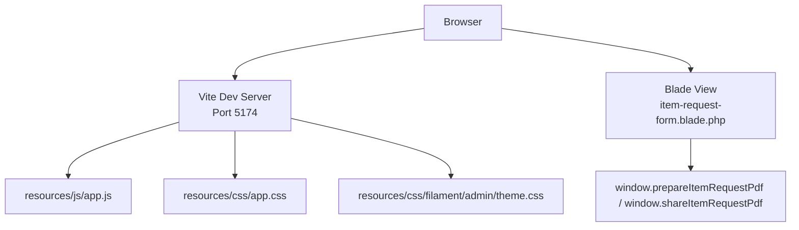
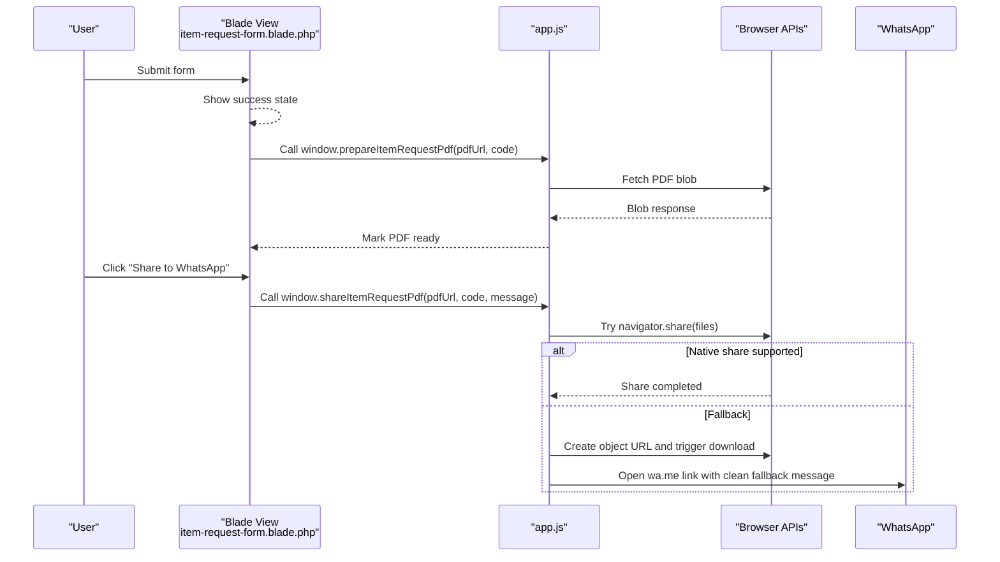
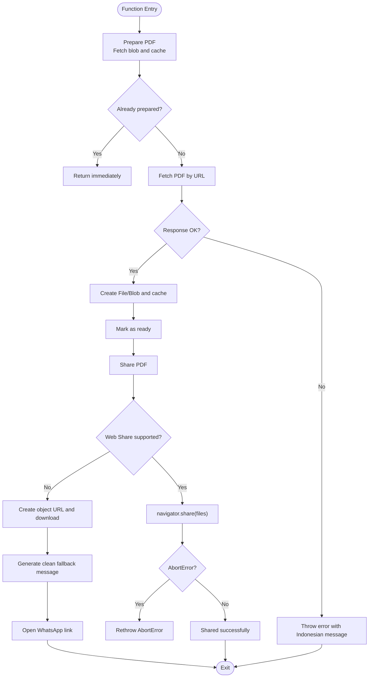
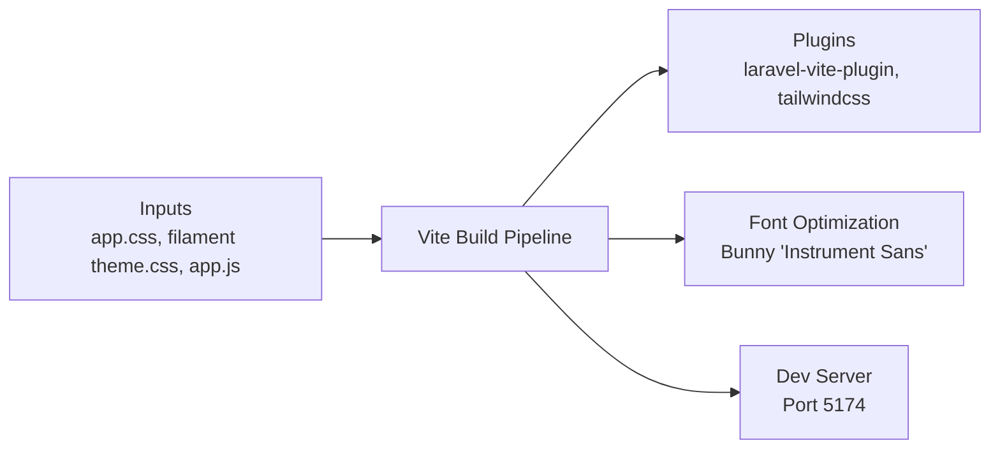
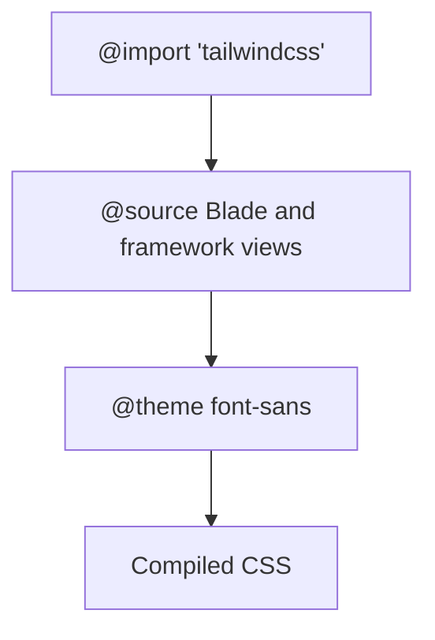
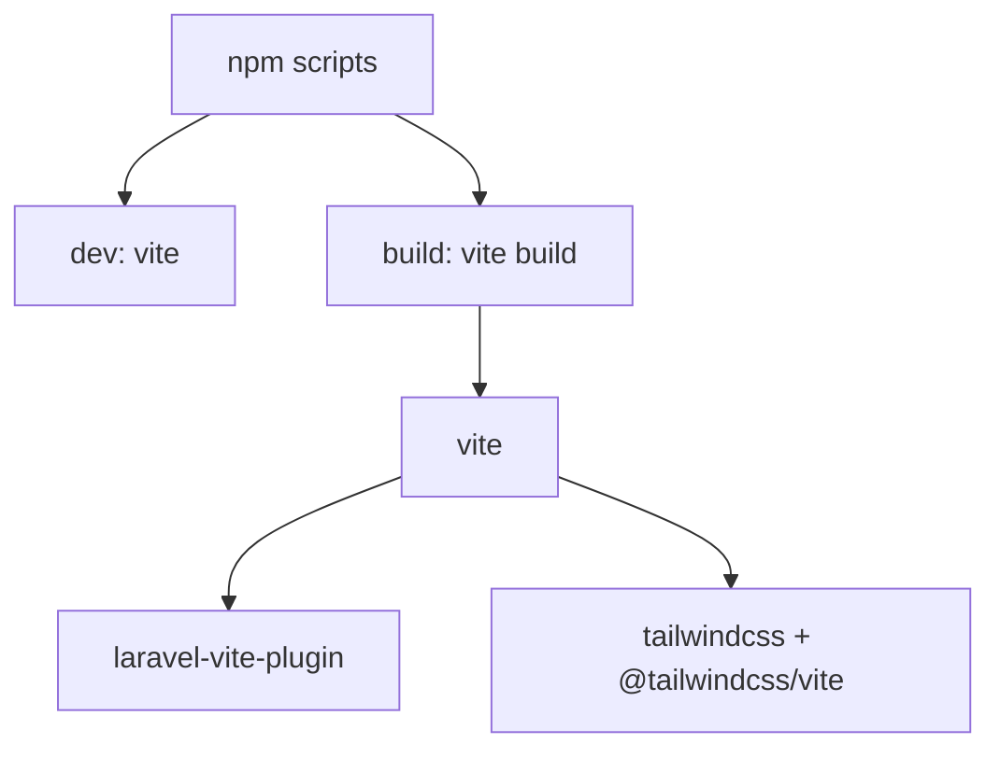

# JavaScript and Assets

<cite>
**Referenced Files in This Document**
- [app.js](file://resources/js/app.js)
- [vite.config.js](file://vite.config.js)
- [package.json](file://package.json)
- [app.css](file://resources/css/app.css)
- [item-request-form.blade.php](file://resources/views/livewire/item-request-form.blade.php)
</cite>

## Update Summary
**Changes Made**
- Updated JavaScript sharing functionality documentation to reflect enhanced error handling and cleaner fallback messaging
- Enhanced PDF sharing workflow documentation with improved user experience details
- Updated troubleshooting guide with new error handling patterns
- Refined architecture diagrams to show improved share operation flow

## Table of Contents
1. [Introduction](#introduction)
2. [Project Structure](#project-structure)
3. [Core Components](#core-components)
4. [Architecture Overview](#architecture-overview)
5. [Detailed Component Analysis](#detailed-component-analysis)
6. [Dependency Analysis](#dependency-analysis)
7. [Performance Considerations](#performance-considerations)
8. [Troubleshooting Guide](#troubleshooting-guide)
9. [Conclusion](#conclusion)
10. [Appendices](#appendices)

## Introduction
This document explains the frontend JavaScript setup and asset management for the project. It focuses on:
- The minimal client-side logic in `resources/js/app.js` with enhanced PDF sharing capabilities.
- How Vite compiles CSS, fonts, and JavaScript.
- The role of Blade and Livewire in invoking JavaScript.
- Package dependencies and their purposes.
- Production build behavior, including bundling, minification, and cache busting.
- Guidance for extending functionality, integrating third-party libraries, and optimizing performance.

## Project Structure
The frontend assets are organized under `resources/`:
- `resources/js/app.js` is the main JavaScript entry point with enhanced sharing functionality.
- `resources/css/app.css` configures Tailwind CSS and theme variables.
- `resources/css/filament/admin/theme.css` is included as a separate input for Filament admin styling.
- Blade views under `resources/views/` integrate with the compiled assets through Laravel's Vite integration.

**Diagram sources**
- [vite.config.js:6-22](file://vite.config.js#L6-L22)
- [item-request-form.blade.php:95-110](file://resources/views/livewire/item-request-form.blade.php#L95-L110)

**Section sources**
- [vite.config.js:6-22](file://vite.config.js#L6-L22)
- [app.css:1-11](file://resources/css/app.css#L1-L11)
- [item-request-form.blade.php:95-110](file://resources/views/livewire/item-request-form.blade.php#L95-L110)

## Core Components
- `resources/js/app.js`: Exposes two global functions used by the Blade/Livewire UI to prepare and share PDFs with enhanced error handling and cleaner fallback messaging.
- `resources/css/app.css`: Sets up Tailwind CSS v4, source scanning for Blade templates, and font theme configuration.
- `vite.config.js`: Defines inputs, plugins (Laravel Vite plugin, Tailwind), font optimization via Bunny, and development server settings.
- `package.json`: Declares scripts and dependencies for building and developing assets.

Key responsibilities:
- JavaScript handles PDF preparation, caching, native sharing when available, and streamlined fallback download plus WhatsApp link opening with improved user feedback.
- CSS uses Tailwind v4 with explicit source scanning so utility classes generated from Blade templates are included.
- Vite integrates with Laravel, compiles inputs, and serves them during development.

**Section sources**
- [app.js:1-70](file://resources/js/app.js#L1-L70)
- [app.css:1-11](file://resources/css/app.css#L1-L11)
- [vite.config.js:6-29](file://vite.config.js#L6-L29)
- [package.json:1-20](file://package.json#L1-L20)

## Architecture Overview
The frontend architecture is intentionally minimal with enhanced user experience:
- Blade renders the UI and injects data into Alpine.js state.
- On success, the view triggers PDF preparation via `window.prepareItemRequestPdf`.
- When ready, the user can share via the Web Share API or fall back to downloading and opening WhatsApp with cleaner messaging.

**Diagram sources**
- [item-request-form.blade.php:95-110](file://resources/views/livewire/item-request-form.blade.php#L95-L110)
- [app.js:3-69](file://resources/js/app.js#L3-L69)

## Detailed Component Analysis

### JavaScript Entry Point: `resources/js/app.js`
Purpose:
- Provide a small, focused API for preparing and sharing item request PDFs.
- Cache prepared PDFs to avoid redundant network requests.
- Use modern browser APIs where available, with graceful fallbacks and improved error handling.

Behavior summary:
- `prepareItemRequestPdf(pdfUrl, code)` fetches the PDF once per URL, stores it in memory, and creates a safe filename based on the provided code.
- `shareItemRequestPdf(pdfUrl, code, message)` attempts to use the Web Share API with the cached PDF file. If unavailable, it falls back to creating a temporary object URL, triggering a download, and opening a WhatsApp link with a pre-filled message using cleaner fallback messaging.

Enhanced error handling:
- Network errors during PDF fetch throw descriptive Indonesian error messages.
- Share failures handle AbortError specifically while ignoring other non-abort errors.
- The fallback path always opens WhatsApp after initiating the download with improved user feedback.
- Improved status indicators in the UI provide better user experience during share operations.

**Diagram sources**
- [app.js:3-69](file://resources/js/app.js#L3-L69)

Integration points:
- Blade invokes these functions via Alpine.js bindings in the success state of the item request form with enhanced status indicators.

**Section sources**
- [app.js:1-70](file://resources/js/app.js#L1-L70)
- [item-request-form.blade.php:95-110](file://resources/views/livewire/item-request-form.blade.php#L95-L110)

### Vite Configuration: `vite.config.js`
Inputs:
- `resources/css/app.css`
- `resources/css/filament/admin/theme.css`
- `resources/js/app.js`

Plugins:
- `laravel-vite-plugin`: Integrates with Laravel, enables hot module replacement, and manages asset paths.
- `@tailwindcss/vite`: Enables Tailwind CSS v4 processing.

Fonts:
- Uses `laravel-vite-plugin/fonts` with Bunny to optimize and serve the "Instrument Sans" font at specified weights.

Development server:
- Runs on port `5174`, strict mode enabled.
- Ignores compiled Blade views to prevent unnecessary reloads.

**Diagram sources**
- [vite.config.js:6-29](file://vite.config.js#L6-L29)

**Section sources**
- [vite.config.js:6-29](file://vite.config.js#L6-L29)

### CSS Setup: `resources/css/app.css`
Tailwind v4 configuration:
- Imports Tailwind via `@import 'tailwindcss'`.
- Scans Blade templates and framework pagination views using `@source` directives.
- Defines a theme variable for the sans font stack, relying on the optimized "Instrument Sans" font configured in Vite.

**Diagram sources**
- [app.css:1-11](file://resources/css/app.css#L1-L11)

**Section sources**
- [app.css:1-11](file://resources/css/app.css#L1-L11)

### Blade Integration: `resources/views/livewire/item-request-form.blade.php`
Role:
- Renders the item request form and success state.
- Uses Alpine.js (`x-data`, `x-init`) to manage local UI state with enhanced status indicators.
- Invokes global JavaScript functions exposed by `app.js` to prepare and share PDFs.

Enhanced interactions:
- On success, `x-init` calls `window.prepareItemRequestPdf` with the PDF URL and request code.
- A button click calls `window.shareItemRequestPdf` with the PDF URL, code, and share message.
- Improved error handling with user-friendly messages and better status indicators.
- Streamlined user experience with clear visual feedback during PDF preparation and sharing operations.

**Section sources**
- [item-request-form.blade.php:95-110](file://resources/views/livewire/item-request-form.blade.php#L95-L110)

## Dependency Analysis
Dependencies and their roles:
- `vite`: Frontend build tool and dev server.
- `laravel-vite-plugin`: Bridges Vite with Laravel, enabling asset injection and HMR.
- `tailwindcss` and `@tailwindcss/vite`: Tailwind CSS v4 and its Vite integration.
- `concurrently`: Utility for running multiple commands concurrently (available but not used directly in scripts).
- `@laravel/multiplex`: Optional dependency for real-time features (not required for current frontend flow).

Scripts:
- `npm run dev`: Starts the Vite development server.
- `npm run build`: Produces production assets.

**Diagram sources**
- [package.json:5-18](file://package.json#L5-L18)

**Section sources**
- [package.json:1-20](file://package.json#L1-L20)

## Performance Considerations
- Keep `app.js` minimal: It currently performs only essential operations (fetch, cache, share/download). Avoid adding heavy logic here.
- Leverage caching: PDF blobs are cached per URL to prevent repeated downloads.
- Prefer native APIs: The Web Share API provides a better UX when available; fallbacks ensure compatibility.
- Font optimization: Using Bunny via Vite reduces font payload and improves load times.
- Tailwind v4 scanning: Explicit `@source` directives ensure only needed utilities are included.
- Development server: Port `5174` avoids conflicts; ignoring compiled Blade views prevents unnecessary reloads.
- Enhanced error handling: Improved user feedback reduces confusion and support requests.

## Troubleshooting Guide
Common issues and resolutions:
- PDF fails to prepare:
  - Verify the PDF URL is accessible and returns a valid PDF.
  - Check network errors thrown by the fetch call with Indonesian error messages.
- Share button does nothing:
  - Ensure the browser supports `navigator.canShare` and `navigator.share`.
  - If unsupported, the fallback will download the PDF and open WhatsApp with cleaner messaging.
- Alpine state not updating:
  - Confirm that `x-init` runs and that `window.prepareItemRequestPdf` resolves successfully.
  - Inspect local Alpine state variables (`isPreparingPdf`, `isPdfReady`, `isSharing`, `shareError`).
- Enhanced error handling:
  - Check for specific AbortError cases that should be rethrown.
  - Verify that fallback messaging displays correctly in Indonesian.

Operational checks:
- Confirm Vite dev server is running on port `5174`.
- Ensure Blade templates include the necessary data (`pdfUrl`, `code`, `shareMessage`) passed to JavaScript.
- Test both native sharing and fallback scenarios to ensure proper user experience.

**Section sources**
- [app.js:3-69](file://resources/js/app.js#L3-L69)
- [item-request-form.blade.php:95-110](file://resources/views/livewire/item-request-form.blade.php#L95-L110)

## Conclusion
The frontend is intentionally lightweight with enhanced user experience:
- `app.js` exposes a small, robust API for preparing and sharing PDFs with improved error handling and cleaner fallback messaging.
- Vite compiles CSS and JS, integrates with Laravel, and optimizes fonts.
- Blade and Livewire orchestrate the user flow and invoke JavaScript at the right moments with enhanced status indicators.
- Dependencies are minimal and purpose-driven, focusing on development experience and efficient production builds.
- The enhanced sharing workflow provides better user feedback and more reliable fallback behavior.

## Appendices

### Extending JavaScript Functionality
- Add new global functions to `resources/js/app.js` and expose them via `window`.
- Invoke these functions from Blade using Alpine.js bindings similar to existing patterns.
- Keep side effects minimal and prefer returning promises for asynchronous operations.
- Follow the established error handling patterns with descriptive Indonesian messages.

### Integrating Third-Party Libraries
- Install packages via npm/yarn/pnpm.
- Import libraries in `resources/js/app.js` or dedicated modules.
- Re-export or attach to `window` if Blade needs direct access.
- Ensure library assets are compatible with Vite and do not conflict with Tailwind.

### Optimizing Frontend Performance
- Split large libraries into lazy-loaded modules if needed.
- Use Vite's code splitting and tree-shaking by importing only what you need.
- Monitor bundle size with Vite's built-in analysis tools.
- Keep Tailwind scanning accurate to avoid unused styles.
- Maintain the enhanced error handling patterns for better user experience.