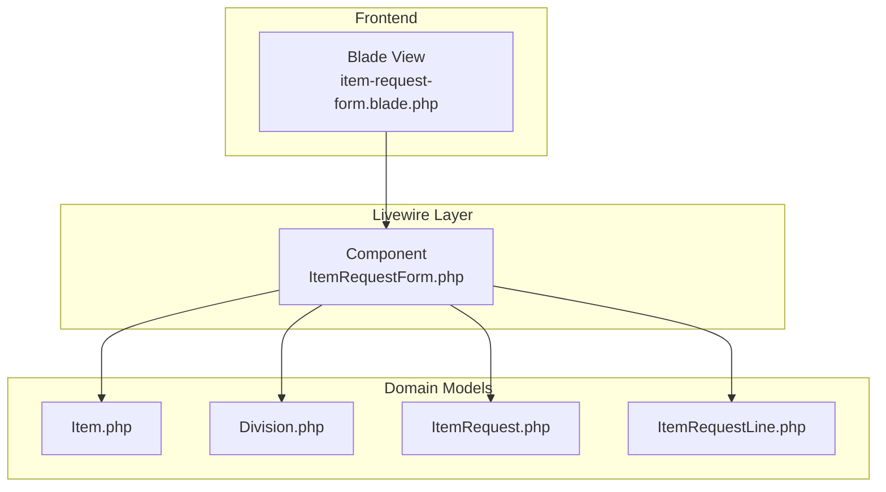
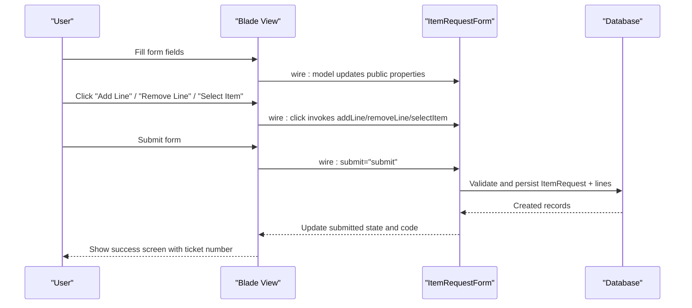
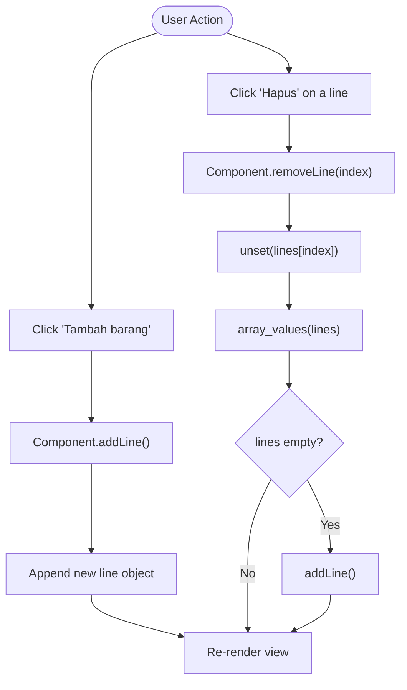
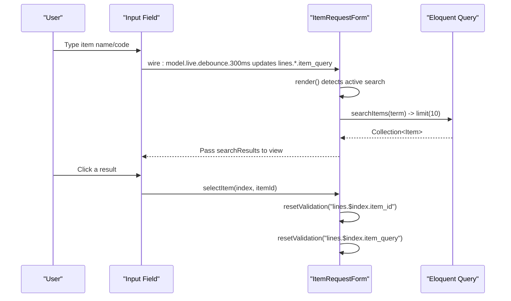
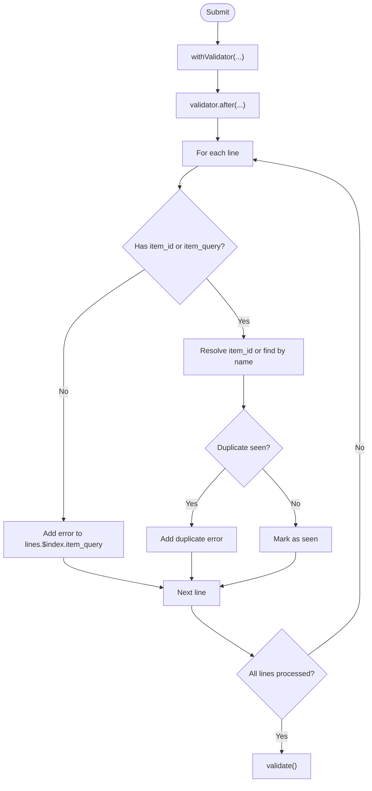
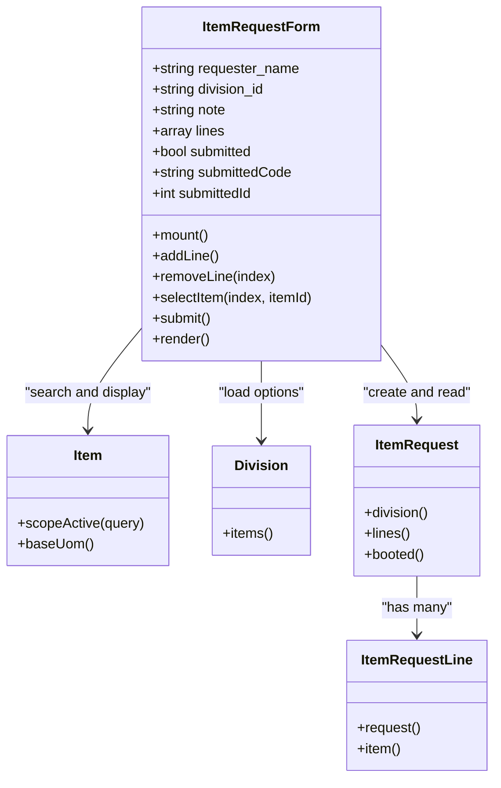
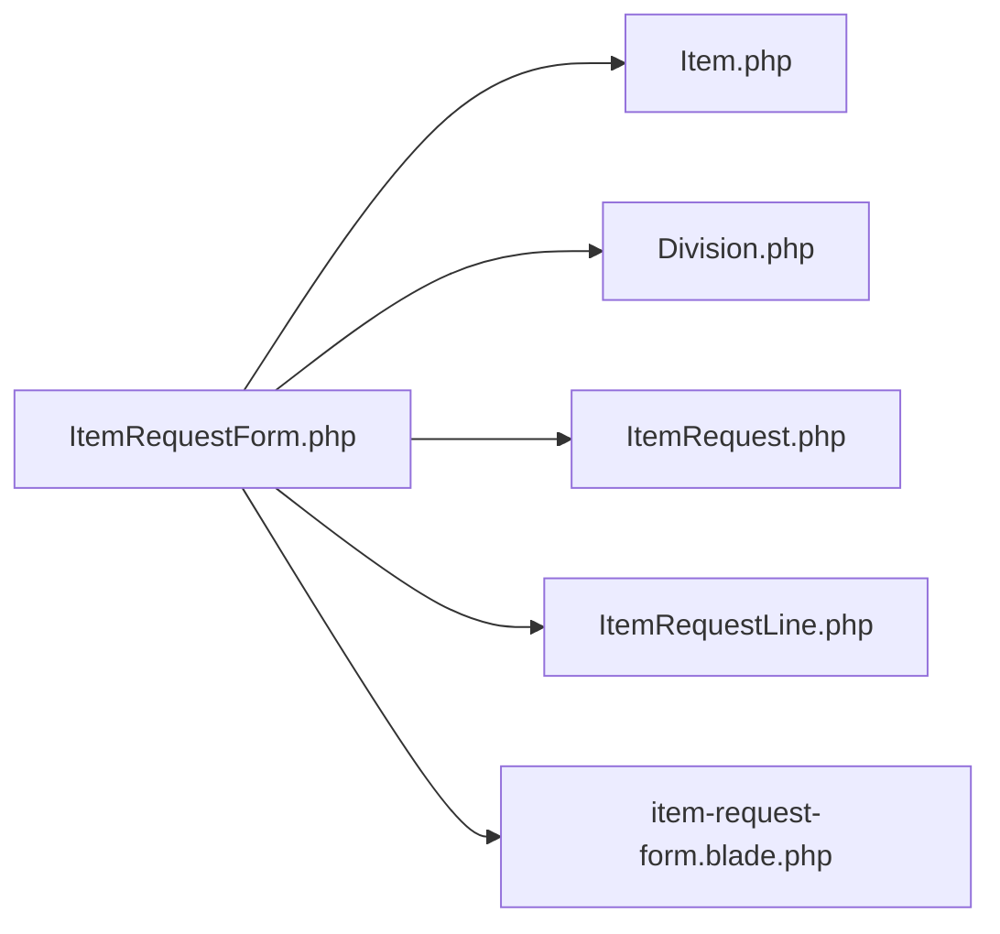

# Livewire Components

<cite>
**Referenced Files in This Document**   
- [ItemRequestForm.php](file://app/Livewire/ItemRequestForm.php)
- [item-request-form.blade.php](file://resources/views/livewire/item-request-form.blade.php)
- [Item.php](file://app/Models/Item.php)
- [Division.php](file://app/Models/Division.php)
- [ItemRequest.php](file://app/Models/ItemRequest.php)
- [ItemRequestLine.php](file://app/Models/ItemRequestLine.php)
</cite>

## Table of Contents
1. [Introduction](#introduction)
2. [Project Structure](#project-structure)
3. [Core Components](#core-components)
4. [Architecture Overview](#architecture-overview)
5. [Detailed Component Analysis](#detailed-component-analysis)
6. [Dependency Analysis](#dependency-analysis)
7. [Performance Considerations](#performance-considerations)
8. [Troubleshooting Guide](#troubleshooting-guide)
9. [Conclusion](#conclusion)

## Introduction
This document explains the Livewire-based Item Request Form component, using `ItemRequestForm` as the primary example. It covers state management, interactive features, validation, lifecycle methods, data binding, event handling, backend integration with Eloquent models, and performance considerations for large datasets.

The form allows a requester to:
- Provide requester identity and division
- Add multiple line items
- Search master items or enter manual item names
- Validate and submit requests
- View submission confirmation, download PDF, and share via WhatsApp

## Project Structure
The feature is implemented as a Livewire component paired with a Blade view and backed by Eloquent models.

**Diagram sources**
- [item-request-form.blade.php:1-584](file://resources/views/livewire/item-request-form.blade.php#L1-L584)
- [ItemRequestForm.php:1-305](file://app/Livewire/ItemRequestForm.php#L1-L305)
- [Item.php:1-173](file://app/Models/Item.php#L1-L173)
- [Division.php:1-32](file://app/Models/Division.php#L1-L32)
- [ItemRequest.php:1-135](file://app/Models/ItemRequest.php#L1-L135)
- [ItemRequestLine.php:1-80](file://app/Models/ItemRequestLine.php#L1-L80)

**Section sources**
- [ItemRequestForm.php:1-305](file://app/Livewire/ItemRequestForm.php#L1-L305)
- [item-request-form.blade.php:1-584](file://resources/views/livewire/item-request-form.blade.php#L1-L584)

## Core Components
- Livewire component: `ItemRequestForm`
- Blade view: `livewire.item-request-form`
- Domain models: `Item`, `Division`, `ItemRequest`, `ItemRequestLine`

Key responsibilities:
- Component manages public state, validation, search, and persistence
- Blade renders the UI, binds inputs, and triggers component actions
- Models define entities, relationships, scopes, and business rules

**Section sources**
- [ItemRequestForm.php:20-49](file://app/Livewire/ItemRequestForm.php#L20-L49)
- [item-request-form.blade.php:179-582](file://resources/views/livewire/item-request-form.blade.php#L179-L582)
- [Item.php:158-161](file://app/Models/Item.php#L158-L161)
- [Division.php:11-30](file://app/Models/Division.php#L11-L30)
- [ItemRequest.php:52-59](file://app/Models/ItemRequest.php#L52-L59)
- [ItemRequestLine.php:55-63](file://app/Models/ItemRequestLine.php#L55-L63)

## Architecture Overview
The component follows a typical Livewire pattern:
- Public properties hold form state
- Methods handle user interactions and persistence
- Blade uses `wire:model` and `wire:click` to bind events
- Data is loaded in `render()` and passed to the view

**Diagram sources**
- [item-request-form.blade.php:179-582](file://resources/views/livewire/item-request-form.blade.php#L179-L582)
- [ItemRequestForm.php:46-169](file://app/Livewire/ItemRequestForm.php#L46-L169)
- [ItemRequestForm.php:95-152](file://app/Livewire/ItemRequestForm.php#L95-L152)

## Detailed Component Analysis

### State Management
Public properties:
- `requester_name`: string
- `division_id`: string
- `note`: string
- `lines`: array of line objects with keys `key`, `item_id`, `item_query`, `quantity`, `note`
- `website`: honeypot field for anti-spam
- `submitted`: boolean flag for success view
- `submittedCode`: generated request code
- `submittedId`: locked integer ID used to fetch submitted request details
- `nextLineKey`: auto-incrementing key for stable line rendering

Submission states:
- `submitted` toggles between form and success views
- `submittedCode` displays the official ticket number
- `submittedId` is locked to prevent client tampering

**Section sources**
- [ItemRequestForm.php:24-44](file://app/Livewire/ItemRequestForm.php#L24-L44)
- [ItemRequestForm.php:148-151](file://app/Livewire/ItemRequestForm.php#L148-L151)

### Interactive Features

#### Dynamic Line Items
- Add line: `addLine()` appends a new line with an incrementing key
- Remove line: `removeLine(index)` removes the line at index, reindexes, and ensures at least one line exists
- Clear selection: `clearSelectedItem(index)` resets selected item for a line

**Diagram sources**
- [ItemRequestForm.php:51-70](file://app/Livewire/ItemRequestForm.php#L51-L70)
- [item-request-form.blade.php:313-322](file://resources/views/livewire/item-request-form.blade.php#L313-L322)
- [item-request-form.blade.php:354-364](file://resources/views/livewire/item-request-form.blade.php#L354-L364)

**Section sources**
- [ItemRequestForm.php:51-70](file://app/Livewire/ItemRequestForm.php#L51-L70)
- [item-request-form.blade.php:313-322](file://resources/views/livewire/item-request-form.blade.php#L313-L322)
- [item-request-form.blade.php:354-364](file://resources/views/livewire/item-request-form.blade.php#L354-L364)

#### Real-Time Item Search
- The input uses `wire:model.live.debounce.300ms` to trigger live search
- When a line has a non-empty `item_query` and no selected `item_id`, the component computes search results
- Results are limited to 10 entries and include base unit of measure
- Selecting a result calls `selectItem(index, itemId)` and clears validation errors for that line

**Diagram sources**
- [item-request-form.blade.php:417-424](file://resources/views/livewire/item-request-form.blade.php#L417-L424)
- [ItemRequestForm.php:210-226](file://app/Livewire/ItemRequestForm.php#L210-L226)
- [ItemRequestForm.php:289-303](file://app/Livewire/ItemRequestForm.php#L289-L303)
- [ItemRequestForm.php:73-84](file://app/Livewire/ItemRequestForm.php#L73-L84)

**Section sources**
- [item-request-form.blade.php:417-424](file://resources/views/livewire/item-request-form.blade.php#L417-L424)
- [ItemRequestForm.php:210-226](file://app/Livewire/ItemRequestForm.php#L210-L226)
- [ItemRequestForm.php:289-303](file://app/Livewire/ItemRequestForm.php#L289-L303)
- [ItemRequestForm.php:73-84](file://app/Livewire/ItemRequestForm.php#L73-L84)

#### Form Validation
Validation rules:
- `requester_name`: required, string, max 100
- `division_id`: required, integer, must exist in active divisions
- `note`: nullable, string, max 1000
- `website`: honeypot field (max 0 effectively blocks bots)
- `lines`: required array, min 1
- Each line:
  - `item_id`: nullable, string, must exist in active items
  - `item_query`: nullable, string, max 255
  - `quantity`: required, numeric, greater than 0
  - `note`: nullable, string, max 255

Custom validation:
- Ensures each line has either a selected item or a manual name
- Prevents duplicate items across lines (by resolved item ID or normalized manual name)

**Diagram sources**
- [ItemRequestForm.php:95-125](file://app/Livewire/ItemRequestForm.php#L95-L125)
- [ItemRequestForm.php:174-187](file://app/Livewire/ItemRequestForm.php#L174-L187)

**Section sources**
- [ItemRequestForm.php:95-125](file://app/Livewire/ItemRequestForm.php#L95-L125)
- [ItemRequestForm.php:174-187](file://app/Livewire/ItemRequestForm.php#L174-L187)

### Component Lifecycle Methods

#### mount()
Initializes the form by adding one line so users can start entering items immediately.

**Section sources**
- [ItemRequestForm.php:46-49](file://app/Livewire/ItemRequestForm.php#L46-L49)

#### addLine()
Appends a new line with a unique key and default empty fields.

**Section sources**
- [ItemRequestForm.php:51-60](file://app/Livewire/ItemRequestForm.php#L51-L60)

#### removeLine(int $index)
Removes a line, reindexes the array, and ensures at least one line remains.

**Section sources**
- [ItemRequestForm.php:62-70](file://app/Livewire/ItemRequestForm.php#L62-L70)

#### selectItem(int $index, string $itemId)
Sets the selected item for a line and clears validation errors for both item selection and query fields.

**Section sources**
- [ItemRequestForm.php:73-84](file://app/Livewire/ItemRequestForm.php#L73-L84)

#### submit()
Validates the entire form, persists the request and its lines within a database transaction, then sets success state and clears validation.

**Section sources**
- [ItemRequestForm.php:95-152](file://app/Livewire/ItemRequestForm.php#L95-L152)

### Data Binding Patterns
- Top-level fields use `wire:model` for two-way binding
- Line fields use indexed arrays with `wire:model` and `wire:key` for stable DOM reconciliation
- Live search uses `wire:model.live.debounce.300ms` for efficient real-time filtering
- Honeypot field `website` helps mitigate spam submissions

**Section sources**
- [item-request-form.blade.php:204-211](file://resources/views/livewire/item-request-form.blade.php#L204-L211)
- [item-request-form.blade.php:236-245](file://resources/views/livewire/item-request-form.blade.php#L236-L245)
- [item-request-form.blade.php:417-424](file://resources/views/livewire/item-request-form.blade.php#L417-L424)
- [item-request-form.blade.php:542-545](file://resources/views/livewire/item-request-form.blade.php#L542-L545)

### Event Handling and Communication
- User interactions trigger component methods via `wire:click` and `wire:submit`
- Success flow updates component state (`submitted`, `submittedCode`, `submittedId`) which switches the view to a confirmation screen
- PDF generation URL is created server-side and exposed to the frontend for download and sharing

**Section sources**
- [item-request-form.blade.php:557-579](file://resources/views/livewire/item-request-form.blade.php#L557-L579)
- [ItemRequestForm.php:148-151](file://app/Livewire/ItemRequestForm.php#L148-L151)
- [ItemRequestForm.php:234-240](file://app/Livewire/ItemRequestForm.php#L234-L240)

### Backend Integration with Models
- Division list is filtered by active status and sorted by name
- Master items are queried with active scope and eager-loaded base unit of measure
- Submitted request details are fetched with related division and lines including item base unit
- New requests generate a code automatically through model boot logic
- Lines are persisted with either mapped item ID or manual requested item name

**Diagram sources**
- [ItemRequestForm.php:210-261](file://app/Livewire/ItemRequestForm.php#L210-L261)
- [ItemRequestForm.php:127-146](file://app/Livewire/ItemRequestForm.php#L127-L146)
- [Item.php:86-89](file://app/Models/Item.php#L86-L89)
- [Item.php:158-161](file://app/Models/Item.php#L158-L161)
- [Division.php:27-30](file://app/Models/Division.php#L27-L30)
- [ItemRequest.php:75-83](file://app/Models/ItemRequest.php#L75-L83)
- [ItemRequest.php:52-59](file://app/Models/ItemRequest.php#L52-L59)
- [ItemRequestLine.php:55-63](file://app/Models/ItemRequestLine.php#L55-L63)

**Section sources**
- [ItemRequestForm.php:210-261](file://app/Livewire/ItemRequestForm.php#L210-L261)
- [ItemRequestForm.php:127-146](file://app/Livewire/ItemRequestForm.php#L127-L146)
- [Item.php:86-89](file://app/Models/Item.php#L86-L89)
- [Item.php:158-161](file://app/Models/Item.php#L158-L161)
- [Division.php:27-30](file://app/Models/Division.php#L27-L30)
- [ItemRequest.php:75-83](file://app/Models/ItemRequest.php#L75-L83)
- [ItemRequest.php:52-59](file://app/Models/ItemRequest.php#L52-L59)
- [ItemRequestLine.php:55-63](file://app/Models/ItemRequestLine.php#L55-L63)

## Dependency Analysis
The component depends on:
- Eloquent models for domain data and relationships
- Database transactions for atomic persistence
- Blade for rendering and event binding
- Livewire attributes for layout, title, and property locking

**Diagram sources**
- [ItemRequestForm.php:1-18](file://app/Livewire/ItemRequestForm.php#L1-L18)
- [item-request-form.blade.php:1-584](file://resources/views/livewire/item-request-form.blade.php#L1-L584)
- [Item.php:1-173](file://app/Models/Item.php#L1-L173)
- [Division.php:1-32](file://app/Models/Division.php#L1-L32)
- [ItemRequest.php:1-135](file://app/Models/ItemRequest.php#L1-L135)
- [ItemRequestLine.php:1-80](file://app/Models/ItemRequestLine.php#L1-L80)

**Section sources**
- [ItemRequestForm.php:1-18](file://app/Livewire/ItemRequestForm.php#L1-L18)
- [item-request-form.blade.php:1-584](file://resources/views/livewire/item-request-form.blade.php#L1-L584)

## Performance Considerations
- Live search debouncing reduces server round-trips during typing
- Search results are limited to 10 entries to control payload size
- Active scoping filters inactive records early in queries
- Eager loading of base unit avoids N+1 queries when displaying units
- Locked property `submittedId` prevents unnecessary re-renders and protects sensitive IDs
- Transactional writes ensure consistency and reduce partial state risks

Recommendations for large datasets:
- Paginate or virtualize dropdown results if item catalog grows significantly
- Cache frequently accessed reference data (e.g., active divisions)
- Use database indexes on commonly searched columns like `item_name` and `item_code`
- Avoid loading full item collections into memory; prefer targeted queries per line
- Consider lazy-loading heavy sections after initial render

[No sources needed since this section provides general guidance]

## Troubleshooting Guide
Common issues and resolutions:
- Duplicate items across lines:
  - The custom validator prevents identical items from being requested twice
  - If you see duplicate errors, change one of the conflicting lines to a different item or remove the duplicate
- Missing item selection:
  - Each line requires either a selected item or a manual name; otherwise validation fails
- Invalid quantity:
  - Quantity must be numeric and greater than zero
- Division not found:
  - Only active divisions are selectable; ensure the chosen division is active
- Search returns no results:
  - Typing a manual name will still allow submission; the system stores it as a manual item

**Section sources**
- [ItemRequestForm.php:95-125](file://app/Livewire/ItemRequestForm.php#L95-L125)
- [ItemRequestForm.php:174-187](file://app/Livewire/ItemRequestForm.php#L174-L187)
- [ItemRequestForm.php:192-208](file://app/Livewire/ItemRequestForm.php#L192-L208)

## Conclusion
The `ItemRequestForm` component demonstrates a robust Livewire implementation for complex forms with dynamic line items, real-time search, comprehensive validation, and secure submission flows. By leveraging Eloquent models, scoped queries, and Livewire’s reactive bindings, it delivers a responsive user experience while maintaining data integrity and performance. For scaling, adopt pagination, caching, and indexing strategies to handle large catalogs efficiently.

[No sources needed since this section summarizes without analyzing specific files]