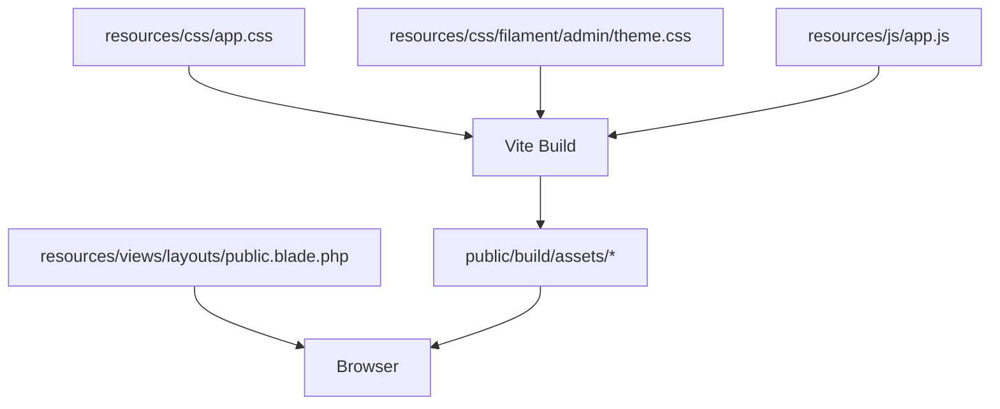
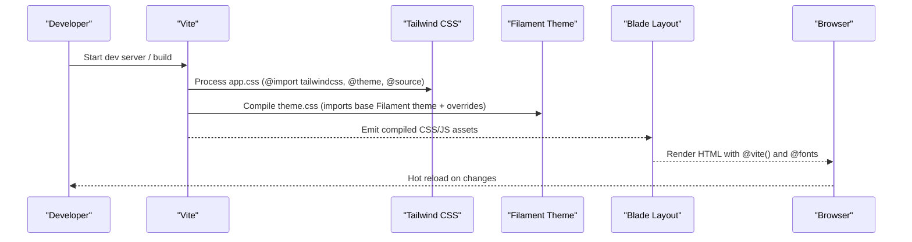
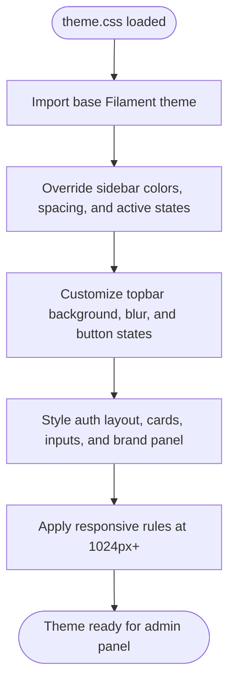
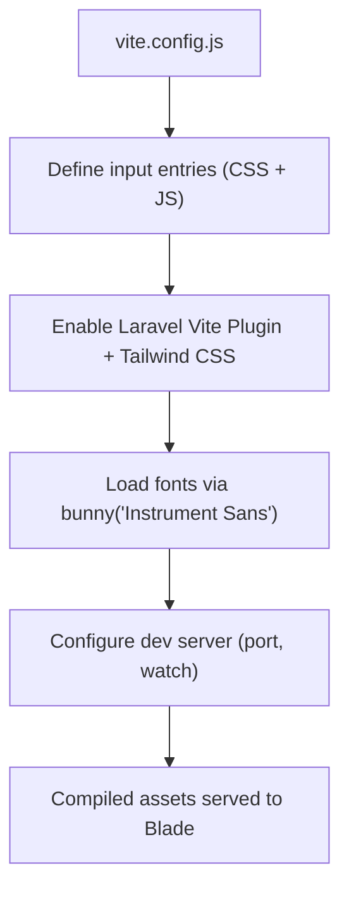
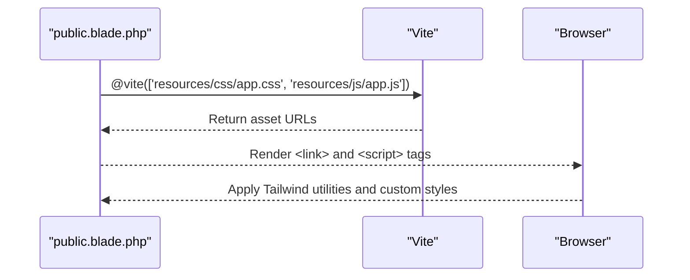
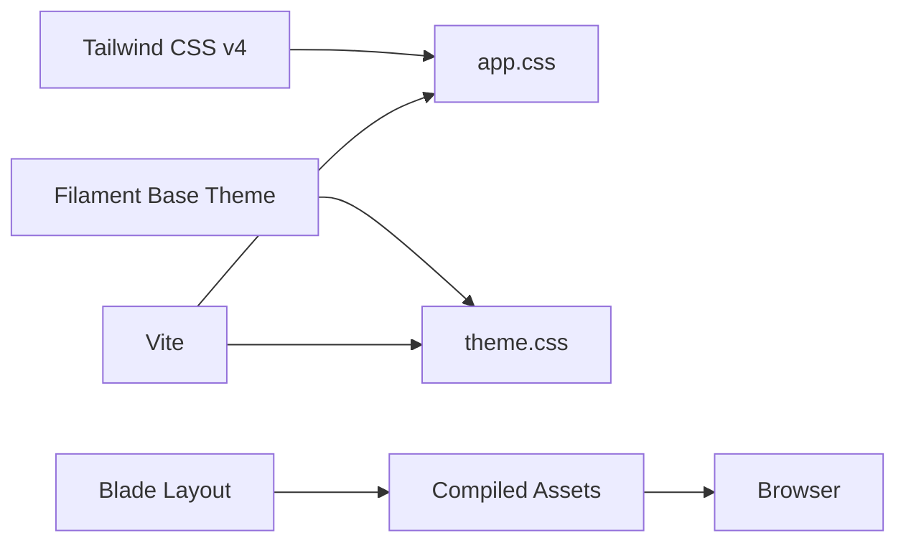

# Styling and Theming

<cite>
**Referenced Files in This Document**
- [app.css](file://resources/css/app.css)
- [theme.css](file://resources/css/filament/admin/theme.css)
- [vite.config.js](file://vite.config.js)
- [package.json](file://package.json)
- [public.blade.php](file://resources/views/layouts/public.blade.php)
</cite>

## Table of Contents
1. [Introduction](#introduction)
2. [Project Structure](#project-structure)
3. [Core Components](#core-components)
4. [Architecture Overview](#architecture-overview)
5. [Detailed Component Analysis](#detailed-component-analysis)
6. [Dependency Analysis](#dependency-analysis)
7. [Performance Considerations](#performance-considerations)
8. [Troubleshooting Guide](#troubleshooting-guide)
9. [Conclusion](#conclusion)

## Introduction
This document explains the styling system and theming approach used by the application. It covers:
- Tailwind CSS v4 utility-first architecture and custom styles in app.css
- Filament admin panel theming via theme.css, including color schemes, typography, and component customization
- Vite build configuration for asset compilation, CSS processing, and optimization
- Responsive design patterns, breakpoints, and mobile-first usage
- Guidelines for adding new styles, maintaining consistency, and optimizing performance (CSS purging and lazy loading)

## Project Structure
The styling assets are organized into two primary entry points:
- Public-facing site styles: resources/css/app.css
- Filament admin panel theme overrides: resources/css/filament/admin/theme.css

Vite compiles these assets and injects them into Blade views. The public layout includes the compiled CSS and fonts.

**Diagram sources**
- [app.css:1-10](file://resources/css/app.css#L1-L10)
- [theme.css:1-5](file://resources/css/filament/admin/theme.css#L1-L5)
- [vite.config.js:6-22](file://vite.config.js#L6-L22)
- [public.blade.php:12-16](file://resources/views/layouts/public.blade.php#L12-L16)

**Section sources**
- [app.css:1-10](file://resources/css/app.css#L1-L10)
- [theme.css:1-5](file://resources/css/filament/admin/theme.css#L1-L5)
- [vite.config.js:6-22](file://vite.config.js#L6-L22)
- [public.blade.php:12-16](file://resources/views/layouts/public.blade.php#L12-L16)

## Core Components
- Tailwind CSS v4 is imported directly in app.css using @import 'tailwindcss'.
- Custom font theme is defined via @theme to set the sans-serif font stack.
- Source scanning directives ensure Tailwind scans Blade views and Livewire components for class usage.
- Filament theme.css imports the base Filament theme and then applies extensive customizations for sidebar, topbar, auth pages, and brand elements.

Key responsibilities:
- app.css: Base Tailwind setup, font theme, and source scanning.
- theme.css: Filament-specific overrides for colors, typography, layout, and interactive states.
- vite.config.js: Asset inputs, font loading, Tailwind plugin integration, dev server settings.
- public.blade.php: Injects compiled assets and sets global body classes.

**Section sources**
- [app.css:1-10](file://resources/css/app.css#L1-L10)
- [theme.css:1-489](file://resources/css/filament/admin/theme.css#L1-L489)
- [vite.config.js:6-22](file://vite.config.js#L6-L22)
- [public.blade.php:18-18](file://resources/views/layouts/public.blade.php#L18-L18)

## Architecture Overview
The styling pipeline integrates Tailwind CSS with Vite and Blade:
- Tailwind v4 processes utilities and theme variables from app.css.
- Filament’s base theme is extended by theme.css.
- Vite compiles CSS/JS and serves them during development; production builds optimize assets.
- Blade templates include compiled assets and use Tailwind utility classes throughout.

**Diagram sources**
- [vite.config.js:6-22](file://vite.config.js#L6-L22)
- [app.css:1-10](file://resources/css/app.css#L1-L10)
- [theme.css:1-5](file://resources/css/filament/admin/theme.css#L1-L5)
- [public.blade.php:12-16](file://resources/views/layouts/public.blade.php#L12-L16)

## Detailed Component Analysis

### Tailwind CSS Setup in app.css
- Imports Tailwind v4 core.
- Declares @source directives to scan Blade views and pagination views for class usage.
- Defines a custom font stack under @theme for consistent typography across the app.

Responsibilities:
- Establishes the base utility framework.
- Ensures unused classes are purged at build time based on scanned sources.
- Sets the default sans-serif font family globally.

Guidelines:
- Prefer Tailwind utility classes over custom CSS when possible.
- Extend the theme via @theme for shared tokens like fonts.
- Keep custom CSS minimal and scoped to specific components.

**Section sources**
- [app.css:1-10](file://resources/css/app.css#L1-L10)

### Filament Admin Panel Theming in theme.css
- Imports the base Filament theme to inherit defaults.
- Overrides sidebar background, header, active item indicators, icons, and user menu interactions.
- Customizes topbar appearance, including backdrop blur, hover states, and dark mode variants.
- Styles authentication pages with a split layout on large screens, branded left panel, and refined form controls.
- Uses responsive media queries to adjust layouts and visual effects at 1024px and above.

Color scheme highlights:
- Dark sidebar with subtle gradients and high-contrast text.
- Amber accent colors for active states and branding.
- Neutral slate tones for text and borders with dark mode adjustments.

Typography:
- Consistent font weights and letter-spacing for headings and labels.
- Clear hierarchy for headers, subheadings, and body copy.

Component customization:
- Sidebar items, groups, and footer spacing and transitions.
- Topbar icon buttons and user menu triggers with hover/focus states.
- Auth page card shapes, shadows, and decorative backgrounds.

Responsive behavior:
- Grid-based split layout for auth pages at 1024px+.
- Conditional visibility of brand panel and decorative elements.

**Diagram sources**
- [theme.css:1-489](file://resources/css/filament/admin/theme.css#L1-L489)

**Section sources**
- [theme.css:1-489](file://resources/css/filament/admin/theme.css#L1-L489)

### Vite Build Configuration
- Inputs: app.css, filament admin theme.css, and app.js.
- Integrates Tailwind CSS plugin for processing.
- Configures font loading via Bunny Fonts for Instrument Sans with selected weights.
- Development server runs on port 5174 with strict port enforcement and ignores compiled view files for watching.

Build characteristics:
- Development: Fast refresh and incremental compilation.
- Production: Optimized output through Vite’s build process.

**Diagram sources**
- [vite.config.js:6-29](file://vite.config.js#L6-L29)

**Section sources**
- [vite.config.js:6-29](file://vite.config.js#L6-L29)
- [package.json:5-15](file://package.json#L5-L15)

### Blade Integration and Global Styles
- The public layout injects compiled CSS and JS via @vite and loads fonts via @fonts.
- Body classes apply Tailwind utilities for layout, colors, typography, and selection styling.
- Navigation and content sections rely heavily on Tailwind utility classes for responsiveness and aesthetics.

**Diagram sources**
- [public.blade.php:12-16](file://resources/views/layouts/public.blade.php#L12-L16)
- [public.blade.php:18-18](file://resources/views/layouts/public.blade.php#L18-L18)

**Section sources**
- [public.blade.php:12-16](file://resources/views/layouts/public.blade.php#L12-L16)
- [public.blade.php:18-18](file://resources/views/layouts/public.blade.php#L18-L18)

## Dependency Analysis
- Tailwind CSS v4 is the core styling engine, processed by Vite.
- Filament theme.css depends on the base Filament theme and extends it with custom overrides.
- Blade templates depend on compiled assets produced by Vite.
- Font loading is handled by the Laravel Vite Plugin’s Bunny Fonts integration.

**Diagram sources**
- [app.css:1-10](file://resources/css/app.css#L1-L10)
- [theme.css:1-5](file://resources/css/filament/admin/theme.css#L1-L5)
- [vite.config.js:6-22](file://vite.config.js#L6-L22)
- [public.blade.php:12-16](file://resources/views/layouts/public.blade.php#L12-L16)

**Section sources**
- [app.css:1-10](file://resources/css/app.css#L1-L10)
- [theme.css:1-5](file://resources/css/filament/admin/theme.css#L1-L5)
- [vite.config.js:6-22](file://vite.config.js#L6-L22)
- [public.blade.php:12-16](file://resources/views/layouts/public.blade.php#L12-L16)

## Performance Considerations
- CSS Purging: Tailwind v4 automatically purges unused utilities based on @source directives. Ensure all Blade views and Livewire components are included in scanning paths.
- Lazy Loading: Use Tailwind’s responsive utilities to conditionally render components only where needed. Avoid heavy custom CSS that bypasses purging.
- Font Optimization: Load only required font weights via the Bunny Fonts configuration to reduce payload size.
- Build Optimization: Rely on Vite’s production build for minification and asset hashing. Keep input entries minimal and avoid unnecessary CSS files.

[No sources needed since this section provides general guidance]

## Troubleshooting Guide
- Missing Classes: If Tailwind classes do not appear, verify @source directives include the relevant Blade or Livewire view paths.
- Font Not Loading: Confirm the font name and weights match the Bunny Fonts configuration in Vite.
- Admin Theme Overrides Not Applied: Ensure theme.css imports the base Filament theme and that Vite includes it as an input entry.
- Dev Server Port Conflicts: Adjust the server.port setting if another service uses 5174.

**Section sources**
- [app.css:3-5](file://resources/css/app.css#L3-L5)
- [vite.config.js:15-19](file://vite.config.js#L15-L19)
- [vite.config.js:23-29](file://vite.config.js#L23-L29)
- [theme.css:1-5](file://resources/css/filament/admin/theme.css#L1-L5)

## Conclusion
The project adopts a modern, utility-first styling approach powered by Tailwind CSS v4 and Vite. The public interface relies on Tailwind utilities and a minimal custom theme, while the Filament admin panel is extensively customized via theme.css. The build pipeline ensures efficient compilation, purging, and font loading. Following the guidelines for adding styles, maintaining consistency, and optimizing performance will keep the codebase clean and fast.

[No sources needed since this section summarizes without analyzing specific files]