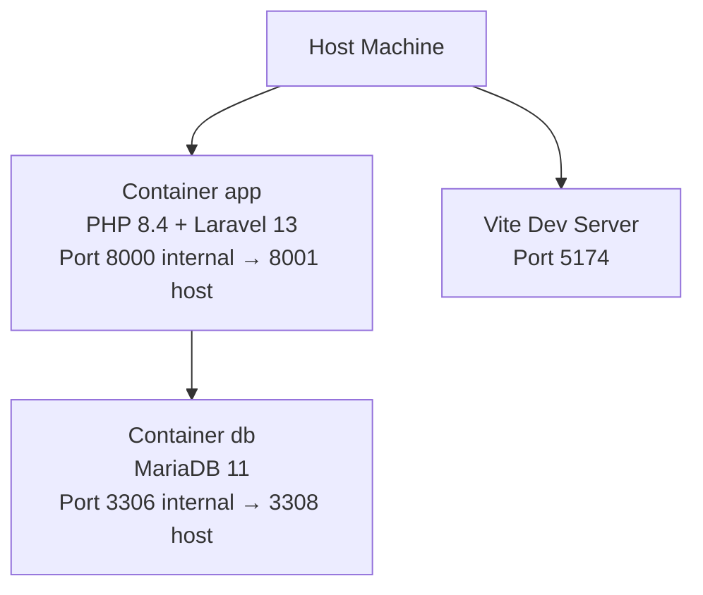
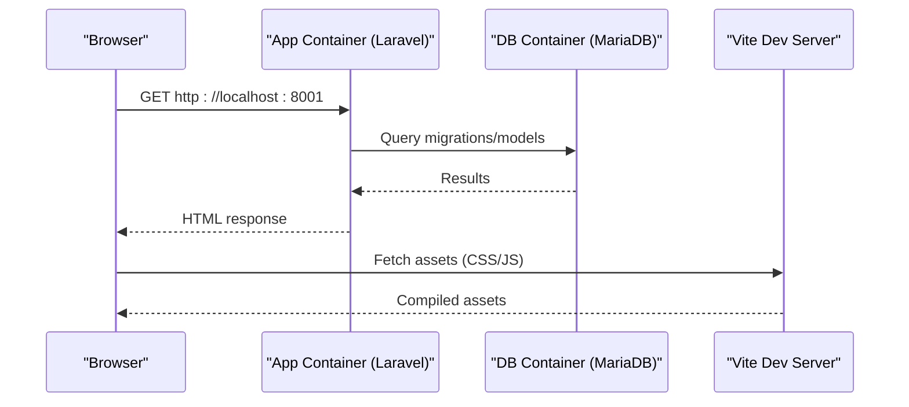
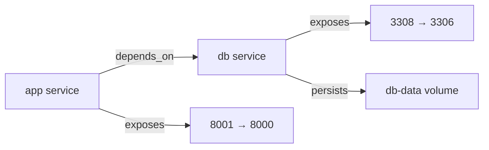

# Getting Started

<cite>
**Referenced Files in This Document**
- [README.md](file://README.md)
- [docker-compose.yml](file://docker-compose.yml)
- [Dockerfile](file://Dockerfile)
- [.env.example](file://.env.example)
- [config/database.php](file://config/database.php)
- [package.json](file://package.json)
- [vite.config.js](file://vite.config.js)
- [app/Providers/Filament/AdminPanelProvider.php](file://app/Providers/Filament/AdminPanelProvider.php)
</cite>

## Table of Contents
1. [Introduction](#introduction)
2. [Project Structure](#project-structure)
3. [Core Components](#core-components)
4. [Architecture Overview](#architecture-overview)
5. [Detailed Component Analysis](#detailed-component-analysis)
6. [Dependency Analysis](#dependency-analysis)
7. [Performance Considerations](#performance-considerations)
8. [Troubleshooting Guide](#troubleshooting-guide)
9. [Conclusion](#conclusion)

## Introduction
RSV Helmet is a Laravel 13 application where PHP runs inside Docker, while frontend assets (Blade, Tailwind, Vite) are built on the host machine. The development stack includes:
- Laravel 13 with PHP 8.4
- MariaDB 11 in a container
- Filament admin panel at `/admin`
- Vite development server for frontend assets

This guide explains how to install, configure, run, and develop RSV Helmet using Docker Compose and Vite. It also covers database configuration, common commands, troubleshooting, and how the containers work together.

## Project Structure
The project uses a simple two-service setup:
- `app`: PHP CLI running `php artisan serve` inside the container, exposing port 8000 internally and mapped to host port 8001.
- `db`: MariaDB 11 container with persistent data volume.

**Diagram sources**
- [docker-compose.yml:1-42](file://docker-compose.yml#L1-L42)
- [Dockerfile:1-25](file://Dockerfile#L1-L25)

**Section sources**
- [README.md:1-22](file://README.md#L1-L22)
- [docker-compose.yml:1-42](file://docker-compose.yml#L1-L42)
- [Dockerfile:1-25](file://Dockerfile#L1-L25)

## Core Components
- Application runtime: PHP 8.4 CLI image with required extensions and Composer installed.
- Database: MariaDB 11 with health checks and persistent storage.
- Frontend build: Vite configured for Tailwind and Filament theme assets.
- Admin panel: Filament 5 registered under `/admin`.

Key responsibilities:
- Dockerfile defines the PHP environment and default command.
- docker-compose.yml orchestrates services, ports, volumes, and dependencies.
- .env.example provides default environment variables including database credentials.
- config/database.php reads connection settings from environment variables.
- vite.config.js sets up input files, Tailwind, fonts, and dev server port.
- AdminPanelProvider registers the Filament admin panel path and resources.

**Section sources**
- [Dockerfile:1-25](file://Dockerfile#L1-L25)
- [docker-compose.yml:1-42](file://docker-compose.yml#L1-L42)
- [.env.example:1-69](file://.env.example#L1-L69)
- [config/database.php:1-185](file://config/database.php#L1-L185)
- [vite.config.js:1-31](file://vite.config.js#L1-L31)
- [app/Providers/Filament/AdminPanelProvider.php:1-91](file://app/Providers/Filament/AdminPanelProvider.php#L1-L91)

## Architecture Overview
The development architecture separates backend and frontend concerns:
- Backend runs in Docker and serves HTTP requests via Laravel’s built-in server.
- Frontend assets are compiled by Vite on the host and served through the browser.
- Database runs in a separate container with a named volume for persistence.

**Diagram sources**
- [docker-compose.yml:1-42](file://docker-compose.yml#L1-L42)
- [vite.config.js:1-31](file://vite.config.js#L1-L31)

## Detailed Component Analysis

### Installation and Environment Setup
Follow these steps to set up RSV Helmet locally:
1. Copy the example environment file if it does not exist.
2. Build the Docker image.
3. Start the containers.
4. Generate the application key and run migrations.
5. Install Node dependencies and start Vite.

Commands:
- Prepare environment:
  - Copy `.env.example` to `.env`.
  - Build the image: `docker compose build`.
  - Start services: `docker compose up -d`.
- Initialize application:
  - Generate key: `docker compose exec app php artisan key:generate`.
  - Run migrations: `docker compose exec app php artisan migrate`.
- Frontend assets:
  - Install dependencies: `npm install`.
  - Start Vite dev server: `npm run dev -- --port 5174`.

Access points:
- Application: `http://localhost:8001`
- Admin panel: `http://localhost:8001/admin`
- Vite dev server: `http://localhost:5174`

**Section sources**
- [README.md:23-38](file://README.md#L23-L38)
- [docker-compose.yml:1-42](file://docker-compose.yml#L1-L42)
- [.env.example:1-69](file://.env.example#L1-L69)

### Database Configuration
Database settings are read from environment variables:
- Connection driver defaults to MySQL/MariaDB when using Docker Compose.
- Host is set to `db` so the app connects to the database container.
- Port is the internal container port 3306; host access uses 3308.
- Credentials include username, password, and root password.

Important notes:
- Change `DB_PASSWORD` and `DB_ROOT_PASSWORD` before use outside local development.
- From host tools (e.g., DBeaver/TablePlus), connect to `127.0.0.1:3308`.

Configuration references:
- Default connection and MySQL/MariaDB options are defined in the database configuration.
- Environment variables are provided in `.env.example`.

**Section sources**
- [config/database.php:20-85](file://config/database.php#L20-L85)
- [.env.example:23-29](file://.env.example#L23-L29)
- [README.md:56-72](file://README.md#L56-L72)

### Running the Application and Admin Panel
- The app container exposes port 8000 internally and maps to host port 8001.
- The admin panel is registered under `/admin` by Filament.
- To create an admin user, run the Filament user generator inside the app container.

Common tasks:
- Start/stop services:
  - `docker compose up -d`
  - `docker compose down`
- View logs:
  - `docker compose logs -f app`
- Run Artisan commands:
  - `docker compose exec app php artisan ...`
- Create admin user:
  - `docker compose exec app php artisan make:filament-user`

Admin panel details:
- Path: `/admin`
- Provider: `app/Providers/Filament/AdminPanelProvider.php`
- Resources/pages/widgets auto-discovered from `app/Filament/`.

**Section sources**
- [README.md:74-90](file://README.md#L74-L90)
- [app/Providers/Filament/AdminPanelProvider.php:29-55](file://app/Providers/Filament/AdminPanelProvider.php#L29-L55)
- [docker-compose.yml:11-20](file://docker-compose.yml#L11-L20)

### Frontend Development with Vite
Frontend assets are built on the host using Vite:
- Input files include application CSS, Filament admin theme CSS, and JavaScript.
- Tailwind is integrated via the Tailwind Vite plugin.
- Fonts are loaded using Bunny font integration.
- Dev server runs on port 5174.

Commands:
- Install dependencies: `npm install`
- Start development server: `npm run dev -- --port 5174`
- Build production assets: `npm run build`

Notes:
- Ensure Node 20+ is installed on the host.
- The Vite server is configured to ignore compiled view cache files.

**Section sources**
- [package.json:1-20](file://package.json#L1-L20)
- [vite.config.js:1-31](file://vite.config.js#L1-L31)
- [README.md:35-38](file://README.md#L35-L38)

### Common Commands Reference
Useful commands for daily development:
- Start services: `docker compose up -d`
- Stop services: `docker compose down`
- View logs: `docker compose logs -f app`
- Run Artisan inside container: `docker compose exec app php artisan ...`
- Open Tinker: `docker compose exec app php artisan tinker`
- Run Composer inside container: `docker compose exec app composer ...`
- Start Vite dev server: `npm run dev -- --port 5174`
- Build assets: `npm run build`

**Section sources**
- [README.md:42-54](file://README.md#L42-L54)

## Dependency Analysis
Service dependencies and mappings:
- `app` depends on `db` being healthy before starting.
- Ports mapping:
  - App: 8001 (host) → 8000 (container)
  - DB: 3308 (host) → 3306 (container)
- Volumes:
  - `db-data` persists MariaDB data.
  - Project directory bind-mounted into `/var/www/html`.

**Diagram sources**
- [docker-compose.yml:1-42](file://docker-compose.yml#L1-L42)

**Section sources**
- [docker-compose.yml:1-42](file://docker-compose.yml#L1-L42)

## Performance Considerations
- Use the host-based Vite dev server for fast asset compilation and live reload.
- Keep database credentials consistent between `.env` and Docker Compose to avoid repeated rebuilds or reinitializations.
- Avoid rebuilding images frequently; rely on bind mounts for code changes.
- For production builds, run asset compilation once and deploy static assets.

[No sources needed since this section provides general guidance]

## Troubleshooting Guide
Common issues and resolutions:
- Port conflicts:
  - If ports 8001, 3308, or 5174 are already in use, stop other services or change the exposed ports in Docker Compose and Vite configuration.
- Database connection errors:
  - Verify `.env` has correct `DB_HOST`, `DB_PORT`, `DB_DATABASE`, `DB_USERNAME`, and `DB_PASSWORD`.
  - Confirm MariaDB container is healthy and accessible at `127.0.0.1:3308`.
- Missing application key:
  - Run `docker compose exec app php artisan key:generate`.
- Migration failures:
  - Ensure database credentials are valid and the database exists.
  - Re-run migrations after fixing schema issues.
- Admin login issues:
  - Create an admin user with `docker compose exec app php artisan make:filament-user`.
  - Check session and cookie middleware in the admin panel provider.
- Asset loading problems:
  - Ensure Vite dev server is running on port 5174 and the browser can fetch assets.
  - Clear compiled views and caches if necessary.

**Section sources**
- [README.md:56-72](file://README.md#L56-L72)
- [app/Providers/Filament/AdminPanelProvider.php:75-88](file://app/Providers/Filament/AdminPanelProvider.php#L75-L88)
- [vite.config.js:23-29](file://vite.config.js#L23-L29)

## Conclusion
You now have the essentials to install, configure, and develop RSV Helmet using Docker Compose and Vite. Use the provided commands to manage services, generate keys, run migrations, create admin users, and build assets. Refer to the troubleshooting section for common setup issues and consult the referenced files for deeper configuration details.

[No sources needed since this section summarizes without analyzing specific files]