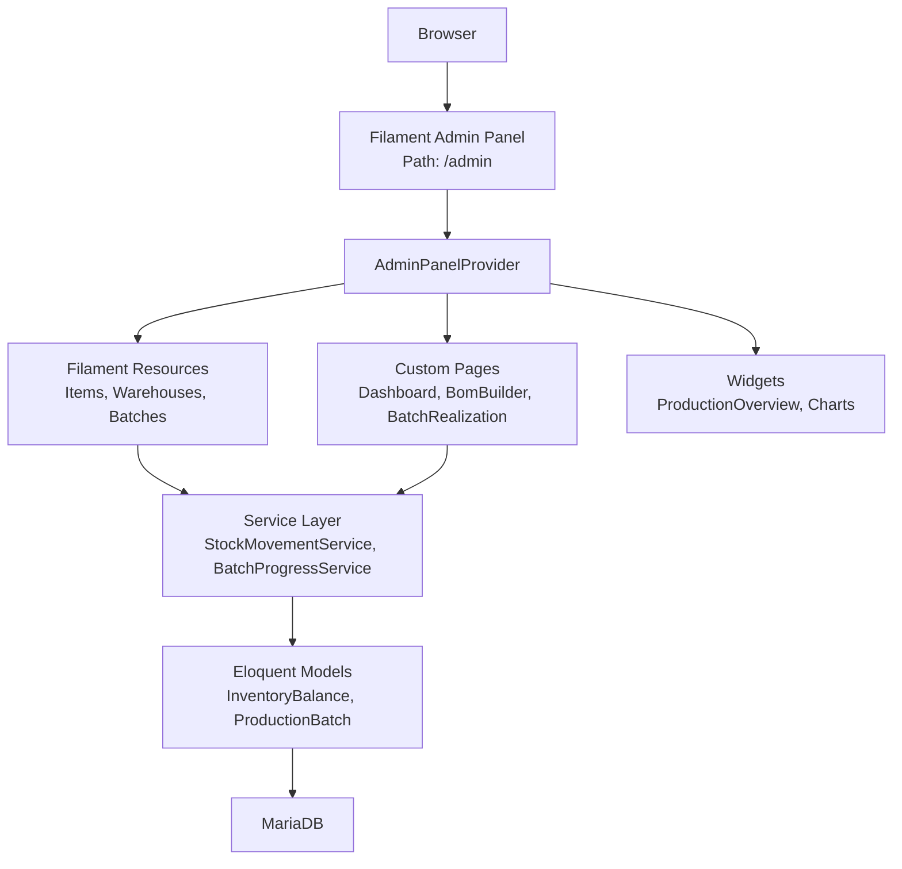
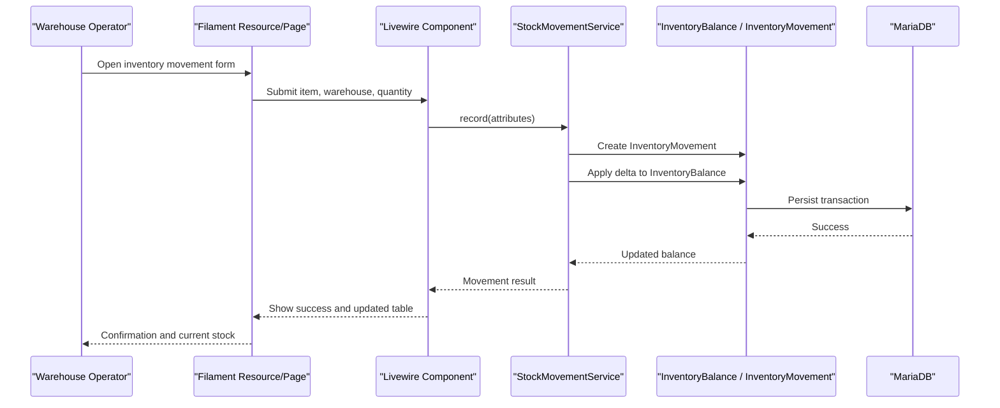
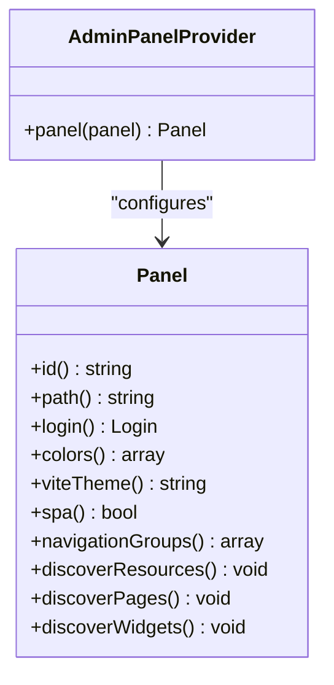
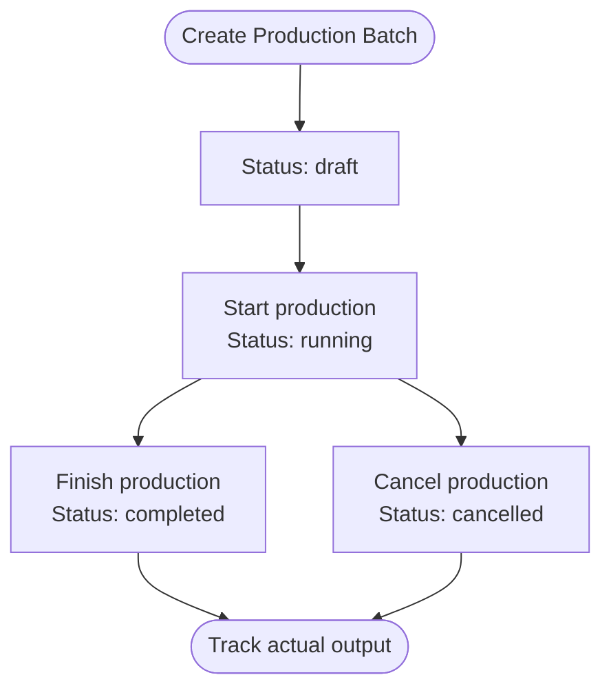
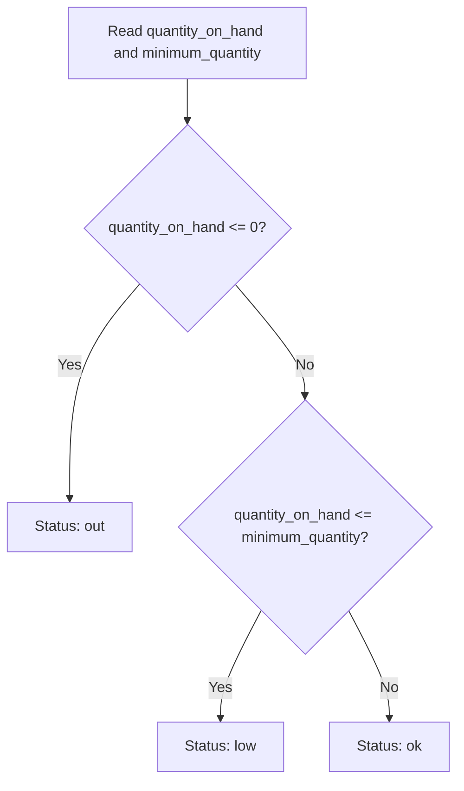
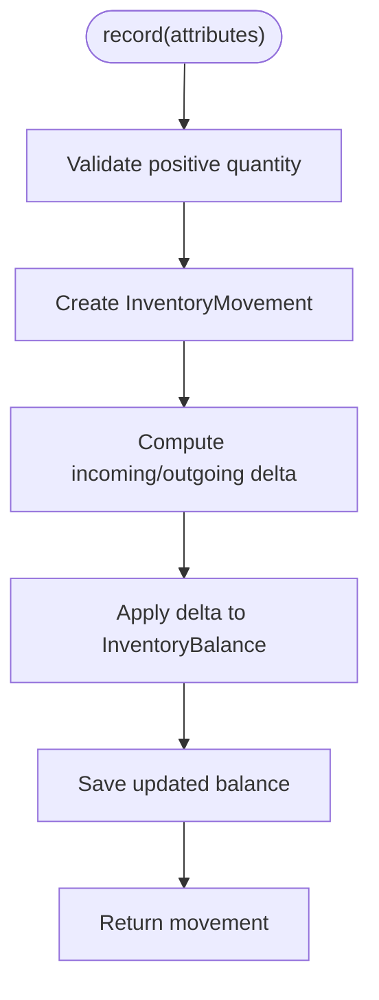
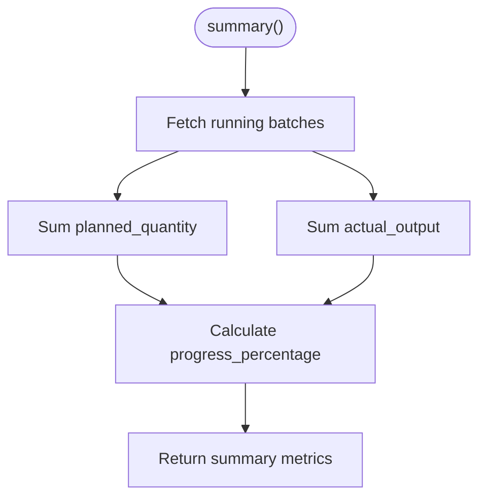
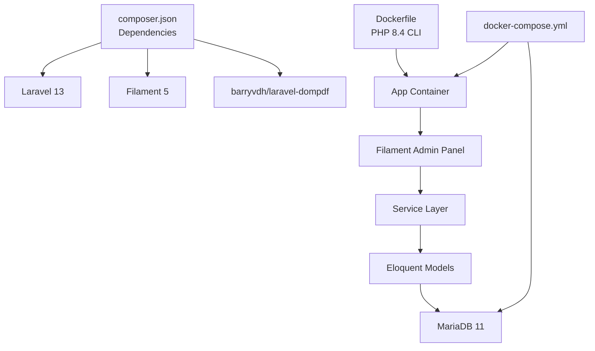

# Project Overview

<cite>
**Referenced Files in This Document**
- [README.md](file://README.md)
- [composer.json](file://composer.json)
- [Dockerfile](file://Dockerfile)
- [docker-compose.yml](file://docker-compose.yml)
- [AdminPanelProvider.php](file://app/Providers/Filament/AdminPanelProvider.php)
- [ProductionBatch.php](file://app/Models/ProductionBatch.php)
- [InventoryBalance.php](file://app/Models/InventoryBalance.php)
- [BatchProgressService.php](file://app/Services/BatchProgressService.php)
- [StockMovementService.php](file://app/Services/StockMovementService.php)
</cite>

## Table of Contents
1. [Introduction](#introduction)
2. [Project Structure](#project-structure)
3. [Core Components](#core-components)
4. [Architecture Overview](#architecture-overview)
5. [Detailed Component Analysis](#detailed-component-analysis)
6. [Dependency Analysis](#dependency-analysis)
7. [Performance Considerations](#performance-considerations)
8. [Troubleshooting Guide](#troubleshooting-guide)
9. [Conclusion](#conclusion)

## Introduction
RSV Helmet is a Laravel-based production and inventory management system designed for an Indonesian manufacturing environment. It centralizes master data, warehouse operations, stock movements, item requests, bill-of-materials workflows, and production batch execution into one admin-driven application. The system targets production managers, warehouse operators, and administrators who need reliable visibility into planned versus actual output, real-time inventory balances, and traceable stock transactions.

Key capabilities include:
- Production batch management with draft, running, completed, and cancelled states.
- Inventory control per warehouse with on-hand quantities, minimum thresholds, and low/out-of-stock indicators.
- Stock movement recording, including production output, transfers, and grouped multi-item moves.
- Supply chain integration through external item mappings and synced barang records.
- Document generation for item requests and related reports.

The project is built around Filament 5 as the admin interface, Livewire-powered components for interactive forms and tables, and a service layer that encapsulates complex business logic such as stock deltas, material consumption, and batch progress calculations.

**Section sources**
- [README.md:1-15](file://README.md#L1-L15)
- [AGENTS.md:3-9](file://AGENTS.md#L3-L9)

## Project Structure
At a high level, the repository follows standard Laravel conventions while adding domain-specific layers:
- `app/Models` contains Eloquent models for items, warehouses, inventory balances, production batches, and related entities.
- `app/Filament` holds the admin panel resources, pages, widgets, imports, exports, and custom form components.
- `app/Livewire` provides interactive UI components such as the item request form.
- `app/Services` implements core business workflows like stock movement handling, batch progress calculation, BOM explosion, and external synchronization.
- `database/migrations` define the schema for inventory, production, and supply-chain entities.
- `resources/views` includes Blade templates for Filament pages, public layouts, and PDF documents.
- `docker/production` contains deployment artifacts for Nginx, PHP configuration, and process supervision.

**Diagram sources**
- [AdminPanelProvider.php:29-88](file://app/Providers/Filament/AdminPanelProvider.php#L29-L88)
- [StockMovementService.php:16-60](file://app/Services/StockMovementService.php#L16-L60)
- [BatchProgressService.php:9-44](file://app/Services/BatchProgressService.php#L9-L44)
- [ProductionBatch.php:22-87](file://app/Models/ProductionBatch.php#L22-L87)
- [InventoryBalance.php:20-45](file://app/Models/InventoryBalance.php#L20-L45)

**Section sources**
- [README.md:17-38](file://README.md#L17-L38)
- [AGENTS.md:11-41](file://AGENTS.md#L11-L41)

## Core Components
This section highlights the primary building blocks that deliver RSV Helmet’s production and inventory functionality.

- Filament Admin Panel Provider
  - Registers the `/admin` panel, navigation groups for warehouse, production, and master data, and discovers resources, pages, and widgets.
  - Integrates authentication, middleware, and custom render hooks for branding and SPA behavior.

- Production Batch Model
  - Defines batch lifecycle statuses: draft, running, completed, cancelled.
  - Links to items, materials, inventory movements, and warehouses for material sourcing and finished goods output.
  - Provides computed attributes for planned quantity and actual output derived from movements or explicit values.

- Inventory Balance Model
  - Tracks per-warehouse stock levels with decimal precision.
  - Computes stock status (out, low, ok) based on on-hand quantity versus minimum threshold.
  - Exposes scopes and relationships for querying low-stock and balance details.

- Batch Progress Service
  - Aggregates running batch counts, planned vs actual quantities, and monthly completion metrics.
  - Formats batch progress data for charts and tables.
  - Calculates percentage progress safely when planned quantities are zero.

- Stock Movement Service
  - Records single stock transactions and updates balances atomically.
  - Handles production output by automatically consuming active BOM components from the material warehouse.
  - Supports single and bulk transfers between warehouses with shortage validation.
  - Provides safe deletion by reversing deltas and handling transfer groups and child movements.

These components work together to ensure accurate inventory accounting, auditable stock changes, and clear production tracking.

**Section sources**
- [AdminPanelProvider.php:29-88](file://app/Providers/Filament/AdminPanelProvider.php#L29-L88)
- [ProductionBatch.php:22-116](file://app/Models/ProductionBatch.php#L22-L116)
- [InventoryBalance.php:20-70](file://app/Models/InventoryBalance.php#L20-L70)
- [BatchProgressService.php:9-151](file://app/Services/BatchProgressService.php#L9-L151)
- [StockMovementService.php:16-397](file://app/Services/StockMovementService.php#L16-L397)

## Architecture Overview
RSV Helmet uses a layered architecture:
- Presentation layer: Filament admin panel with Blade views, Livewire components, and custom pages.
- Application layer: Controllers and Livewire components orchestrate user actions.
- Domain layer: Service classes implement business rules for stock movements, batch progress, BOM explosion, and external integrations.
- Data layer: Eloquent models map to MariaDB tables, providing relationships and computed attributes.

**Diagram sources**
- [StockMovementService.php:23-60](file://app/Services/StockMovementService.php#L23-L60)
- [InventoryBalance.php:47-69](file://app/Models/InventoryBalance.php#L47-L69)

## Detailed Component Analysis

### Filament Admin Panel and Navigation
The admin panel provider configures the panel path, colors, SPA mode, navigation groups, and auto-discovery of resources, pages, and widgets. It also attaches authentication and rendering hooks for branding and infinite-scroll fixes.

**Diagram sources**
- [AdminPanelProvider.php:29-88](file://app/Providers/Filament/AdminPanelProvider.php#L29-L88)

**Section sources**
- [AdminPanelProvider.php:29-88](file://app/Providers/Filament/AdminPanelProvider.php#L29-L88)

### Production Batch Management
Production batches track planned outputs, actual outputs, and lifecycle transitions. They link to items, materials, and inventory movements, enabling traceability from raw materials to finished goods.

**Diagram sources**
- [ProductionBatch.php:27-57](file://app/Models/ProductionBatch.php#L27-L57)
- [ProductionBatch.php:94-115](file://app/Models/ProductionBatch.php#L94-L115)

**Section sources**
- [ProductionBatch.php:22-116](file://app/Models/ProductionBatch.php#L22-L116)

### Inventory Control and Stock Status
Inventory balances compute stock status dynamically based on on-hand quantities and minimum thresholds. This supports alerts for low or out-of-stock conditions and drives replenishment workflows.

**Diagram sources**
- [InventoryBalance.php:47-63](file://app/Models/InventoryBalance.php#L47-L63)

**Section sources**
- [InventoryBalance.php:20-70](file://app/Models/InventoryBalance.php#L20-L70)

### Stock Movement Workflow
The stock movement service ensures atomicity and integrity across inventory changes. It validates positive quantities, prevents negative balances, and handles production output with automatic material consumption.

**Diagram sources**
- [StockMovementService.php:23-60](file://app/Services/StockMovementService.php#L23-L60)
- [StockMovementService.php:358-387](file://app/Services/StockMovementService.php#L358-L387)

**Section sources**
- [StockMovementService.php:16-397](file://app/Services/StockMovementService.php#L16-L397)

### Batch Progress Reporting
The batch progress service aggregates running batches, calculates total planned and actual quantities, and computes progress percentages. It also provides recent completed batches and status counts for dashboard widgets.

**Diagram sources**
- [BatchProgressService.php:20-44](file://app/Services/BatchProgressService.php#L20-L44)
- [BatchProgressService.php:110-117](file://app/Services/BatchProgressService.php#L110-L117)

**Section sources**
- [BatchProgressService.php:9-151](file://app/Services/BatchProgressService.php#L9-L151)

## Dependency Analysis
The system’s dependencies can be understood at three levels:
- Framework and runtime: Laravel 13, PHP 8.3+, Filament 5, dompdf for document generation.
- Containerization: Docker Compose runs the app and MariaDB; the app container exposes port 8001, and the database container exposes port 3308.
- Domain modules: Filament resources/pages/widgets depend on services; services depend on models; models depend on the database.

**Diagram sources**
- [composer.json:8-16](file://composer.json#L8-L16)
- [Dockerfile:1-24](file://Dockerfile#L1-L24)
- [docker-compose.yml:1-42](file://docker-compose.yml#L1-L42)

**Section sources**
- [composer.json:8-16](file://composer.json#L8-L16)
- [Dockerfile:1-24](file://Dockerfile#L1-L24)
- [docker-compose.yml:1-42](file://docker-compose.yml#L1-L42)

## Performance Considerations
- Use database transactions for all stock mutations to prevent inconsistent balances during concurrent operations.
- Prefer eager loading and aggregated queries in services to reduce N+1 issues when rendering dashboards and lists.
- Keep Filament resources thin; delegate complex calculations to services to improve maintainability and testability.
- Cache frequently accessed master data where appropriate, but ensure cache invalidation aligns with inventory updates.
- Optimize migrations and indexes for common filters such as item codes, warehouse IDs, and batch statuses.

[No sources needed since this section provides general guidance]

## Troubleshooting Guide
Common operational issues and their resolution paths:
- Negative stock errors: Occur when outgoing movements exceed available balances. Verify minimum quantities and validate inputs before recording movements.
- Transfer validation failures: Ensure origin and destination warehouses differ and sufficient stock exists for each item.
- Production output shortages: When recording production output, check active BOM components and material warehouse availability; resolve shortages before proceeding.
- Batch progress anomalies: Confirm that movements are correctly linked to production batches and that planned quantities are defined for items.

**Section sources**
- [StockMovementService.php:102-118](file://app/Services/StockMovementService.php#L102-L118)
- [StockMovementService.php:147-200](file://app/Services/StockMovementService.php#L147-L200)
- [StockMovementService.php:209-289](file://app/Services/StockMovementService.php#L209-L289)
- [StockMovementService.php:358-387](file://app/Services/StockMovementService.php#L358-L387)

## Conclusion
RSV Helmet delivers a robust production and inventory management solution tailored for Indonesian manufacturing operations. Its Filament-driven admin interface, Livewire-enhanced interactivity, and service-oriented business logic provide clear workflows for managing production batches, controlling inventory, integrating supply chain data, and generating documents. Dockerized development and deployment streamline setup and scaling, while the modular architecture supports future enhancements and integrations.

[No sources needed since this section summarizes without analyzing specific files]