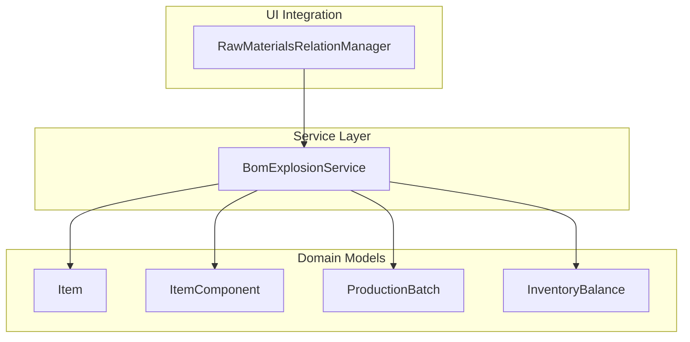
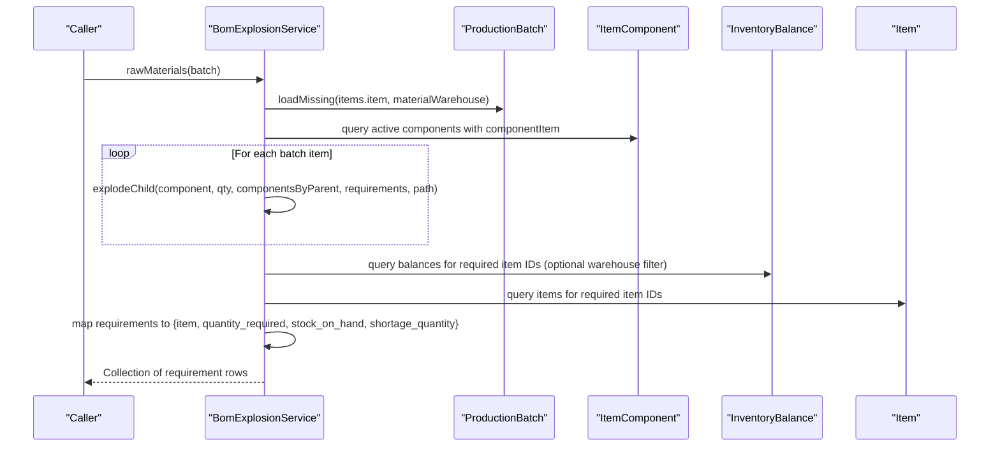
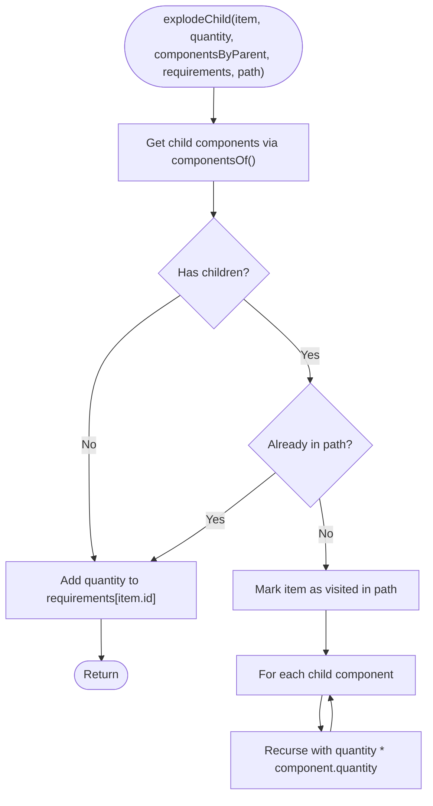
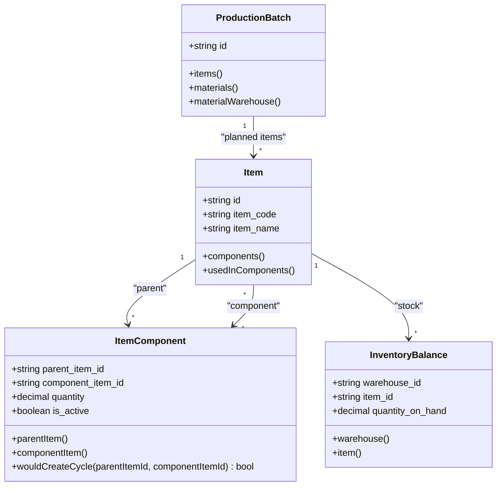

# BOM Explosion Service

<cite>
**Referenced Files in This Document**
- [BomExplosionService.php](file://app/Services/BomExplosionService.php)
- [ProductionBatch.php](file://app/Models/ProductionBatch.php)
- [ItemComponent.php](file://app/Models/ItemComponent.php)
- [Item.php](file://app/Models/Item.php)
- [InventoryBalance.php](file://app/Models/InventoryBalance.php)
- [RawMaterialsRelationManager.php](file://app/Filament/Resources/ProductionBatches/RelationManagers/RawMaterialsRelationManager.php)
</cite>

## Table of Contents
1. [Introduction](#introduction)
2. [Project Structure](#project-structure)
3. [Core Components](#core-components)
4. [Architecture Overview](#architecture-overview)
5. [Detailed Component Analysis](#detailed-component-analysis)
6. [Dependency Analysis](#dependency-analysis)
7. [Performance Considerations](#performance-considerations)
8. [Troubleshooting Guide](#troubleshooting-guide)
9. [Conclusion](#conclusion)

## Introduction
The BomExplosionService implements a recursive Bill of Materials (BOM) explosion for production batches. It takes a ProductionBatch and breaks down its planned finished goods into raw material requirements by traversing active component hierarchies. The service aggregates required quantities per item, checks current stock availability from InventoryBalance records, and calculates shortage quantities. It is designed as an informational calculation; actual stock reservation during production uses the direct production batch materials rather than this explosion result.

This documentation explains:
- How rawMaterials() processes a ProductionBatch
- How nested component hierarchies are exploded recursively
- How quantity requirements are calculated
- How stock availability and shortages are computed
- How circular dependencies are prevented
- How performance is optimized
- How the service integrates with inventory management and Filament UI

## Project Structure
The BOM explosion logic lives in a dedicated service class and interacts with Eloquent models representing items, components, production batches, and inventory balances. A Filament relation manager consumes the service to display raw material requirements for a production batch.

**Diagram sources**
- [BomExplosionService.php:11-107](file://app/Services/BomExplosionService.php#L11-L107)
- [RawMaterialsRelationManager.php:62-80](file://app/Filament/Resources/ProductionBatches/RelationManagers/RawMaterialsRelationManager.php#L62-L80)
- [ProductionBatch.php:59-77](file://app/Models/ProductionBatch.php#L59-L77)
- [ItemComponent.php:36-44](file://app/Models/ItemComponent.php#L36-L44)
- [Item.php:136-144](file://app/Models/Item.php#L136-L144)
- [InventoryBalance.php:37-45](file://app/Models/InventoryBalance.php#L37-L45)

**Section sources**
- [BomExplosionService.php:11-107](file://app/Services/BomExplosionService.php#L11-L107)
- [RawMaterialsRelationManager.php:62-80](file://app/Filament/Resources/ProductionBatches/RelationManagers/RawMaterialsRelationManager.php#L62-L80)

## Core Components
- BomExplosionService: Provides the rawMaterials() method that performs BOM explosion and shortage analysis.
- ProductionBatch: Represents a production order with planned items and associated warehouse context.
- ItemComponent: Defines parent-to-child relationships in the BOM hierarchy.
- Item: Represents any product or raw material entity.
- InventoryBalance: Tracks on-hand stock per item and warehouse.

Key responsibilities:
- Load batch data efficiently
- Build a lookup of active components grouped by parent
- Recursively explode components into leaf raw materials
- Aggregate total required quantities per item
- Fetch stock levels and compute shortages
- Return a sorted collection of requirement rows

**Section sources**
- [BomExplosionService.php:11-107](file://app/Services/BomExplosionService.php#L11-L107)
- [ProductionBatch.php:59-77](file://app/Models/ProductionBatch.php#L59-L77)
- [ItemComponent.php:36-44](file://app/Models/ItemComponent.php#L36-L44)
- [Item.php:136-144](file://app/Models/Item.php#L136-L144)
- [InventoryBalance.php:37-45](file://app/Models/InventoryBalance.php#L37-L45)

## Architecture Overview
The rawMaterials() workflow follows these steps:
1. Load batch items and related data
2. Preload all active components grouped by parent
3. For each planned batch item, initialize a path tracker and explode its component tree
4. Accumulate raw material requirements in a map keyed by item ID
5. Query inventory balances for those items, optionally filtered by the batch’s material warehouse
6. Map requirements to Item entities and calculate stock_on_hand and shortage_quantity
7. Sort results by item code and return a Collection

**Diagram sources**
- [BomExplosionService.php:22-107](file://app/Services/BomExplosionService.php#L22-L107)
- [ProductionBatch.php:59-77](file://app/Models/ProductionBatch.php#L59-L77)
- [ItemComponent.php:36-44](file://app/Models/ItemComponent.php#L36-L44)
- [InventoryBalance.php:37-45](file://app/Models/InventoryBalance.php#L37-L45)
- [Item.php:136-144](file://app/Models/Item.php#L136-L144)

## Detailed Component Analysis

### BomExplosionService::rawMaterials()
Purpose:
- Explode a ProductionBatch’s planned items through their active component trees
- Aggregate total required quantities per item
- Compute stock availability and shortages based on InventoryBalance
- Return a sorted Collection of requirement rows

Parameters:
- ProductionBatch $batch: The production batch whose planned items will be exploded

Return value:
- Collection<int, array{item: Item, quantity_required: float, stock_on_hand: float, shortage_quantity: float}>
  - item: The Item model for the raw material
  - quantity_required: Rounded total required quantity
  - stock_on_hand: Summed on-hand quantity across warehouses (filtered by batch material warehouse if present)
  - shortage_quantity: Non-negative difference between required and on-hand

Processing logic:
- Loads missing relations for batch items and material warehouse
- Builds a grouped lookup of active components by parent item ID
- Iterates over batch items, skipping invalid or non-positive planned quantities
- Initializes a path tracker per batch item to prevent revisiting nodes during recursion
- Calls explodeChild() for each component, multiplying planned quantity by component quantity
- Aggregates requirements in a map keyed by item ID
- Queries InventoryBalance for required items, optionally scoped to the batch’s material_warehouse_id
- Maps aggregated requirements to Item entities and computes shortage_quantity
- Sorts results by item_code and returns values

Complexity considerations:
- Component loading is O(C) where C is number of active components
- Requirement aggregation is proportional to total edges visited during traversal
- Stock queries are O(R) where R is number of unique required items

Error handling:
- Skips missing items or non-positive planned quantities
- Filters out null componentItem references
- Returns empty Collection when no requirements exist

Integration notes:
- Does not modify inventory; it is informational only
- Actual stock reservation uses production_batch_materials elsewhere

**Section sources**
- [BomExplosionService.php:22-107](file://app/Services/BomExplosionService.php#L22-L107)

#### Example BOM Structures and Calculation Logic
Conceptual example:
- Finished Good FG-A requires 2 units of Sub-Assembly SA-B
- SA-B requires 3 units of Part P-C and 1 unit of Part P-D
- Planned batch produces 10 units of FG-A

Calculation flow:
- Start with FG-A planned quantity 10
- Expand to SA-B: 10 × 2 = 20
- Expand SA-B to P-C: 20 × 3 = 60
- Expand SA-B to P-D: 20 × 1 = 20
- Final raw material requirements:
  - P-C: 60
  - P-D: 20

Stock and shortage:
- If stock_on_hand for P-C is 50, shortage_quantity = max(60 − 50, 0) = 10
- If stock_on_hand for P-D is 25, shortage_quantity = max(20 − 25, 0) = 0

[No sources needed since this section provides conceptual examples]

### BomExplosionService::explodeChild()
Purpose:
- Recursively traverse the component tree starting from a given Item
- Prevent infinite loops using a path tracker
- Accumulate leaf-level raw material requirements

Parameters:
- Item $item: Current node being processed
- float $quantity: Required quantity for this node
- Collection $componentsByParent: Preloaded component lookup
- array &$requirements: Reference to aggregated requirements map
- array $path: Path tracker keyed by item ID to detect cycles

Behavior:
- Retrieves child components via componentsOf()
- If no children or the item is already in the path, add quantity to requirements and return
- Otherwise, mark the item as visited and recurse into each valid child component
- Child quantity is multiplied by the component’s per-unit quantity

Circular dependency prevention:
- Uses the path array to avoid reprocessing nodes already on the current recursion stack
- Combined with ItemComponent::wouldCreateCycle(), this prevents both runtime recursion loops and invalid BOM definitions

Performance optimization:
- Avoids repeated database queries by passing preloaded componentsByParent
- Short-circuits when encountering leaf nodes or cycles

**Section sources**
- [BomExplosionService.php:114-144](file://app/Services/BomExplosionService.php#L114-L144)
- [ItemComponent.php:50-84](file://app/Models/ItemComponent.php#L50-L84)

#### Recursive Processing Flowchart

**Diagram sources**
- [BomExplosionService.php:114-144](file://app/Services/BomExplosionService.php#L114-L144)

### BomExplosionService::componentsOf()
Purpose:
- Retrieve active components for a given Item from the preloaded componentsByParent lookup
- Filter out null componentItem references
- Return a Collection of ItemComponent objects

Parameters:
- Item $item: Parent item whose components are requested
- Collection $componentsByParent: Grouped active components by parent item ID

Return value:
- Collection<int, ItemComponent>

Optimization:
- Uses in-memory grouping instead of additional database queries
- Ensures only valid componentItem relationships are returned

**Section sources**
- [BomExplosionService.php:150-156](file://app/Services/BomExplosionService.php#L150-L156)

### Data Model Relationships

**Diagram sources**
- [Item.php:136-144](file://app/Models/Item.php#L136-L144)
- [ItemComponent.php:36-44](file://app/Models/ItemComponent.php#L36-L44)
- [ProductionBatch.php:59-77](file://app/Models/ProductionBatch.php#L59-L77)
- [InventoryBalance.php:37-45](file://app/Models/InventoryBalance.php#L37-L45)

## Dependency Analysis
- BomExplosionService depends on:
  - ProductionBatch for planned items and warehouse context
  - ItemComponent for BOM structure
  - Item for entity resolution and sorting
  - InventoryBalance for stock availability
- RawMaterialsRelationManager depends on BomExplosionService to populate Filament table columns with computed attributes

Coupling:
- Service is decoupled from UI; it returns plain arrays with Item instances
- Models encapsulate relationships and validation helpers (e.g., wouldCreateCycle)

Potential circular dependencies:
- Runtime recursion is guarded by path tracking
- Data integrity is further protected by ItemComponent::wouldCreateCycle()

External integrations:
- Filament UI consumes service output and augments Item instances with computed attributes for display

**Section sources**
- [BomExplosionService.php:22-107](file://app/Services/BomExplosionService.php#L22-L107)
- [RawMaterialsRelationManager.php:62-80](file://app/Filament/Resources/ProductionBatches/RelationManagers/RawMaterialsRelationManager.php#L62-L80)
- [ItemComponent.php:50-84](file://app/Models/ItemComponent.php#L50-L84)

## Performance Considerations
- Preloading components: All active components are loaded once and grouped by parent to avoid N+1 queries during traversal.
- In-memory aggregation: Requirements are accumulated in a PHP array keyed by item ID, minimizing object overhead.
- Warehouse-scoped stock query: When a batch has a material_warehouse_id, stock queries are filtered to that warehouse, reducing result set size.
- Sorting at the end: Results are sorted by item_code after mapping to reduce intermediate work.
- Early exits: Missing items, non-positive planned quantities, and leaf nodes are skipped early to reduce recursion depth.

Recommendations:
- For very large BOMs, consider caching componentsByParent across requests if called repeatedly within the same request lifecycle.
- Use database indexes on ItemComponent.parent_item_id, ItemComponent.is_active, and InventoryBalance.item_id, warehouse_id to optimize lookups.

[No sources needed since this section provides general guidance]

## Troubleshooting Guide
Common issues and resolutions:
- Empty raw materials result:
  - Cause: No planned items, no active components, or all planned quantities are zero or negative
  - Resolution: Verify ProductionBatch items and ItemComponent.is_active flags
- Unexpected shortages:
  - Cause: Insufficient stock_on_hand in InventoryBalance for required items
  - Resolution: Check InventoryBalance records for the relevant warehouse and items
- Circular dependency warnings:
  - Cause: BOM contains cycles
  - Resolution: Use ItemComponent::wouldCreateCycle() to validate before saving components
- Incorrect stock filtering:
  - Cause: Batch lacks material_warehouse_id
  - Resolution: Ensure the batch’s material_warehouse_id is set when you want warehouse-specific stock checks

Validation helpers:
- ItemComponent::wouldCreateCycle(parentItemId, componentItemId): Detects whether adding a component would create a cycle in the BOM graph

**Section sources**
- [ItemComponent.php:50-84](file://app/Models/ItemComponent.php#L50-L84)
- [BomExplosionService.php:22-107](file://app/Services/BomExplosionService.php#L22-L107)

## Conclusion
The BomExplosionService provides a robust, efficient, and safe mechanism to explode production batches into raw material requirements. It leverages preloaded component hierarchies, recursive traversal with cycle prevention, and integrated stock checks to deliver actionable insights for planning and procurement. While it does not perform actual stock reservations, it complements the production materialization process by informing users of potential shortages and enabling proactive supply chain decisions.

[No sources needed since this section summarizes without analyzing specific files]