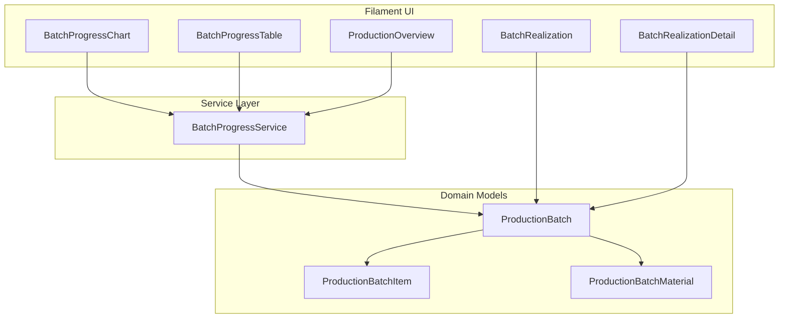
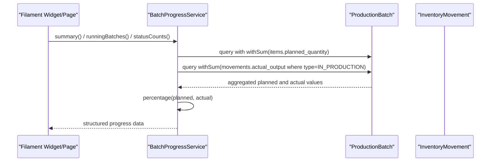
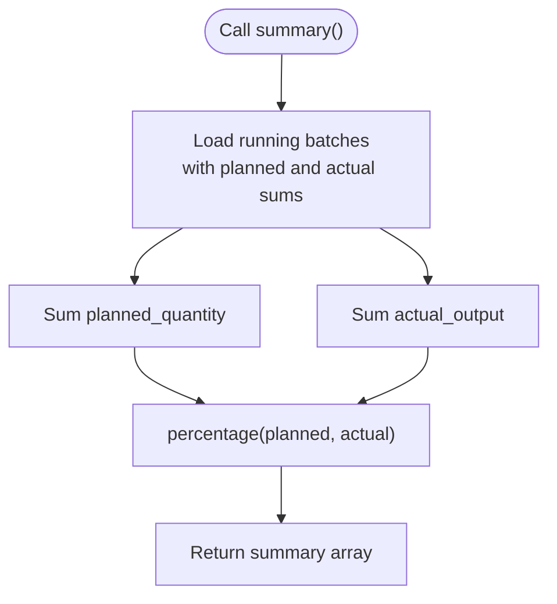
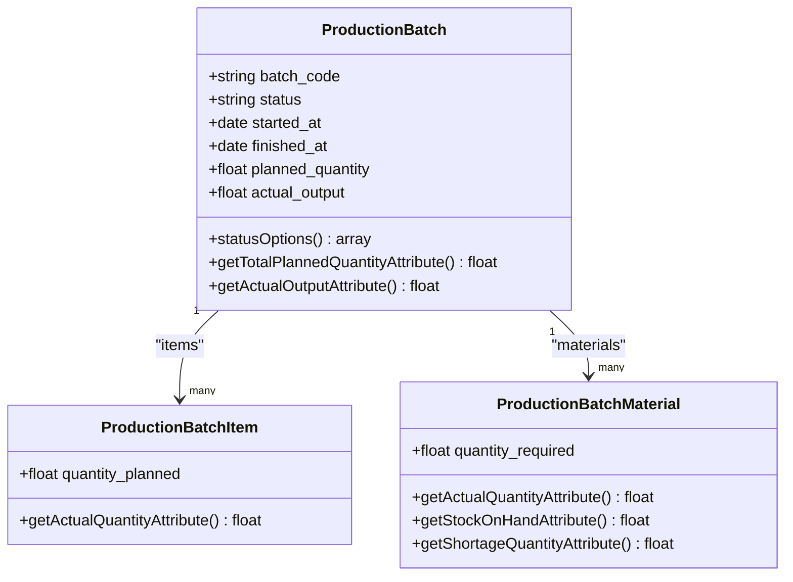
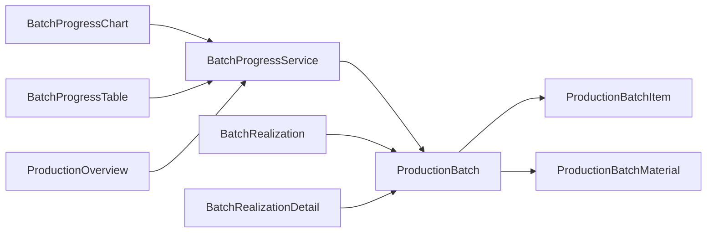

# Batch Progress Service

<cite>
**Referenced Files in This Document**   
- [BatchProgressService.php](file://app/Services/BatchProgressService.php)
- [ProductionBatch.php](file://app/Models/ProductionBatch.php)
- [ProductionBatchItem.php](file://app/Models/ProductionBatchItem.php)
- [ProductionBatchMaterial.php](file://app/Models/ProductionBatchMaterial.php)
- [BatchProgressChart.php](file://app/Filament/Widgets/BatchProgressChart.php)
- [BatchProgressTable.php](file://app/Filament/Widgets/BatchProgressTable.php)
- [ProductionOverview.php](file://app/Filament/Widgets/ProductionOverview.php)
- [BatchRealization.php](file://app/Filament/Pages/BatchRealization.php)
- [BatchRealizationDetail.php](file://app/Filament/Pages/BatchRealizationDetail.php)
- [DashboardTest.php](file://tests/Feature/DashboardTest.php)
</cite>

## Table of Contents
1. [Introduction](#introduction)
2. [Project Structure](#project-structure)
3. [Core Components](#core-components)
4. [Architecture Overview](#architecture-overview)
5. [Detailed Component Analysis](#detailed-component-analysis)
6. [Dependency Analysis](#dependency-analysis)
7. [Performance Considerations](#performance-considerations)
8. [Troubleshooting Guide](#troubleshooting-guide)
9. [Conclusion](#conclusion)

## Introduction
This document explains the `BatchProgressService` class and its role in calculating and tracking production batch progress. It covers how completion percentages are computed, how material consumption is tracked against planned quantities, and how production status is monitored. It also documents real-time updates through Filament widgets, integration with the production batch lifecycle, performance considerations for large batches, caching strategies, error handling for invalid states, and reporting formats used by the dashboard and export features.

## Project Structure
The batch progress functionality is implemented as a service layer that reads from Eloquent models and exposes aggregated data to Filament widgets and pages. The main components are:

- Service: `BatchProgressService`
- Models: `ProductionBatch`, `ProductionBatchItem`, `ProductionBatchMaterial`
- Filament Widgets: `BatchProgressChart`, `BatchProgressTable`, `ProductionOverview`
- Filament Pages: `BatchRealization`, `BatchRealizationDetail`
- Tests: `DashboardTest`

**Diagram sources**
- [BatchProgressService.php:9-151](file://app/Services/BatchProgressService.php#L9-L151)
- [ProductionBatch.php:22-116](file://app/Models/ProductionBatch.php#L22-L116)
- [ProductionBatchItem.php:16-74](file://app/Models/ProductionBatchItem.php#L16-L74)
- [ProductionBatchMaterial.php:16-73](file://app/Models/ProductionBatchMaterial.php#L16-L73)
- [BatchProgressChart.php:8-60](file://app/Filament/Widgets/BatchProgressChart.php#L8-L60)
- [BatchProgressTable.php:18-99](file://app/Filament/Widgets/BatchProgressTable.php#L18-L99)
- [ProductionOverview.php:10-39](file://app/Filament/Widgets/ProductionOverview.php#L10-L39)
- [BatchRealization.php:19-111](file://app/Filament/Pages/BatchRealization.php#L19-L111)
- [BatchRealizationDetail.php:18-214](file://app/Filament/Pages/BatchRealizationDetail.php#L18-L214)

**Section sources**
- [BatchProgressService.php:9-151](file://app/Services/BatchProgressService.php#L9-L151)
- [ProductionBatch.php:22-116](file://app/Models/ProductionBatch.php#L22-L116)
- [BatchProgressChart.php:8-60](file://app/Filament/Widgets/BatchProgressChart.php#L8-L60)
- [BatchProgressTable.php:18-99](file://app/Filament/Widgets/BatchProgressTable.php#L18-L99)
- [ProductionOverview.php:10-39](file://app/Filament/Widgets/ProductionOverview.php#L10-L39)
- [BatchRealization.php:19-111](file://app/Filament/Pages/BatchRealization.php#L19-L111)
- [BatchRealizationDetail.php:18-214](file://app/Filament/Pages/BatchRealizationDetail.php#L18-L214)

## Core Components
- `BatchProgressService.summary()`: Aggregates running batches to compute total planned quantity, actual output, overall progress percentage, and completed batches this month.
- `BatchProgressService.runningBatches(limit)`: Returns recent running batches with planned vs actual quantities and per-batch progress percentage.
- `BatchProgressService.statusCounts()`: Returns counts for all defined statuses, ensuring missing statuses have zero counts.
- `BatchProgressService.recentCompleted(limit)`: Returns recently completed batches with planned vs actual outputs and progress percentage.
- `BatchProgressService.percentage(planned, actual)`: Computes completion percentage safely when planned quantity is non-positive.

Key responsibilities:
- Compute progress using planned versus actual output.
- Track material consumption via inventory movements.
- Provide consistent reporting structures for UI widgets and reports.

**Section sources**
- [BatchProgressService.php:20-44](file://app/Services/BatchProgressService.php#L20-L44)
- [BatchProgressService.php:54-63](file://app/Services/BatchProgressService.php#L54-L63)
- [BatchProgressService.php:68-78](file://app/Services/BatchProgressService.php#L68-L78)
- [BatchProgressService.php:89-108](file://app/Services/BatchProgressService.php#L89-L108)
- [BatchProgressService.php:110-117](file://app/Services/BatchProgressService.php#L110-L117)

## Architecture Overview
The service integrates with the production batch lifecycle through model relationships and inventory movement types. UI components consume service methods to render charts, tables, and statistics.

**Diagram sources**
- [BatchProgressService.php:20-44](file://app/Services/BatchProgressService.php#L20-L44)
- [BatchProgressService.php:54-63](file://app/Services/BatchProgressService.php#L54-L63)
- [BatchProgressService.php:110-117](file://app/Services/BatchProgressService.php#L110-L117)
- [ProductionBatch.php:59-72](file://app/Models/ProductionBatch.php#L59-L72)

## Detailed Component Analysis

### BatchProgressService
Responsibilities:
- Summarize running batches and compute aggregate metrics.
- List recent running batches with progress.
- Provide status distribution across all possible statuses.
- Report recently completed batches with progress.
- Calculate safe completion percentages.

Data flow:
- Uses `withSum` on `items` for planned quantities.
- Uses `withSum` on `movements` filtered by `TYPE_IN_PRODUCTION` for actual outputs.
- Formats results into arrays suitable for UI rendering.

Progress calculation algorithm:
- Percentage = round(actual / planned * 100, 1), with guard for non-positive planned quantities returning zero.

Status transitions:
- Draft → Running → Completed or Cancelled.
- Status counts include all options even if zero.

Real-time updates:
- Widgets poll periodically (e.g., every 60 seconds).
- Charts and tables reflect latest service data.

Error handling:
- Safe division by zero in percentage calculation.
- Ensures all statuses appear in counts.

**Diagram sources**
- [BatchProgressService.php:20-44](file://app/Services/BatchProgressService.php#L20-L44)
- [BatchProgressService.php:110-117](file://app/Services/BatchProgressService.php#L110-L117)

**Section sources**
- [BatchProgressService.php:20-44](file://app/Services/BatchProgressService.php#L20-L44)
- [BatchProgressService.php:54-63](file://app/Services/BatchProgressService.php#L54-L63)
- [BatchProgressService.php:68-78](file://app/Services/BatchProgressService.php#L68-L78)
- [BatchProgressService.php:89-108](file://app/Services/BatchProgressService.php#L89-L108)
- [BatchProgressService.php:110-117](file://app/Services/BatchProgressService.php#L110-L117)
- [BatchProgressService.php:122-131](file://app/Services/BatchProgressService.php#L122-L131)
- [BatchProgressService.php:140-150](file://app/Services/BatchProgressService.php#L140-L150)

### ProductionBatch Model
Responsibilities:
- Define batch lifecycle statuses and labels.
- Provide relationships to items, materials, and movements.
- Compute total planned quantity from items.
- Resolve actual output with priority: stored value > movement sum > fallback to item actuals.

Status options:
- Draft, Running, Completed, Cancelled.

Output resolution logic:
- If `actual_output` attribute exists and is positive, use it.
- Else sum `InventoryMovement` records of type `IN_PRODUCTION`.
- Fallback to sum of `actual_quantity` from related items.

**Diagram sources**
- [ProductionBatch.php:22-116](file://app/Models/ProductionBatch.php#L22-L116)
- [ProductionBatchItem.php:16-74](file://app/Models/ProductionBatchItem.php#L16-L74)
- [ProductionBatchMaterial.php:16-73](file://app/Models/ProductionBatchMaterial.php#L16-L73)

**Section sources**
- [ProductionBatch.php:27-57](file://app/Models/ProductionBatch.php#L27-L57)
- [ProductionBatch.php:59-87](file://app/Models/ProductionBatch.php#L59-L87)
- [ProductionBatch.php:94-115](file://app/Models/ProductionBatch.php#L94-L115)

### ProductionBatchItem Model
Responsibilities:
- Track planned quantity for each product item in a batch.
- Resolve actual quantity with priority: movement sum > stock in output warehouse > total stock balance.

Fallback behavior:
- If no movement exists, checks output warehouse stock for the item.
- Otherwise falls back to total stock balance across warehouses.

**Section sources**
- [ProductionBatchItem.php:16-74](file://app/Models/ProductionBatchItem.php#L16-L74)

### ProductionBatchMaterial Model
Responsibilities:
- Track required material quantities for a batch.
- Compute consumed quantity from `OUT_PRODUCTION` movements.
- Determine available stock based on material warehouse scope.
- Calculate shortage as max(required - available, 0).

Usage in reporting:
- Used by realization pages to show material shortages and remaining needs.

**Section sources**
- [ProductionBatchMaterial.php:16-73](file://app/Models/ProductionBatchMaterial.php#L16-L73)

### Filament Integration

#### BatchProgressChart
- Displays planned vs realized quantities for running batches.
- Calls `BatchProgressService.runningBatches()` and maps results to chart datasets.

**Section sources**
- [BatchProgressChart.php:8-60](file://app/Filament/Widgets/BatchProgressChart.php#L8-L60)

#### BatchProgressTable
- Shows batch code, status, start date, planned vs actual output, difference, and progress bar.
- Uses `BatchProgressService::percentage()` to compute progress percentage.
- Polls every 60 seconds for real-time updates.

**Section sources**
- [BatchProgressTable.php:18-99](file://app/Filament/Widgets/BatchProgressTable.php#L18-L99)

#### ProductionOverview
- Stats widget showing running batches count, total planned quantity, total actual quantity, and overall progress percentage.
- Calls `BatchProgressService.summary()`.

**Section sources**
- [ProductionOverview.php:10-39](file://app/Filament/Widgets/ProductionOverview.php#L10-L39)

#### BatchRealization Page
- Lists all batches with planned vs actual output and material shortage counts.
- Uses eager loading of planned and actual sums plus material counts.

**Section sources**
- [BatchRealization.php:19-111](file://app/Filament/Pages/BatchRealization.php#L19-L111)

#### BatchRealizationDetail Page
- Provides detailed output and material realization for a specific batch.
- Computes per-item output and material usage, including remaining requirements and stock shortages.
- Exports CSV report with headers and rows for output and material sections.

**Section sources**
- [BatchRealizationDetail.php:18-214](file://app/Filament/Pages/BatchRealizationDetail.php#L18-L214)

## Dependency Analysis
The service depends on Eloquent models and inventory movement types to compute progress. UI components depend on the service for aggregated data.

**Diagram sources**
- [BatchProgressService.php:9-151](file://app/Services/BatchProgressService.php#L9-L151)
- [ProductionBatch.php:22-116](file://app/Models/ProductionBatch.php#L22-L116)
- [BatchProgressChart.php:8-60](file://app/Filament/Widgets/BatchProgressChart.php#L8-L60)
- [BatchProgressTable.php:18-99](file://app/Filament/Widgets/BatchProgressTable.php#L18-L99)
- [ProductionOverview.php:10-39](file://app/Filament/Widgets/ProductionOverview.php#L10-L39)
- [BatchRealization.php:19-111](file://app/Filament/Pages/BatchRealization.php#L19-L111)
- [BatchRealizationDetail.php:18-214](file://app/Filament/Pages/BatchRealizationDetail.php#L18-L214)

**Section sources**
- [BatchProgressService.php:9-151](file://app/Services/BatchProgressService.php#L9-L151)
- [ProductionBatch.php:22-116](file://app/Models/ProductionBatch.php#L22-L116)

## Performance Considerations
- Use eager aggregation with `withSum` to avoid N+1 queries when computing planned and actual quantities.
- Limit result sets (e.g., default limit of 8 for running batches) to reduce payload size for UI.
- Prefer database-level filtering (`where('status', ...)` and `where('type', ...)`) to minimize in-memory processing.
- For large batches:
  - Consider indexing `production_batches.status`, `inventory_movements.type`, and foreign keys (`production_batch_id`, `item_id`).
  - Cache frequently accessed aggregates (e.g., dashboard summary) using Laravel cache with short TTLs for near-real-time updates.
  - Offload heavy exports to background jobs if needed.

Caching strategy recommendations:
- Cache `summary()` and `statusCounts()` for 30–60 seconds during peak usage.
- Invalidate caches on batch state changes (start, finish, cancel).
- Use tag-based cache invalidation per batch or per dashboard section.

Real-time updates:
- Widgets poll at intervals (e.g., 60 seconds).
- Ensure service methods are efficient and avoid unnecessary joins.

[No sources needed since this section provides general guidance]

## Troubleshooting Guide
Common issues and resolutions:

- Zero planned quantity:
  - Percentage returns zero to avoid division errors.
  - Validate batch items have planned quantities before starting production.

- Missing actual output:
  - Check inventory movements of type `IN_PRODUCTION`.
  - Verify output warehouse stock if movement data is absent.

- Inconsistent status counts:
  - Ensure all statuses are present in counts; missing statuses should be zero.
  - Confirm status constants match database values.

- Large dataset performance:
  - Add appropriate indexes on status and movement type columns.
  - Apply limits to list endpoints and consider pagination.

- Data inconsistencies between planned and actual:
  - Review item-level actual quantities and movement logs.
  - Reconcile output warehouse balances with movement records.

Validation references:
- Dashboard tests assert expected summary structure and status counts.
- Running batches limit enforced by service.

**Section sources**
- [BatchProgressService.php:110-117](file://app/Services/BatchProgressService.php#L110-L117)
- [ProductionBatch.php:49-57](file://app/Models/ProductionBatch.php#L49-L57)
- [DashboardTest.php:119-140](file://tests/Feature/DashboardTest.php#L119-L140)
- [DashboardTest.php:178-185](file://tests/Feature/DashboardTest.php#L178-L185)

## Conclusion
`BatchProgressService` centralizes production batch progress calculations, providing reliable metrics for planned versus actual outputs, material consumption tracking, and status monitoring. Its design leverages Eloquent aggregations and clear separation of concerns, enabling efficient dashboard rendering and robust reporting. With careful attention to performance, caching, and error handling, the service supports real-time insights and scalable operations for large production environments.

[No sources needed since this section summarizes without analyzing specific files]