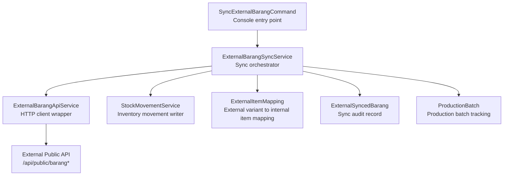
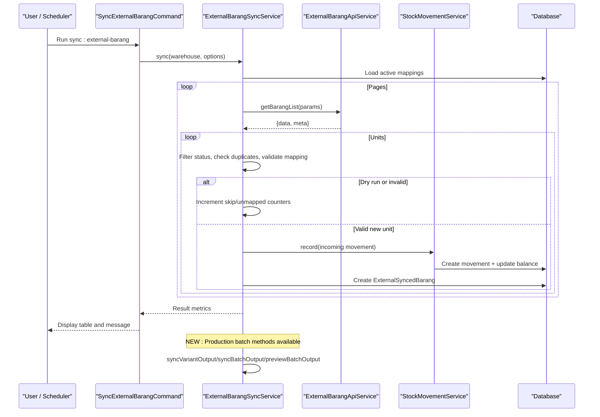
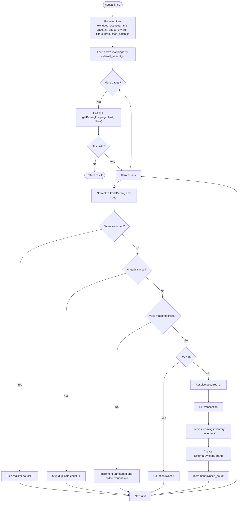
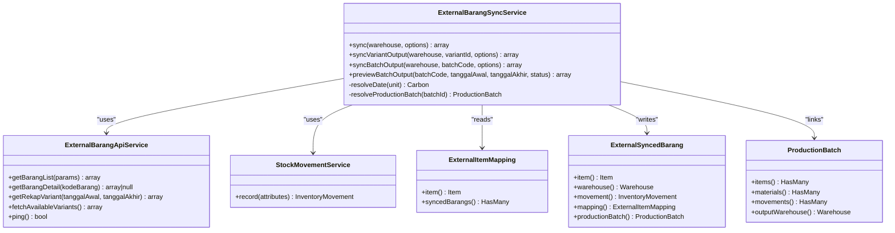

# External Barang Sync Service

<cite>
**Referenced Files in This Document**
- [ExternalBarangSyncService.php](file://app/Services/ExternalBarangSyncService.php)
- [ExternalBarangApiService.php](file://app/Services/ExternalBarangApiService.php)
- [StockMovementService.php](file://app/Services/StockMovementService.php)
- [ExternalItemMapping.php](file://app/Models/ExternalItemMapping.php)
- [ExternalSyncedBarang.php](file://app/Models/ExternalSyncedBarang.php)
- [ProductionBatch.php](file://app/Models/ProductionBatch.php)
- [SyncExternalBarangCommand.php](file://app/Console/Commands/SyncExternalBarangCommand.php)
- [2026_11_23_000001_create_external_item_mappings_table.php](file://database/migrations/2026_11_23_000001_create_external_item_mappings_table.php)
- [2026_11_23_000002_create_external_synced_barangs_table.php](file://database/migrations/2026_11_23_000002_create_external_synced_barangs_table.php)
- [2026_11_24_000001_add_production_batch_id_to_external_synced_barangs_table.php](file://database/migrations/2026_11_24_000001_add_production_batch_id_to_external_synced_barangs_table.php)
- [services.php](file://config/services.php)
- [ExternalBarangSyncServiceTest.php](file://tests/Feature/ExternalBarangSyncServiceTest.php)
</cite>

## Update Summary
**Changes Made**
- Added comprehensive documentation for new production batch integration methods
- Updated architecture diagrams to include production batch relationships
- Enhanced method descriptions to cover syncVariantOutput(), syncBatchOutput(), and previewBatchOutput()
- Added production batch ID field support documentation
- Updated data models section to include ProductionBatch relationship
- Expanded troubleshooting guide with production batch specific scenarios

## Table of Contents
1. [Introduction](#introduction)
2. [Project Structure](#project-structure)
3. [Core Components](#core-components)
4. [Architecture Overview](#architecture-overview)
5. [Detailed Component Analysis](#detailed-component-analysis)
6. [Production Batch Integration](#production-batch-integration)
7. [Dependency Analysis](#dependency-analysis)
8. [Performance Considerations](#performance-considerations)
9. [Troubleshooting Guide](#troubleshooting-guide)
10. [Conclusion](#conclusion)

## Introduction
This document explains the External Barang synchronization system that pulls finished helmet units from an external public API and records them as inventory movements into a configured warehouse. The central orchestrator is `ExternalBarangSyncService`. It coordinates:

- Fetching paginated unit data from the external API through `ExternalBarangApiService`.
- Filtering by status, skipping already synced items, and validating variant mappings via `ExternalItemMapping`.
- Recording stock increases using `StockMovementService`.
- Persisting sync audit records in `ExternalSyncedBarang`.
- Providing a console command entry point for manual or scheduled runs.
- **NEW**: Integrating with production batches for structured output tracking through `syncVariantOutput()`, `syncBatchOutput()`, and `previewBatchOutput()` methods.

The service is designed to be idempotent, safe for repeated execution, and focused on production finish goods rather than registration-stage items.

## Project Structure
The synchronization feature spans services, models, migrations, configuration, a console command, and tests:



**Diagram sources**
- [SyncExternalBarangCommand.php:16-28](file://app/Console/Commands/SyncExternalBarangCommand.php#L16-L28)
- [ExternalBarangSyncService.php:14-19](file://app/Services/ExternalBarangSyncService.php#L14-L19)
- [ExternalBarangApiService.php:10-20](file://app/Services/ExternalBarangApiService.php#L10-L20)
- [StockMovementService.php:16-23](file://app/Services/StockMovementService.php#L16-L23)
- [ExternalItemMapping.php:23-47](file://app/Models/ExternalItemMapping.php#L23-L47)
- [ExternalSyncedBarang.php:23-60](file://app/Models/ExternalSyncedBarang.php#L23-L60)
- [ProductionBatch.php:22-117](file://app/Models/ProductionBatch.php#L22-L117)

**Section sources**
- [ExternalBarangSyncService.php:14-801](file://app/Services/ExternalBarangSyncService.php#L14-L801)
- [ExternalBarangApiService.php:10-188](file://app/Services/ExternalBarangApiService.php#L10-L188)
- [StockMovementService.php:16-398](file://app/Services/StockMovementService.php#L16-L398)
- [ExternalItemMapping.php:23-47](file://app/Models/ExternalItemMapping.php#L23-L47)
- [ExternalSyncedBarang.php:23-60](file://app/Models/ExternalSyncedBarang.php#L23-L60)
- [ProductionBatch.php:22-117](file://app/Models/ProductionBatch.php#L22-L117)
- [SyncExternalBarangCommand.php:9-90](file://app/Console/Commands/SyncExternalBarangCommand.php#L9-L90)

## Core Components
- `ExternalBarangSyncService`: Orchestrates the full sync workflow, including pagination, filtering, validation, mapping, idempotency checks, stock recording, and result reporting. **Updated** to include production batch integration methods.
- `ExternalBarangApiService`: Encapsulates HTTP calls to the external public API with base URL, timeout, error logging, and helper endpoints such as ping and variant discovery.
- `StockMovementService`: Records inventory movements and updates balances safely within database transactions.
- `ExternalItemMapping`: Maps external variant identifiers to internal items; used to determine whether a unit can be synchronized.
- `ExternalSyncedBarang`: Persists each successfully processed external unit for audit and deduplication. **Updated** to include production batch tracking.
- `ProductionBatch`: Represents production batches that track manufacturing output and link inventory movements to specific production runs.
- `SyncExternalBarangCommand`: Provides a user-friendly CLI interface to run sync jobs with options like limit, page handling, status filter, and dry-run mode.

**Section sources**
- [ExternalBarangSyncService.php:14-801](file://app/Services/ExternalBarangSyncService.php#L14-L801)
- [ExternalBarangApiService.php:10-188](file://app/Services/ExternalBarangApiService.php#L10-L188)
- [StockMovementService.php:16-398](file://app/Services/StockMovementService.php#L16-L398)
- [ExternalItemMapping.php:23-47](file://app/Models/ExternalItemMapping.php#L23-L47)
- [ExternalSyncedBarang.php:23-60](file://app/Models/ExternalSyncedBarang.php#L23-L60)
- [ProductionBatch.php:22-117](file://app/Models/ProductionBatch.php#L22-L117)
- [SyncExternalBarangCommand.php:9-90](file://app/Console/Commands/SyncExternalBarangCommand.php#L9-L90)

## Architecture Overview
The sync process follows a clear pipeline with enhanced production batch integration:

1. Command receives options and resolves the target warehouse.
2. Sync service loads active mappings and prepares counters.
3. For each page:
   - Build query parameters (page, limit, optional status and variant filters).
   - Call external API via `ExternalBarangApiService`.
   - Iterate units and apply business rules:
     - Skip excluded statuses.
     - Skip duplicates already recorded.
     - Validate variant mapping.
     - Optionally simulate in dry-run mode.
     - Record inventory movement and persisted sync record within a transaction.
4. Return structured results with metrics and unmapped variant details.

**NEW**: Production batch integration provides three specialized workflows:
- `syncVariantOutput()`: Aggregates all units for a specific variant into one movement
- `syncBatchOutput()`: Processes all variants in an external batch code, creating separate movements per mapped item
- `previewBatchOutput()`: Returns preview data without committing changes



**Diagram sources**
- [SyncExternalBarangCommand.php:33-87](file://app/Console/Commands/SyncExternalBarangCommand.php#L33-L87)
- [ExternalBarangSyncService.php:40-222](file://app/Services/ExternalBarangSyncService.php#L40-L222)
- [ExternalBarangApiService.php:33-55](file://app/Services/ExternalBarangApiService.php#L33-L55)
- [StockMovementService.php:23-60](file://app/Services/StockMovementService.php#L23-L60)

## Detailed Component Analysis

### ExternalBarangSyncService
Responsibilities:
- Parse sync options: excluded statuses, limit, page, all pages, dry run, user ID, status filter, variant filter, **and production batch ID**.
- Load active mappings keyed by external variant ID.
- Paginate external API responses and iterate units.
- Apply business rules:
  - Exclude registration-like statuses.
  - Enforce idempotency by checking existing `ExternalSyncedBarang` records.
  - Require valid mapping to an internal item.
  - Support dry-run simulation without writing stock.
- Resolve occurrence date from external fields with fallback to current time.
- Record stock increase and persist sync audit record within a database transaction.
- Aggregate metrics and return a structured result array.

**NEW Methods:**
- `syncVariantOutput()`: Processes all eligible units for a specific variant into a single inventory movement linked to a production batch.
- `syncBatchOutput()`: Groups units by external batch code, creates separate movements per mapped item, and handles unmapped variants.
- `previewBatchOutput()`: Returns preview data for batch processing without committing changes.

Key behaviors:
- Pagination: supports single-page and multi-page processing controlled by `all_pages`.
- Idempotency: prevents duplicate syncs per `kode_barang`.
- Validation: skips unmapped variants and reports them for operator action.
- Error isolation: individual unit failures are logged and do not abort the entire batch.
- **Production batch linking**: All sync operations can now be associated with production batches for better tracking and reporting.



**Diagram sources**
- [ExternalBarangSyncService.php:40-222](file://app/Services/ExternalBarangSyncService.php#L40-L222)

**Section sources**
- [ExternalBarangSyncService.php:40-801](file://app/Services/ExternalBarangSyncService.php#L40-L801)

### ExternalBarangApiService
Responsibilities:
- Configure base URL and timeout from environment/config.
- Provide methods for:
  - Listing barang units with pagination and filters.
  - Fetching detail by `kodeBarang`.
  - Fetching aggregated variant recap.
  - Discovering available variants for mapping setup.
  - Pinging the external API for health checks.
- Log warnings and errors for non-successful responses or connection issues.
- Return normalized arrays even when API fails to keep callers stable.

API communication patterns:
- Uses Laravel HTTP client with JSON accept header.
- Returns empty structures instead of throwing exceptions for failed requests, allowing sync to continue gracefully.

**Section sources**
- [ExternalBarangApiService.php:10-188](file://app/Services/ExternalBarangApiService.php#L10-L188)

### StockMovementService
Responsibilities relevant to sync:
- `record()` creates an inventory movement and applies delta to warehouse balance.
- Ensures positive quantity and uses database transactions for consistency.
- Locks balance rows during updates to prevent race conditions.

Integration with sync:
- Sync service calls `record()` with type indicating incoming production output.
- Movement reference uses external `kodeBarang`, linking audit records to inventory changes.
- **NEW**: Movements can now be linked to production batches via `production_batch_id` field.

**Section sources**
- [StockMovementService.php:23-60](file://app/Services/StockMovementService.php#L23-L60)
- [StockMovementService.php:358-387](file://app/Services/StockMovementService.php#L358-L387)

### Data Models and Mappings

#### ExternalItemMapping
Purpose:
- Maps external variant identifiers to internal items.
- Stores external descriptive metadata useful for UI and diagnostics.
- Supports activation flag to control which mappings participate in sync.

Relationships:
- Belongs to internal `Item`.
- Has many `ExternalSyncedBarang` records linked by `external_variant_id`.

**Section sources**
- [ExternalItemMapping.php:23-47](file://app/Models/ExternalItemMapping.php#L23-L47)

#### ExternalSyncedBarang
Purpose:
- Audit record for each successfully synced external unit.
- Tracks external identifiers, mapped internal item, warehouse, movement link, status, timestamps.
- **UPDATED**: Now includes `production_batch_id` field to link sync records to production batches.

Relationships:
- Belongs to `Item`, `Warehouse`, `InventoryMovement`, `ExternalItemMapping`, and **NEW** `ProductionBatch`.

**Section sources**
- [ExternalSyncedBarang.php:23-60](file://app/Models/ExternalSyncedBarang.php#L23-L60)

#### ProductionBatch
Purpose:
- Represents a production batch that tracks manufacturing output.
- Links inventory movements to specific production runs.
- Provides actual output calculations based on inventory movements.

Relationships:
- Has many `ProductionBatchItem`, `ProductionBatchMaterial`, and `InventoryMovement` records.
- Belongs to material and output warehouses.

**Section sources**
- [ProductionBatch.php:22-117](file://app/Models/ProductionBatch.php#L22-L117)

#### Database Schema Highlights
- `external_item_mappings`: Unique constraint on `external_variant_id`; indexes support efficient lookup during sync.
- `external_synced_barangs`: Unique constraint on `kode_barang`; indexes on `item_id`, `warehouse_id`, and `synced_at` support queries and reporting.
- **NEW**: `production_batch_id` foreign key added to `external_synced_barangs` table linking to `production_batches`.

**Section sources**
- [2026_11_23_000001_create_external_item_mappings_table.php:14-27](file://database/migrations/2026_11_23_000001_create_external_item_mappings_table.php#L14-L27)
- [2026_11_23_000002_create_external_synced_barangs_table.php:14-37](file://database/migrations/2026_11_23_000002_create_external_synced_barangs_table.php#L14-L37)
- [2026_11_24_000001_add_production_batch_id_to_external_synced_barangs_table.php:14-20](file://database/migrations/2026_11_24_000001_add_production_batch_id_to_external_synced_barangs_table.php#L14-L20)

### Console Command: SyncExternalBarangCommand
Responsibilities:
- Define command signature with options: warehouse, limit, all-pages, status, dry-run.
- Resolve active warehouse from config or first active warehouse if none provided.
- Invoke sync service with parsed options.
- Display metrics table and unmapped variants list.

Usage examples:
- Basic sync to default warehouse:
  - `php artisan sync:external-barang`
- Sync with explicit warehouse and limit:
  - `php artisan sync:external-barang --warehouse=1 --limit=50`
- Process all pages:
  - `php artisan sync:external-barang --all-pages`
- Filter by status:
  - `php artisan sync:external-barang --status=FINISHGOOD`
- Dry-run simulation:
  - `php artisan sync:external-barang --dry-run`
- **NEW**: Link to production batch:
  - `php artisan sync:external-barang --warehouse=1 --production-batch-id=5`

**Section sources**
- [SyncExternalBarangCommand.php:9-90](file://app/Console/Commands/SyncExternalBarangCommand.php#L9-L90)

## Production Batch Integration

### Overview
The production batch integration enhances the External Barang sync system by providing structured tracking of finished goods against specific production runs. This enables better accountability, reporting, and reconciliation between external production data and internal inventory management.

### New Methods

#### syncVariantOutput()
Aggregates all eligible units for a specific external variant into a single inventory movement linked to a production batch.

**Key Features:**
- Validates variant mapping exists
- Filters units by status, date range, and batch code
- Creates one consolidated movement with total quantity
- Handles duplicate detection and date range filtering
- Supports optional quantity limiting

**Usage Example:**
```php
$result = $syncService->syncVariantOutput($warehouse, $variantId, [
    'production_batch_id' => $batch->getKey(),
    'tanggal_awal' => '2026-11-01',
    'tanggal_akhir' => '2026-11-30',
    'status' => 'FINISHGOOD',
    'occurred_at' => '2026-11-24 08:00:00',
]);
```

#### syncBatchOutput()
Processes all units from an external batch code, creating separate inventory movements for each mapped item while handling unmapped variants.

**Key Features:**
- Groups units by external variant
- Creates separate movements per mapped item
- Reports unmapped variants separately
- Supports per-variant quantity limits
- Validates batch code existence

**Usage Example:**
```php
$result = $syncService->syncBatchOutput($warehouse, 'BC001', [
    'production_batch_id' => $batch->getKey(),
    'status' => 'FINISHGOOD',
    'quantities' => [5 => 2, 6 => 1], // Limit variant 5 to 2 units
]);
```

#### previewBatchOutput()
Returns preview data for batch processing without committing any changes.

**Key Features:**
- Non-destructive preview operation
- Groups units by variant with mapping information
- Reports unmapped variants
- Supports date range and status filtering

**Usage Example:**
```php
$preview = $syncService->previewBatchOutput('BC001', null, null, 'FINISHGOOD');
// Returns: ['total_units' => 3, 'groups' => [...], 'unmapped' => [...]]
```

### Production Batch Field Support
All sync operations now support the `production_batch_id` option to link inventory movements and sync records to specific production batches.

**Field Usage:**
- In `sync()`: Links individual unit syncs to a production batch
- In `syncVariantOutput()`: Required parameter for batch association
- In `syncBatchOutput()`: Required parameter for batch association
- In `ExternalSyncedBarang`: New `production_batch_id` field stores the relationship

**Section sources**
- [ExternalBarangSyncService.php:245-506](file://app/Services/ExternalBarangSyncService.php#L245-L506)
- [ExternalSyncedBarang.php:18](file://app/Models/ExternalSyncedBarang.php#L18)
- [2026_11_24_000001_add_production_batch_id_to_external_synced_barangs_table.php:14-20](file://database/migrations/2026_11_24_000001_add_production_batch_id_to_external_synced_barangs_table.php#L14-L20)

## Dependency Analysis
The sync service depends on:

- `ExternalBarangApiService` for external data retrieval.
- `StockMovementService` for inventory updates.
- Eloquent models for mappings and sync records.
- Configuration for external API settings and defaults.
- **NEW**: `ProductionBatch` model for production batch tracking.



**Diagram sources**
- [ExternalBarangSyncService.php:14-801](file://app/Services/ExternalBarangSyncService.php#L14-L801)
- [ExternalBarangApiService.php:10-188](file://app/Services/ExternalBarangApiService.php#L10-L188)
- [StockMovementService.php:16-398](file://app/Services/StockMovementService.php#L16-L398)
- [ExternalItemMapping.php:23-47](file://app/Models/ExternalItemMapping.php#L23-L47)
- [ExternalSyncedBarang.php:23-60](file://app/Models/ExternalSyncedBarang.php#L23-L60)
- [ProductionBatch.php:22-117](file://app/Models/ProductionBatch.php#L22-L117)

**Section sources**
- [ExternalBarangSyncService.php:14-801](file://app/Services/ExternalBarangSyncService.php#L14-L801)
- [ExternalBarangApiService.php:10-188](file://app/Services/ExternalBarangApiService.php#L10-L188)
- [StockMovementService.php:16-398](file://app/Services/StockMovementService.php#L16-L398)
- [ExternalItemMapping.php:23-47](file://app/Models/ExternalItemMapping.php#L23-L47)
- [ExternalSyncedBarang.php:23-60](file://app/Models/ExternalSyncedBarang.php#L23-L60)
- [ProductionBatch.php:22-117](file://app/Models/ProductionBatch.php#L22-L117)

## Performance Considerations
- Pagination limits: The sync service caps limit at 100 to avoid large payloads and reduce memory pressure.
- All-pages mode: Use cautiously; it iterates multiple pages and may increase runtime and API load.
- Mapping cache: Active mappings are loaded once per sync run and keyed by external variant ID for fast lookup.
- Transaction scope: Each unit's stock recording and sync record creation are wrapped in a transaction, ensuring atomicity but potentially increasing lock contention under high concurrency.
- Logging: Errors are logged per unit failure; consider log rotation and sampling for very large batches.
- Indexes: Database indexes on `external_synced_barangs.item_id`, `warehouse_id`, and `synced_at` improve query performance for reporting and deduplication.
- **NEW**: Production batch operations benefit from batch-level grouping, reducing database round-trips for related units.

Recommendations:
- Schedule sync jobs during off-peak hours.
- Use dry-run mode to validate configurations before committing stock changes.
- Monitor unmapped variants and maintain mappings proactively.
- Consider queueing sync jobs for large datasets to avoid request timeouts.
- **NEW**: Use `previewBatchOutput()` to validate batch processing logic before committing changes.

[No sources needed since this section provides general guidance]

## Troubleshooting Guide
Common issues and resolutions:

- No active warehouse found:
  - Ensure an active warehouse exists or pass `--warehouse=ID`.
  - Check configuration `EXTERNAL_BARANG_DEFAULT_WAREHOUSE_ID`.

- External API unreachable:
  - Verify `EXTERNAL_BARANG_API_URL` and network connectivity.
  - Use `ExternalBarangApiService::ping()` to test availability.
  - Review logs for connection errors.

- Excessive skipped register counts:
  - Adjust `excluded_statuses` in configuration if business rules change.
  - Confirm external API status values match expected formats.

- High unmapped variant count:
  - Configure mappings in `ExternalItemMapping` for missing external variants.
  - Use `ExternalBarangApiService::fetchAvailableVariants()` to discover variants.

- Duplicate sync attempts:
  - Idempotency is enforced by `kode_barang`; re-running sync will skip already synced units.
  - If you need to force re-sync, remove or adjust existing `ExternalSyncedBarang` records carefully.

- Inventory movement failures:
  - Inspect logs for stock recording errors.
  - Validate that the mapped item and warehouse exist and have sufficient constraints.

- Dry-run behavior:
  - Dry-run increments counters but does not write stock or sync records.
  - Use dry-run to validate filters and mappings before real execution.

- **NEW**: Production batch validation errors:
  - Ensure `production_batch_id` refers to an existing production batch.
  - Check that the production batch has proper warehouse assignments.
  - Verify that the batch status allows output recording.

- **NEW**: Batch output grouping issues:
  - Use `previewBatchOutput()` to identify unmapped variants before processing.
  - Check external batch codes match expected format.
  - Verify variant mappings exist for all expected variants in the batch.

- **NEW**: Quantity limiting problems:
  - Ensure requested quantities don't exceed available units.
  - Check that quantity limits are properly formatted as integers.
  - Verify that zero quantities are handled correctly (variants excluded).

**Section sources**
- [ExternalBarangSyncService.php:189-194](file://app/Services/ExternalBarangSyncService.php#L189-L194)
- [ExternalBarangApiService.php:42-54](file://app/Services/ExternalBarangApiService.php#L42-L54)
- [SyncExternalBarangCommand.php:35-45](file://app/Console/Commands/SyncExternalBarangCommand.php#L35-L45)
- [ExternalBarangSyncServiceTest.php:158-186](file://tests/Feature/ExternalBarangSyncServiceTest.php#L158-L186)
- [ExternalBarangSyncServiceTest.php:233-268](file://tests/Feature/ExternalBarangSyncServiceTest.php#L233-L268)
- [ExternalBarangSyncServiceTest.php:270-345](file://tests/Feature/ExternalBarangSyncServiceTest.php#L270-L345)

## Conclusion
The External Barang synchronization system provides a robust, idempotent mechanism to import finished helmet units from an external API into internal inventory. It emphasizes safety through transactions, clear filtering and validation, and comprehensive metrics reporting. Operators can configure warehouses, limits, filters, and dry-run modes via the console command, while developers can extend variant discovery and mapping workflows using the provided services and models.

**Updated**: The addition of production batch integration significantly enhances the system's capability to track finished goods against specific production runs. The new `syncVariantOutput()`, `syncBatchOutput()`, and `previewBatchOutput()` methods provide structured workflows for batch processing, while the `production_batch_id` field ensures proper linkage between external production data and internal inventory management. Proper maintenance of mappings, monitoring of logs and metrics, and utilization of the new batch processing features ensures reliable operation at scale with improved traceability and accountability.

[No sources needed since this section summarizes without analyzing specific files]