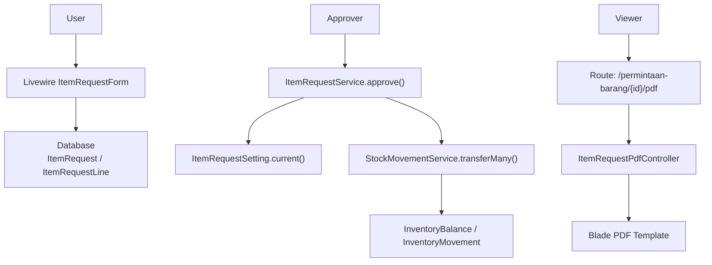
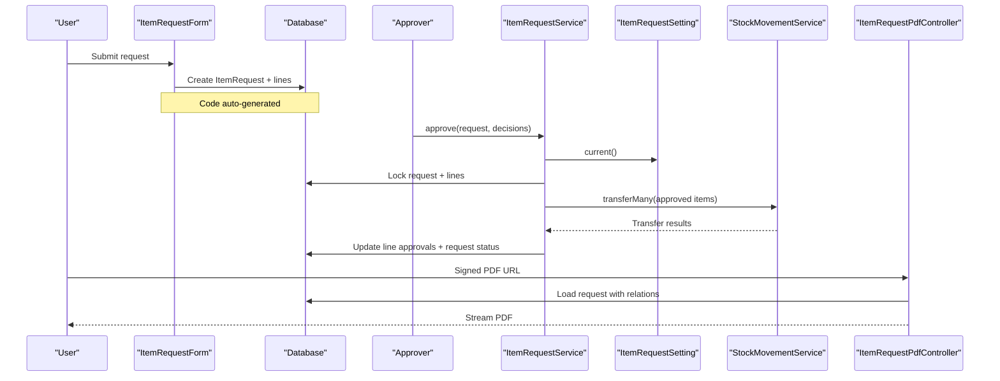
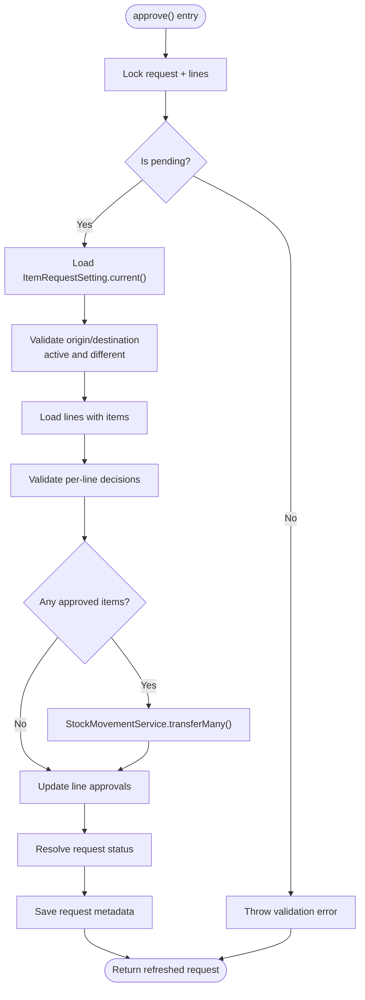
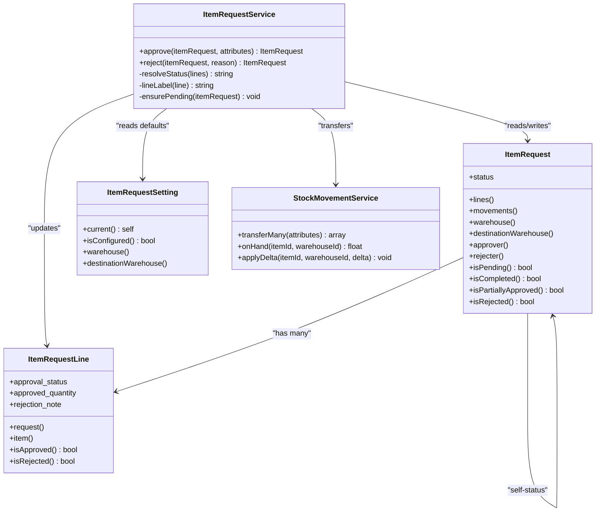

# Item Request Service

<cite>
**Referenced Files in This Document**
- [ItemRequestService.php](file://app/Services/ItemRequestService.php)
- [ItemRequest.php](file://app/Models/ItemRequest.php)
- [ItemRequestLine.php](file://app/Models/ItemRequestLine.php)
- [ItemRequestSetting.php](file://app/Models/ItemRequestSetting.php)
- [StockMovementService.php](file://app/Services/StockMovementService.php)
- [ItemRequestPdfController.php](file://app/Http/Controllers/ItemRequestPdfController.php)
- [ItemRequestForm.php](file://app/Livewire/ItemRequestForm.php)
- [web.php](file://routes/web.php)
- [item-request.blade.php](file://resources/views/pdf/item-request.blade.php)
</cite>

## Table of Contents
1. [Introduction](#introduction)
2. [Project Structure](#project-structure)
3. [Core Components](#core-components)
4. [Architecture Overview](#architecture-overview)
5. [Detailed Component Analysis](#detailed-component-analysis)
6. [Dependency Analysis](#dependency-analysis)
7. [Performance Considerations](#performance-considerations)
8. [Troubleshooting Guide](#troubleshooting-guide)
9. [Conclusion](#conclusion)

## Introduction
This document explains the item request processing and validation system centered on the `ItemRequestService`. It covers how requests are created, validated, approved or rejected, how inventory is allocated through warehouse transfers, and how PDF documents are generated for sharing. The documentation also describes the request lifecycle, approval workflow, integration with inventory management, business rules for allocation and partial approvals, and error handling for invalid inputs, insufficient stock, and rejections.

## Project Structure
The item request feature spans service logic, Eloquent models, a Livewire form, a PDF controller, routing, and a Blade template:

- Service layer:
  - `ItemRequestService` handles approval, rejection, status resolution, and coordination with inventory transfers.
  - `StockMovementService` performs stock checks and creates transfer movements between warehouses.
- Models:
  - `ItemRequest` represents the overall request header, including status, approval metadata, and relationships to lines and movements.
  - `ItemRequestLine` represents each requested item line, including per-line approval state and quantities.
  - `ItemRequestSetting` stores default origin and destination warehouses used during approval.
- UI and presentation:
  - `ItemRequestForm` (Livewire) validates user input, creates requests, and generates signed PDF links.
  - `ItemRequestPdfController` renders a signed PDF using a Blade view.
  - `item-request.blade.php` is the PDF template wrapper that includes the shared document view.
- Routing:
  - Public routes expose the creation form and the signed PDF endpoint.

**Diagram sources**
- [ItemRequestService.php:22-185](file://app/Services/ItemRequestService.php#L22-L185)
- [StockMovementService.php:209-289](file://app/Services/StockMovementService.php#L209-L289)
- [ItemRequestForm.php:95-151](file://app/Livewire/ItemRequestForm.php#L95-L151)
- [ItemRequestPdfController.php:11-17](file://app/Http/Controllers/ItemRequestPdfController.php#L11-L17)
- [web.php:11-17](file://routes/web.php#L11-L17)

**Section sources**
- [ItemRequestService.php:14-257](file://app/Services/ItemRequestService.php#L14-L257)
- [ItemRequest.php:26-134](file://app/Models/ItemRequest.php#L26-L134)
- [ItemRequestLine.php:21-79](file://app/Models/ItemRequestLine.php#L21-L79)
- [ItemRequestSetting.php:13-37](file://app/Models/ItemRequestSetting.php#L13-L37)
- [StockMovementService.php:16-397](file://app/Services/StockMovementService.php#L16-L397)
- [ItemRequestForm.php:22-304](file://app/Livewire/ItemRequestForm.php#L22-L304)
- [ItemRequestPdfController.php:9-19](file://app/Http/Controllers/ItemRequestPdfController.php#L9-L19)
- [web.php:11-17](file://routes/web.php#L11-L17)
- [item-request.blade.php:1-21](file://resources/views/pdf/item-request.blade.php#L1-L21)

## Core Components
- `ItemRequestService`: Encapsulates approval and rejection workflows, validates warehouse configuration, enforces per-line decisions, updates approval states, resolves final request status, and triggers inventory transfers for approved items.
- `ItemRequest` model: Defines statuses (`pending`, `processing`, `completed`, `partial`, `rejected`), helper methods for status checks, and relationships to lines, movements, warehouses, and users.
- `ItemRequestLine` model: Represents individual requested items, their requested quantity, approval status, approved quantity, and optional rejection notes.
- `ItemRequestSetting` model: Provides the current global setting for default origin and destination warehouses used by approval.
- `StockMovementService`: Validates and executes stock transfers, including multi-item transfers, shortage checks, and balance updates.
- `ItemRequestForm` (Livewire): Handles request creation, client-side validation, duplicate prevention, and signed PDF link generation.
- `ItemRequestPdfController`: Renders a signed PDF for an existing request.

**Section sources**
- [ItemRequestService.php:22-257](file://app/Services/ItemRequestService.php#L22-L257)
- [ItemRequest.php:31-134](file://app/Models/ItemRequest.php#L31-L134)
- [ItemRequestLine.php:26-79](file://app/Models/ItemRequestLine.php#L26-L79)
- [ItemRequestSetting.php:18-37](file://app/Models/ItemRequestSetting.php#L18-L37)
- [StockMovementService.php:209-289](file://app/Services/StockMovementService.php#L209-L289)
- [ItemRequestForm.php:95-151](file://app/Livewire/ItemRequestForm.php#L95-L151)
- [ItemRequestPdfController.php:11-17](file://app/Http/Controllers/ItemRequestPdfController.php#L11-L17)

## Architecture Overview
The end-to-end flow consists of three main phases:

1. Request Creation
   - A user fills out the Livewire form.
   - Validation ensures required fields, active divisions, valid items, positive quantities, and no duplicate items.
   - The request header and lines are persisted; a unique code is auto-generated.

2. Approval Workflow
   - An approver calls `ItemRequestService::approve()` with per-line decisions.
   - The service locks the request and its lines, validates warehouse settings, validates decisions, and optionally transfers stock for approved lines.
   - Per-line approval states and quantities are updated.
   - The request status becomes `completed`, `partial`, or `rejected` based on line outcomes.

3. Document Generation
   - After submission, the form can generate a signed PDF URL.
   - The signed route invokes the PDF controller, which loads the request with related data and streams a PDF.

**Diagram sources**
- [ItemRequestForm.php:95-151](file://app/Livewire/ItemRequestForm.php#L95-L151)
- [ItemRequestService.php:22-185](file://app/Services/ItemRequestService.php#L22-L185)
- [StockMovementService.php:209-289](file://app/Services/StockMovementService.php#L209-L289)
- [ItemRequestPdfController.php:11-17](file://app/Http/Controllers/ItemRequestPdfController.php#L11-L17)

## Detailed Component Analysis

### ItemRequestService
Responsibilities:
- Approve a pending request with per-line decisions.
- Reject a pending request globally without changing stock.
- Resolve final request status from line-level approval outcomes.
- Validate warehouse configuration and decision inputs.
- Coordinate inventory transfers for approved items.

Key behaviors:
- `approve(ItemRequest $itemRequest, array $attributes)`:
  - Uses a database transaction and row-level locking to prevent concurrent modifications.
  - Ensures the request is pending.
  - Reads default origin and destination warehouses from `ItemRequestSetting::current()`.
  - Validates that both warehouses are configured, active, and different.
  - Loads all lines with associated items under lock.
  - Requires a decision for every line.
  - For rejected lines, requires a non-empty rejection note within length limits.
  - For approved lines, requires a mapped item and a positive approved quantity not exceeding the requested quantity.
  - Calls `StockMovementService::transferMany()` when there are approved items.
  - Updates per-line approval status, approved quantity, and rejection notes.
  - Resolves the request status to `completed`, `partial`, or `rejected`.
  - Records approver/rejector timestamps and notes at the request level.

- `reject(ItemRequest $itemRequest, string $reason)`:
  - Validates that the reason is non-empty.
  - Locks the request, ensures it is pending, sets request status to rejected, and marks all lines as rejected with the provided reason.

- `resolveStatus(Collection $lines)`:
  - Returns `rejected` if all lines are rejected.
  - Returns `completed` if all lines are approved and fully covered by approved quantities.
  - Otherwise returns `partial`.

Error handling:
- Throws `ValidationException` for missing or invalid warehouse configuration, same origin/destination, inactive warehouses, missing line decisions, empty rejection notes, unmapped items, invalid approved quantities, and attempts to process non-pending requests.

**Diagram sources**
- [ItemRequestService.php:22-185](file://app/Services/ItemRequestService.php#L22-L185)

**Section sources**
- [ItemRequestService.php:22-257](file://app/Services/ItemRequestService.php#L22-L257)

### ItemRequest Model
Responsibilities:
- Define request statuses and labels.
- Auto-generate a unique request code upon creation.
- Provide relationship helpers for division, lines, movements, warehouses, approver, and rejecter.
- Expose convenience methods for checking status.

Important details:
- Status constants include `pending`, `processing`, `completed`, `partial`, and `rejected`.
- The code format is generated automatically after creation.
- Relationships support navigation to related entities for reporting and PDF generation.

**Section sources**
- [ItemRequest.php:26-134](file://app/Models/ItemRequest.php#L26-L134)

### ItemRequestLine Model
Responsibilities:
- Represent each requested item line.
- Track requested quantity, approval status, approved quantity, and rejection notes.
- Provide helper methods to check if a line is approved or rejected.

Important details:
- Quantity and approved quantity are cast to decimal precision.
- Relationship to the parent request and the mapped item.

**Section sources**
- [ItemRequestLine.php:21-79](file://app/Models/ItemRequestLine.php#L21-L79)

### ItemRequestSetting Model
Responsibilities:
- Store the current default origin and destination warehouses used during approval.
- Provide a singleton-like accessor to retrieve or create the current setting.

Important details:
- `current()` returns the single configuration row, creating it if absent.
- `isConfigured()` indicates whether both warehouses are set.

**Section sources**
- [ItemRequestSetting.php:13-37](file://app/Models/ItemRequestSetting.php#L13-L37)

### StockMovementService Integration
Responsibilities relevant to item requests:
- `transferMany(array $attributes)` validates origin/destination warehouses, aggregates quantities per item, checks available stock, and creates paired outgoing/incoming inventory movements.
- Shortage detection prevents approvals from moving more stock than available.

Integration points:
- `ItemRequestService::approve()` passes approved items, warehouse IDs, occurrence time, reference code, note, requester ID, and the request ID to `transferMany()`.
- Successful transfers update `InventoryBalance` and record `InventoryMovement` entries linked to the request.

Error handling:
- Throws validation exceptions for missing warehouses, same origin/destination, zero or negative quantities, and insufficient stock.

**Section sources**
- [StockMovementService.php:209-289](file://app/Services/StockMovementService.php#L209-L289)
- [StockMovementService.php:346-387](file://app/Services/StockMovementService.php#L346-L387)

### Request Creation via Livewire Form
Responsibilities:
- Render the request form with active divisions and active items.
- Validate required fields, ensure active divisions and items, enforce positive quantities, and prevent duplicate items.
- Persist the request and lines inside a transaction.
- Generate a signed PDF URL for the submitted request.

Validation rules:
- Requester name, division, and at least one line are required.
- Each line must have either a selected active item or a manual item name.
- Duplicate items are prevented across lines.
- Quantities must be numeric and greater than zero.

Post-submission behavior:
- Sets success flags, captures the request code and ID, resets validation, and prepares a share message and signed PDF URL.

**Section sources**
- [ItemRequestForm.php:95-151](file://app/Livewire/ItemRequestForm.php#L95-L151)
- [ItemRequestForm.php:174-208](file://app/Livewire/ItemRequestForm.php#L174-L208)
- [ItemRequestForm.php:210-262](file://app/Livewire/ItemRequestForm.php#L210-L262)

### PDF Generation
Responsibilities:
- Provide a signed route for downloading a PDF of a specific request.
- Load necessary relations for rendering.
- Stream the PDF with a filename derived from the request code.

Template usage:
- The PDF controller uses a Blade view that includes the shared document view with a PDF mode flag.

Routing:
- The signed route is exposed under `/permintaan-barang/{itemRequest}/pdf`.

**Section sources**
- [ItemRequestPdfController.php:11-17](file://app/Http/Controllers/ItemRequestPdfController.php#L11-L17)
- [item-request.blade.php:1-21](file://resources/views/pdf/item-request.blade.php#L1-L21)
- [web.php:15-17](file://routes/web.php#L15-L17)

## Dependency Analysis
The following diagram shows key dependencies among components involved in item request processing:

**Diagram sources**
- [ItemRequestService.php:22-257](file://app/Services/ItemRequestService.php#L22-L257)
- [ItemRequest.php:26-134](file://app/Models/ItemRequest.php#L26-L134)
- [ItemRequestLine.php:21-79](file://app/Models/ItemRequestLine.php#L21-L79)
- [ItemRequestSetting.php:13-37](file://app/Models/ItemRequestSetting.php#L13-L37)
- [StockMovementService.php:209-289](file://app/Services/StockMovementService.php#L209-L289)

## Performance Considerations
- Database locking:
  - Approval uses `lockForUpdate()` on both the request and its lines to prevent race conditions during concurrent approvals.
- Transaction boundaries:
  - Approval and rejection wrap multiple writes in transactions to maintain consistency.
- Stock aggregation:
  - `transferMany()` aggregates quantities per item before checking stock and creating movements, reducing repeated lookups.
- Relation loading:
  - PDF generation explicitly loads only needed relations to minimize query overhead.

Recommendations:
- Keep approval operations short-lived and avoid heavy computations inside transactions.
- Use indexed queries for frequent filters such as active warehouses and active items.
- Consider caching frequently accessed configuration like `ItemRequestSetting::current()` if read-heavy.

[No sources needed since this section provides general guidance]

## Troubleshooting Guide
Common issues and resolutions:

- Invalid request creation:
  - Missing requester name, division, or lines will fail validation.
  - Duplicate items across lines are blocked.
  - Ensure active divisions and active items are selected.

- Insufficient stock during approval:
  - If approved quantities exceed available stock, `StockMovementService` throws a validation exception listing shortages.
  - Reduce approved quantities or increase stock before approving.

- Rejection errors:
  - Global rejection requires a non-empty reason.
  - Per-line rejection requires a non-empty rejection note with a maximum length limit.

- Warehouse configuration errors:
  - Origin and destination warehouses must be configured, active, and different.
  - Configure them via the item request settings interface.

- Attempting to process non-pending requests:
  - Only requests with status `pending` can be approved or rejected.

**Section sources**
- [ItemRequestForm.php:95-151](file://app/Livewire/ItemRequestForm.php#L95-L151)
- [ItemRequestForm.php:174-208](file://app/Livewire/ItemRequestForm.php#L174-L208)
- [ItemRequestService.php:35-105](file://app/Services/ItemRequestService.php#L35-L105)
- [ItemRequestService.php:191-221](file://app/Services/ItemRequestService.php#L191-L221)
- [StockMovementService.php:249-265](file://app/Services/StockMovementService.php#L249-L265)

## Conclusion
The `ItemRequestService` centralizes the approval and rejection workflow for item requests, enforcing strict validation, safe concurrency, and consistent inventory updates. Combined with the Livewire form for creation and the PDF controller for document generation, the system provides a complete lifecycle from request submission to fulfillment and documentation. Proper configuration of warehouses, careful validation of per-line decisions, and adherence to stock availability rules are essential to maintaining accurate inventory and reliable approvals.

[No sources needed since this section summarizes without analyzing specific files]