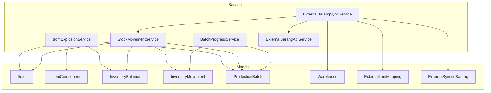
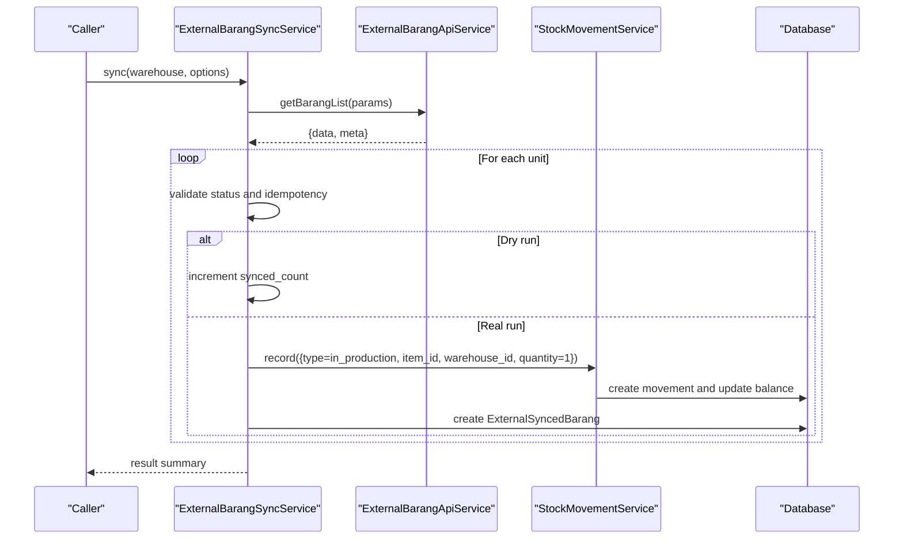
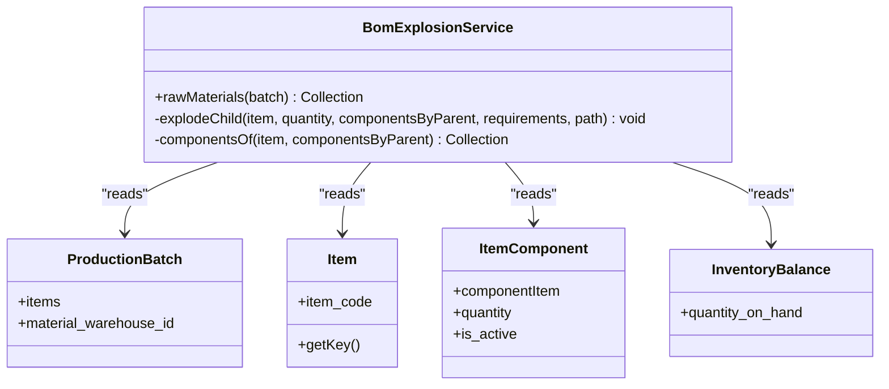
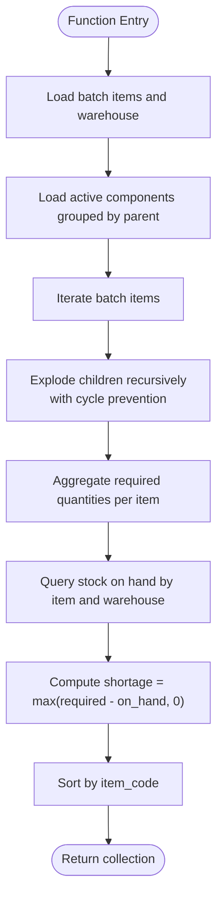
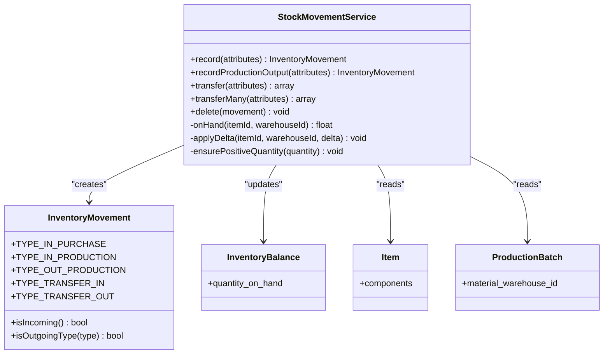
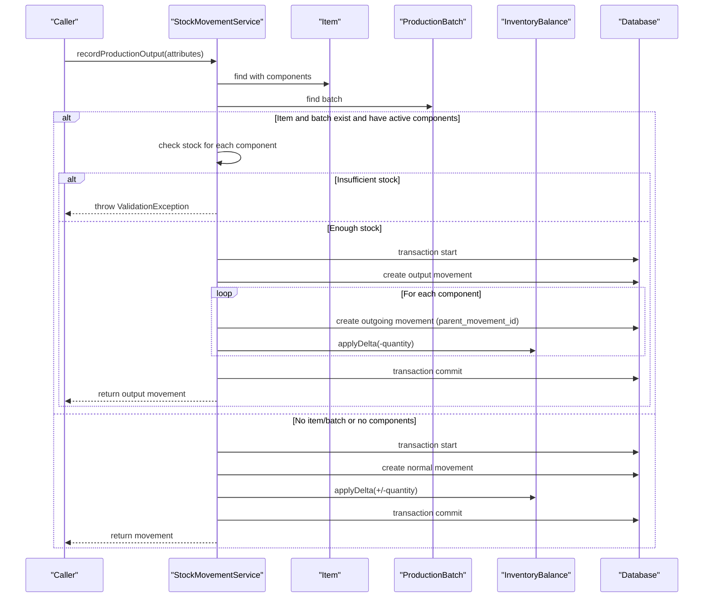
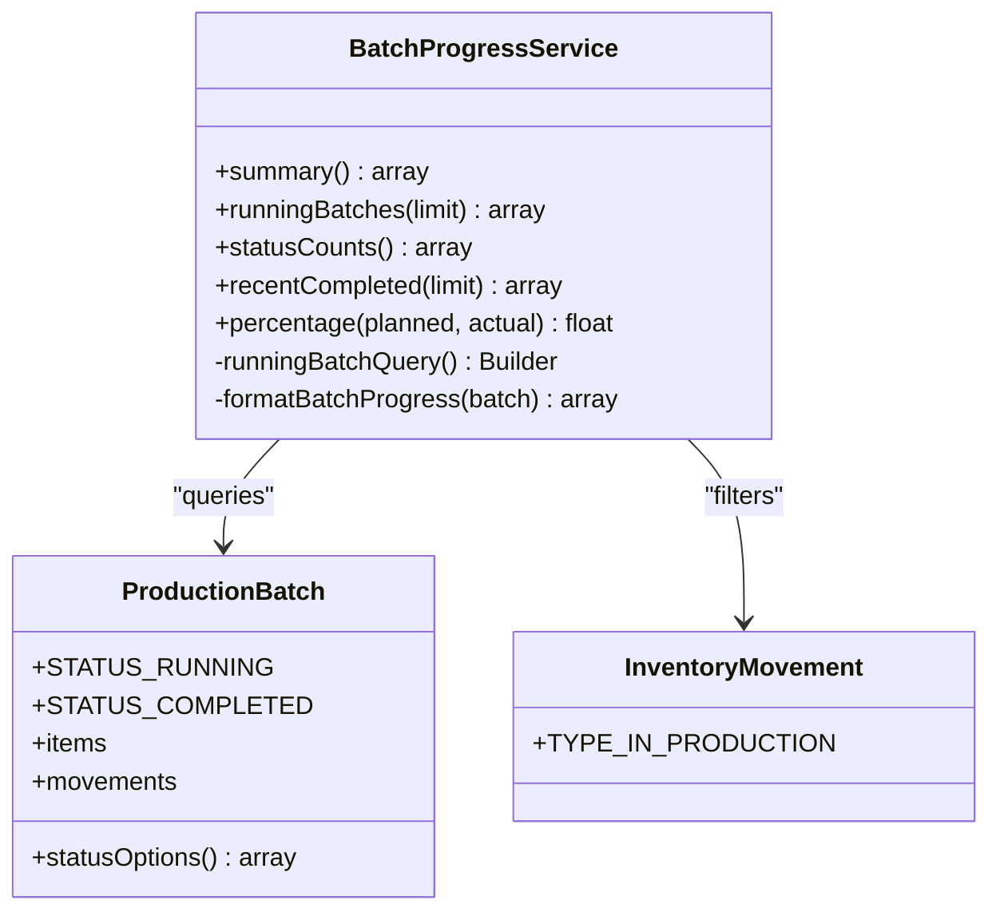
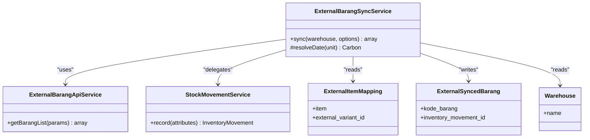
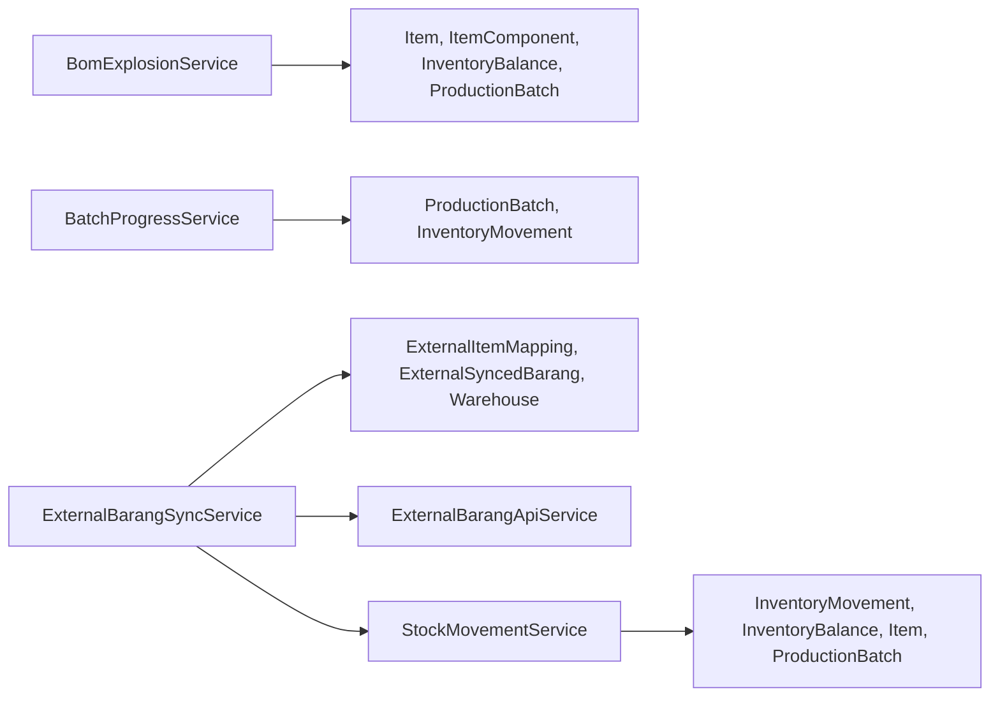

# Services Layer

<cite>
**Referenced Files in This Document**
- [BomExplosionService.php](file://app/Services/BomExplosionService.php)
- [StockMovementService.php](file://app/Services/StockMovementService.php)
- [BatchProgressService.php](file://app/Services/BatchProgressService.php)
- [ExternalBarangSyncService.php](file://app/Services/ExternalBarangSyncService.php)
- [ExternalBarangApiService.php](file://app/Services/ExternalBarangApiService.php)
- [Item.php](file://app/Models/Item.php)
- [ItemComponent.php](file://app/Models/ItemComponent.php)
- [InventoryBalance.php](file://app/Models/InventoryBalance.php)
- [InventoryMovement.php](file://app/Models/InventoryMovement.php)
- [ProductionBatch.php](file://app/Models/ProductionBatch.php)
- [Warehouse.php](file://app/Models/Warehouse.php)
- [ExternalItemMapping.php](file://app/Models/ExternalItemMapping.php)
- [ExternalSyncedBarang.php](file://app/Models/ExternalSyncedBarang.php)
</cite>

## Table of Contents
1. [Introduction](#introduction)
2. [Project Structure](#project-structure)
3. [Core Components](#core-components)
4. [Architecture Overview](#architecture-overview)
5. [Detailed Component Analysis](#detailed-component-analysis)
6. [Dependency Analysis](#dependency-analysis)
7. [Performance Considerations](#performance-considerations)
8. [Troubleshooting Guide](#troubleshooting-guide)
9. [Conclusion](#conclusion)

## Introduction
This document explains the services layer architecture for inventory, production, and external synchronization. It focuses on four core service classes:

- BomExplosionService: calculates raw material requirements from a production batch by exploding active BOM components.
- StockMovementService: records stock movements, transfers, production outputs, and updates inventory balances safely with transactions.
- BatchProgressService: computes production progress summaries, running batches, status counts, and recent completed batches.
- ExternalBarangSyncService: synchronizes finished goods from an external API into local inventory using mappings and idempotency.

The services collaborate through shared models and composition patterns. Transaction boundaries, validation, error handling, and performance techniques are documented to help developers understand how to use and extend these services safely.

## Project Structure
The services live under app/Services and operate over domain models under app/Models. The main relationships are:

- BomExplosionService reads ProductionBatch, Item, ItemComponent, and InventoryBalance to compute required raw materials.
- StockMovementService writes InventoryMovement and updates InventoryBalance.
- BatchProgressService reads ProductionBatch and InventoryMovement to calculate progress metrics.
- ExternalBarangSyncService composes ExternalBarangApiService and StockMovementService, and persists ExternalSyncedBarang and ExternalItemMapping references.

**Diagram sources**
- [BomExplosionService.php:11-107](file://app/Services/BomExplosionService.php#L11-L107)
- [StockMovementService.php:16-397](file://app/Services/StockMovementService.php#L16-L397)
- [BatchProgressService.php:9-151](file://app/Services/BatchProgressService.php#L9-L151)
- [ExternalBarangSyncService.php:14-241](file://app/Services/ExternalBarangSyncService.php#L14-L241)
- [ExternalBarangApiService.php:10-187](file://app/Services/ExternalBarangApiService.php#L10-L187)
- [Item.php:41-172](file://app/Models/Item.php#L41-L172)
- [ItemComponent.php:19-85](file://app/Models/ItemComponent.php#L19-L85)
- [InventoryBalance.php:20-70](file://app/Models/InventoryBalance.php#L20-L70)
- [InventoryMovement.php:28-190](file://app/Models/InventoryMovement.php#L28-L190)
- [ProductionBatch.php:22-116](file://app/Models/ProductionBatch.php#L22-L116)
- [Warehouse.php:12-36](file://app/Models/Warehouse.php#L12-L36)
- [ExternalItemMapping.php:23-48](file://app/Models/ExternalItemMapping.php#L23-L48)
- [ExternalSyncedBarang.php:23-61](file://app/Models/ExternalSyncedBarang.php#L23-L61)

**Section sources**
- [BomExplosionService.php:11-107](file://app/Services/BomExplosionService.php#L11-L107)
- [StockMovementService.php:16-397](file://app/Services/StockMovementService.php#L16-L397)
- [BatchProgressService.php:9-151](file://app/Services/BatchProgressService.php#L9-L151)
- [ExternalBarangSyncService.php:14-241](file://app/Services/ExternalBarangSyncService.php#L14-L241)

## Core Components
This section summarizes each service’s responsibilities, key methods, parameters, return values, and business logic.

### BomExplosionService
Responsibilities:
- Explode active BOM components recursively for items in a production batch.
- Aggregate total required quantities per component item.
- Compare required quantities against current stock to compute shortages.

Key method:
- rawMaterials(ProductionBatch $batch): Collection<int, array{item: Item, quantity_required: float, stock_on_hand: float, shortage_quantity: float}>
  - Parameters:
    - batch: A production batch whose planned items will be exploded.
  - Returns:
    - A collection of rows containing the item, required quantity, current stock on hand (optionally filtered by the batch’s material warehouse), and shortage quantity.
  - Business logic:
    - Loads batch items and their related item data.
    - Loads all active ItemComponent relations grouped by parent_item_id.
    - For each batch item, recursively explodes child components while preventing cycles via a path tracker.
    - Aggregates total required quantities per component item.
    - Queries InventoryBalance for aggregated stock on hand, optionally scoped to the batch’s material_warehouse_id.
    - Computes shortage as max(required - on_hand, 0).
    - Sorts results by item_code.

Complexity notes:
- Component explosion is proportional to the number of active components reachable from batch items.
- Stock queries are batched by item IDs to reduce N+1 lookups.

Usage example:
- Call rawMaterials(batch) from a BOM builder page or report to show required raw materials and shortages.

**Section sources**
- [BomExplosionService.php:11-107](file://app/Services/BomExplosionService.php#L11-L107)
- [ItemComponent.php:19-85](file://app/Models/ItemComponent.php#L19-L85)
- [InventoryBalance.php:20-70](file://app/Models/InventoryBalance.php#L20-L70)

### StockMovementService
Responsibilities:
- Record single stock movements and update inventory balances atomically.
- Record production output with automatic material consumption based on active BOM components.
- Transfer stock between warehouses with paired outgoing and incoming movements.
- Delete movements with safe reversal and dependency handling.

Key methods:
- record(array $attributes): InventoryMovement
  - Parameters:
    - attributes: type, item_id, warehouse_id, optional production_batch_id, stock_opname_id, item_request_id, transfer_group_id, parent_movement_id, occurred_at, reference, note, created_by.
  - Returns:
    - Created InventoryMovement.
  - Business logic:
    - Validates positive quantity.
    - Creates movement inside a database transaction.
    - Applies signed delta to InventoryBalance using lockForUpdate to prevent race conditions.

- recordProductionOutput(array $attributes): InventoryMovement
  - Parameters:
    - attributes: includes item_id, production_batch_id, warehouse_id, quantity, plus common fields.
  - Returns:
    - Created InventoryMovement representing production output.
  - Business logic:
    - If both item and batch exist and item has active components, it checks available stock in the batch’s material warehouse.
    - Throws ValidationException if any component is short.
    - Records the output movement and then records outgoing movements for each component, linked via parent_movement_id.

- transfer(array $attributes): array{0: InventoryMovement, 1: InventoryMovement}
  - Parameters:
    - attributes: item_id, warehouse_id (origin), destination_warehouse_id, quantity, plus common fields.
  - Returns:
    - Array of two movements: origin out and destination in.
  - Business logic:
    - Validates that origin and destination differ and are present.
    - Creates paired movements within a transaction and applies deltas.

- transferMany(array $attributes): array<int, array{0: InventoryMovement, 1: InventoryMovement}>
  - Parameters:
    - attributes: warehouse_id, destination_warehouse_id, items array of {item_id, quantity}, plus common fields.
  - Returns:
    - Array of paired movements for each valid item.
  - Business logic:
    - Aggregates quantities per item.
    - Validates availability across all items before committing.
    - Delegates to transfer() for each item inside a transaction.

- delete(InventoryMovement $movement): void
  - Parameters:
    - movement: Movement to reverse and remove.
  - Business logic:
    - If part of a transfer group, reverses and deletes all paired movements.
    - Reverses child movements first, then parent movements.
    - Validates that reversing incoming movements does not cause negative stock.

Helper methods:
- onHand(string $itemId, int|string|null $warehouseId): float
  - Returns current stock on hand for an item and warehouse; returns 0 when no warehouse is provided.
- applyDelta(string $itemId, int|string $warehouseId, float $delta): void
  - Atomically updates InventoryBalance with lockForUpdate and prevents negative stock.
- ensurePositiveQuantity(float $quantity): void
  - Throws ValidationException if quantity is not positive.

Error handling:
- Uses ValidationException for business rule violations such as insufficient stock, invalid warehouse pairs, and non-positive quantities.
- Uses DB::transaction to ensure consistency across multiple writes.

Performance considerations:
- Uses lockForUpdate on balance rows to avoid race conditions.
- Pre-validates shortages before committing large operations like transferMany.

Usage examples:
- Use record() for manual stock adjustments.
- Use recordProductionOutput() when finalizing production output with automatic material consumption.
- Use transfer() or transferMany() for moving stock between warehouses.
- Use delete() to undo movements safely.

**Section sources**
- [StockMovementService.php:16-397](file://app/Services/StockMovementService.php#L16-L397)
- [InventoryMovement.php:28-190](file://app/Models/InventoryMovement.php#L28-L190)
- [InventoryBalance.php:20-70](file://app/Models/InventoryBalance.php#L20-L70)

### BatchProgressService
Responsibilities:
- Provide summary metrics for running production batches.
- List recent running batches with progress percentages.
- Count batches by status.
- List recently completed batches with planned vs actual output.

Key methods:
- summary(): array{running_batches: int, planned_quantity: float, actual_quantity: float, progress_percentage: float, completed_this_month: int}
  - Computes totals for running batches and counts completed batches within the current month.

- runningBatches(int $limit = 8): array<int, array{batch_code: string, planned_quantity: float, actual_quantity: float, progress_percentage: float}>
  - Returns up to limit running batches ordered by started_at and id.

- statusCounts(): array<string, int>
  - Returns counts for each status option defined in ProductionBatch.

- recentCompleted(int $limit = 8): array<int, array{batch_code: string, finished_at: ?string, planned_quantity: float, actual_quantity: float, progress_percentage: float}>
  - Returns recently completed batches with planned and actual output computed via Eloquent sums.

- static percentage(float $plannedQuantity, float $actualQuantity): float
  - Calculates progress percentage safely when planned quantity is zero.

Business logic:
- Uses withSum to efficiently aggregate planned_quantity from ProductionBatchItem and actual_output from InventoryMovement where type equals TYPE_IN_PRODUCTION.
- Formats batch progress consistently across methods.

Usage examples:
- Use summary() for dashboard widgets.
- Use runningBatches() for a quick view of ongoing work.
- Use statusCounts() for charts showing distribution of batch statuses.
- Use recentCompleted() for reporting recent completions.

**Section sources**
- [BatchProgressService.php:9-151](file://app/Services/BatchProgressService.php#L9-L151)
- [ProductionBatch.php:22-116](file://app/Models/ProductionBatch.php#L22-L116)
- [InventoryMovement.php:28-190](file://app/Models/InventoryMovement.php#L28-L190)

### ExternalBarangSyncService
Responsibilities:
- Synchronize finished goods from an external API into local inventory.
- Map external variants to internal items using ExternalItemMapping.
- Ensure idempotent sync by skipping already synced kode_barang entries.
- Persist ExternalSyncedBarang records and create corresponding inventory movements.

Key method:
- sync(Warehouse $warehouse, array $options = []): array{success: bool, warehouse_id: int, warehouse_name: string, synced_count: int, skipped_register_count: int, skipped_duplicate_count: int, unmapped_count: int, unmapped_variants: array<int, array<string, mixed>>, total_processed: int, dry_run: bool, message: string}
  - Parameters:
    - warehouse: Destination warehouse for incoming stock.
    - options: excluded_statuses, limit, page, all_pages, dry_run, user_id, status, variant_id.
  - Returns:
    - A detailed result object including counts, unmapped variants, and a human-readable message.

Business logic:
- Loads active ExternalItemMapping records keyed by external_variant_id.
- Paginates external barang list via ExternalBarangApiService.getBarangList().
- Skips units with excluded statuses (default REGISTER).
- Skips duplicates by checking ExternalSyncedBarang.kode_barang uniqueness.
- Tracks unmapped variants and collects metadata for them.
- In non-dry-run mode, creates an inventory movement and a synced record inside a per-unit transaction.
- Catches exceptions per unit and logs errors without aborting the entire sync.
- Resolves occurrence date from external fields with fallback to now().

Integration points:
- Composes ExternalBarangApiService for remote data access.
- Delegates stock creation to StockMovementService.record().
- Persists ExternalSyncedBarang and uses Warehouse for target location.

Usage examples:
- Run sync(warehouse, ['dry_run' => true]) to preview what would be synced.
- Run sync(warehouse, ['all_pages' => true, 'excluded_statuses' => ['REGISTER', 'CANCELLED']]) to process multiple pages and filter statuses.

**Section sources**
- [ExternalBarangSyncService.php:14-241](file://app/Services/ExternalBarangSyncService.php#L14-L241)
- [ExternalBarangApiService.php:10-187](file://app/Services/ExternalBarangApiService.php#L10-L187)
- [StockMovementService.php:16-397](file://app/Services/StockMovementService.php#L16-L397)
- [ExternalItemMapping.php:23-48](file://app/Models/ExternalItemMapping.php#L23-L48)
- [ExternalSyncedBarang.php:23-61](file://app/Models/ExternalSyncedBarang.php#L23-L61)
- [Warehouse.php:12-36](file://app/Models/Warehouse.php#L12-L36)

## Architecture Overview
The services layer follows a composition pattern where higher-level services orchestrate lower-level concerns:

- BomExplosionService is read-only and focuses on BOM calculation and shortage analysis.
- StockMovementService encapsulates all write paths for inventory changes and ensures atomicity.
- BatchProgressService provides analytical queries over ProductionBatch and InventoryMovement.
- ExternalBarangSyncService orchestrates API calls, mapping, idempotency, and stock recording.

**Diagram sources**
- [ExternalBarangSyncService.php:40-221](file://app/Services/ExternalBarangSyncService.php#L40-L221)
- [ExternalBarangApiService.php:33-55](file://app/Services/ExternalBarangApiService.php#L33-L55)
- [StockMovementService.php:23-60](file://app/Services/StockMovementService.php#L23-L60)

## Detailed Component Analysis

### BomExplosionService Analysis
Class diagram:

**Diagram sources**
- [BomExplosionService.php:11-157](file://app/Services/BomExplosionService.php#L11-L157)
- [ProductionBatch.php:22-116](file://app/Models/ProductionBatch.php#L22-L116)
- [Item.php:41-172](file://app/Models/Item.php#L41-L172)
- [ItemComponent.php:19-85](file://app/Models/ItemComponent.php#L19-L85)
- [InventoryBalance.php:20-70](file://app/Models/InventoryBalance.php#L20-L70)

Flowchart for rawMaterials algorithm:

**Diagram sources**
- [BomExplosionService.php:22-107](file://app/Services/BomExplosionService.php#L22-L107)

**Section sources**
- [BomExplosionService.php:11-157](file://app/Services/BomExplosionService.php#L11-L157)

### StockMovementService Analysis
Class diagram:

**Diagram sources**
- [StockMovementService.php:16-397](file://app/Services/StockMovementService.php#L16-L397)
- [InventoryMovement.php:28-190](file://app/Models/InventoryMovement.php#L28-L190)
- [InventoryBalance.php:20-70](file://app/Models/InventoryBalance.php#L20-L70)
- [Item.php:41-172](file://app/Models/Item.php#L41-L172)
- [ProductionBatch.php:22-116](file://app/Models/ProductionBatch.php#L22-L116)

Sequence diagram for recordProductionOutput:

**Diagram sources**
- [StockMovementService.php:68-139](file://app/Services/StockMovementService.php#L68-L139)
- [InventoryMovement.php:28-190](file://app/Models/InventoryMovement.php#L28-L190)

**Section sources**
- [StockMovementService.php:16-397](file://app/Services/StockMovementService.php#L16-L397)

### BatchProgressService Analysis
Class diagram:

**Diagram sources**
- [BatchProgressService.php:9-151](file://app/Services/BatchProgressService.php#L9-L151)
- [ProductionBatch.php:22-116](file://app/Models/ProductionBatch.php#L22-L116)
- [InventoryMovement.php:28-190](file://app/Models/InventoryMovement.php#L28-L190)

**Section sources**
- [BatchProgressService.php:9-151](file://app/Services/BatchProgressService.php#L9-L151)

### ExternalBarangSyncService Analysis
Class diagram:

**Diagram sources**
- [ExternalBarangSyncService.php:14-241](file://app/Services/ExternalBarangSyncService.php#L14-L241)
- [ExternalBarangApiService.php:10-187](file://app/Services/ExternalBarangApiService.php#L10-L187)
- [StockMovementService.php:16-397](file://app/Services/StockMovementService.php#L16-L397)
- [ExternalItemMapping.php:23-48](file://app/Models/ExternalItemMapping.php#L23-L48)
- [ExternalSyncedBarang.php:23-61](file://app/Models/ExternalSyncedBarang.php#L23-L61)
- [Warehouse.php:12-36](file://app/Models/Warehouse.php#L12-L36)

**Section sources**
- [ExternalBarangSyncService.php:14-241](file://app/Services/ExternalBarangSyncService.php#L14-L241)

## Dependency Analysis
The services layer exhibits clear separation of concerns:

- BomExplosionService depends only on read-side models and performs calculations without side effects.
- StockMovementService encapsulates all state-changing operations and enforces constraints at the service boundary.
- BatchProgressService is analytical and relies on efficient Eloquent aggregations.
- ExternalBarangSyncService composes API and stock services, adding integration logic and persistence.

**Diagram sources**
- [BomExplosionService.php:11-107](file://app/Services/BomExplosionService.php#L11-L107)
- [StockMovementService.php:16-397](file://app/Services/StockMovementService.php#L16-L397)
- [BatchProgressService.php:9-151](file://app/Services/BatchProgressService.php#L9-L151)
- [ExternalBarangSyncService.php:14-241](file://app/Services/ExternalBarangSyncService.php#L14-L241)
- [ExternalBarangApiService.php:10-187](file://app/Services/ExternalBarangApiService.php#L10-L187)

**Section sources**
- [BomExplosionService.php:11-107](file://app/Services/BomExplosionService.php#L11-L107)
- [StockMovementService.php:16-397](file://app/Services/StockMovementService.php#L16-L397)
- [BatchProgressService.php:9-151](file://app/Services/BatchProgressService.php#L9-L151)
- [ExternalBarangSyncService.php:14-241](file://app/Services/ExternalBarangSyncService.php#L14-L241)

## Performance Considerations
- Batched queries: BomExplosionService aggregates requirements and queries stock by item IDs to minimize round trips.
- Efficient aggregation: BatchProgressService uses withSum to compute planned and actual quantities without loading full collections.
- Concurrency safety: StockMovementService uses lockForUpdate on InventoryBalance rows to prevent race conditions during concurrent updates.
- Idempotency: ExternalBarangSyncService skips duplicate kode_barang entries to avoid redundant processing.
- Pagination control: ExternalBarangSyncService supports configurable limit and page, with all_pages for full dataset processing.
- Early validation: StockMovementService validates shortages before committing bulk operations like transferMany.

[No sources needed since this section provides general guidance]

## Troubleshooting Guide
Common issues and strategies:

- Insufficient stock errors:
  - Occur in StockMovementService when applying deltas or validating component availability.
  - Check ValidationException messages indicating current stock and required quantities.
  - Verify that inventory balances exist and are updated correctly.

- Negative stock prevention:
  - StockMovementService.applyDelta throws ValidationException if new quantity would be negative.
  - When deleting movements, reverse logic also validates incoming movements cannot be undone if stock is insufficient.

- External API failures:
  - ExternalBarangApiService logs warnings/errors and returns empty payloads on failure.
  - ExternalBarangSyncService catches per-unit exceptions and continues processing other units.

- Mapping gaps:
  - ExternalBarangSyncService tracks unmapped variants and returns metadata for manual configuration.
  - Ensure ExternalItemMapping records are active and correctly mapped to internal items.

- Progress anomalies:
  - BatchProgressService relies on correct types for production movements (TYPE_IN_PRODUCTION).
  - Confirm that production output movements are recorded with the expected type.

**Section sources**
- [StockMovementService.php:104-118](file://app/Services/StockMovementService.php#L104-L118)
- [StockMovementService.php:321-344](file://app/Services/StockMovementService.php#L321-L344)
- [ExternalBarangApiService.php:33-80](file://app/Services/ExternalBarangApiService.php#L33-L80)
- [ExternalBarangSyncService.php:189-194](file://app/Services/ExternalBarangSyncService.php#L189-L194)

## Conclusion
The services layer cleanly separates concerns across BOM calculations, inventory operations, production analytics, and external synchronization. BomExplosionService provides read-only insights, StockMovementService guarantees consistent state changes, BatchProgressService delivers actionable metrics, and ExternalBarangSyncService integrates external data safely. By leveraging transactions, validation, batching, and idempotency, the system maintains reliability and performance under real-world usage. Developers should rely on these services for all inventory and production workflows and extend them by composing existing capabilities rather than duplicating logic.

[No sources needed since this section summarizes without analyzing specific files]