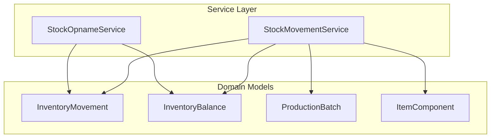
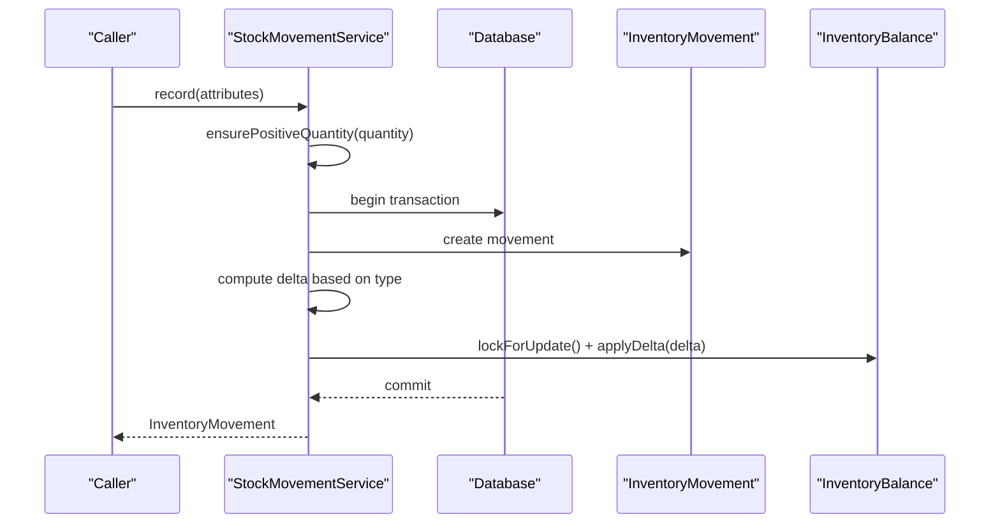
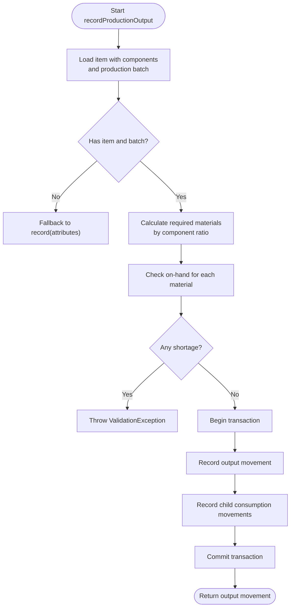
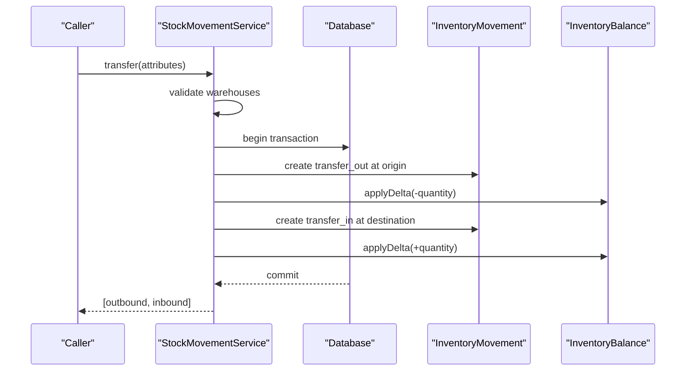
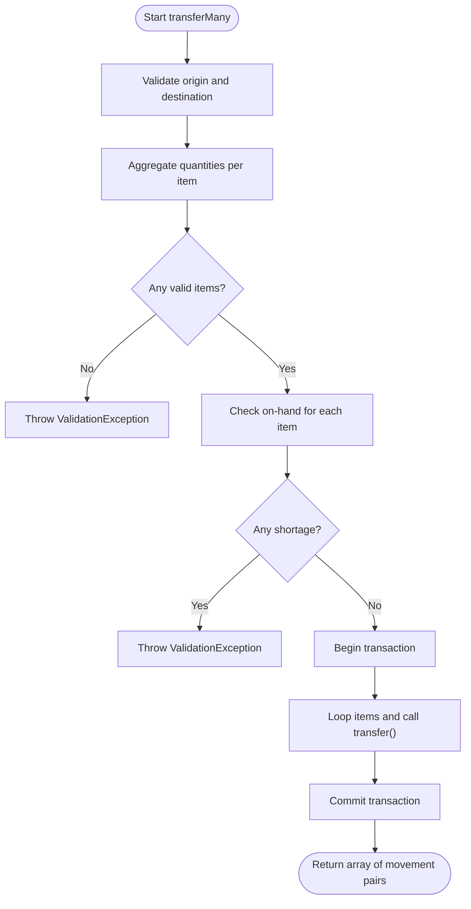
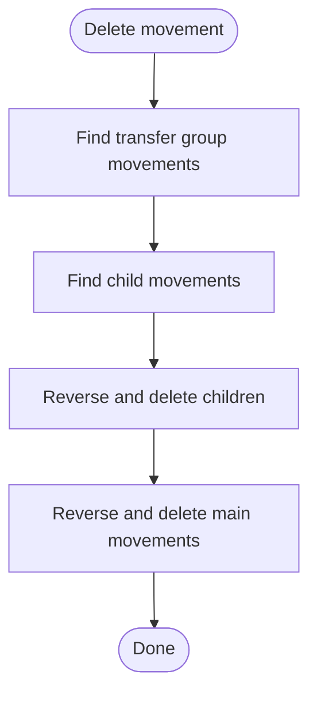
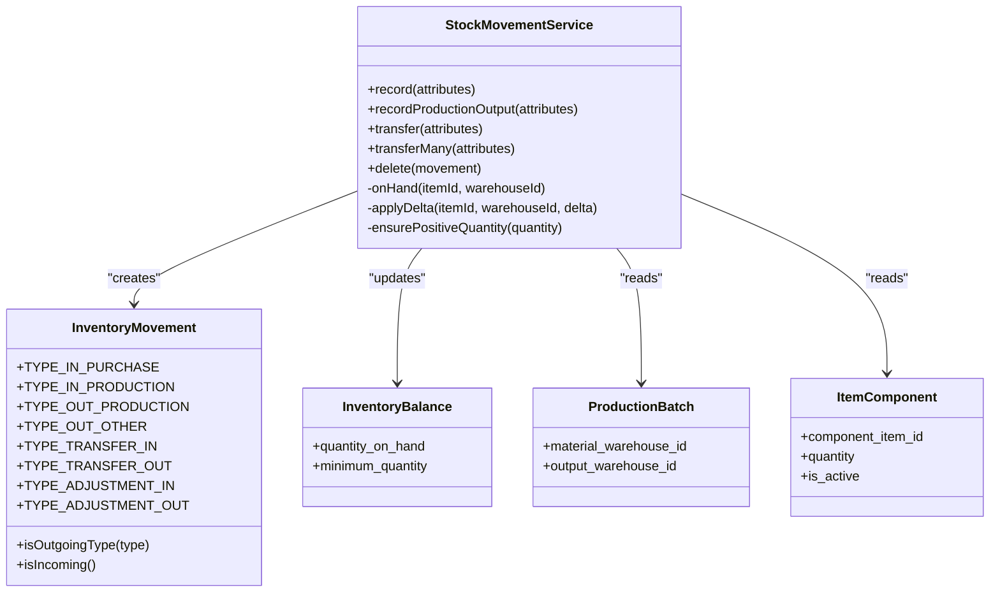

# Stock Movement Service

<cite>
**Referenced Files in This Document**   
- [StockMovementService.php](file://app/Services/StockMovementService.php)
- [InventoryMovement.php](file://app/Models/InventoryMovement.php)
- [InventoryBalance.php](file://app/Models/InventoryBalance.php)
- [ProductionBatch.php](file://app/Models/ProductionBatch.php)
- [ItemComponent.php](file://app/Models/ItemComponent.php)
- [StockOpnameService.php](file://app/Services/StockOpnameService.php)
- [StockMovementTest.php](file://tests/Feature/StockMovementTest.php)
- [StockOpnameTest.php](file://tests/Feature/StockOpnameTest.php)
</cite>

## Table of Contents
1. [Introduction](#introduction)
2. [Project Structure](#project-structure)
3. [Core Components](#core-components)
4. [Architecture Overview](#architecture-overview)
5. [Detailed Component Analysis](#detailed-component-analysis)
6. [Dependency Analysis](#dependency-analysis)
7. [Performance Considerations](#performance-considerations)
8. [Troubleshooting Guide](#troubleshooting-guide)
9. [Conclusion](#conclusion)

## Introduction
This document explains the `StockMovementService` class, which is responsible for inventory movement calculations, validations, and consistency guarantees. It covers:
- Recording stock movements
- Validating available quantities
- Handling production consumption, stock adjustments, and inter-warehouse transfers
- Transaction management and atomic operations
- Error handling and rollback behavior
- Performance considerations for bulk operations and concurrent access

The service is designed to keep physical stock balances consistent while maintaining an auditable history of every change through `InventoryMovement` records.

## Project Structure
The stock movement domain centers around a service layer that coordinates models and database transactions:
- `StockMovementService` orchestrates movement recording, transfer logic, production output, and deletion with balance reversal.
- `InventoryMovement` represents each recorded change and provides type helpers for incoming/outgoing classification.
- `InventoryBalance` stores the current on-hand quantity per item and warehouse.
- `ProductionBatch` and `ItemComponent` support automatic material consumption during production output.
- `StockOpnameService` integrates with stock adjustments and uses movement types for reconciliation.

**Diagram sources**
- [StockMovementService.php:16-397](file://app/Services/StockMovementService.php#L16-L397)
- [InventoryMovement.php:28-190](file://app/Models/InventoryMovement.php#L28-L190)
- [InventoryBalance.php:20-70](file://app/Models/InventoryBalance.php#L20-L70)
- [ProductionBatch.php:22-116](file://app/Models/ProductionBatch.php#L22-L116)
- [ItemComponent.php:19-85](file://app/Models/ItemComponent.php#L19-L85)
- [StockOpnameService.php:14-42](file://app/Services/StockOpnameService.php#L14-L42)

**Section sources**
- [StockMovementService.php:16-397](file://app/Services/StockMovementService.php#L16-L397)
- [InventoryMovement.php:28-190](file://app/Models/InventoryMovement.php#L28-L190)
- [InventoryBalance.php:20-70](file://app/Models/InventoryBalance.php#L20-L70)
- [ProductionBatch.php:22-116](file://app/Models/ProductionBatch.php#L22-L116)
- [ItemComponent.php:19-85](file://app/Models/ItemComponent.php#L19-L85)
- [StockOpnameService.php:14-42](file://app/Services/StockOpnameService.php#L14-L42)

## Core Components
- `StockMovementService`: Provides public methods for recording single movements, producing finished goods with automatic material consumption, transferring stock between warehouses, bulk transfers, and deleting movements with balance reversal.
- `InventoryMovement`: Defines movement types (purchase in, production in, production out, other out, transfer in/out, adjustment in/out), helper methods for direction checks, signed quantity, and relationships to items, warehouses, batches, opnames, requests, parent movements, and creators.
- `InventoryBalance`: Stores per-item, per-warehouse on-hand quantities and minimum thresholds; used by the service to enforce non-negative balances.
- `ProductionBatch` and `ItemComponent`: Provide batch context and component recipes used by production output to calculate required materials.
- `StockOpnameService`: Creates stock opname documents and posts adjustments that generate adjustment movements; it complements the movement service rather than replacing it.

Key responsibilities:
- Validate positive quantities and sufficient stock before applying deltas.
- Ensure all changes are wrapped in database transactions.
- Maintain auditability via movement records and optional grouping identifiers.
- Support reversals when deleting movements or canceling transfers.

**Section sources**
- [StockMovementService.php:23-397](file://app/Services/StockMovementService.php#L23-L397)
- [InventoryMovement.php:33-190](file://app/Models/InventoryMovement.php#L33-L190)
- [InventoryBalance.php:20-70](file://app/Models/InventoryBalance.php#L20-L70)
- [ProductionBatch.php:59-116](file://app/Models/ProductionBatch.php#L59-L116)
- [ItemComponent.php:36-85](file://app/Models/ItemComponent.php#L36-L85)
- [StockOpnameService.php:14-42](file://app/Services/StockOpnameService.php#L14-L42)

## Architecture Overview
The service enforces a strict separation between business rules and persistence:
- Input validation occurs early (positive quantity, warehouse constraints).
- Business rules check availability before mutating state.
- Database transactions guarantee atomicity across related writes.
- Balance updates use row-level locking to prevent race conditions.

**Diagram sources**
- [StockMovementService.php:23-59](file://app/Services/StockMovementService.php#L23-L59)
- [InventoryMovement.php:161-179](file://app/Models/InventoryMovement.php#L161-L179)
- [InventoryBalance.php:28-35](file://app/Models/InventoryBalance.php#L28-L35)

## Detailed Component Analysis

### Single Movement Recording (`record`)
Purpose:
- Record one inventory movement and update the corresponding warehouse balance atomically.

Behavior:
- Validates that quantity is positive.
- Persists an `InventoryMovement` with allowed attributes.
- Computes signed delta: outgoing types subtract; incoming types add.
- Applies the delta to `InventoryBalance`, creating the row if missing.
- Throws validation errors for insufficient stock or invalid quantity.

Data consistency:
- All writes occur inside a single database transaction.
- Balance updates use `lockForUpdate()` to serialize concurrent modifications.

Error handling:
- Positive quantity validation.
- Insufficient stock validation when delta would make balance negative.

Common scenarios:
- Purchase receipt increases stock.
- Production consumption or other outbound reduces stock.

**Section sources**
- [StockMovementService.php:23-59](file://app/Services/StockMovementService.php#L23-L59)
- [StockMovementService.php:358-387](file://app/Services/StockMovementService.php#L358-L387)
- [StockMovementService.php:389-396](file://app/Services/StockMovementService.php#L389-L396)
- [InventoryMovement.php:161-179](file://app/Models/InventoryMovement.php#L161-L179)

### Production Output with Automatic Material Consumption (`recordProductionOutput`)
Purpose:
- Record finished goods output and automatically consume required materials from the batch’s material warehouse.

Behavior:
- Loads the product item with its active components and the production batch.
- If no item or batch is provided, falls back to simple recording.
- Calculates required material quantities based on component ratios and output quantity.
- Pre-validates material availability; throws validation error if any component is short.
- Records the output movement and then records child consumption movements linked by `parent_movement_id`.
- Uses the batch’s material warehouse when available; otherwise uses the provided warehouse.

Data consistency:
- Entire operation runs in a transaction.
- Child consumption movements reference the parent output movement for traceability.

Validation rules:
- Quantity must be positive.
- Each required material must have sufficient on-hand quantity.

Common scenario:
- Producing a batch of finished goods consumes raw materials proportionally.

**Diagram sources**
- [StockMovementService.php:68-139](file://app/Services/StockMovementService.php#L68-L139)
- [ProductionBatch.php:59-82](file://app/Models/ProductionBatch.php#L59-L82)
- [ItemComponent.php:36-44](file://app/Models/ItemComponent.php#L36-L44)

**Section sources**
- [StockMovementService.php:68-139](file://app/Services/StockMovementService.php#L68-L139)
- [StockMovementTest.php:203-245](file://tests/Feature/StockMovementTest.php#L203-L245)
- [StockMovementTest.php:247-290](file://tests/Feature/StockMovementTest.php#L247-L290)

### Inter-Warehouse Transfer (`transfer`)
Purpose:
- Move stock from an origin warehouse to a destination warehouse, creating paired inbound and outbound movements.

Behavior:
- Validates both warehouses exist and are different.
- Generates a UUID-based `transfer_group_id` to link the two movements.
- Creates an outbound movement at the origin and applies a negative delta.
- Creates an inbound movement at the destination and applies a positive delta.
- Returns both movement records.

Data consistency:
- Both movements and balance updates are within a single transaction.
- Group identifier enables coordinated deletion or reporting.

Validation rules:
- Origin and destination must be present and distinct.

Common scenario:
- Moving finished goods from a production warehouse to a distribution warehouse.

**Diagram sources**
- [StockMovementService.php:147-201](file://app/Services/StockMovementService.php#L147-L201)

**Section sources**
- [StockMovementService.php:147-201](file://app/Services/StockMovementService.php#L147-L201)
- [StockMovementTest.php:82-107](file://tests/Feature/StockMovementTest.php#L82-L107)

### Bulk Transfers (`transferMany`)
Purpose:
- Transfer multiple items from one origin warehouse to one destination warehouse in a single operation.

Behavior:
- Validates warehouses and aggregates requested quantities per item.
- Skips invalid lines (missing item ID or non-positive quantity).
- Requires at least one valid line.
- Pre-validates on-hand availability for all requested items.
- Executes all transfers in a single transaction using the shared `transfer` method.

Validation rules:
- At least one item with positive quantity must be provided.
- All requested items must have sufficient stock.

Common scenario:
- Consolidating multiple SKUs into another warehouse for fulfillment.

**Diagram sources**
- [StockMovementService.php:209-290](file://app/Services/StockMovementService.php#L209-L290)

**Section sources**
- [StockMovementService.php:209-290](file://app/Services/StockMovementService.php#L209-L290)

### Deletion and Reversal (`delete`, `reverse`)
Purpose:
- Delete a movement and reverse its effect on balances. For transfers, delete both paired movements.

Behavior:
- Finds all movements belonging to the same transfer group if applicable.
- Finds child movements linked by `parent_movement_id`.
- Reverses each child movement’s balance effect before deleting it.
- Reverses the main movement(s) and deletes them.
- Enforces a safety check: reversing an incoming movement requires enough on-hand stock to avoid negative balances.

Data consistency:
- All deletions and reversals occur within a single transaction.

Validation rules:
- Cannot reverse an incoming movement if doing so would reduce stock below zero.

Common scenario:
- Canceling a transfer or undoing a mistakenly posted receipt.

**Diagram sources**
- [StockMovementService.php:296-344](file://app/Services/StockMovementService.php#L296-L344)

**Section sources**
- [StockMovementService.php:296-344](file://app/Services/StockMovementService.php#L296-L344)
- [StockMovementTest.php:109-151](file://tests/Feature/StockMovementTest.php#L109-L151)

### Stock Adjustment via Stock Opname
Purpose:
- Adjust physical stock to match counted quantities during stock opname processes.

Integration:
- `StockOpnameService` creates opname documents and lines, then posts adjustments.
- Posting generates adjustment movements (`adjustment_in` or `adjustment_out`) and updates balances accordingly.
- Movements are linked to the opname via `stock_opname_id`.

Validation rules:
- At least one counted line is required to post.
- Adjustments reconcile against current stock, not only the snapshot taken when the opname was created.

Common scenario:
- Month-end stocktaking where physical counts differ from system balances.

**Section sources**
- [StockOpnameService.php:14-42](file://app/Services/StockOpnameService.php#L14-L42)
- [StockOpnameTest.php:92-122](file://tests/Feature/StockOpnameTest.php#L92-L122)
- [StockOpnameTest.php:124-180](file://tests/Feature/StockOpnameTest.php#L124-L180)
- [StockOpnameTest.php:182-215](file://tests/Feature/StockOpnameTest.php#L182-L215)

## Dependency Analysis
The service depends on several models and utilities:
- `InventoryMovement` for movement creation and type classification.
- `InventoryBalance` for reading and updating on-hand quantities.
- `ProductionBatch` and `ItemComponent` for production output material calculation.
- Laravel’s `DB::transaction` for atomicity.
- `ValidationException` for structured validation errors.

**Diagram sources**
- [StockMovementService.php:16-397](file://app/Services/StockMovementService.php#L16-L397)
- [InventoryMovement.php:33-190](file://app/Models/InventoryMovement.php#L33-L190)
- [InventoryBalance.php:20-70](file://app/Models/InventoryBalance.php#L20-L70)
- [ProductionBatch.php:22-116](file://app/Models/ProductionBatch.php#L22-L116)
- [ItemComponent.php:19-85](file://app/Models/ItemComponent.php#L19-L85)

**Section sources**
- [StockMovementService.php:16-397](file://app/Services/StockMovementService.php#L16-L397)
- [InventoryMovement.php:33-190](file://app/Models/InventoryMovement.php#L33-L190)
- [InventoryBalance.php:20-70](file://app/Models/InventoryBalance.php#L20-L70)
- [ProductionBatch.php:22-116](file://app/Models/ProductionBatch.php#L22-L116)
- [ItemComponent.php:19-85](file://app/Models/ItemComponent.php#L19-L85)

## Performance Considerations
- Batched queries: The service avoids N+1 issues by loading related data efficiently (e.g., eager loading components).
- Row-level locking: `lockForUpdate()` serializes concurrent balance updates for the same item-warehouse pair, preventing race conditions.
- Transaction boundaries: All multi-step operations are wrapped in transactions to minimize lock duration and ensure atomicity.
- Bulk transfers: `transferMany` aggregates quantities and performs a single transaction loop over items, reducing overhead compared to many independent calls.
- Decimal precision: Quantities are cast to decimal with three decimal places to maintain precision across calculations and storage.

Recommendations:
- Prefer `transferMany` for moving multiple SKUs to reduce transaction overhead.
- Avoid mixing high-frequency reads and writes on the same item-warehouse pair without proper locking.
- Use background jobs for very large reconciliations or mass adjustments to keep request latency low.

[No sources needed since this section provides general guidance]

## Troubleshooting Guide
Common errors and their causes:
- Positive quantity validation failure: Occurs when quantity is zero or negative.
- Insufficient stock validation failure: Occurs when an outgoing movement would make the balance negative.
- Warehouse validation failure: Occurs when origin and destination are missing or identical in transfers.
- No items provided: Occurs in bulk transfers when no valid item lines are supplied.
- Deletion blocked: Occurs when attempting to reverse an incoming movement that has already been consumed beyond available stock.

Resolution steps:
- Verify input quantities and ensure they are positive.
- Check current on-hand balances before posting outgoing movements.
- Ensure origin and destination warehouses are correctly set and distinct.
- Confirm at least one valid item line exists for bulk transfers.
- Review downstream consumption or subsequent movements that may have reduced stock before attempting reversal.

Operational tips:
- Use movement references and notes to trace the source of changes.
- Leverage transfer groups to coordinate deletion of paired movements.
- Inspect child movements under production outputs to understand material consumption.

**Section sources**
- [StockMovementService.php:23-59](file://app/Services/StockMovementService.php#L23-L59)
- [StockMovementService.php:147-201](file://app/Services/StockMovementService.php#L147-L201)
- [StockMovementService.php:209-290](file://app/Services/StockMovementService.php#L209-L290)
- [StockMovementService.php:296-344](file://app/Services/StockMovementService.php#L296-L344)
- [StockMovementService.php:358-396](file://app/Services/StockMovementService.php#L358-L396)
- [StockMovementTest.php:66-80](file://tests/Feature/StockMovementTest.php#L66-L80)
- [StockMovementTest.php:345-394](file://tests/Feature/StockMovementTest.php#L345-L394)

## Conclusion
`StockMovementService` provides robust, transactional inventory movement handling with clear validation rules and strong consistency guarantees. It supports:
- Simple movement recording with automatic balance updates
- Production output with automatic material consumption
- Inter-warehouse transfers with paired movements and grouping
- Bulk transfers for efficiency
- Safe deletion and reversal with protection against negative balances

Together with `InventoryMovement`, `InventoryBalance`, `ProductionBatch`, `ItemComponent`, and `StockOpnameService`, the system ensures accurate, auditable, and reliable stock management across diverse operational scenarios.

[No sources needed since this section summarizes without analyzing specific files]