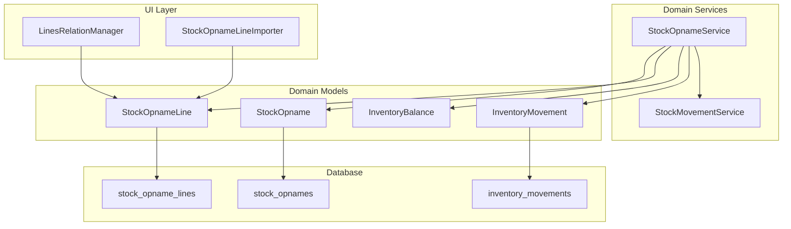
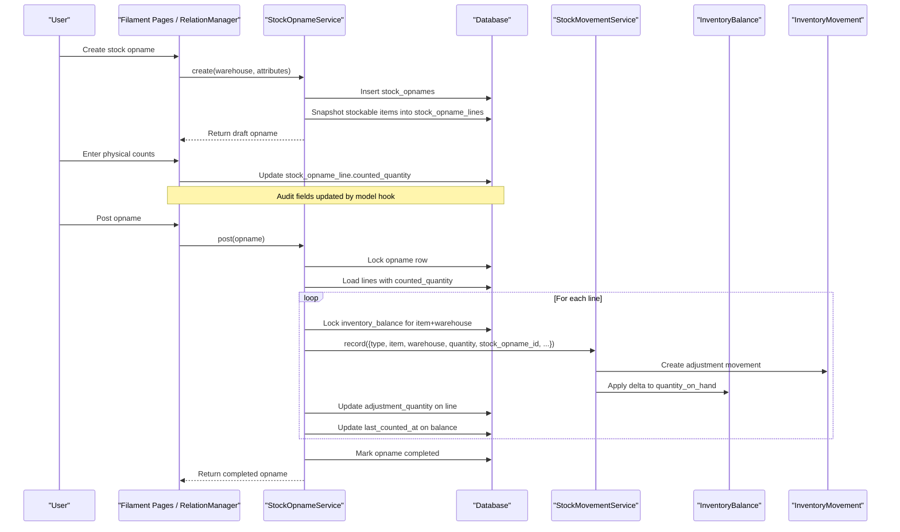
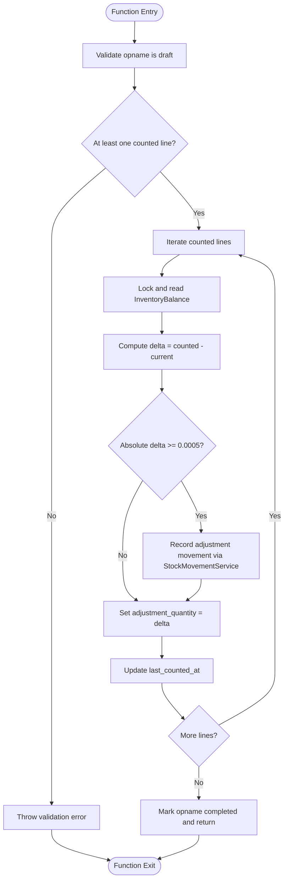
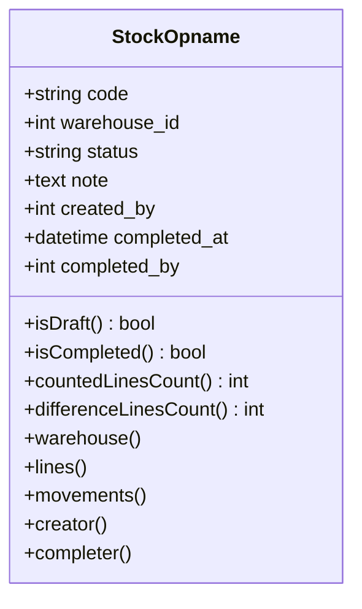
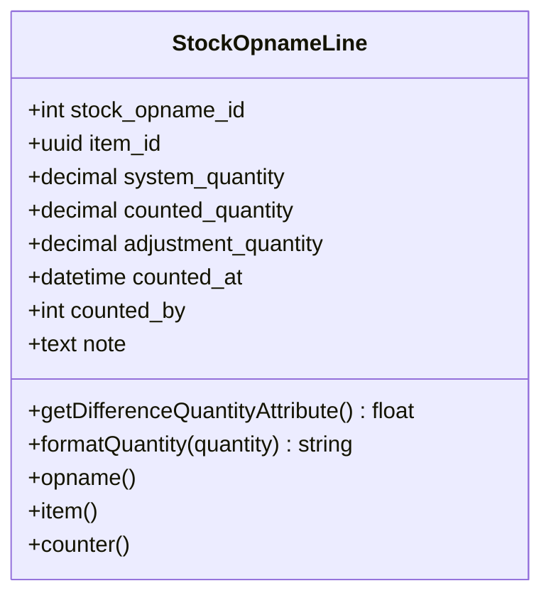
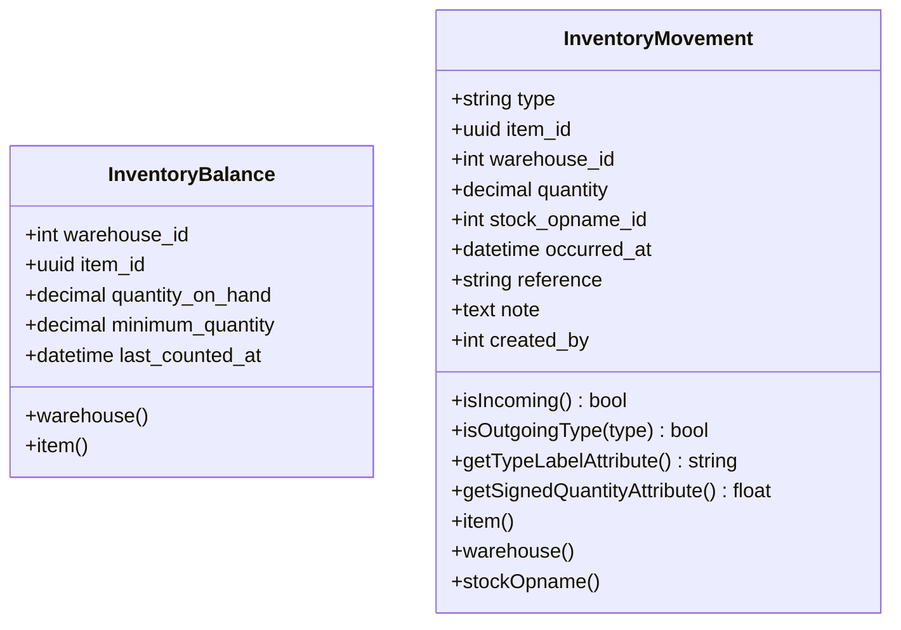
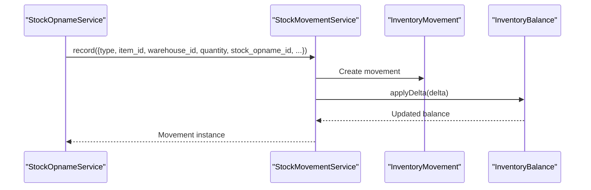
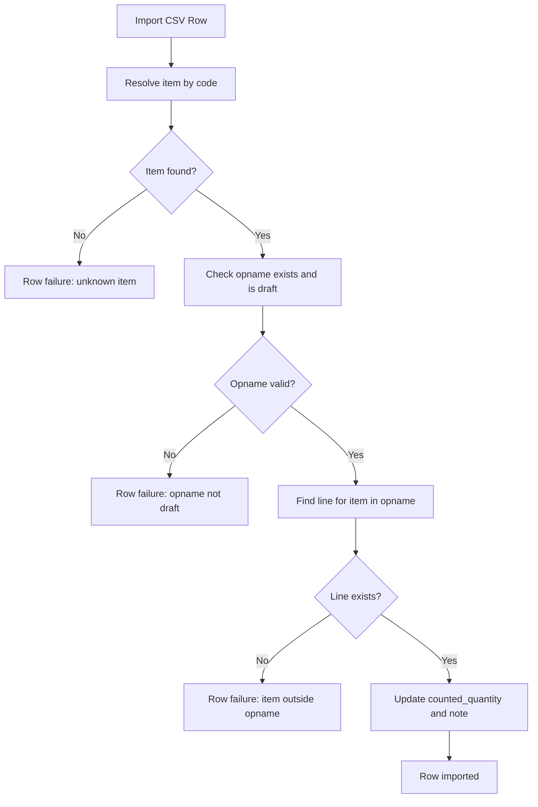
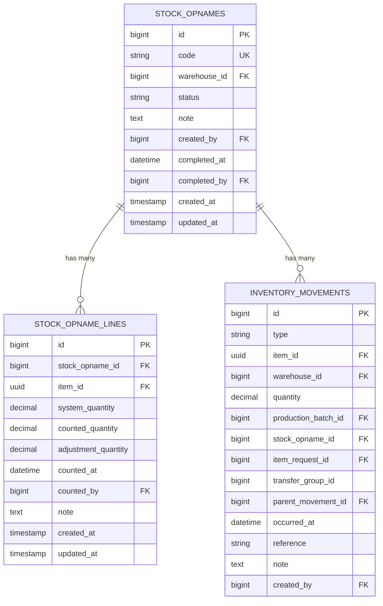
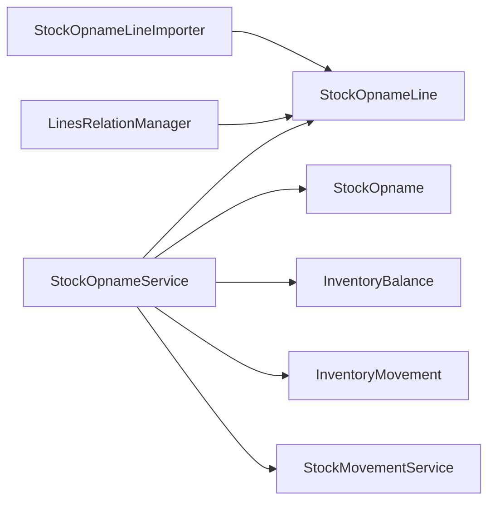

# Stock Opname Service

<cite>
**Referenced Files in This Document**
- [StockOpnameService.php](file://app/Services/StockOpnameService.php)
- [StockOpname.php](file://app/Models/StockOpname.php)
- [StockOpnameLine.php](file://app/Models/StockOpnameLine.php)
- [InventoryBalance.php](file://app/Models/InventoryBalance.php)
- [InventoryMovement.php](file://app/Models/InventoryMovement.php)
- [StockMovementService.php](file://app/Services/StockMovementService.php)
- [2026_11_19_000002_create_stock_opnames_table.php](file://database/migrations/2026_11_19_000002_create_stock_opnames_table.php)
- [2026_11_19_000003_create_stock_opname_lines_table.php](file://database/migrations/2026_11_19_000003_create_stock_opname_lines_table.php)
- [2026_11_19_000004_add_stock_opname_id_to_inventory_movements_table.php](file://database/migrations/2026_11_19_000004_add_stock_opname_id_to_inventory_movements_table.php)
- [LinesRelationManager.php](file://app/Filament/Resources/StockOpnames/RelationManagers/LinesRelationManager.php)
- [StockOpnameLineImporter.php](file://app/Filament/Imports/StockOpnameLineImporter.php)
- [StockOpnameTest.php](file://tests/Feature/StockOpnameTest.php)
</cite>

## Table of Contents
1. [Introduction](#introduction)
2. [Project Structure](#project-structure)
3. [Core Components](#core-components)
4. [Architecture Overview](#architecture-overview)
5. [Detailed Component Analysis](#detailed-component-analysis)
6. [Dependency Analysis](#dependency-analysis)
7. [Performance Considerations](#performance-considerations)
8. [Troubleshooting Guide](#troubleshooting-guide)
9. [Conclusion](#conclusion)

## Introduction
This document explains the Stock Opname feature that reconciles system inventory with physical counts and generates adjustment entries. The core logic lives in `StockOpnameService`, which creates stock opname documents, processes physical count lines, calculates variances against current inventory balances, and records audit-friendly inventory movements. The UI layer is provided by Filament resources, importers, and relation managers, while tests define expected behavior for creation, posting, cancellation, counting, importing, exporting, and locking rules.

## Project Structure
The stock opname domain spans service code, Eloquent models, database migrations, Filament UI components, import/export tools, and feature tests:

**Diagram sources**
- [StockOpnameService.php:14-170](file://app/Services/StockOpnameService.php#L14-L170)
- [StockOpname.php:21-106](file://app/Models/StockOpname.php#L21-L106)
- [StockOpnameLine.php:21-93](file://app/Models/StockOpnameLine.php#L21-L93)
- [InventoryBalance.php:20-70](file://app/Models/InventoryBalance.php#L20-L70)
- [InventoryMovement.php:28-190](file://app/Models/InventoryMovement.php#L28-L190)
- [StockMovementService.php:16-398](file://app/Services/StockMovementService.php#L16-L398)
- [2026_11_19_000002_create_stock_opnames_table.php:14-34](file://database/migrations/2026_11_19_000002_create_stock_opnames_table.php#L14-L34)
- [2026_11_19_000003_create_stock_opname_lines_table.php:14-35](file://database/migrations/2026_11_19_000003_create_stock_opname_lines_table.php#L14-L35)
- [2026_11_19_000004_add_stock_opname_id_to_inventory_movements_table.php:14-20](file://database/migrations/2026_11_19_000004_add_stock_opname_id_to_inventory_movements_table.php#L14-L20)
- [LinesRelationManager.php:27-229](file://app/Filament/Resources/StockOpnames/RelationManagers/LinesRelationManager.php#L27-L229)
- [StockOpnameLineImporter.php:13-120](file://app/Filament/Imports/StockOpnameLineImporter.php#L13-L120)

**Section sources**
- [StockOpnameService.php:14-170](file://app/Services/StockOpnameService.php#L14-L170)
- [StockOpname.php:21-106](file://app/Models/StockOpname.php#L21-L106)
- [StockOpnameLine.php:21-93](file://app/Models/StockOpnameLine.php#L21-L93)
- [InventoryBalance.php:20-70](file://app/Models/InventoryBalance.php#L20-L70)
- [InventoryMovement.php:28-190](file://app/Models/InventoryMovement.php#L28-L190)
- [StockMovementService.php:16-398](file://app/Services/StockMovementService.php#L16-L398)
- [LinesRelationManager.php:27-229](file://app/Filament/Resources/StockOpnames/RelationManagers/LinesRelationManager.php#L27-L229)
- [StockOpnameLineImporter.php:13-120](file://app/Filament/Imports/StockOpnameLineImporter.php#L13-L120)

## Core Components
- `StockOpnameService`: Orchestrates stock opname lifecycle: creation, posting, and cancellation. It snapshots system quantities, computes variances, records adjustments through `StockMovementService`, and locks documents to prevent re-posting.
- `StockOpname`: Represents the opname document with status transitions (`draft`, `completed`, `cancelled`), relationships to lines and movements, and helper methods such as counted/difference line counters.
- `StockOpnameLine`: Represents one item’s snapshot and physical count. It tracks system quantity, counted quantity, adjustment quantity, counter identity, timestamp, and notes. A model hook updates audit fields when a physical count changes.
- `InventoryBalance`: Holds per-item warehouse stock levels and last counted timestamp; used as the reconciliation baseline during posting.
- `InventoryMovement`: Records every stock change, including adjustment movements created by stock opname posting.
- `StockMovementService`: Centralizes movement recording, balance updates, transfers, and deletion/reversal logic.
- Filament UI: `LinesRelationManager` provides table editing, bulk fill/clear actions, CSV import/export, and filtering. `StockOpnameLineImporter` validates imported rows against items and opname state.

**Section sources**
- [StockOpnameService.php:14-170](file://app/Services/StockOpnameService.php#L14-L170)
- [StockOpname.php:21-106](file://app/Models/StockOpname.php#L21-L106)
- [StockOpnameLine.php:21-93](file://app/Models/StockOpnameLine.php#L21-L93)
- [InventoryBalance.php:20-70](file://app/Models/InventoryBalance.php#L20-L70)
- [InventoryMovement.php:28-190](file://app/Models/InventoryMovement.php#L28-L190)
- [StockMovementService.php:16-398](file://app/Services/StockMovementService.php#L16-L398)
- [LinesRelationManager.php:27-229](file://app/Filament/Resources/StockOpnames/RelationManagers/LinesRelationManager.php#L27-L229)
- [StockOpnameLineImporter.php:13-120](file://app/Filament/Imports/StockOpnameLineImporter.php#L13-L120)

## Architecture Overview
The stock opname workflow integrates UI input, service orchestration, inventory balancing, and audit trails:

**Diagram sources**
- [StockOpnameService.php:21-133](file://app/Services/StockOpnameService.php#L21-L133)
- [StockMovementService.php:23-60](file://app/Services/StockMovementService.php#L23-L60)
- [InventoryMovement.php:28-190](file://app/Models/InventoryMovement.php#L28-L190)
- [InventoryBalance.php:20-70](file://app/Models/InventoryBalance.php#L20-L70)
- [StockOpnameLine.php:39-57](file://app/Models/StockOpnameLine.php#L39-L57)

## Detailed Component Analysis

### StockOpnameService
Responsibilities:
- Create an opname document and snapshot all stockable items without variants into `stock_opname_lines`.
- Post physical counts: validate draft status, require at least one counted line, compute variance against current `InventoryBalance`, record adjustment movements, update line adjustments, refresh last counted timestamps, and mark the opname completed.
- Cancel draft opnames.
- Generate unique opname codes per warehouse.

Key behaviors:
- Creation uses a database transaction and batches item insertion to avoid memory pressure.
- Posting uses row-level locking on both the opname and the affected inventory balances to prevent concurrent modifications.
- Variances are rounded to three decimals; only non-zero deltas generate adjustment movements.
- Adjustment movements reference the opname code and include a note linking back to the opname.

Validation and error handling:
- Re-posting a completed or cancelled opname throws a validation exception.
- Posting without any counted lines throws a validation exception.
- Cancellation is restricted to draft opnames.

**Diagram sources**
- [StockOpnameService.php:67-133](file://app/Services/StockOpnameService.php#L67-L133)
- [StockMovementService.php:23-60](file://app/Services/StockMovementService.php#L23-L60)

**Section sources**
- [StockOpnameService.php:21-169](file://app/Services/StockOpnameService.php#L21-L169)

### StockOpname Model
Responsibilities:
- Define status constants and label helpers.
- Provide relationships to warehouse, lines, movements, creator, and completer.
- Expose computed counts for counted and difference lines.

Important aspects:
- Status labels are derived from static options.
- Count helpers enable reporting and UI summaries.

**Diagram sources**
- [StockOpname.php:21-106](file://app/Models/StockOpname.php#L21-L106)

**Section sources**
- [StockOpname.php:21-106](file://app/Models/StockOpname.php#L21-L106)

### StockOpnameLine Model
Responsibilities:
- Store system quantity, physical count, adjustment quantity, and audit metadata.
- Automatically set `counted_at` and `counted_by` when `counted_quantity` changes.
- Clear audit fields when the physical count is removed.
- Provide a computed difference attribute and formatted quantity helper.

Validation and data integrity:
- Decimal casting ensures consistent precision across system, counted, and adjustment quantities.
- Difference calculation is rounded to three decimals.

**Diagram sources**
- [StockOpnameLine.php:21-93](file://app/Models/StockOpnameLine.php#L21-L93)

**Section sources**
- [StockOpnameLine.php:21-93](file://app/Models/StockOpnameLine.php#L21-L93)

### InventoryBalance and InventoryMovement
- `InventoryBalance`: Tracks per-item warehouse stock and last counted timestamp. Used as the reconciliation baseline during posting.
- `InventoryMovement`: Records all stock changes, including adjustment movements generated by stock opname posting. Provides type classification, signed quantity, and relationships to opnames.

**Diagram sources**
- [InventoryBalance.php:20-70](file://app/Models/InventoryBalance.php#L20-L70)
- [InventoryMovement.php:28-190](file://app/Models/InventoryMovement.php#L28-L190)

**Section sources**
- [InventoryBalance.php:20-70](file://app/Models/InventoryBalance.php#L20-L70)
- [InventoryMovement.php:28-190](file://app/Models/InventoryMovement.php#L28-L190)

### StockMovementService Integration
`StockOpnameService` delegates actual movement recording and balance updates to `StockMovementService.record`. This keeps adjustment logic centralized and reusable across other inventory operations.

Key integration points:
- Adjustment movements use types `adjustment_in` or `adjustment_out`.
- Movements carry `stock_opname_id`, `reference`, and `note` for traceability.
- Balances are updated atomically within the same transaction as the movement.

**Diagram sources**
- [StockMovementService.php:23-60](file://app/Services/StockMovementService.php#L23-L60)
- [StockMovementService.php:358-387](file://app/Services/StockMovementService.php#L358-L387)

**Section sources**
- [StockMovementService.php:23-60](file://app/Services/StockMovementService.php#L23-L60)
- [StockMovementService.php:358-387](file://app/Services/StockMovementService.php#L358-L387)

### Filament UI and Import/Export
- `LinesRelationManager`:
  - Displays system quantity, physical count, difference, adjustment, notes, counter, and timestamp.
  - Allows filling system quantities, clearing counts, adding extra items, importing CSV, and exporting CSV.
  - Disables editing after completion and restricts import/export actions based on opname status.
- `StockOpnameLineImporter`:
  - Validates item codes, checks membership in the opname, enforces draft-only imports, and handles blank rows.
  - Uses synchronous job connection by default for simplicity.

**Diagram sources**
- [StockOpnameLineImporter.php:41-107](file://app/Filament/Imports/StockOpnameLineImporter.php#L41-L107)
- [LinesRelationManager.php:194-212](file://app/Filament/Resources/StockOpnames/RelationManagers/LinesRelationManager.php#L194-L212)

**Section sources**
- [LinesRelationManager.php:27-229](file://app/Filament/Resources/StockOpnames/RelationManagers/LinesRelationManager.php#L27-L229)
- [StockOpnameLineImporter.php:13-120](file://app/Filament/Imports/StockOpnameLineImporter.php#L13-L120)

### Database Schema Highlights
- `stock_opnames`: Unique code, warehouse link, status, optional note, creator/completer references, timestamps, and index on warehouse/status.
- `stock_opname_lines`: Links to opname and item, system/counted/adjustment quantities, audit fields, optional note, timestamps, and unique constraint on (opname, item).
- `inventory_movements`: Added nullable `stock_opname_id` to tie adjustment movements back to the originating opname.

**Diagram sources**
- [2026_11_19_000002_create_stock_opnames_table.php:14-34](file://database/migrations/2026_11_19_000002_create_stock_opnames_table.php#L14-L34)
- [2026_11_19_000003_create_stock_opname_lines_table.php:14-35](file://database/migrations/2026_11_19_000003_create_stock_opname_lines_table.php#L14-L35)
- [2026_11_19_000004_add_stock_opname_id_to_inventory_movements_table.php:14-20](file://database/migrations/2026_11_19_000004_add_stock_opname_id_to_inventory_movements_table.php#L14-L20)

**Section sources**
- [2026_11_19_000002_create_stock_opnames_table.php:14-34](file://database/migrations/2026_11_19_000002_create_stock_opnames_table.php#L14-L34)
- [2026_11_19_000003_create_stock_opname_lines_table.php:14-35](file://database/migrations/2026_11_19_000003_create_stock_opname_lines_table.php#L14-L35)
- [2026_11_19_000004_add_stock_opname_id_to_inventory_movements_table.php:14-20](file://database/migrations/2026_11_19_000004_add_stock_opname_id_to_inventory_movements_table.php#L14-L20)

## Dependency Analysis
Coupling and cohesion:
- `StockOpnameService` depends on `StockOpname`, `StockOpnameLine`, `InventoryBalance`, `InventoryMovement`, and `StockMovementService`.
- `StockMovementService` centralizes movement and balance mutations, reducing duplication and improving testability.
- Filament components depend on models and services but do not contain business logic.

Potential circular dependencies:
- No direct circular imports observed between service and model layers.
- UI components depend on models and services; services do not depend on UI.

External integration points:
- Authentication context is used to populate audit fields (`created_by`, `completed_by`, `counted_by`).
- Database transactions and row locks ensure consistency under concurrency.

**Diagram sources**
- [StockOpnameService.php:14-170](file://app/Services/StockOpnameService.php#L14-L170)
- [LinesRelationManager.php:27-229](file://app/Filament/Resources/StockOpnames/RelationManagers/LinesRelationManager.php#L27-L229)
- [StockOpnameLineImporter.php:13-120](file://app/Filament/Imports/StockOpnameLineImporter.php#L13-L120)

**Section sources**
- [StockOpnameService.php:14-170](file://app/Services/StockOpnameService.php#L14-L170)
- [LinesRelationManager.php:27-229](file://app/Filament/Resources/StockOpnames/RelationManagers/LinesRelationManager.php#L27-L229)
- [StockOpnameLineImporter.php:13-120](file://app/Filament/Imports/StockOpnameLineImporter.php#L13-L120)

## Performance Considerations
- Batch insertion of opname lines avoids loading all stockable items into memory at once.
- Row-level locking prevents race conditions during posting but may increase contention; consider queuing large postings if needed.
- Rounding to three decimals reduces floating-point drift and aligns with database precision.
- Export action queries all lines regardless of table filters to ensure complete reports.

[No sources needed since this section provides general guidance]

## Troubleshooting Guide
Common issues and resolutions:
- Cannot post because no physical counts exist:
  - Ensure at least one line has a non-null `counted_quantity`.
  - Use “Fill according to system” or import CSV to populate counts.
- Cannot post or cancel a completed opname:
  - Completed opnames are locked; create a new opname for further adjustments.
- Import fails for unknown item code:
  - Verify the item exists and its code matches exactly.
- Import fails because item is outside the opname:
  - Only items included in the opname snapshot can be imported; add the item manually if necessary.
- Import fails because opname is not draft:
  - Imports are allowed only for draft opnames.
- Adjustment does not appear:
  - Variances below the rounding threshold are ignored; check absolute delta magnitude.
- Balance not updated:
  - Confirm the movement was recorded and the transaction completed successfully.

Validation exceptions:
- Re-posting or cancelling non-draft opnames raises validation errors.
- Missing counted lines raise validation errors.
- Unknown or out-of-scope items in imports raise row-level failures.

**Section sources**
- [StockOpnameService.php:67-155](file://app/Services/StockOpnameService.php#L67-L155)
- [StockOpnameLineImporter.php:41-107](file://app/Filament/Imports/StockOpnameLineImporter.php#L41-L107)
- [StockOpnameTest.php:217-283](file://tests/Feature/StockOpnameTest.php#L217-L283)
- [StockOpnameTest.php:482-524](file://tests/Feature/StockOpnameTest.php#L482-L524)

## Conclusion
The Stock Opname feature provides a robust, auditable process for reconciling physical counts with system inventory. `StockOpnameService` orchestrates creation, posting, and cancellation while ensuring data integrity through transactions and row locks. Variances are calculated against current balances, and adjustments are recorded as inventory movements linked to the originating opname. Filament UI and import/export tools streamline counting workflows, while comprehensive tests validate correctness, locking rules, and edge cases.

[No sources needed since this section summarizes without analyzing specific files]