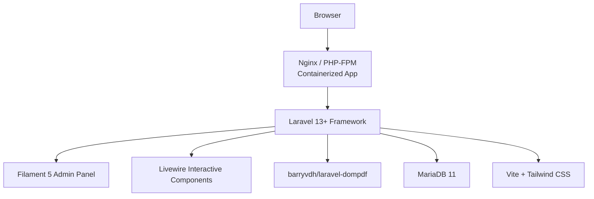
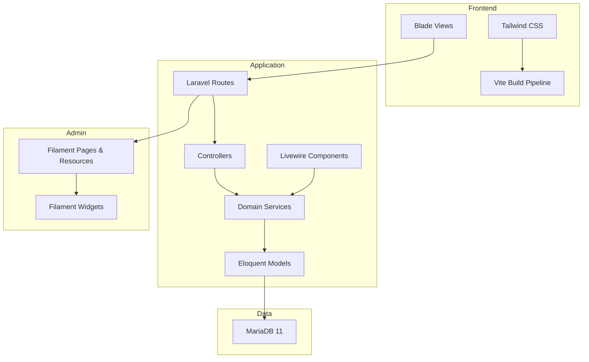
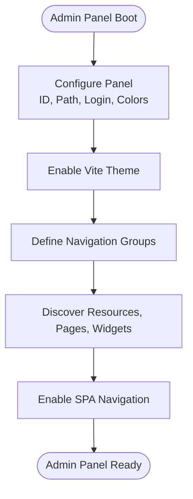
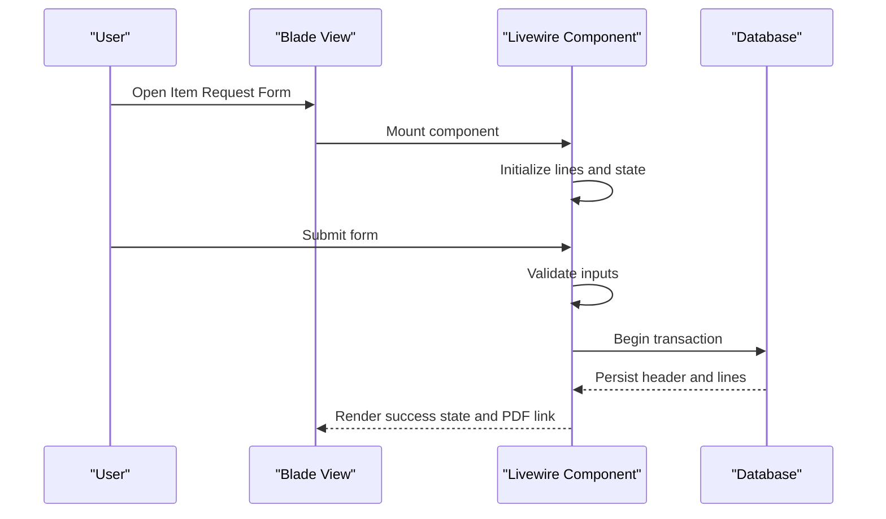
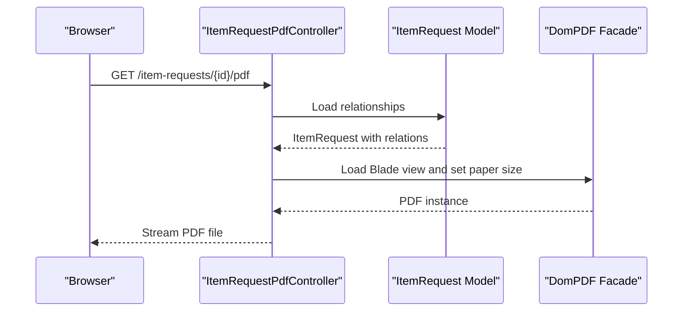
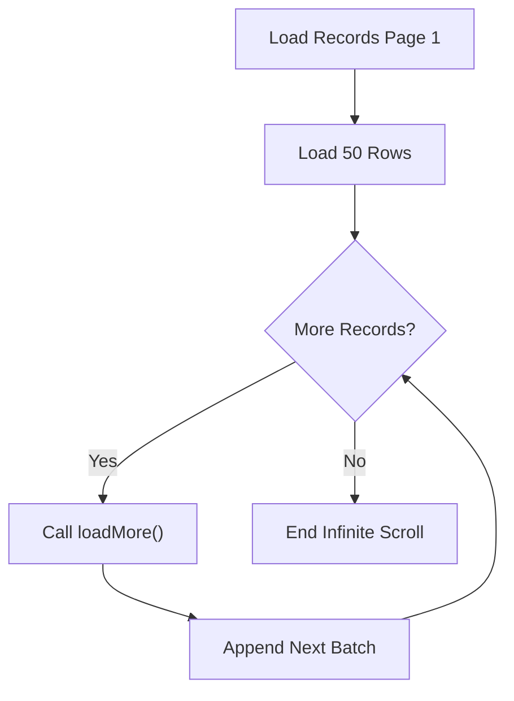
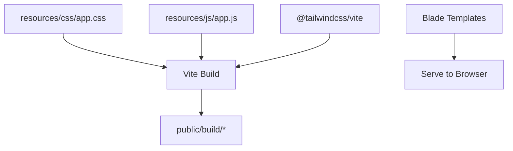
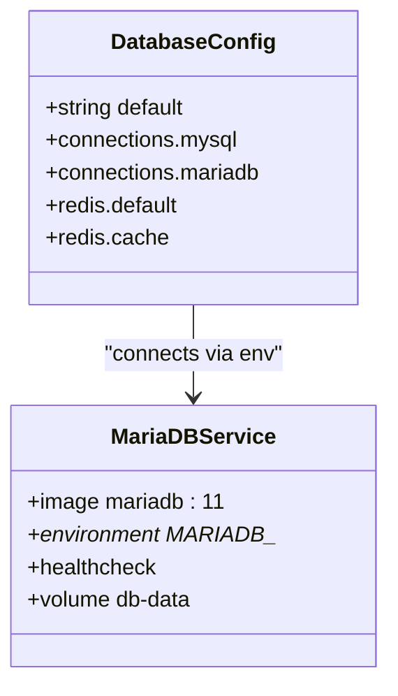
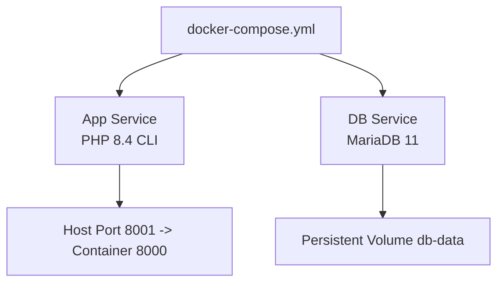
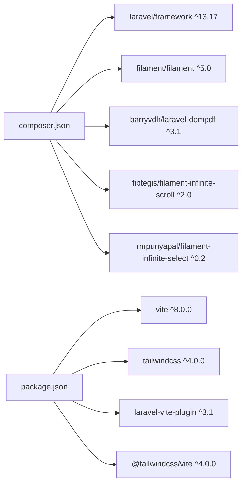

# Technology Stack

<cite>
**Referenced Files in This Document**
- [composer.json](file://composer.json)
- [package.json](file://package.json)
- [vite.config.js](file://vite.config.js)
- [Dockerfile](file://Dockerfile)
- [docker-compose.yml](file://docker-compose.yml)
- [config/database.php](file://config/database.php)
- [app/Providers/Filament/AdminPanelProvider.php](file://app/Providers/Filament/AdminPanelProvider.php)
- [app/Livewire/ItemRequestForm.php](file://app/Livewire/ItemRequestForm.php)
- [app/Http/Controllers/ItemRequestPdfController.php](file://app/Http/Controllers/ItemRequestPdfController.php)
- [tests/Feature/InfiniteScrollTest.php](file://tests/Feature/InfiniteScrollTest.php)
- [AGENTS.md](file://AGENTS.md)
</cite>

## Table of Contents
1. [Introduction](#introduction)
2. [Project Structure](#project-structure)
3. [Core Components](#core-components)
4. [Architecture Overview](#architecture-overview)
5. [Detailed Component Analysis](#detailed-component-analysis)
6. [Dependency Analysis](#dependency-analysis)
7. [Performance Considerations](#performance-considerations)
8. [Troubleshooting Guide](#troubleshooting-guide)
9. [Conclusion](#conclusion)

## Introduction
RSV Helmet is a Laravel-based inventory, production batch, and item request management application with a Filament admin interface. The stack centers on modern PHP and Laravel tooling, a Blade + Tailwind CSS frontend built with Vite, MariaDB as the primary database, and Docker for local and production containerization. Key runtime dependencies include Filament 5 for the admin panel, Livewire for interactive server-driven components, barryvdh/laravel-dompdf for PDF generation, and filament-infinite-scroll plus related packages to optimize large table performance.

## Project Structure
The repository follows standard Laravel conventions:
- Application code under `app/` (Models, Services, Livewire components, Filament resources, pages, widgets, controllers).
- Configuration under `config/`.
- Database migrations, seeders, and factories under `database/`.
- Frontend assets under `resources/` with Blade views, CSS, and JS.
- Build configuration via `vite.config.js` and `package.json`.
- Container definitions via `Dockerfile` and `docker-compose.yml`.

**Diagram sources**
- [composer.json:8-15](file://composer.json#L8-L15)
- [package.json:9-14](file://package.json#L9-L14)
- [docker-compose.yml:22-38](file://docker-compose.yml#L22-L38)
- [vite.config.js:6-22](file://vite.config.js#L6-L22)

**Section sources**
- [composer.json:1-93](file://composer.json#L1-L93)
- [package.json:1-20](file://package.json#L1-L20)
- [docker-compose.yml:1-42](file://docker-compose.yml#L1-L42)

## Core Components
This section documents the core technology choices and their roles.

- Laravel 13.17+ and PHP 8.3+
  - Role: Application framework and runtime.
  - Compatibility: Requires PHP 8.3 or newer; the project targets Laravel 13.17+.
  - Why chosen: Provides a mature MVC structure, Eloquent ORM, routing, middleware, testing, and ecosystem integration.

- Filament 5
  - Role: Admin panel framework powering resource CRUD, pages, widgets, navigation groups, and SPA behavior.
  - Integration: Configured through `AdminPanelProvider`, enabling custom login, colors, Vite theme, navigation groups, and automatic discovery of resources/pages/widgets.
  - Why chosen: Rapid development of admin interfaces with consistent UI, form handling, tables, and charts.

- Livewire
  - Role: Server-driven interactivity for forms and dynamic UI without heavy JavaScript.
  - Integration: Used by public-facing forms such as the item request form, which validates, persists data, and renders results inline.
  - Why chosen: Enables rich interactions while keeping logic in PHP, simplifying state management and validation.

- barryvdh/laravel-dompdf
  - Role: PDF generation from Blade templates.
  - Integration: Controller loads a Blade view into a PDF document and streams it to the browser.
  - Why chosen: Straightforward PDF rendering using familiar Blade syntax.

- filament-infinite-scroll and related packages
  - Role: Performance optimization for large list tables in Filament.
  - Integration: List pages load records in batches (default 50), disable normal pagination, and reset on search/filter/sort. A SPA fix recalculates table height after navigation.
  - Why chosen: Improves perceived performance and reduces initial payload for large datasets.

- Frontend stack: Blade templates, Tailwind CSS, Vite
  - Role: Server-rendered views with utility-first styling and modern asset pipeline.
  - Integration: Vite compiles CSS and JS, integrates with Laravel, and includes Tailwind v4 plugin. Fonts are loaded via the Laravel Vite fonts helper.
  - Why chosen: Fast build times, hot module replacement, and a lightweight, composable styling approach.

- Database: MariaDB 11
  - Role: Primary relational database for inventory, production batches, item requests, and master data.
  - Integration: Defined in `docker-compose.yml`; Laravel supports both `mysql` and `mariadb` drivers in configuration.
  - Why chosen: Stable, widely supported RDBMS compatible with Laravel’s MySQL driver.

- Containerization: Docker
  - Role: Local and production environment consistency.
  - Integration: Development compose file runs the app and MariaDB services; the app image uses PHP 8.4 CLI and exposes port 8000. Production compose and Dockerfiles exist for deployment.
  - Why chosen: Reproducible environments, simplified dependency management, and easy scaling.

**Section sources**
- [composer.json:8-15](file://composer.json#L8-L15)
- [app/Providers/Filament/AdminPanelProvider.php:29-64](file://app/Providers/Filament/AdminPanelProvider.php#L29-L64)
- [app/Livewire/ItemRequestForm.php:20-49](file://app/Livewire/ItemRequestForm.php#L20-L49)
- [app/Http/Controllers/ItemRequestPdfController.php:9-18](file://app/Http/Controllers/ItemRequestPdfController.php#L9-L18)
- [AGENTS.md:43-57](file://AGENTS.md#L43-L57)
- [vite.config.js:6-22](file://vite.config.js#L6-L22)
- [docker-compose.yml:22-38](file://docker-compose.yml#L22-L38)

## Architecture Overview
The application architecture layers responsibilities clearly:
- Presentation layer: Blade templates styled with Tailwind CSS, served through Laravel routes and Filament pages.
- Interaction layer: Livewire components handle user input and server-side processing.
- Business layer: Services encapsulate domain logic (e.g., batch requirements, stock movements, external sync).
- Data access layer: Eloquent models and migrations interact with MariaDB.
- Infrastructure: Docker containers orchestrate the app and database; Vite builds frontend assets.

**Diagram sources**
- [app/Providers/Filament/AdminPanelProvider.php:29-64](file://app/Providers/Filament/AdminPanelProvider.php#L29-L64)
- [app/Livewire/ItemRequestForm.php:20-49](file://app/Livewire/ItemRequestForm.php#L20-L49)
- [config/database.php:47-85](file://config/database.php#L47-L85)
- [vite.config.js:6-22](file://vite.config.js#L6-L22)

## Detailed Component Analysis

### Filament 5 Admin Interface
- Purpose: Provides a feature-rich admin panel for managing inventory, production batches, item requests, warehouses, and master data.
- Configuration highlights:
  - Panel ID and path set to `admin`.
  - Custom login class and color scheme.
  - Vite theme integration for admin styles.
  - Navigation groups organizing modules like warehouse, production, and master data.
  - Automatic discovery of resources, pages, and widgets.
- SPA behavior: Enabled to improve navigation experience within the admin panel.

**Diagram sources**
- [app/Providers/Filament/AdminPanelProvider.php:29-64](file://app/Providers/Filament/AdminPanelProvider.php#L29-L64)

**Section sources**
- [app/Providers/Filament/AdminPanelProvider.php:29-64](file://app/Providers/Filament/AdminPanelProvider.php#L29-L64)

### Livewire Interactive Components
- Purpose: Handle complex user interactions such as multi-line item requests, live search, validation, and submission without full page reloads.
- Key behaviors:
  - Dynamic line items with add/remove operations.
  - Validation rules ensuring required fields and uniqueness constraints.
  - Transactional persistence of request headers and lines.
  - Rendering of submitted state and PDF download links.

**Diagram sources**
- [app/Livewire/ItemRequestForm.php:46-152](file://app/Livewire/ItemRequestForm.php#L46-L152)
- [app/Livewire/ItemRequestForm.php:174-207](file://app/Livewire/ItemRequestForm.php#L174-L207)

**Section sources**
- [app/Livewire/ItemRequestForm.php:20-49](file://app/Livewire/ItemRequestForm.php#L20-L49)
- [app/Livewire/ItemRequestForm.php:95-152](file://app/Livewire/ItemRequestForm.php#L95-L152)
- [app/Livewire/ItemRequestForm.php:174-207](file://app/Livewire/ItemRequestForm.php#L174-L207)

### PDF Generation with barryvdh/laravel-dompdf
- Purpose: Generate printable PDFs for item requests based on Blade templates.
- Flow:
  - Controller receives an item request model.
  - Loads missing relationships for accurate rendering.
  - Uses the DomPDF facade to render a Blade view into a PDF and stream it to the browser.

**Diagram sources**
- [app/Http/Controllers/ItemRequestPdfController.php:9-18](file://app/Http/Controllers/ItemRequestPdfController.php#L9-L18)

**Section sources**
- [app/Http/Controllers/ItemRequestPdfController.php:9-18](file://app/Http/Controllers/ItemRequestPdfController.php#L9-L18)

### Infinite Scroll Optimization
- Purpose: Improve performance when listing large datasets in Filament tables.
- Implementation:
  - List pages extend a base infinite scroll list and use the plugin’s concerns.
  - Tables call `->infinite(perPage: 50)` to load records in batches.
  - Search, filters, and sorting reset the batch automatically.
  - A partial script recalculates table height after SPA navigation events.
- Testing: Feature tests assert batch loading behavior and completion state.

**Diagram sources**
- [AGENTS.md:43-57](file://AGENTS.md#L43-L57)
- [tests/Feature/InfiniteScrollTest.php:23-38](file://tests/Feature/InfiniteScrollTest.php#L23-L38)

**Section sources**
- [AGENTS.md:43-57](file://AGENTS.md#L43-L57)
- [tests/Feature/InfiniteScrollTest.php:23-38](file://tests/Feature/InfiniteScrollTest.php#L23-L38)

### Frontend Stack: Blade, Tailwind CSS, Vite
- Blade templates provide server-rendered views for both public pages and Filament custom pages.
- Tailwind CSS v4 is integrated via the Vite plugin for utility-first styling.
- Vite compiles assets, enables hot reloading, and integrates fonts via the Laravel Vite fonts helper.

**Diagram sources**
- [vite.config.js:6-22](file://vite.config.js#L6-L22)
- [package.json:9-14](file://package.json#L9-L14)

**Section sources**
- [vite.config.js:6-22](file://vite.config.js#L6-L22)
- [package.json:9-14](file://package.json#L9-L14)

### Database Technology: MariaDB 11
- Purpose: Store structured data for items, categories, brands, warehouses, inventory balances, production batches, stock opnames, divisions, and item requests.
- Configuration:
  - Default connection can be SQLite for local development.
  - MySQL and MariaDB drivers are configured with charset/collation options.
  - Redis connections are defined for caching and queues.
- Containerization:
  - MariaDB 11 service runs in Docker with health checks and persistent volumes.

**Diagram sources**
- [config/database.php:20-85](file://config/database.php#L20-L85)
- [config/database.php:146-180](file://config/database.php#L146-L180)
- [docker-compose.yml:22-38](file://docker-compose.yml#L22-L38)

**Section sources**
- [config/database.php:20-85](file://config/database.php#L20-L85)
- [config/database.php:146-180](file://config/database.php#L146-L180)
- [docker-compose.yml:22-38](file://docker-compose.yml#L22-L38)

### Containerization Approach with Docker
- Development:
  - App service builds from the project Dockerfile, maps source code volume, and exposes port 8001 locally mapped to container port 8000.
  - Database service runs MariaDB 11 with environment variables and health checks.
- Production:
  - Separate Dockerfiles and compose files exist for production deployments.
- Benefits:
  - Consistent environments across developer machines and servers.
  - Simplified dependency management and service orchestration.

**Diagram sources**
- [docker-compose.yml:1-20](file://docker-compose.yml#L1-L20)
- [docker-compose.yml:22-38](file://docker-compose.yml#L22-L38)
- [Dockerfile:1-25](file://Dockerfile#L1-L25)

**Section sources**
- [docker-compose.yml:1-42](file://docker-compose.yml#L1-L42)
- [Dockerfile:1-25](file://Dockerfile#L1-L25)

## Dependency Analysis
The following diagram shows key runtime dependencies and their roles:

**Diagram sources**
- [composer.json:8-15](file://composer.json#L8-L15)
- [package.json:9-14](file://package.json#L9-L14)

**Section sources**
- [composer.json:8-15](file://composer.json#L8-L15)
- [package.json:9-14](file://package.json#L9-L14)

## Performance Considerations
- Use infinite scroll for large lists to reduce initial payload and improve perceived responsiveness.
- Keep Filament tables limited to necessary columns and eager-load relationships to avoid N+1 queries.
- Leverage Vite’s HMR and optimized builds for faster frontend development and delivery.
- Ensure database indexes align with query patterns used by Eloquent models and services.
- Monitor memory usage during PDF generation for large documents.

[No sources needed since this section provides general guidance]

## Troubleshooting Guide
- Filament admin not loading correctly:
  - Verify panel configuration and that resources/pages/widgets are discovered.
  - Confirm Vite theme path and that assets are built.
- Livewire form validation errors:
  - Check validation rules and messages in the component.
  - Ensure required fields and unique constraints are enforced.
- PDF generation issues:
  - Confirm DomPDF package is installed and the controller uses the correct Blade view.
  - Verify font availability and paper settings.
- Infinite scroll not working:
  - Ensure list pages extend the infinite scroll base and call `->infinite(perPage: 50)`.
  - Confirm SPA navigation hooks are present for table height recalculation.
- Database connectivity:
  - Validate environment variables for MariaDB host, credentials, and database name.
  - Ensure the MariaDB service is healthy and reachable.

**Section sources**
- [app/Providers/Filament/AdminPanelProvider.php:29-64](file://app/Providers/Filament/AdminPanelProvider.php#L29-L64)
- [app/Livewire/ItemRequestForm.php:174-207](file://app/Livewire/ItemRequestForm.php#L174-L207)
- [app/Http/Controllers/ItemRequestPdfController.php:9-18](file://app/Http/Controllers/ItemRequestPdfController.php#L9-L18)
- [AGENTS.md:43-57](file://AGENTS.md#L43-L57)
- [docker-compose.yml:22-38](file://docker-compose.yml#L22-L38)

## Conclusion
RSV Helmet combines a robust Laravel backend with a modern frontend stack and a powerful Filament admin interface. The choice of MariaDB ensures reliable relational storage, while Docker provides consistent environments. Filament accelerates admin development, Livewire enables interactive features with minimal JavaScript, barryvdh/laravel-dompdf simplifies PDF generation, and filament-infinite-scroll optimizes performance for large datasets. Together, these technologies create a cohesive, maintainable, and scalable application architecture.

[No sources needed since this section summarizes without analyzing specific files]