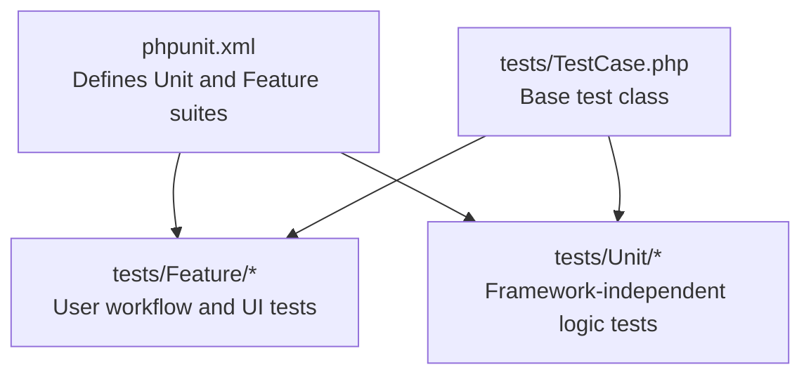
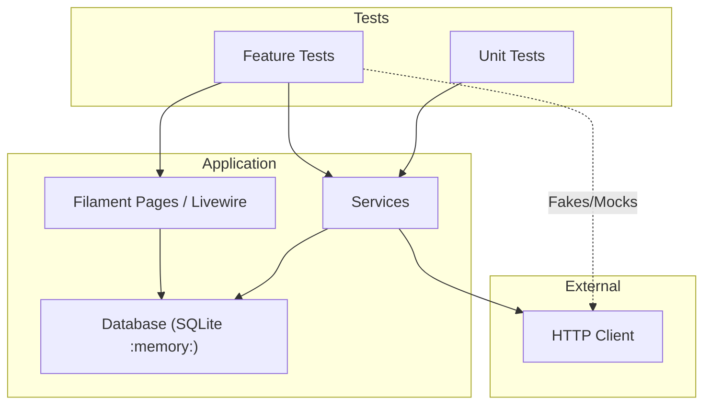
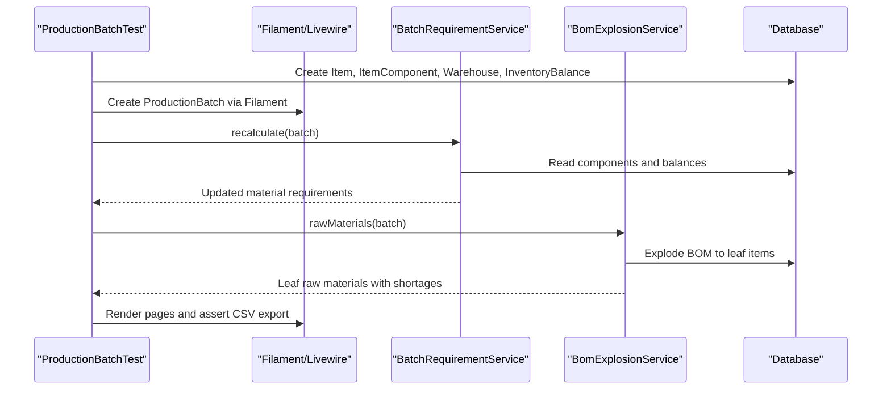
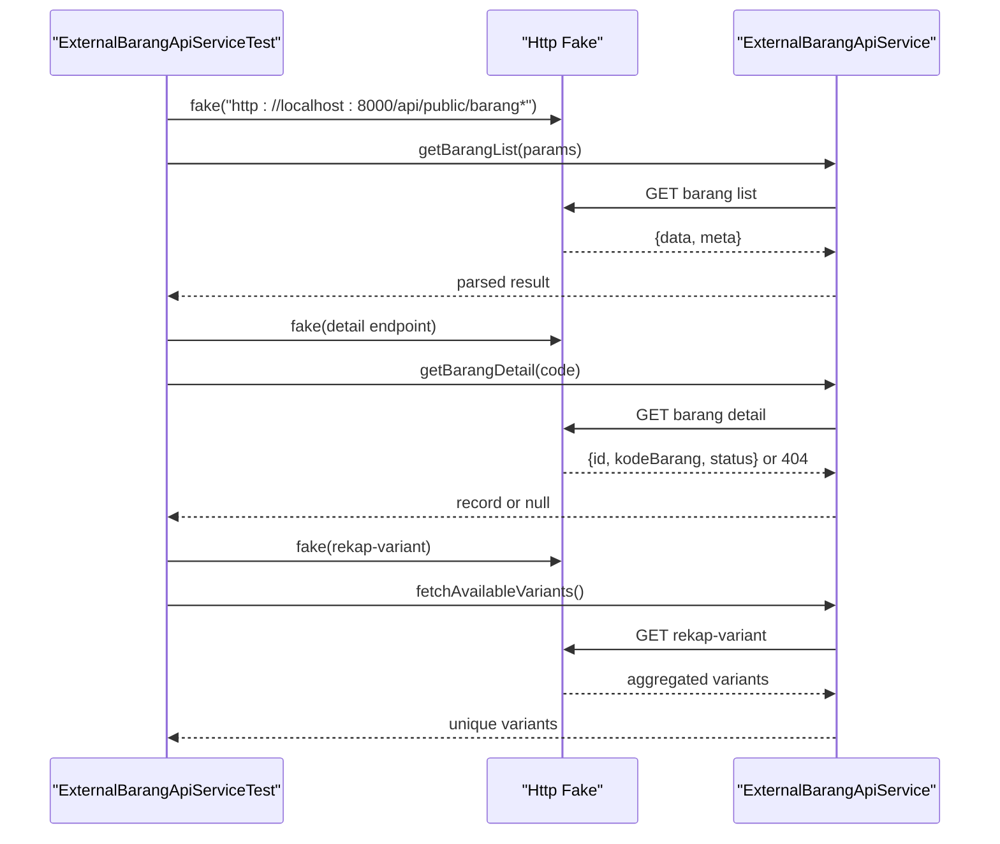
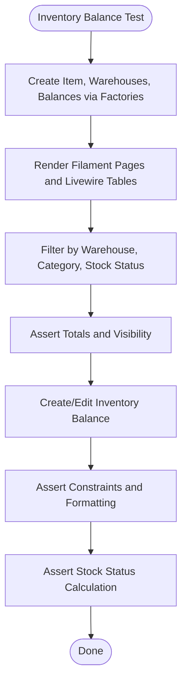
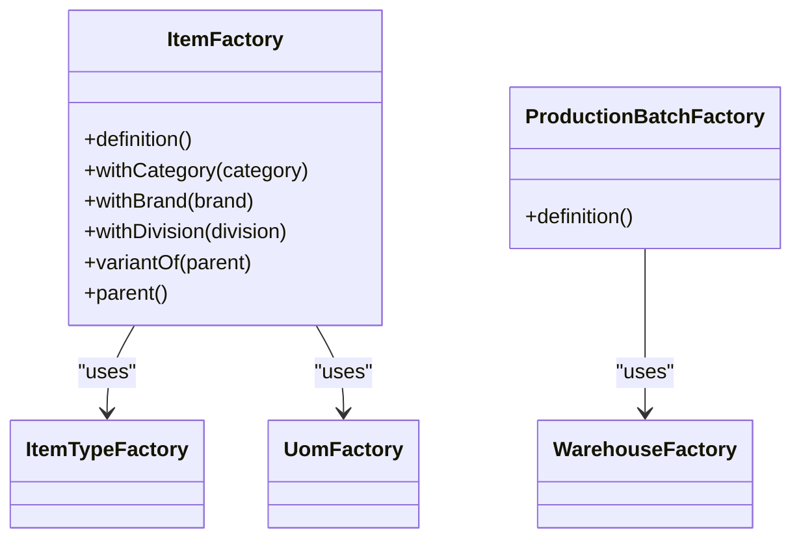
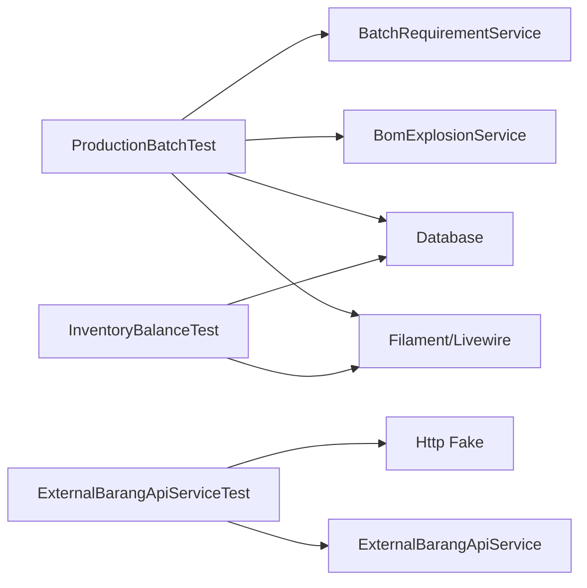

# Testing Strategy

<cite>
**Referenced Files in This Document**
- [phpunit.xml](file://phpunit.xml)
- [TestCase.php](file://tests/TestCase.php)
- [ProductionBatchTest.php](file://tests/Feature/ProductionBatchTest.php)
- [ExternalBarangApiServiceTest.php](file://tests/Feature/ExternalBarangApiServiceTest.php)
- [InventoryBalanceTest.php](file://tests/Feature/InventoryBalanceTest.php)
- [ItemFactory.php](file://database/factories/ItemFactory.php)
- [ProductionBatchFactory.php](file://database/factories/ProductionBatchFactory.php)
- [ci-cd.yml](file://.github/workflows/ci-cd.yml)
- [SKILL.md](file://.claude/skills/testing-best-practices/SKILL.md)
- [naming.md](file://.claude/skills/testing-best-practices/rules/naming.md)
- [isolation.md](file://.claude/skills/testing-best-practices/rules/isolation.md)
- [test-data.md](file://.claude/skills/testing-best-practices/rules/test-data.md)
- [performance.md](file://.claude/skills/testing-best-practices/rules/performance.md)
</cite>

## Table of Contents
1. [Introduction](#introduction)
2. [Project Structure](#project-structure)
3. [Core Components](#core-components)
4. [Architecture Overview](#architecture-overview)
5. [Detailed Component Analysis](#detailed-component-analysis)
6. [Dependency Analysis](#dependency-analysis)
7. [Performance Considerations](#performance-considerations)
8. [Troubleshooting Guide](#troubleshooting-guide)
9. [Conclusion](#conclusion)

## Introduction
This document defines the testing strategy for RSV Helmet. It explains how feature tests cover user workflows and how unit tests validate business logic. It documents test organization, naming conventions, best practices, mocking strategies, database testing approaches, factory-based test data management, and examples for complex scenarios such as production batch workflows, inventory calculations, and external API integrations. It also covers performance optimization and continuous integration setup.

The project uses PHPUnit with a clear separation between Feature and Unit testsuites. The repository includes comprehensive skill rules that guide consistency, isolation, data ownership, endpoint coverage, security, and suite performance.

## Project Structure
Tests are organized under `tests/` with two primary suites:
- Feature tests under `tests/Feature/` for end-to-end user workflows, Filament pages, Livewire interactions, and service orchestration.
- Unit tests under `tests/Unit/` for framework-independent business logic.

Configuration is defined in `phpunit.xml`, which sets environment variables for fast testing (in-memory SQLite, array cache/mail/session drivers, disabled telemetry). The base test class extends Laravel’s base test case.

**Diagram sources**
- [phpunit.xml:7-14](file://phpunit.xml#L7-L14)
- [TestCase.php:7-10](file://tests/TestCase.php#L7-L10)

**Section sources**
- [phpunit.xml:1-37](file://phpunit.xml#L1-L37)
- [TestCase.php:1-11](file://tests/TestCase.php#L1-L11)

## Core Components
- Test suites: Unit and Feature are explicitly declared and include their directories.
- Base test class: All tests extend the project’s base `TestCase`.
- Environment configuration: In-memory SQLite, array mail/cache/session, disabled Pulse/Telescope/Nightwatch to speed up runs.
- Skill rules: Naming, assertions, endpoint coverage, test data, isolation, security, and performance rules provide consistent standards.

Key responsibilities:
- Feature tests assert observable behavior through HTTP/Livewire/Filament interactions and database state changes.
- Unit tests focus on pure logic without booting the application.

**Section sources**
- [phpunit.xml:7-35](file://phpunit.xml#L7-L35)
- [SKILL.md:9-33](file://.claude/skills/testing-best-practices/SKILL.md#L9-L33)

## Architecture Overview
The testing architecture follows a layered approach:
- Tests interact with the application via HTTP endpoints, Livewire components, or direct service calls.
- External dependencies are isolated using fakes and mocks.
- Database interactions use real queries against an in-memory SQLite database.
- Factories generate deterministic, minimal test data.

[No sources needed since this diagram shows conceptual workflow, not actual code structure]

## Detailed Component Analysis

### Production Batch Workflow Tests
These tests validate end-to-end production batch creation, requirement calculation, raw material explosion, stock shortage computation, and Filament page rendering and actions. They exercise:
- Requirement aggregation from item components.
- Recalculation updates and removal of obsolete materials.
- Shortage calculation based on stock on hand.
- Cycle prevention in item composition.
- Filament page rendering and export functionality.
- Starting and finishing batches via Livewire actions.
- Adding products and components through relation managers.
- Raw material explosion to leaf items.

**Diagram sources**
- [ProductionBatchTest.php:40-142](file://tests/Feature/ProductionBatchTest.php#L40-L142)
- [ProductionBatchTest.php:339-409](file://tests/Feature/ProductionBatchTest.php#L339-L409)
- [ProductionBatchTest.php:245-284](file://tests/Feature/ProductionBatchTest.php#L245-L284)

**Section sources**
- [ProductionBatchTest.php:40-142](file://tests/Feature/ProductionBatchTest.php#L40-L142)
- [ProductionBatchTest.php:159-243](file://tests/Feature/ProductionBatchTest.php#L159-L243)
- [ProductionBatchTest.php:245-337](file://tests/Feature/ProductionBatchTest.php#L245-L337)
- [ProductionBatchTest.php:339-478](file://tests/Feature/ProductionBatchTest.php#L339-L478)

### External API Integration Tests
These tests verify the external barang API service by faking HTTP responses for list, detail, variant recap, available variants, and ping endpoints. They ensure:
- Correct parsing of response payloads.
- Handling of missing records.
- Aggregation and transformation of variant data.
- Reachability checks.

**Diagram sources**
- [ExternalBarangApiServiceTest.php:11-49](file://tests/Feature/ExternalBarangApiServiceTest.php#L11-L49)
- [ExternalBarangApiServiceTest.php:51-73](file://tests/Feature/ExternalBarangApiServiceTest.php#L51-L73)
- [ExternalBarangApiServiceTest.php:75-139](file://tests/Feature/ExternalBarangApiServiceTest.php#L75-L139)
- [ExternalBarangApiServiceTest.php:141-149](file://tests/Feature/ExternalBarangApiServiceTest.php#L141-L149)

**Section sources**
- [ExternalBarangApiServiceTest.php:11-49](file://tests/Feature/ExternalBarangApiServiceTest.php#L11-L49)
- [ExternalBarangApiServiceTest.php:51-73](file://tests/Feature/ExternalBarangApiServiceTest.php#L51-L73)
- [ExternalBarangApiServiceTest.php:75-139](file://tests/Feature/ExternalBarangApiServiceTest.php#L75-L139)
- [ExternalBarangApiServiceTest.php:141-149](file://tests/Feature/ExternalBarangApiServiceTest.php#L141-L149)

### Inventory Balance and Filament Resource Tests
These tests validate Filament resources and Livewire interactions for warehouses and inventory balances:
- Navigation grouping and resource placement.
- Indonesian labels and form rendering.
- Summary totals across warehouses and filtering by warehouse/category/stock status.
- Creation and editing of warehouses and inventory balances.
- Uniqueness constraints and formatted display values.
- Stock status calculation.

**Diagram sources**
- [InventoryBalanceTest.php:31-66](file://tests/Feature/InventoryBalanceTest.php#L31-L66)
- [InventoryBalanceTest.php:68-138](file://tests/Feature/InventoryBalanceTest.php#L68-L138)
- [InventoryBalanceTest.php:140-222](file://tests/Feature/InventoryBalanceTest.php#L140-L222)
- [InventoryBalanceTest.php:224-242](file://tests/Feature/InventoryBalanceTest.php#L224-L242)

**Section sources**
- [InventoryBalanceTest.php:31-66](file://tests/Feature/InventoryBalanceTest.php#L31-L66)
- [InventoryBalanceTest.php:68-138](file://tests/Feature/InventoryBalanceTest.php#L68-L138)
- [InventoryBalanceTest.php:140-222](file://tests/Feature/InventoryBalanceTest.php#L140-L222)
- [InventoryBalanceTest.php:224-242](file://tests/Feature/InventoryBalanceTest.php#L224-L242)

### Test Data Management Using Factories
Factories encapsulate model construction and relationships:
- `ItemFactory` provides default attributes and helper states like `withCategory`, `withBrand`, `withDivision`, `variantOf`, and `parent`.
- `ProductionBatchFactory` generates batch codes, statuses, and related warehouses.

Best practices applied:
- Use `create()` when persistence is required; use `make()` otherwise.
- Prefer named factory states over raw attribute arrays for readability.
- Keep factories focused on defaults and reusable states.

**Diagram sources**
- [ItemFactory.php:24-88](file://database/factories/ItemFactory.php#L24-L88)
- [ProductionBatchFactory.php:20-31](file://database/factories/ProductionBatchFactory.php#L20-L31)

**Section sources**
- [ItemFactory.php:24-88](file://database/factories/ItemFactory.php#L24-L88)
- [ProductionBatchFactory.php:20-31](file://database/factories/ProductionBatchFactory.php#L20-L31)
- [test-data.md:1-32](file://.claude/skills/testing-best-practices/rules/test-data.md#L1-L32)

### Mocking Strategies for External Dependencies
Guidelines:
- Use framework fakes for facades (events, queues, mail, notifications, storage, HTTP client, time, sleep).
- Prefer developer-defined fakes for application services when available.
- Use mocks only for container-resolved contracts that leave the process or are nondeterministic.
- For outbound HTTP, call `Http::preventStrayRequests()` and fake exact endpoints.
- Freeze time or travel to specific dates; avoid global Carbon test hooks.
- Run real queries against the test database; do not mock the query builder.

Examples in the repository:
- External API service tests fake HTTP endpoints and assert parsed results.
- Production batch tests use real database interactions and service calls.

**Section sources**
- [isolation.md:5-52](file://.claude/skills/testing-best-practices/rules/isolation.md#L5-L52)
- [ExternalBarangApiServiceTest.php:11-49](file://tests/Feature/ExternalBarangApiServiceTest.php#L11-L49)

### Database Testing Approaches
- Use `RefreshDatabase` trait for tests requiring migrations and seed-like setup.
- Prefer in-memory SQLite configured in `phpunit.xml`.
- Assert application behavior caused by schema (e.g., uniqueness constraints), not engine internals.
- Avoid mocking the query builder; assert real records and serialized model shapes when necessary.

Evidence:
- `ProductionBatchTest` and `InventoryBalanceTest` use `RefreshDatabase`.
- `phpunit.xml` configures SQLite in memory.

**Section sources**
- [ProductionBatchTest.php:29-38](file://tests/Feature/ProductionBatchTest.php#L29-L38)
- [InventoryBalanceTest.php:20-29](file://tests/Feature/InventoryBalanceTest.php#L20-L29)
- [phpunit.xml:20-35](file://phpunit.xml#L20-L35)
- [isolation.md:47-52](file://.claude/skills/testing-best-practices/rules/isolation.md#L47-L52)

### Complex Scenarios: Production Batch Workflows, Inventory Calculations, External APIs
- Production batch workflows: requirement aggregation, recalculation, cycle prevention, raw material explosion, and Filament page actions are covered comprehensively.
- Inventory calculations: stock totals across warehouses, filtering, uniqueness constraints, and stock status calculation are validated.
- External API integrations: HTTP fakes cover list/detail/recap/variants/ping endpoints with precise endpoint matching.

**Section sources**
- [ProductionBatchTest.php:40-142](file://tests/Feature/ProductionBatchTest.php#L40-L142)
- [ProductionBatchTest.php:339-409](file://tests/Feature/ProductionBatchTest.php#L339-L409)
- [InventoryBalanceTest.php:68-138](file://tests/Feature/InventoryBalanceTest.php#L68-L138)
- [ExternalBarangApiServiceTest.php:11-149](file://tests/Feature/ExternalBarangApiServiceTest.php#L11-L149)

## Dependency Analysis
The test suite depends on:
- Laravel testing infrastructure (PHPUnit, Livewire, Filament).
- Factories for deterministic data generation.
- Fakes for HTTP and other external dependencies.
- In-memory SQLite for fast, isolated database operations.

**Diagram sources**
- [ProductionBatchTest.php:40-142](file://tests/Feature/ProductionBatchTest.php#L40-L142)
- [ExternalBarangApiServiceTest.php:11-49](file://tests/Feature/ExternalBarangApiServiceTest.php#L11-L49)
- [InventoryBalanceTest.php:31-66](file://tests/Feature/InventoryBalanceTest.php#L31-L66)

**Section sources**
- [ProductionBatchTest.php:40-142](file://tests/Feature/ProductionBatchTest.php#L40-L142)
- [ExternalBarangApiServiceTest.php:11-49](file://tests/Feature/ExternalBarangApiServiceTest.php#L11-L49)
- [InventoryBalanceTest.php:31-66](file://tests/Feature/InventoryBalanceTest.php#L31-L66)

## Performance Considerations
Recommended settings and practices:
- Set `BCRYPT_ROUNDS=4` in `.env.testing` or `phpunit.xml` to reduce hashing overhead.
- Disable Xdebug and pcov unless coverage is required.
- Disable packages that perform work on every request (Pulse, Telescope, Nightwatch).
- Use `WithCachedConfig` and `WithCachedRoutes` traits to avoid parsing configuration and routes per test.
- Call `withoutVite()` or `withoutMix()` to skip asset resolution.
- Global fakes in base `TestCase`: `Http::preventStrayRequests()`, `Sleep::fake(syncWithCarbon: true)`, `Exceptions::fake()`.
- Parallel execution with `php artisan test --parallel`; ensure tests are independent and do not share files, cache keys, or queues.
- Identify slow tests using `php artisan test --profile`.

Current configuration highlights:
- `phpunit.xml` disables Pulse, Telescope, and Nightwatch.
- CI runs tests with compact output and in-memory SQLite.

**Section sources**
- [performance.md:10-47](file://.claude/skills/testing-best-practices/rules/performance.md#L10-L47)
- [phpunit.xml:20-35](file://phpunit.xml#L20-L35)

## Troubleshooting Guide
Common issues and resolutions:
- Network requests reaching the internet: Ensure `Http::preventStrayRequests()` is active and all external endpoints are faked precisely.
- Slow login flows: Verify `BCRYPT_ROUNDS=4` is set in the test environment.
- Sleep/backoff delays: Use `Sleep::fake(syncWithCarbon: true)` globally or locally.
- Flaky parallel tests: Confirm each test creates its own data, does not depend on run order, and avoids shared resources.
- Unexpected exceptions reported externally: Enable `Exceptions::fake()` to capture and assert exception handling without side effects.
- Misleading failures due to broad fakes: Replace wildcard fakes with exact endpoint matches.

**Section sources**
- [isolation.md:16-46](file://.claude/skills/testing-best-practices/rules/isolation.md#L16-L46)
- [performance.md:18-47](file://.claude/skills/testing-best-practices/rules/performance.md#L18-L47)

## Conclusion
RSV Helmet’s testing strategy emphasizes observable behavior, strict isolation, and deterministic data. Feature tests validate user workflows through Filament and Livewire, while unit tests focus on framework-independent logic. External dependencies are isolated using fakes and mocks, and databases are tested with real queries against an in-memory SQLite instance. Factories provide clean, readable test data. Performance optimizations and CI automation ensure fast, reliable feedback loops. Following the established naming, assertion, and isolation rules will keep the suite maintainable and effective.