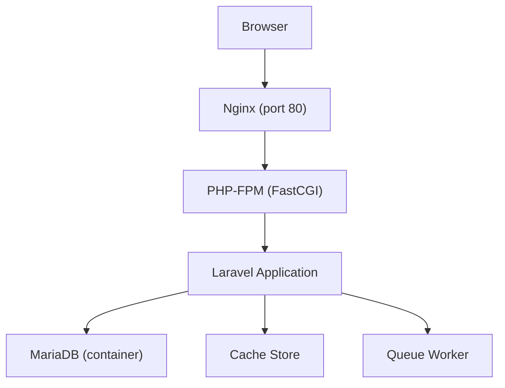
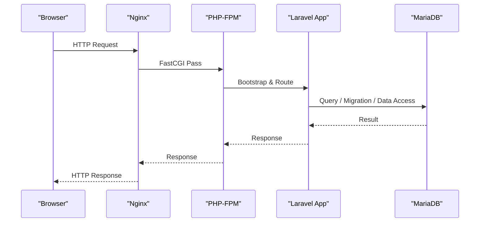
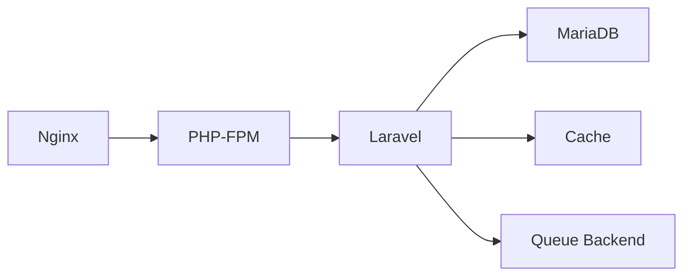

# Troubleshooting & FAQ

<cite>
**Referenced Files in This Document**
- [README.md](file://README.md)
- [docker-compose.yml](file://docker-compose.yml)
- [Dockerfile.prod](file://Dockerfile.prod)
- [config/database.php](file://config/database.php)
- [app/Providers/Filament/AdminPanelProvider.php](file://app/Providers/Filament/AdminPanelProvider.php)
- [config/logging.php](file://config/logging.php)
- [config/app.php](file://config/app.php)
- [docker/production/nginx.conf](file://docker/production/nginx.conf)
- [docker/production/php.ini](file://docker/production/php.ini)
- [config/cache.php](file://config/cache.php)
- [config/queue.php](file://config/queue.php)
- [app/Filament/Pages/BomBuilder.php](file://app/Filament/Pages/BomBuilder.php)
- [app/Services/BatchRequirementService.php](file://app/Services/BatchRequirementService.php)
</cite>

## Table of Contents
1. [Introduction](#introduction)
2. [Project Structure](#project-structure)
3. [Core Components](#core-components)
4. [Architecture Overview](#architecture-overview)
5. [Detailed Component Analysis](#detailed-component-analysis)
6. [Dependency Analysis](#dependency-analysis)
7. [Performance Considerations](#performance-considerations)
8. [Troubleshooting Guide](#troubleshooting-guide)
9. [Conclusion](#conclusion)
10. [Appendices](#appendices)

## Introduction
This document provides comprehensive troubleshooting and frequently asked questions for RSV Helmet, focusing on Docker container issues, database connectivity, Filament admin panel access, performance bottlenecks, debugging techniques using Laravel tools, log analysis, profiling methods, error message interpretation, and production optimization guidelines.

## Project Structure
RSV Helmet is a Laravel 13 application running inside Docker containers with MariaDB as the database. The development setup uses PHP CLI with `php artisan serve`, while the production image runs Nginx + PHP-FPM under Supervisor. Frontend assets are built via Vite.

**Diagram sources**
- [docker/production/nginx.conf:37-81](file://docker/production/nginx.conf#L37-L81)
- [Dockerfile.prod:39-96](file://Dockerfile.prod#L39-L96)
- [docker-compose.yml:1-42](file://docker-compose.yml#L1-L42)

**Section sources**
- [README.md:1-115](file://README.md#L1-L115)
- [docker-compose.yml:1-42](file://docker-compose.yml#L1-L42)
- [Dockerfile.prod:1-97](file://Dockerfile.prod#L1-L97)

## Core Components
- Database configuration supports multiple drivers; default reads from environment variables.
- Logging uses Monolog channels configured via environment variables.
- Filament Admin Panel provider defines routes, middleware, and resources discovery.
- Production runtime includes Nginx, PHP extensions, Opcache, and Supervisor.

Key areas to inspect during troubleshooting:
- Environment variables for database, cache, queue, logging, and app settings.
- Container networking and port mappings.
- File permissions for storage and bootstrap cache.
- Asset build outputs and Filament asset publishing.

**Section sources**
- [config/database.php:20-85](file://config/database.php#L20-L85)
- [config/logging.php:21-140](file://config/logging.php#L21-L140)
- [app/Providers/Filament/AdminPanelProvider.php:31-88](file://app/Providers/Filament/AdminPanelProvider.php#L31-L88)
- [Dockerfile.prod:44-96](file://Dockerfile.prod#L44-L96)

## Architecture Overview
The request flow in production goes through Nginx, which proxies PHP requests to PHP-FPM. Laravel handles routing, authentication, and business logic, then interacts with the database and optional services like cache or queues.

**Diagram sources**
- [docker/production/nginx.conf:52-67](file://docker/production/nginx.conf#L52-L67)
- [Dockerfile.prod:39-96](file://Dockerfile.prod#L39-L96)

## Detailed Component Analysis

### Docker Container Problems
Common symptoms:
- Application not reachable at expected ports.
- Container exits immediately or fails health checks.
- Permission errors writing to storage or cache directories.
- Assets missing or outdated after deployment.

Checklist:
- Verify container ports mapping: app exposes 8001 to host, db exposes 3308 to host.
- Ensure `.env` exists and contains required variables (database credentials, APP_KEY).
- Confirm volumes and permissions: storage and bootstrap/cache must be writable by the web server user.
- Rebuild frontend assets and publish Filament assets when deploying.

Resolution steps:
- Inspect logs: `docker compose logs -f app`.
- Validate environment variables and secrets.
- Fix file ownership and permissions for `storage` and `bootstrap/cache`.
- Run asset build and Filament upgrade commands in the container.

**Section sources**
- [docker-compose.yml:11-20](file://docker-compose.yml#L11-L20)
- [docker-compose.yml:29-38](file://docker-compose.yml#L29-L38)
- [Dockerfile.prod:89-96](file://Dockerfile.prod#L89-L96)
- [README.md:23-54](file://README.md#L23-L54)

### Database Connection Issues
Symptoms:
- “Connection refused” or “Access denied”.
- Migrations fail due to wrong driver or credentials.
- Slow queries or connection timeouts.

Diagnosis:
- Check `DB_CONNECTION`, `DB_HOST`, `DB_PORT`, `DB_DATABASE`, `DB_USERNAME`, `DB_PASSWORD`.
- In development, DB host is `db` (internal container name), exposed to host on port 3308.
- Validate that MariaDB container is healthy and initialized.

Resolutions:
- Correct `.env` values and restart containers.
- If switching drivers, ensure PDO extension is installed and driver-specific options are set.
- For SSL connections, configure `MYSQL_ATTR_SSL_CA` if required.

**Section sources**
- [config/database.php:47-85](file://config/database.php#L47-L85)
- [docker-compose.yml:22-38](file://docker-compose.yml#L22-L38)
- [README.md:56-72](file://README.md#L56-L72)

### Filament Panel Access Problems
Symptoms:
- `/admin` returns 404 or redirects to login unexpectedly.
- Missing CSS/JS assets in the panel.
- Users cannot access the panel even after creating an admin account.

Diagnosis:
- Confirm panel path is `/admin` and provider is registered.
- Ensure Filament assets are published and cached in production.
- Non-local environments require users to implement `FilamentUser::canAccessPanel()`.

Resolutions:
- Run `php artisan filament:upgrade` and `php artisan filament:optimize` during deployment.
- Clear caches: `php artisan config:cache`, `php artisan view:cache`, `php artisan route:cache`.
- Implement authorization in `User` model for non-local environments.

**Section sources**
- [app/Providers/Filament/AdminPanelProvider.php:31-88](file://app/Providers/Filament/AdminPanelProvider.php#L31-L88)
- [README.md:74-107](file://README.md#L74-L107)

### Performance Bottlenecks
Symptoms:
- Slow page loads, especially on BOM builder or batch operations.
- High CPU/memory usage in PHP-FPM.
- Queues backing up or jobs timing out.

Diagnosis:
- Profile slow queries and Eloquent N+1 problems.
- Check Opcache configuration and memory limits.
- Inspect queue worker status and retry policies.

Resolutions:
- Enable query logging temporarily to identify slow queries.
- Use indexes and eager loading where appropriate.
- Tune Opcache and PHP memory limits.
- Scale queue workers and adjust retry_after based on job duration.

**Section sources**
- [docker/production/php.ini:1-18](file://docker/production/php.ini#L1-L18)
- [config/queue.php:16-90](file://config/queue.php#L16-L90)
- [app/Filament/Pages/BomBuilder.php:919-967](file://app/Filament/Pages/BomBuilder.php#L919-L967)
- [app/Services/BatchRequirementService.php:1-47](file://app/Services/BatchRequirementService.php#L1-L47)

## Dependency Analysis
The application depends on:
- Nginx for HTTP serving and static asset caching.
- PHP-FPM for executing Laravel code.
- MariaDB for persistent data.
- Optional Redis/Memcached/DynamoDB for cache and queues.
- Supervisor to manage processes in production.

**Diagram sources**
- [docker/production/nginx.conf:37-81](file://docker/production/nginx.conf#L37-L81)
- [config/cache.php:18-106](file://config/cache.php#L18-L106)
- [config/queue.php:16-90](file://config/queue.php#L16-L90)

**Section sources**
- [docker/production/nginx.conf:37-81](file://docker/production/nginx.conf#L37-L81)
- [config/cache.php:18-106](file://config/cache.php#L18-L106)
- [config/queue.php:16-90](file://config/queue.php#L16-L90)

## Performance Considerations
- Opcache: Enabled with tuned memory consumption and max accelerated files.
- PHP limits: Memory limit and execution time adjusted for heavy operations.
- Nginx: Gzip compression enabled, static assets cached aggressively.
- Cache store: Defaulted to database; consider Redis for higher throughput.
- Queue backend: Defaulted to database; consider Redis/SQS for scalability.

Recommendations:
- Switch cache to Redis in production for lower latency.
- Use Redis or SQS for queues to handle high concurrency.
- Monitor slow queries and add appropriate indexes.
- Periodically clear and rebuild caches after deployments.

**Section sources**
- [docker/production/php.ini:1-18](file://docker/production/php.ini#L1-L18)
- [docker/production/nginx.conf:30-35](file://docker/production/nginx.conf#L30-L35)
- [config/cache.php:18-106](file://config/cache.php#L18-L106)
- [config/queue.php:16-90](file://config/queue.php#L16-L90)

## Troubleshooting Guide

### Debugging Techniques Using Laravel Tools
- Enable debug mode temporarily to see detailed stack traces.
- Use Tinker to inspect models and run ad-hoc queries.
- Log queries to identify N+1 or slow queries.
- Use Artisan commands to clear caches and optimize views/routes/config.

Steps:
- Set `APP_DEBUG=true` and `LOG_LEVEL=debug` for local debugging only.
- Run `php artisan tinker` to interact with the application.
- Execute `php artisan log:clear` to rotate logs if needed.
- Run `php artisan optimize` to cache configurations and routes.

**Section sources**
- [config/app.php:29-42](file://config/app.php#L29-L42)
- [config/logging.php:21-66](file://config/logging.php#L21-L66)
- [README.md:42-54](file://README.md#L42-L54)

### Log Analysis
- Logs are written to `storage/logs/laravel.log` by default.
- Channels include single, daily, monthly, stderr, syslog, slack, papertrail.
- Adjust `LOG_CHANNEL` and `LOG_LEVEL` to control verbosity and destination.

Actions:
- Tail logs in Docker: `docker compose logs -f app`.
- Rotate logs using daily channel and set retention days.
- Integrate with external systems (Slack, Papertrail) for alerts.

**Section sources**
- [config/logging.php:53-140](file://config/logging.php#L53-L140)

### Profiling Methods
- Enable query logging to capture SQL statements and durations.
- Use Xdebug or Laravel Telescope (if installed) for request profiling.
- Monitor PHP-FPM process metrics and Opcache stats.

Guidelines:
- Limit query logging to short periods to avoid overhead.
- Analyze slow queries and refactor Eloquent relationships.
- Review Opcache hit rate and memory usage.

**Section sources**
- [docker/production/php.ini:9-18](file://docker/production/php.ini#L9-L18)

### Error Messages, Meanings, and Resolutions
- “Connection refused”: Database host/port incorrect or DB container unhealthy.
  - Resolution: Verify `DB_HOST`, `DB_PORT`, and MariaDB healthcheck.
- “Access denied”: Wrong username/password or insufficient privileges.
  - Resolution: Update `.env` credentials and ensure DB user has correct grants.
- “404 Not Found” on `/admin`: Panel assets not published or route misconfiguration.
  - Resolution: Run `filament:upgrade` and `filament:optimize`; verify provider registration.
- “Memory limit exceeded”: Heavy operations exceed PHP memory limit.
  - Resolution: Increase `memory_limit` and tune Opcache; optimize queries.
- “Job timed out”: Queue jobs take longer than `retry_after`.
  - Resolution: Increase `retry_after` or split jobs; monitor queue workers.

**Section sources**
- [config/database.php:47-85](file://config/database.php#L47-L85)
- [app/Providers/Filament/AdminPanelProvider.php:31-88](file://app/Providers/Filament/AdminPanelProvider.php#L31-L88)
- [docker/production/php.ini:1-6](file://docker/production/php.ini#L1-L6)
- [config/queue.php:38-45](file://config/queue.php#L38-L45)

### Frequently Asked Questions

#### Configuration
- Q: How do I change the database driver?
  - A: Set `DB_CONNECTION` to the desired driver and update related env variables. Ensure PDO extension is installed.
- Q: Where are logs stored?
  - A: By default in `storage/logs/laravel.log`; configurable via logging channels.
- Q: How do I enable Redis cache?
  - A: Set `CACHE_STORE=redis` and configure Redis host/port/password.

**Section sources**
- [config/database.php:20-85](file://config/database.php#L20-L85)
- [config/logging.php:53-140](file://config/logging.php#L53-L140)
- [config/cache.php:81-85](file://config/cache.php#L81-L85)

#### Deployment
- Q: Why are Filament assets missing in production?
  - A: Assets need to be published and optimized during deployment.
- Q: How do I rebuild frontend assets?
  - A: Run `npm run build` in the container or host environment as per README instructions.
- Q: What permissions are required?
  - A: Web server user must own `storage` and `bootstrap/cache` directories.

**Section sources**
- [README.md:98-107](file://README.md#L98-L107)
- [Dockerfile.prod:89-96](file://Dockerfile.prod#L89-L96)

#### Feature Usage
- Q: How do I create an admin user?
  - A: Use `make:filament-user` command within the container.
- Q: How can I restrict panel access?
  - A: Implement `FilamentUser::canAccessPanel()` in the User model for non-local environments.

**Section sources**
- [README.md:84-107](file://README.md#L84-L107)

## Conclusion
This guide consolidates common issues and resolutions for RSV Helmet across Docker, database connectivity, Filament panel access, and performance tuning. Use the provided checklists, diagrams, and section references to diagnose and resolve problems efficiently. For production stability, prioritize proper configuration, logging, caching, queuing, and monitoring.

## Appendices

### Quick Reference Commands
- Start/stop containers: `docker compose up -d`, `docker compose down`.
- View logs: `docker compose logs -f app`.
- Run Artisan commands: `docker compose exec app php artisan ...`.
- Build frontend assets: `npm install && npm run dev -- --port 5174` or `npm run build`.

**Section sources**
- [README.md:23-54](file://README.md#L23-L54)